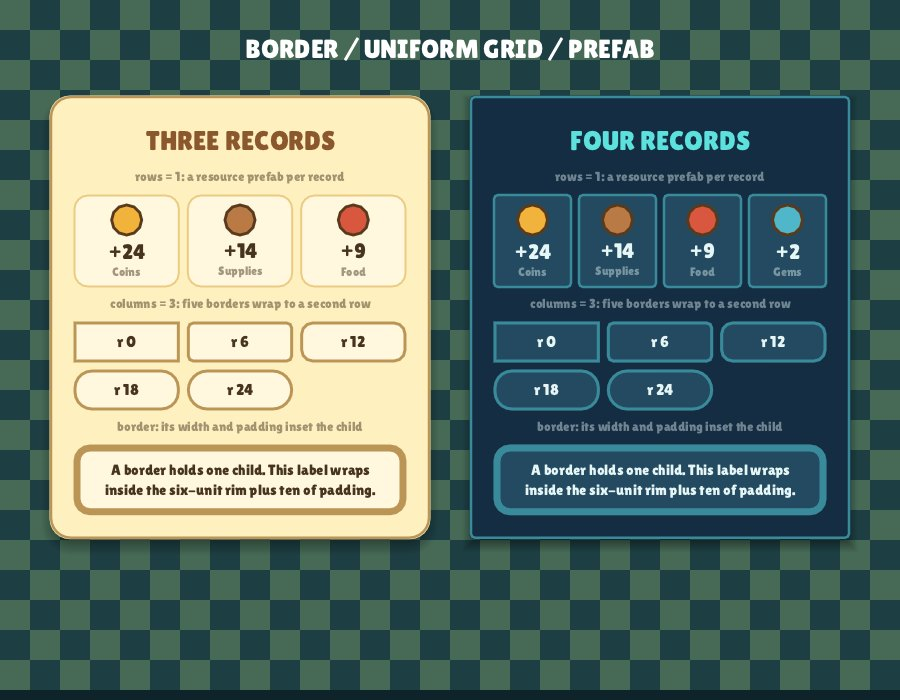

# Element classes, border, uniform grid and prefabs

The form engine's layout moved from two functions that switched on a node's kind
to one class per kind with `measure_override` and `arrange_override`
([UI engine](../../UI_ENGINE.md#measure-and-arrange)). The results dialog's
resources are now `resource_indicator` prefabs (a `border` around icon, amount
and name) in a one-row `uniform_grid`.

Every named still of every game (365 captures) is pixel-identical before and
after, so these show the dialog as it was and is.

| Relic Rush 480×900 | Relic Rush 390×844 | Christmas Market 480×900 | Christmas Market 390×844 |
| --- | --- | --- | --- |
|  |  |  |  |

The new elements on their own, from the UI fixture (`--layout`): a data-backed
row of prefabs with three and four records, five borders wrapping in three
columns, and a border insetting its child.

