# Skin files

Each game's look becomes one data file compiled by the engine's `ui.skin`. See
[skin files](../../UI_ENGINE.md#skins).

## Shared UI fixture: two skin files, every control and state

The same template, now with a bound checkbox, a disabled checked checkbox, a
progress bar and a disabled/accent button pair, drawn by
`tests/fixtures/ui/sunstone_skin.lua` and `tests/fixtures/ui/nightfall_skin.lua`.
Before, both skins were native-theme colour tables with no checkbox.

| | Before | After |
| --- | --- | --- |
| Two skins |  | 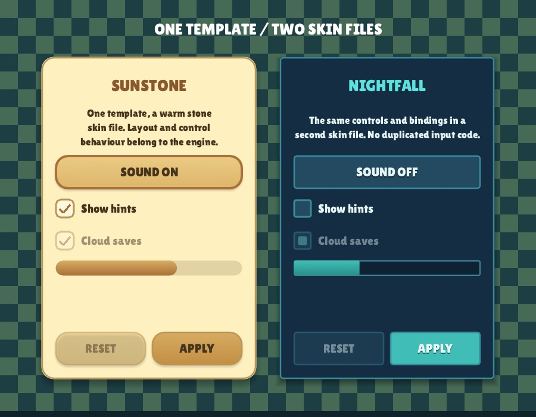 |
| Nested modals |  | 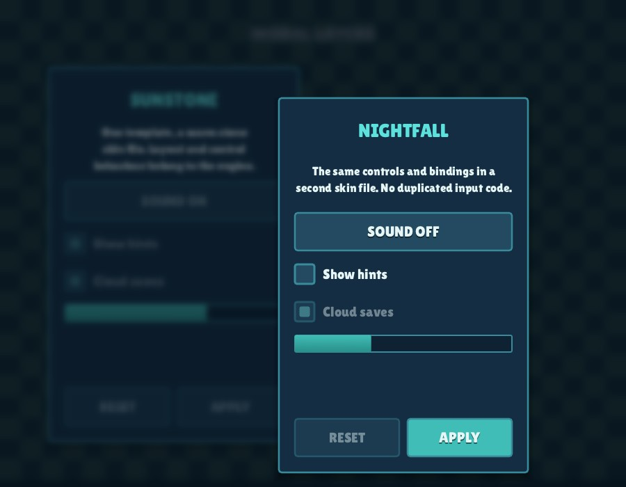 |

## Relic Rush: same pixels, now from `lua/skin.lua`

Relic Rush's hand-written paint (`R.pal`, `R.panel`, `R.paint_button` and the form
skin callbacks) is replaced by `games/relic-rush/lua/skin.lua`. Captures at
480×900 and 390×844 (47/34 safe-area insets) of pause, guide, building card,
shop, expeditions, victory, failure, finale, region card, island, placement and
board are **pixel-identical** to `main` (24 captures). So are 6 more that exercise the
animated dialog transform and the pressed state: the pause and card pop-in
frames, the mid-animation victory card, and held presses on RESUME, the card's
action and the guide's button.

| | Before (`main`) | After |
| --- | --- | --- |
| Pause |  |  |
| Building card |  | 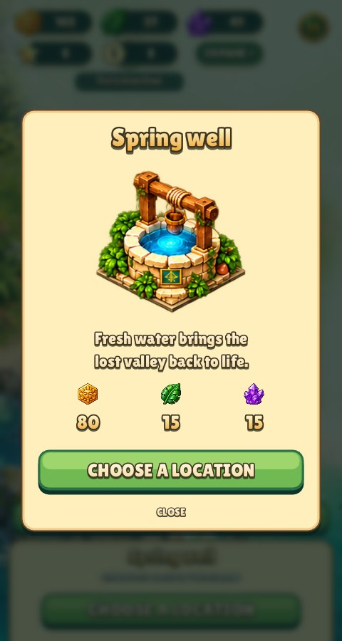 |
| Shop | 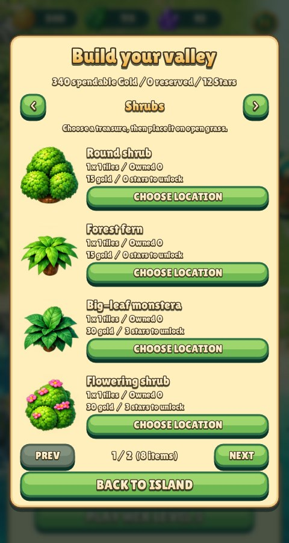 |  |
| Victory | 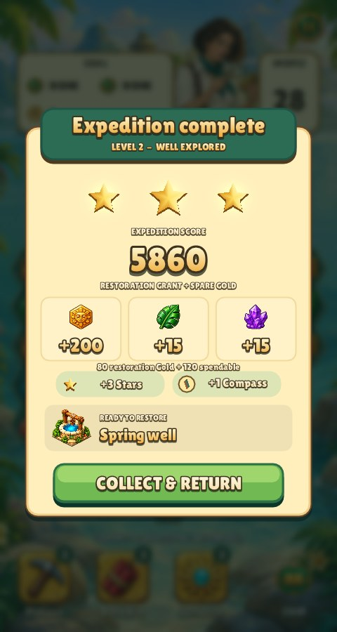 |  |

| Pressed RESUME (sinks 2 units) | Pause pop-in (transform) |
| --- | --- |
| 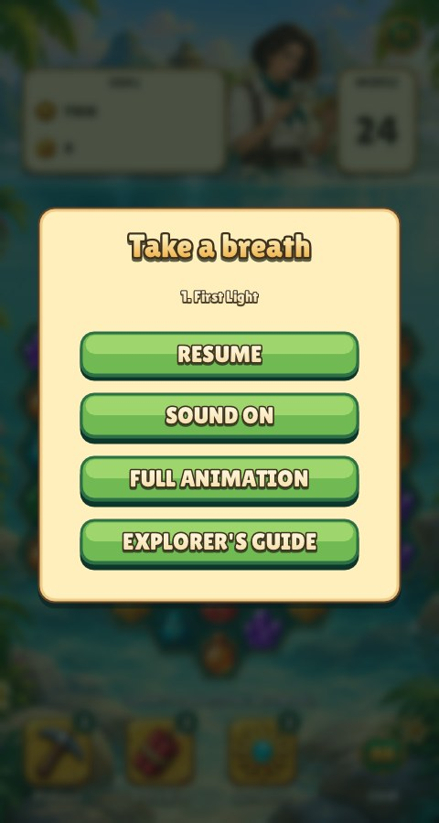 |  |

## Nile Archive and Volcano: the same pixels, now from skin files

`games/nile-archive/lua/archive_skin.lua` holds Nile Archive's fonts (with the
serif's fallback), its 21 text styles, the native theme, the gold-rimmed frame
in teal or parchment at any corner radius (corner studs as a `paint` layer)
and the green/blue/red pill buttons, whose disabled state turns grey.
`games/volcano/lua/volcano_skin.lua` holds Volcano's lettering, theme, and the
panel, button (hover, pressed, disabled, gold accent) and meters that native
widgets drew before.

Pixel-identical to the previous commit: 17 Nile Archive captures (island at
1200×900 and 1600×900, scenes, build tray at 1200×900 and 1368×1026, decoration
catalogue, purchase, opening, first build/win, cast, pause, chapters, reward at
two sizes, story) and 13 Volcano captures (menu at two sizes, five districts,
repaired, complete, pause at two sizes, briefing, help). So are 4 held presses
on Nile pills (green, blue, disabled grey, reward) and 2 on Volcano buttons
(gold accent on the menu, Resume in Pause).

| | Before | After |
| --- | --- | --- |
| Volcano menu |  | 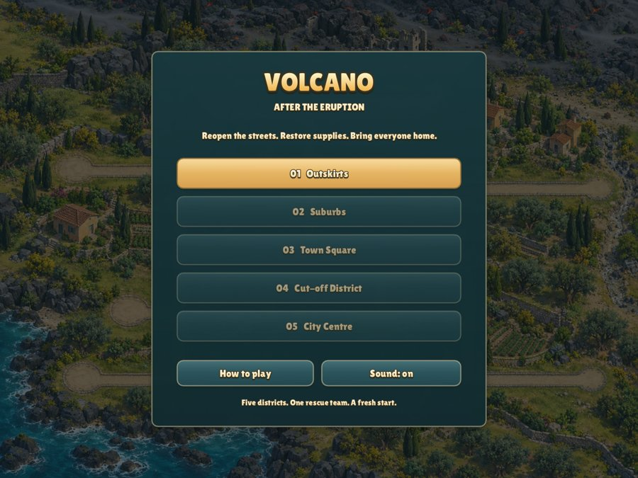 |
| Volcano pause, Resume held |  | 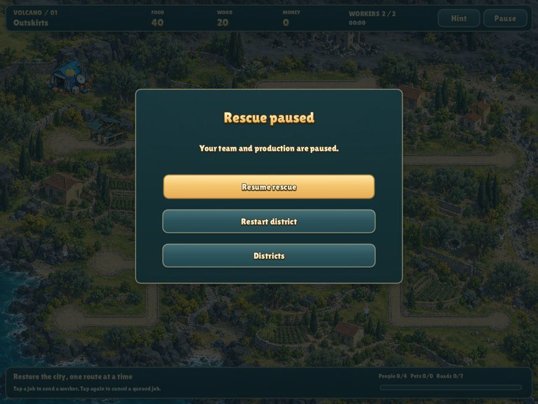 |
| Nile chapters | 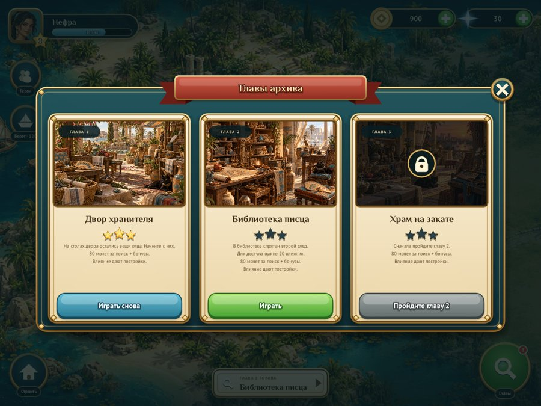 |  |
| Nile chapters, green pill held |  |  |
| Nile build tray | 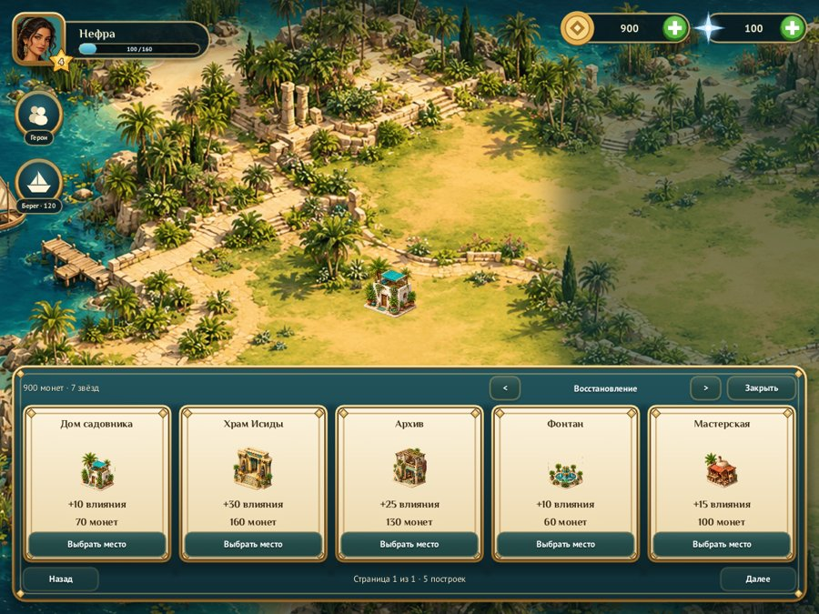 |  |

## Relic Rush: Pause checkboxes

Sound and Reduce motion were toggle buttons whose captions flipped
("SOUND ON" / "FULL ANIMATION"). They are now `checkbox` controls with the
skin's wooden-rimmed well, which fills with jade and a cream tick when checked.
Only these two rows changed; every other Relic Rush capture is identical.

| Size | Before | After |
| --- | --- | --- |
| 480×900 | 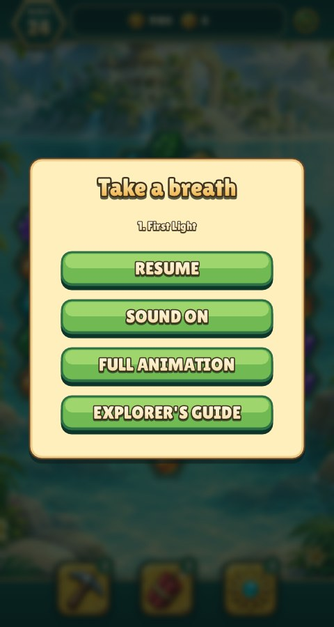 |  |
| 390×844 | 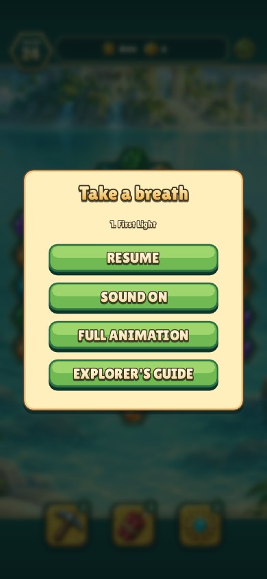 | 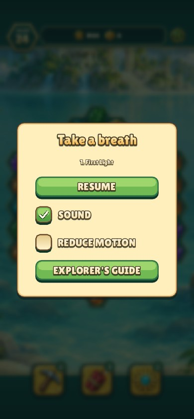 |

| Reduce motion on | Sound held (pressed) | Disabled (not used in game) |
| --- | --- | --- |
| 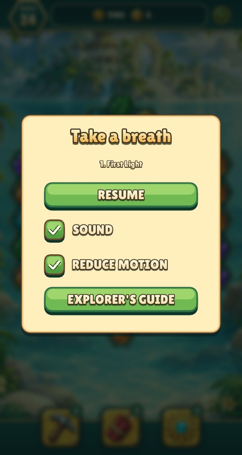 | 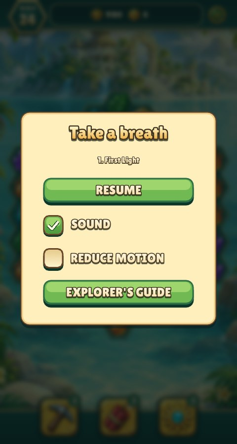 | 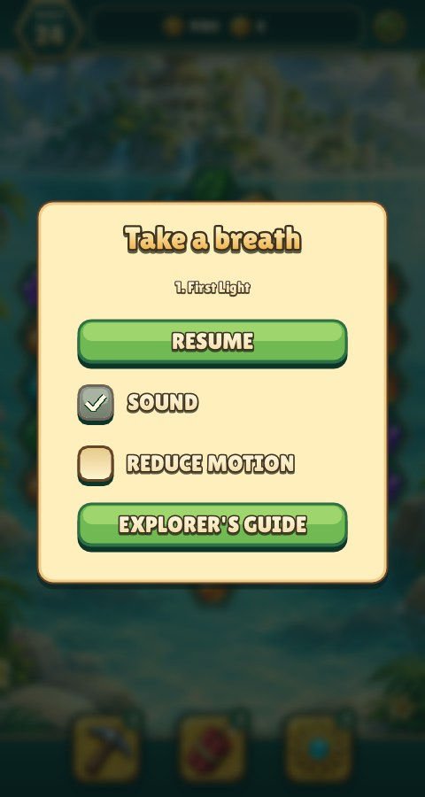 |

## Relic Rush: Pause grouped, with Restart and Quit

Pause now follows other match-3 pause menus. Sound and Reduce motion share one
recessed settings well. Below it come RESUME in jade, then RESTART and QUIT TO
ISLAND in carved wood; EXPLORER'S GUIDE is a gold text link. RESTART asks first
and starts the same expedition afresh. QUIT TO ISLAND keeps the unfinished board
for the island's LEVEL button or the Expeditions browser. From the island, Pause
shows only Resume. `--smoke` cancels and confirms a restart, quits to the island
and resumes the board through real input.

| | 480×900 | 390×844 |
| --- | --- | --- |
| Before (`main`) |  |  |
| Pause in an expedition |  | 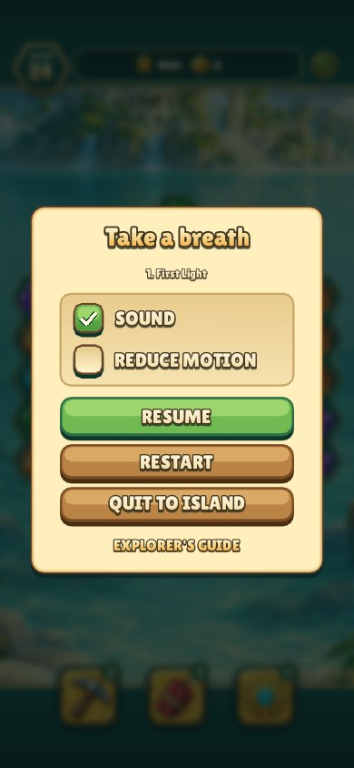 |
| Pause on the island | 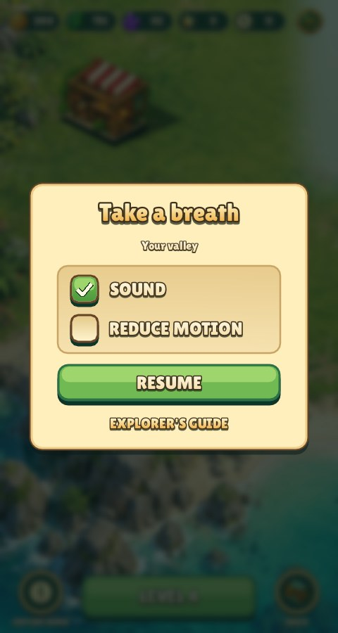 | 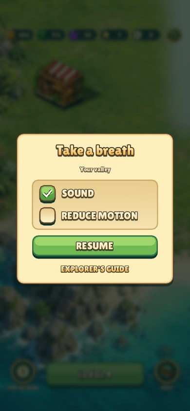 |
| Restart confirmation | 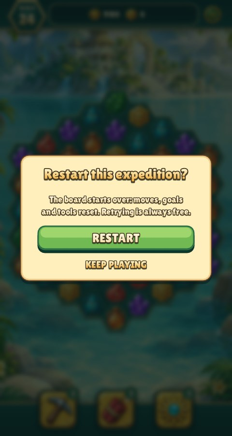 | 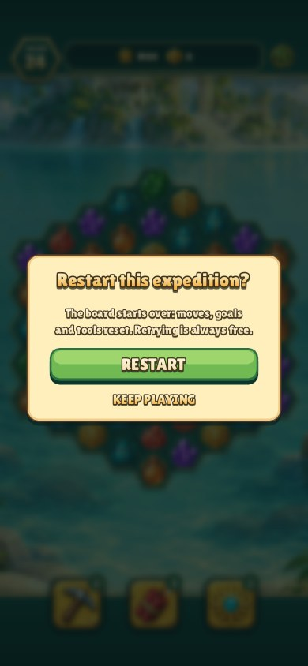 |

| RESTART held (pressed) |
| --- |
| 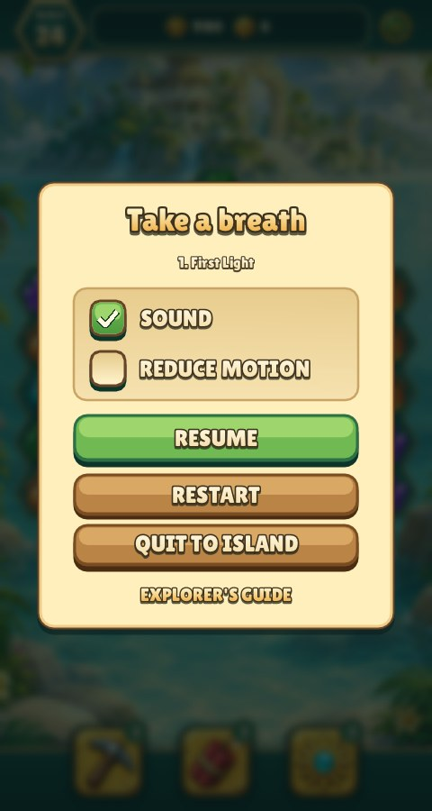 |

## Christmas Market: the same pixels, now from its skin file

Christmas Market forked Relic Rush's paint code; `games/christmas-market/lua/skin.lua`
now holds its palettes, parchment panel, festive red button (pressed, disabled,
flat) and focus ring. 32 captures are pixel-identical to the code it replaced:
pause, guide, building card, two shop categories, expeditions, victory, failure,
finale, region card, market, board and placement at 480×900 and 390×844 with
safe areas, plus the pause and card pop-in, the mid-animation victory card and
held presses on RESUME, the card's action and the guide's button.

| | Before | After |
| --- | --- | --- |
| Pause |  |  |
| Shop | 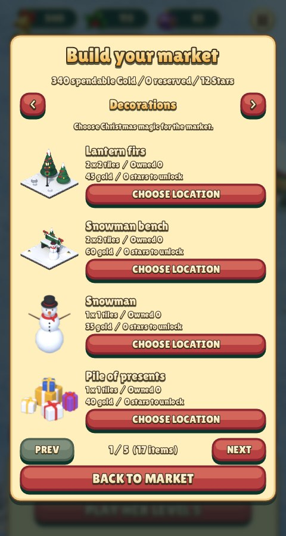 |  |
| RESUME held | 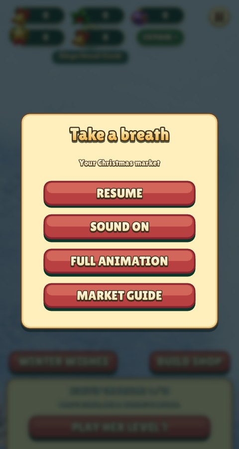 |  |
