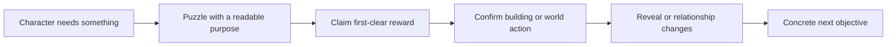

# Applying the reference to Relic Rush and Christmas Market

**Implementation update, 2026-11-12:** the capability/overlap audit below is
the historical research baseline. Six proposed families and redesigned
campaign shapes are now implemented; use [Match-3 elements](../MATCH3_ELEMENTS.md)
and the linked current campaign documents for shipped rules and board data.

This is a design reference and a set of proposals, not a change to either game's
rules or story. Tropicats facts are separated from recommendations throughout.
Use the [mechanics dictionary](MECHANICS.md), [board examples](BOARD_DESIGN.md)
and [complete story index](STORY.md) to inspect the evidence behind a pattern.
The source snapshot is Tropicats 2.5.11; our implementation observations below
were checked against this repository on 2026-11-11.

## Start from the games we have

Both games already have 30 stages, three story episodes, six matchable kinds,
a radius-four hex envelope (61 possible cells), and the same shared matching
engine. A level has a cell mask, terrain ordering, a move budget, score and
collection targets, and soil, chain and ice counts. Terrain ranks cells for
blocker placement; it is not a complete independently authored stack at every
coordinate. A source mask therefore does not fully describe the starting board.

| Existing capability | Source | Consequence for design |
| --- | --- | --- |
| Three hex line axes; four in a line creates that axis's ray, five or more creates a prism | [Shared matching rules](../../engine/match3.lua), `game_matches`, `LINE_MATCHES` | A square Tropicats shape cannot be copied cell-for-cell. Check run lengths and all three hex axes. T/L bomb creation is not currently part of these games' line-matching mode. |
| Soil under pieces, chain and ice locks, selected-kind adjacent thaw | `game_apply`, `game_can_swap`, and each game's [kind flags](../../games/relic-rush/lua/rules.lua) | We can already vary access, uncovering and thaw priorities. Ice, chains and soil have different timing; they are not interchangeable decoration. |
| Downward gravity with side trickling; exposed column tops and blocked-parent pockets can refill | `game_collapse` in the shared rules | A narrow corridor is not automatically a supply bottleneck. Inspect the actual refill paths before calling a pocket starved. |
| Seeded generation; terrain-ranked blocker placement | `game_init` | The authored content defines constraints, with a generated arrangement inside them. Evaluate multiple seeds and inspect the actual blocker coordinates. |
| Win requires score target, collection target, enough soil cleared, and all locks removed | `game_check_end` | Changing the principal goal is more than renaming the title. Goals at zero still appear for score/collection in the present HUD; hiding or replacing those counters is a shared UI change. |
| Separate first-clear building grant, discretionary currency and one-time story scheduling | [Relic rules](../../games/relic-rush/lua/rules.lua), [Christmas rules](../../games/christmas-market/lua/rules.lua), [shared journey](../../engine/match3_game.lua) | A board can serve a specific story action without making random color yield determine whether the player can afford its required building. |
| Thirty named boards and ten scheduled buildings | [Relic campaign](../../games/relic-rush/lua/campaign.lua), [Christmas campaign](../../games/christmas-market/lua/campaign.lua) | Existing milestone levels are 1, 4, 7, 9, 13, 16, 19, 23, 26 and 29. Build on that authored structure. |

A direct comparison of the two campaign tables finds **28 of 30 masks identical
at corresponding levels**, **26 identical move budgets**, and **21 identical
sets of the seven difficulty parameters** (`moves`, `score`, `relics`, `soil`,
`chains`, `ice`, `ice_layers`). Mask differences are at levels 20 and 30. Relic
has 30 distinct masks; Christmas has 28. Both use between 42 and 61 active cells.
These are content comparisons, not measured player difficulty. Names, lessons,
art, story and some parameters already differ.

This makes distinct board decisions a useful next content target. Keep shared
rules where they help implementation; give each campaign its own spatial problems
and reward rhythm. A different outline alone is not sufficient if the same
matches remain the best answer.

## Translate a mechanic by the decision it creates

The theme names below are **proposed adaptations**, not implemented mechanics or
new story canon. First establish the rule and readable state changes; then author
original artwork in the destination game's style.

| Tropicats pattern | Decision to preserve | Relic Rush possibility | Christmas Market possibility | Work needed here |
| --- | --- | --- | --- | --- |
| Hidden statues under coverings | Where to uncover first; when an area is finished | Reveal sections of an inscription or artifact footprint | Uncover a wrapped display or decoration pattern under snow | Soil exists; grouped object footprints, discovery credit and goal UI would be new shared rules. |
| Colored crates | Match the required color at a particular boundary | A seal that accepts its matching relic | A gift parcel released by matching its ribbon color | Add color-gated damage and its authored strength states; not just tinted existing chains. |
| Resistant eggs | First obtain a special, then finish with local matches | Crack a stone case, then uncover its contents | Open a sturdy gift chest, then untie its wrapping | Add an explicit damage-phase state machine and special-hit tests. Current ice is not equivalent. |
| Color wheel | Visit several colors around one fixed object | Restore a multicolor mosaic | Light a multicolor wreath | Multi-cell occupancy, independent color segments and adjacency rules are new. |
| Cannons charged by matching a color | Invest in one color for a delayed payoff | Charge a sun mechanism | Power a festive light or bell mechanism | Add charge accounting, a deterministic effect and readable gauge states. The reference does not establish its exact blast algorithm. |
| Climber / turtle routing | Clear a useful route, not only count pieces | Guide an object to a recovery point | Deliver a parcel to a collection point | Explicit route/exit/spawn semantics and objective movement are new shared systems. |
| Chameleon / Mimic Flower | Respond to an object whose color or position changes | A shifting crystal | A changing ornament | Add movement/color state and turn timing. The static viewer's color order is not a gameplay specification. |
| Growing bamboo | Decide when to interrupt an encroaching hazard | Vines expanding into a passage | Tinsel spreading across work space | Growth timing, suppression and reachability require authored rules and testing. |
| Portals | Plan across separated board regions | A paired passage | A paired delivery chute | Extend gravity as a directed graph; do not disguise an ordinary hex neighbor as a portal. |
| Objective-specific board themes | Recognize the type of task at a glance | Excavation, restoration and mechanism surfaces | Snow-clearing, wrapping and illumination surfaces | Skin/assets work can reinforce rules but cannot introduce a new goal by itself. |

The useful borrowing is the dependency between actions: expose → align → trigger,
charge → spend, or route → deliver. The Tropicats art remains part of the local
reference viewer; our games' runtime assets and characters remain their own.

## Author a board around one readable question

Write the player's decision before choosing an outline. “Which seal should I
open to gain access to the center?” gives a shape, placement and supply problem.
“Level 17, more ice” specifies only a quantity.

1. **Name the main action.** Choose one principal decision and at most one
   supporting complication. State what a player should notice on the first screen.
2. **Draw the access plan.** Identify the working area, constrained region,
   target region, and how clearing one changes access to another. On hex boards,
   inspect all six neighbors and all three line axes.
3. **Place the constraint where it matters.** A lock in a peripheral cell can
   be cleanup; the same lock interrupting a useful line can shape the opening.
   Trace actual generated placement from terrain ordering, not only the count.
4. **Check supply.** Confirm how pieces enter every region, which colors matter,
   and whether required specials can be formed or delivered. Our current rules
   use one configured color count, not Tropicats' per-level weighted palette.
5. **Arrange the payoff.** An opened region should create a visible opportunity:
   a long line, access to covered cells, or a clear route to the last target.
6. **Tune the budget last.** Change one cause at a time during tuning. Record
   why a successful run needs moves: access, target work, setup, or cleanup.
7. **Check the ending.** A board whose interesting decision ends early may leave
   isolated locks or score grinding. Inspect the final five moves, not just the
   opening screenshot or eventual win.

Use a brief like this for a future authored level:

| Brief field | Example: proposed Relic inscription board |
| --- | --- |
| Story purpose | Support the existing names-in-the-stone beat without revealing a fact before its scene |
| Player question | Which side provides room to make a ray through the covered center? |
| Main / supporting rule | Excavation / one local lock bottleneck |
| Initial read | Two open work areas; clearly visible covered center |
| Access and supply | Both areas refill under actual hex gravity; the center becomes easier to work after the chosen lock is removed |
| Intended opportunity | A ray clears a useful line through several target cells |
| Likely failure mode | Cleanup remains in one isolated corner after the center is clear |
| Variation | Move one lock to the opposite approach; then retest, rather than only subtracting moves |
| Verification | Actual starting states over several fixed seeds, play observations, relevant rule tests, opening and late-state captures |

This is an authoring brief, not proof that the current level 13 implements it.

## Give the two campaigns different rhythms

Relic Rush's existing story is an investigation with escalating discoveries and
threats. Its [story guide and script](../../games/relic-rush/docs/story.md) already
connect frost, names, equipment and the temple to the mystery. Board emphasis can
favor excavation, blocked sightlines, deliberate special creation and sudden
access to a new region. Keep a previously learned mechanic available during a
reveal so the story and an unfamiliar rule do not compete for attention.

Christmas Market's [script](../../games/christmas-market/docs/story.md) is about
people helping each other reach Christmas Eve. Board emphasis can favor joining
separated working areas, finishing visible patterns and creating generous cascade
payoffs. Its pressure comes from preparations and anticipation; a harsher move
budget is not needed to make every story beat significant. Tinsel, snow and ice
already have local story explanations.

| Existing content to revisit | Proposed board emphasis | Existing implementation constraints |
| --- | --- | --- |
| Relic 13, *Names in the Stone* | Deliberate ray access to a covered region | Current goal tracks soil count, not which inscription cells were revealed. Use counts honestly or add grouped goals first. |
| Relic 22, *The Frozen Stair* | Choose a thaw approach that opens working space | Matchable flame kind already thaws adjacent ice; verify blockers/refill leave the intended approach meaningful. |
| Relic 23, *The Star Road* | Plan a prism around a high-value collection color | Current prism clears the selected color; it does not route an object. |
| Christmas 15, *Tangled Tinsel* | Open two useful areas by untangling the boundary | Current version already differs from Relic 15: more chains and no ice. Geometry can further reinforce its own question. |
| Christmas 20, *A Letter Forty Years Late* | Make two sides feel connected after clearing | Existing mask already differs from Relic 20. Keep the reconciliation in its authored scene, not in an invented puzzle rule. |
| Christmas 26, *Lantern Ice* | Visible progress through a thawing play area, then a generous finish | Its budget is currently 34 versus Relic's 42; that difference is a tuning input, not evidence the board feels more festive. |
| Both 18 and 28 | Breathing room before the last stretch | Both campaigns deliberately reduce targets/locks here. Preserve their role when adding new mechanics. |

A proposed ten-level teaching cycle is: introduce → repeat with a new shape →
require a choice → combine with one known constraint → reward mastery → reopen
space → remix the choice → breather → synthesis → story payoff. This is a design
worksheet, not a recovered Tropicats scheduling algorithm. Test its fit against
the actual story beats and player observations rather than applying it rigidly.

## Make every puzzle reward advance a specific story action

Tropicats pairs exact level/tier tokens with named task items and targets. The
opening sequence is concrete: 1a supplies a shovel for rubble, 2a supplies bamboo
for the totem site, and 3a–5a supply logs for the totem. The [chapter 1 reference](story/chapter-01.md)
shows the task and scene evidence. Later chapters combine quest work with
village-rank gates. This makes a puzzle reward answer “what can I do now?”

Our games already pay a guaranteed grant at scheduled building milestones and
play story beats on first clears. Keep that causal chain explicit in content:



For a level without a building, the story can still change knowledge, a
relationship, or the next plan. The existing `journey.lua` files support changing
building tap lines and recaps, so a later visit can acknowledge what the player
has learned. A generic congratulations line is not a substitute for that change.

Do not copy the reference's 136 rank tasks and final rank 137 as a balancing
recipe for a thirty-level game. Those belong to its 2,730-level campaign and
separate village system. Any new gate needs its own pacing and resource analysis.
The current guaranteed building grants should remain independent of random board
color yield unless a separate economy change is deliberately designed.

Story implementation must retain the existing distinctions between win, claim,
placement, scene completion and save acknowledgement. Replays must not repeat a
reveal; interrupted dialogue must resume according to the journey contract; a
region announcement must not overlap a building beat. The [repository story guide](../STORY_WRITING.md)
and [shared journey implementation](../../engine/match3_game.lua) define these
constraints more precisely than a chronological quest list alone.

## A practical order for future work

1. Audit six existing boards, three per game, using the brief above and late-state
   observations. Change geometry, terrain placement or goal workload where the
   decision is unclear. This tests differentiation with the current mechanics.
2. Make goal presentation reflect each board's principal task. Any reusable goal
   behavior belongs in the shared engine; names and art belong in game data/skins.
3. Prototype one new dependency at a time. A grouped uncovering goal or a
   two-phase blocker is a smaller first experiment than portals plus moving
   objectives plus growth on the same board.
4. Add a teaching board, a spatial remix and a combination board before spreading
   the mechanic through a campaign. Record actual failure causes and replay
   observations; a greedy-bot win demonstrates a possible run, not human balance.
5. Audit the original visual states in each game's catalogue: strength, color,
   special axis, selected/pressed/disabled states where applicable, animation,
   and how the board distinguishes unfinished from complete.
6. Follow [focused verification](../TESTING.md): build the affected targets,
   choose named rule/input checks and representative captures. Shared rule or UI
   changes need shared coverage. This documentation and viewer work does not
   itself change either playable game.

## Recounting the current campaign overlap

This reads the two pure-data Lua campaign files without starting either game:

```sh
lua - <<'LUA'
local a=dofile('games/relic-rush/lua/campaign.lua')
local b=dofile('games/christmas-market/lua/campaign.lua')
local mask,budget,parameters=0,0,0
local keys={'moves','score','relics','soil','chains','ice','ice_layers'}
for i,l in ipairs(a.levels) do
    local r=b.levels[i]
    if l.mask==r.mask then mask=mask+1 end
    if l.moves==r.moves then budget=budget+1 end
    local same=true
    for _,k in ipairs(keys) do if l[k]~=r[k] then same=false end end
    if same then parameters=parameters+1 end
end
print('Corresponding masks / budgets / parameter sets:',mask,budget,parameters)
LUA
```

Expected for the inspected snapshot: **28 / 26 / 21**. Rerun after campaign
edits; these counts describe the reference baseline, not an ongoing constraint.
