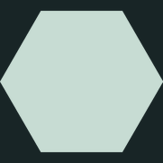

# Canonical match-three hex tile



This is the registration mask for any artwork that fills a match-three tile.
The engine draws a six-sided polygon at angles `0, π/3, …` (see
`engine/gfx.c`), so the left and right vertices are at ±R and the horizontal
top and bottom edges are at ±√3R/2. The transparent PNGs use a square canvas
whose width is 2R. Their alpha is opaque inside that exact shape, with a
four-times supersampled antialiased boundary. These masks describe geometry;
they are not painted game artwork or alternative interaction states.

- [128-pixel mask](hex-mask-128.png): packed runtime tile registration.
- [181-pixel mask](hex-mask-181.png): a source-atlas cell.
- [8×6 source-atlas template](atlas-template-8x6-181.png): a 1448×1086
  reference with 48 equal 181×181 cells. The dark surround makes the pale
  target visible; it is a guide, not alpha to add to artwork.

A full-cell sprite whose canvas uses this mask must be drawn with width and
height `2 * (HEX_R - .65)` to match the well face in the two portrait games.
The engine's board coordinate radius `HEX_R` also includes the well rim.
The mask is normalized to its own width; other projects may draw it at twice
their actual face radius. Use the same source shape in every full-cell state;
do not stretch a square or point-up hex to make it fit.

Regenerate the PNGs and template with `python3 tools/hex_tile_art.py --write-reference`.
The [manifest](manifest.json) records dimensions and reproducible references.

For new painted tile surfaces, supply the template to ImageGen as the geometry
base and request full-bleed material around the central motif. Crop the square
source cell, resize uniformly, then intersect its alpha with the canonical
runtime mask. This spatial cut defines the exact outline; it must not invent
damage states or recolor one state into another. Keep every strength authored
in the same source atlas. `tools/match3_elements_art.py` demonstrates this
workflow. A full-bleed source intentionally has paint outside the hex: check
its **registered output**, rather than treating raw paint bleed as a failure.

## Checking artwork

```sh
python3 tools/hex_tile_art.py art.png --mode fill --strict --overlay-dir /tmp/hex-review
python3 tools/hex_tile_art.py art.png --mode fill --exact
python3 tools/hex_tile_art.py source.png --atlas 8x6 --cells 0,1,2 --mode fill --strict --overlay-dir /tmp/hex-review
python3 tools/hex_tile_art.py portal.png --mode frame --overlay-dir /tmp/hex-review
python3 tests/test_hex_tile_art.py
```

The tool reads the actual RGBA alpha without changing it. For an atlas it
checks source cells at their native resolution, **before** runtime crop/resize;
indices are zero-based in row-major order. The JSON report gives fraction of
the mask covered, fraction of artwork pixels outside the mask, and fraction of
a two-pixel inner boundary covered. Alpha at least 128 counts as covered, so
normal antialiasing on the one-pixel boundary does not falsely register spill.
A strict **fill** needs at least 99.5% coverage, 95% boundary coverage and at
most 0.5% spill. The default, less strict diagnostic uses 97%, 80% and 1%.
These numerical tolerances allow rasterization differences; they are not a
claim of pixel-for-pixel equality. For byte-for-byte alpha equality, use
`--exact` with fill mode. The report also gives the number of unequal alpha
pixels and maximum byte difference. Passing confirms silhouette and registration,
not whether a painting has readable damage states or sensible perspective.

Use **frame** for a ring with transparent center and **object** for a smaller
piece: neither requires filling the center or reaching every edge, but both
must contain visible artwork and respect the outside boundary (1% spill, or
0.5% with `--strict`). Separate intentionally overhanging art is outside this
contract and needs its own explicit registration. Run the checker once per
role when an atlas mixes fills, frames and objects. Overlays show missing
mask space in grey, covered space in cream, spill in red and the expected edge
in green; inspect them alongside the actual art and an in-game capture.
