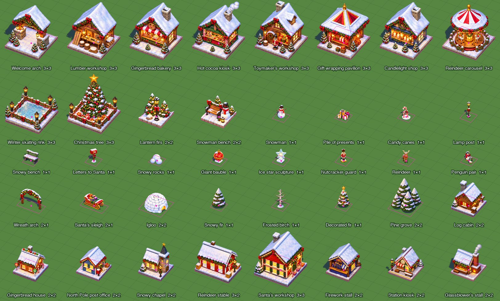
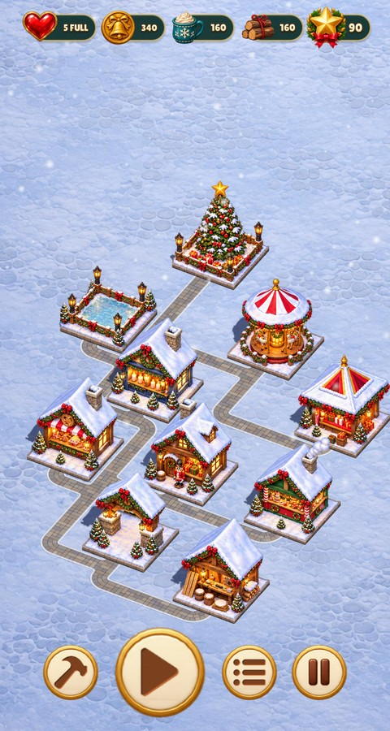
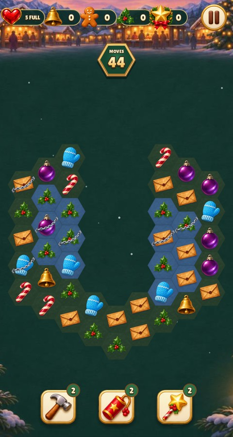
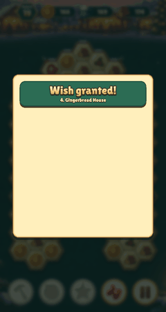

# Christmas Market

From the repository root, `make -C games/christmas-market ios` builds, signs,
installs and launches on the connected iPhone (or iPad when no iPhone is
available). Set `DEVICE="name or UDID"` to choose one. See the
[device deployment guide](../../tools/xcode/README.md#deploy-to-a-connected-iphone-or-ipad).

An in-progress Christmas market game based on Relic Rush's square match-3 and free-placement city systems. Its 37 buildings and decorations are modelled and rendered in Blender after the building direction sheet. See the [building catalogue](docs/building-catalogue.md).

The [reference sheet](art/building-reference-sheet.png) covers ten campaign buildings: Welcome arch, Lumber workshop, Gingerbread bakery, Hot cocoa kiosk, Toymaker's workshop, Gift wrapping pavilion, Candlelight shop, Reindeer carousel, Winter skating rink and Christmas tree. Lantern firs and Snowman bench are repeatable decorations. The build shop adds 25 more objects in four tabs (Decorations, Snowy trees, Cottages): snowmen, presents, a sleigh, reindeer, an igloo, a chapel, a log cabin, Santa's workshop and more.

Direction: snow-covered timber and cream plaster, evergreen garlands, red ribbons, warm amber windows and lights, cool blue snow, readable isometric silhouettes. The Blender models resolve perspective and footprints exactly. The renders can still guide an ImageGen repaint ([#34](https://github.com/corepunch/nile-archive/issues/34)).

The original transparent building atlas and the labeled reference sheet are preserved in `art/`. Built-in ImageGen produced the artwork. Exact generation prompts are in `art/prompts.json` and `art/reference-sheet-prompt.txt`.

The supplied portrait is now the identity reference for Noelle, the main character (`art/noelle-reference.jpg`). Her transparent cutout is used in dialogue. Her [portrait app icon](art/app-icon-1024.png) is installed in the iOS/macOS `AppIcon` catalogue; its opaque square master leaves corner masking to the OS. `python3 games/christmas-market/tools/prepare_character.py` reproduces the portrait resize and all icon sizes. Built-in ImageGen prompts are in `art/character-and-icon-prompts.json`.

Building cards and their contents lift and fade in together. After a win or
loss, the board fades away before the result card arrives. Cards fade out
before moving on, with instant transitions under Reduce Motion.

Haptics accompany matches, tools, cascades, trickling landings,
results, income collection and confirmed building placement/relocation. Dragging
and previews stay silent. See the [shared haptics contract](../../docs/HAPTICS.md).

The ten original winter wishes use square boards up to 9 × 12. Swap two neighboring treats to match three in a row or column. Every blue pane must light. Single and crossed chains mark treats that need one or two hits before the pane can clear. The last few panes get a trail around their square edges during idle play. The [square campaign guide](docs/square-match3.md) lists the levels and artwork.

## Shared match engine and atlas

Each board spawns five piece kinds. After building Theo’s workshop, match 30 toy hammers to charge a hit on a chosen cell. The [engine match-3 module](../../docs/MATCH3_ENGINE.md) owns swaps, blockers, gravity, cascades, hints, tools and timing.

The puzzle and town use the same wallet and blue Settings gear. Each green resource
capsule has the brass rim and drop shadow of the round buttons. The remaining moves
are shown below the wallet on the puzzle. The deep blue tablets mark the objectives on parchment cells, which meet at
hairline seams; cleared tablets return to parchment. Pause opens
the Market Keeper's Guide alongside Sound and Reduce Motion.
[Board palette and guide screenshots](docs/screenshots/review/spruce-palette/README.md).

The board's art is one atlas per kind in `data/board/`: `pieces.png` (the
market goods and the earlier festive pieces), `blockers.png`, `cells.png`,
`hud.png` and `fx.png`, with the backdrop in
`data/board/backs/background.jpg`. Run `python3 tools/match3_atlas.py` to
rebuild the atlases from the registered sprites in `art/registered/`;
[Asset layout](../../docs/ASSET_LAYOUT.md) describes the folders. The three lantern
panes use the board tiles shared with Relic Rush, which `tools/board_tiles.py`
bakes from `engine/art/board-tiles/tiles.json`.
[Asset catalogue](docs/asset-catalogue.md#lantern-panes).

The market keeps Relic Rush's bottom controls in its own skin: Build (the
shop) on the left, a large Play in the middle showing the number of the next
wish, and Settings on the right. A placement shows Cancel and Confirm beside the building. Snow
falls over the village and moves with it when you pan. Dialogue stands the
speaker (and listener) on a full-width bubble in the middle of the screen.

Building bases need one tile of open ground between them. During placement,
cream guides include that clearance and disappear behind buildings that cover
them. Debug `--footprints` shows the full outline over
each sprite. See the [placement captures](docs/review/placement-guides/README.md).

## Market economy

Silver coins pay 3 Gold and gold coins pay 5. Holly, mittens and candy canes earn score.
The arch replaces candy canes with firewood for Supplies. Later stalls add more materials,
Food and chargeable tools. Longer lines multiply the yield (a longer line just clears; there are no special pieces). Each win
banks the goods cleared on the board. Regions and decorations open by
wishes cleared (the purse's fourth slot, `CLEARED`).

Confirmed placement spends Gold, Supplies and Food from that wallet.
The lower-left Build button opens the next stall and shows its price or shortfall. A circling trail signals when you can choose a location. Play another wish to earn the missing resources. The [first 20 wishes](docs/resource-prototype.md) compare both
Cradle of Rome editions and record prices, unlocks and a measured payout
for every board in the prototype.

There are no lives: a failed wish can be retried at once.
Snow drifts over the village behind the controls. Reduce Motion keeps the
flakes still.

`make run-christmas-market` launches the native draft. `--showcase` previews the ten buildings; `--level 4` previews a Christmas puzzle. It has an independent `christmas-market` save namespace. The draft opens on the snowy market and has ten square puzzles, funded construction, player-chosen placement, land expansion, a resource shop and Noelle's dialogue. Native macOS and iOS project files are included.

The build shop and Winter Wishes scroll continuously. Swipe inside either list or
use the mouse wheel. Both are full-screen sheets under the wallet row. The shop
lists one building per row with its whole price, an amount you cannot yet cover
in red, and a BUILD button or the reason it waits; it keeps its category
arrows. Winter Wishes opens near the current puzzle. Both screens share row
templates with Relic Rush.

Pause offers Resume, Restart (it asks first) and Quit to the market, which
keeps the unfinished board for LEVEL or Winter Wishes. Popups open and close
at once.

The game is the same as Relic Rush with other data and art
([docs/PORTRAIT_GAMES.md](../../docs/PORTRAIT_GAMES.md)): every word of the
shared screens is in [`lua/game_config.lua`](lua/game_config.lua), and the flow, dialogs,
shop, effects and debug entry points are the engine's
(`engine/lua/match3/game.lua`). `lua/board.lua` and `lua/screens.lua` paint only
the market's own art: cells, treats, the results card and guide icons.

The interface look (text palettes, panels, the red buttons and their states, focus) is data in [`lua/skin.lua`](lua/skin.lua), compiled by the engine's `ui.skin`; see [skin files](../../docs/UI_ENGINE.md#skins).

Board, HUD and character art is spatially extracted by `python3 games/christmas-market/tools/prepare_assets.py`. Buildings are rendered by `tools/render_buildings.py` and imported by `tools/prepare_catalogue.py`. See the [asset catalogue](docs/asset-catalogue.md) and the [building catalogue](docs/building-catalogue.md).

## Story

The ten playable wishes reach the first market chapter. The Welcome arch, Lumber workshop, Gingerbread bakery and Hot cocoa kiosk carry the story. The Reindeer stable and Gingerbread house join between them. The full [story archive](docs/story.md) includes the later chapters.

`lua/story_content.lua` is compiled from the script by `python3 games/christmas-market/tools/prepare_story.py`; `--check` catches drift in `make test`. `lua/journey.lua` holds the stall schedule, recap and changing tap lines as data; `lua/narrative.lua` holds the cast. The engine (`engine/lua/match3/game.lua`) keeps the checkpoints and plays the scenes. Preview any scene with `--story-beat before-11`, or `--story-beat after-30 --story-line 15`, and `--frames 240` for fully typed text. All six speakers use painted busts. Sources and export commands are in the [asset catalogue](docs/asset-catalogue.md#story-cast). Review captures are in [docs/review/story](docs/review/story/README.md).

## Review and validation

| Snowy market | Festive puzzle | Noelle |
| --- | --- | --- |
|  |  |  |

Run `make CFLAGS="-O2 -g -Werror"`, `make test`, and `./build/christmas-market --headless --fresh --mute --smoke` (under Xvfb on Linux). The smoke test uses the shared `city.move_test` for building gestures and covers real clicks through a puzzle win, funded construction, pan/hold/move/cancel/confirm, decoration purchase/cancellation, replay, pause and the next level. A separate Lua campaign test verifies all twenty ladder stalls fit the land open by their levels, in order, each region opens on the level Pip announces it, and both decoration purchases preserve campaign progress. Its extended run (`make test-extended`) requires the greedy bot to win every one of the thirty story levels at least once without tools. `rules christmas_story` follows every first clear through the story scheduler, interruption, save/read, replays and old-save migration. `--smoke --campaign` plays the thirty story levels through the real result, Collect, region, stall card, placement, dialogue and Play controls. Each board’s panes and the scheduled building’s test wallet are prepared before one real swap. The separate extended campaign run earns its own wallet through actual play. All 36 scenes must play once, in script order, and the run must end on the end screen with twenty stalls and every region open. It takes about 35 seconds and runs in `make test-full` (CI), or alone with `build/test/christmas-market "smoke campaign"`.

## Leaderboard

The LEADERBOARD link in Settings opens the overall rankings by winter wishes cleared. The game
updates the total when the player claims a first-clear reward. Use `com.corepunch.christmasmarket.stars`
in [Game Center](../../docs/GAMECENTER.md) and capture the dialog with `--gamecenter-demo --dialog leaderboard`.

| Settings | Merriest markets |
| --- | --- |
|  |  |

`python3 games/christmas-market/tools/check_assets.py` verifies the 125-file runtime inventory (five of them temporary name-card busts), 37 buildings, all forty authored atlas crops and eleven native icon slots. `python3 games/christmas-market/tools/capture_screenshots.py` reproduces the review captures; pass names such as `market phone-market` to capture a subset. Use `xvfb-run -a` on Linux. CI also builds the iOS Simulator target and the WebAssembly game.

## Fast rule tests

Run `make test-christmas-market` from the repository root for this game's tests in one command. The Lua suites use deterministic state injections and need no window or artwork. See [the testing guide](../../docs/TESTING.md) for coverage, test-only `ENGINE_TEST` hooks, extended samples and renderer smoke checks.

Board artwork fills its registered square slots. In dialogue, portraits face each other and slide into place at the edges of the screen. The same engine layout used by Relic Rush centers the text vertically in the full-width bar. [Dialogue bar captures](docs/review/dialogue-bar/README.md)

The board enters after dialogue with a cell ripple, falling treats, blocker landings and a final light sweep. Tap to skip; reduced motion uses a short fade. See [the engine timeline](../../docs/ENGINE.md#board-entrance).
During refills, each treat gives a small bounce when it comes to rest in its slot. Reduce Motion suppresses the bounce.

Popups use measured vertical forms. Every popup uses the shared title panel. Settings shows the current board as its subtitle during play. Results display Gold, Food and Supplies in three equal columns, with each icon above a plain number. Above Collect, the card shows the amounts the next stall still needs, its picture once the wallet covers it, or a first clear's story find. In reels the result sections still settle on one timeline, which the first tap skips. See [docs/MOTION.md](../../docs/MOTION.md) and the [dialog motion review](docs/review/dialog-motion/README.md).

Placement and move previews show cream ground-footprint guides around the other
buildings, including clearance. Dark contrast edges remain readable on snow.
Guides hide after Confirm/Cancel; the mover's old spot is omitted. See the
[shared review](../../docs/review/city-placement-guides/README.md).

## Town screen

The market is the engine's [shared town screen](../../docs/TOWN.md), laid out by
`lua/town_config.lua`. Tapping a building shows its name in a word bubble; holding
it for half a second lifts it to move.

The town row draws Build, Play, Levels and Pause as enamel buttons sized to their
slots. A single [painted strip](../../art/match3-buttons/README.md) supplies the
128×128 action icons. The board draws its own bonus pieces on the same buttons.

For a local story walkthrough, launch `./build/christmas-market --debug-walkthrough`.
Tap **Skip level** at the top right of the board, read any scene, then claim the usual reward.
On the island, **Advance** places an earned story building or starts the next board.
The walkthrough has its own save. Add `--fresh` to start at the opening without saving.

Theo’s workshop introduces Hammer pieces and the Candlelight shop introduces
Lightning pieces. Match them to charge their tools. Stored uses and partial
charge carry between wishes.

### Board

Honey maple, teal panes and brass trim with snowy fir sprigs frame the ten winter wishes.
