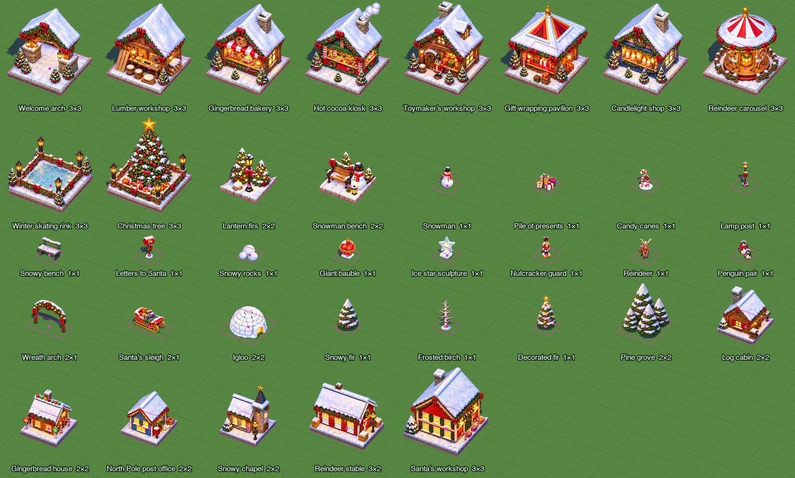
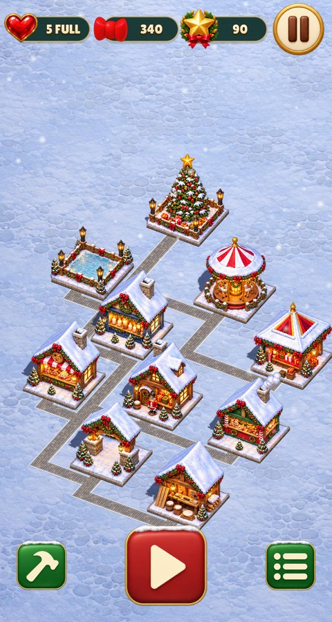
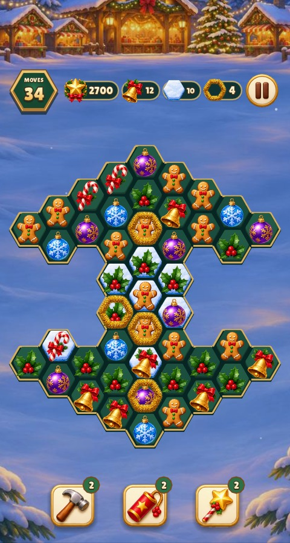
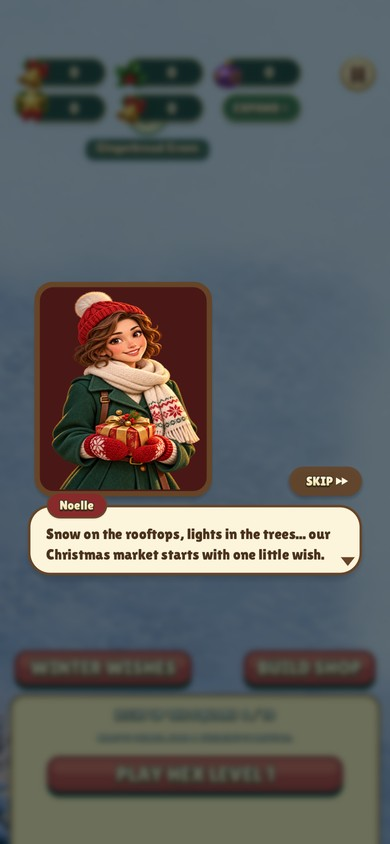
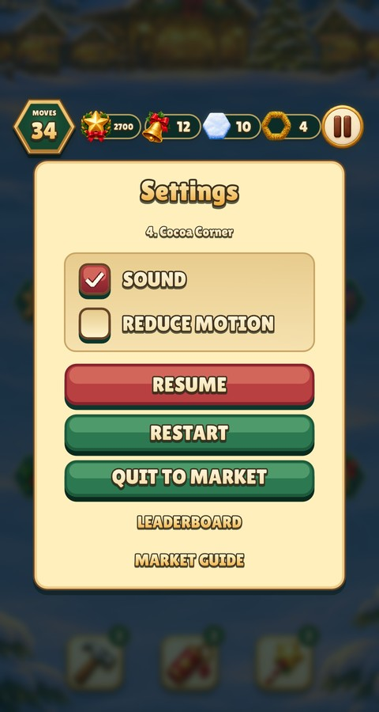
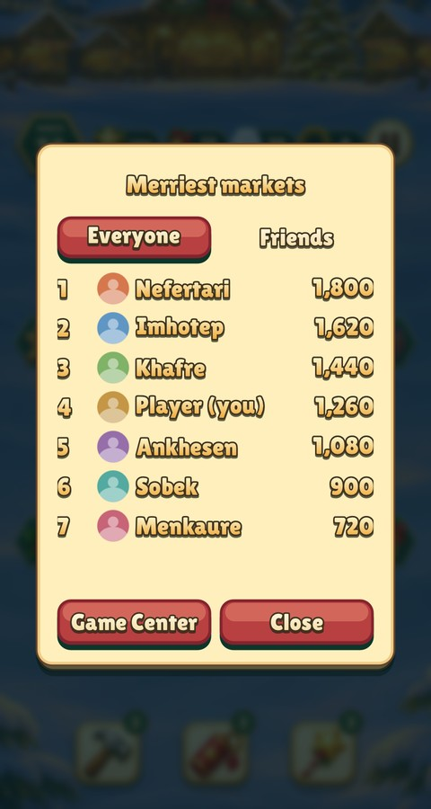
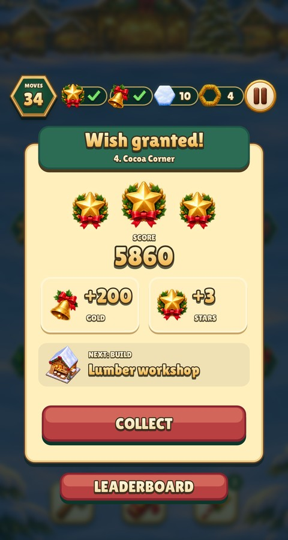
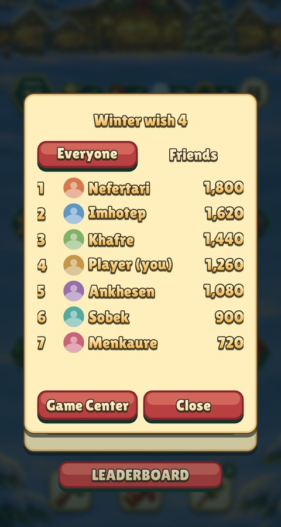
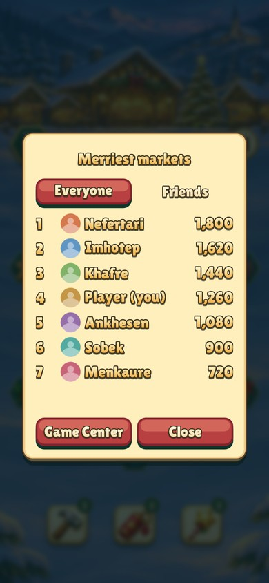
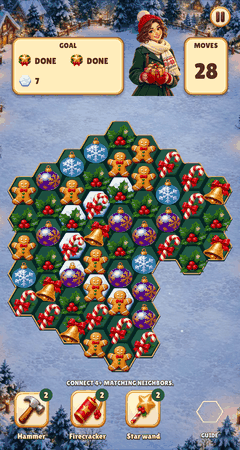

# Christmas Market

From the repository root, `make -C games/christmas-market ios` builds, signs,
installs and launches on the connected iPhone (or iPad when no iPhone is
available). Set `DEVICE="name or UDID"` to choose one. See the
[device deployment guide](../../tools/xcode/README.md#deploy-to-a-connected-iphone-or-ipad).

An in-progress Christmas market game based on Relic Rush's hex straight-line match-3 and free-placement city systems. Its 37 buildings and decorations are modelled and rendered in Blender after the building direction sheet. See the [building catalogue](docs/building-catalogue.md).

The [reference sheet](art/building-reference-sheet.png) covers ten campaign buildings: Welcome arch, Lumber workshop, Gingerbread bakery, Hot cocoa kiosk, Toymaker's workshop, Gift wrapping pavilion, Candlelight shop, Reindeer carousel, Winter skating rink and Christmas tree. Lantern firs and Snowman bench are repeatable decorations. The build shop adds 25 more objects in four tabs (Decorations, Snowy trees, Cottages): snowmen, presents, a sleigh, reindeer, an igloo, a chapel, a log cabin, Santa's workshop and more.

Direction: snow-covered timber and cream plaster, evergreen garlands, red ribbons, warm amber windows and lights, cool blue snow, readable isometric silhouettes. The Blender models resolve perspective and footprints exactly. The renders can still guide an ImageGen repaint ([#34](https://github.com/corepunch/nile-archive/issues/34)).

The original transparent building atlas and the labeled reference sheet are preserved in `art/`. Built-in ImageGen produced the artwork. Exact generation prompts are in `art/prompts.json` and `art/reference-sheet-prompt.txt`.

The supplied portrait is now the identity reference for Noelle, the main character (`art/noelle-reference.jpg`). Her transparent cutout is used in dialogue. Her [portrait app icon](art/app-icon-1024.png) is installed in the iOS/macOS `AppIcon` catalogue; its opaque square master leaves corner masking to the OS. `python3 games/christmas-market/tools/prepare_character.py` reproduces the portrait resize and all icon sizes. Built-in ImageGen prompts are in `art/character-and-icon-prompts.json`.

Building popup images and resource icons follow the panel’s entrance scale,
position and opacity through the shared form skin.

Haptics accompany matches, special activations, cascades, trickling landings,
results, income collection and confirmed building placement/relocation. Dragging
and previews stay silent. See the [shared haptics contract](../../docs/HAPTICS.md).

The thirty winter wishes each use an authored court contour and terrain focus,
with snow, tinsel and ice introduced and revisited across the three episodes.
See the [board progression](docs/board-progression.md) for each wish and the
limits of the current difficulty tuning.

## Shared match engine and atlas

The campaign now includes packed-snow blocks, color gifts, buried star displays,
spreading ribbon, delivery chutes and present deliveries. Each family has
original authored artwork and a different introduction order from Relic Rush.
See the [shared element rules and design reference](../../docs/MATCH3_ELEMENTS.md)
and [in-game art review](../../docs/review/match3-elements/README.md).

The [engine match-3 module](../../docs/MATCH3_ENGINE.md) owns all matching,
swaps, blockers, specials, trickling gravity, cascades, hints, tools and board
input/timing. This game provides campaign data, graphics and integer behavior
flags. Every exposed column top (no active cell directly above) spawns gems
vertically. Interior gems fall straight down whenever their cell below is
empty and movable, and slide diagonally only when that cell is occupied,
locked or missing. Locks still route gems around their sides.

All board imagery uses one `data/match3.png` override atlas. The engine embeds
a neutral resource atlas for games without an override; `--default-match3`
previews it. `python3 tools/match3_atlas.py` reproduces both skins while
preserving authored alpha and every control state. See the
[review captures](docs/review/trickling/README.md).

Swap adjacent treats, or tap two neighbours, to make a straight line of three
or more matching kinds along any of the three hex axes. Bent clusters and
unselected branches do not count. Four in a line creates a striped treat (cream
stripes along the axis it clears, as in Relic Rush); five or more creates a
rainbow star. Pieces have one ordinary state rather
than flower growth stages. Blockers, tools, cascades and restoration rewards
retain their existing rules. Both portrait games use this same matching mode.

The board and Settings panel share Relic Rush's layout. The puzzle backdrop
uses the space above the goals for a lantern-lit Christmas market, with open
snow behind the spruce-green wells and their thin champagne edge. Each well
shades from light at the top to dark at the bottom. Powder snow and both ice
strengths use [thin hex rims](docs/asset-catalogue.md#snow-and-ice-rims).
Goal icons sit slightly left over their capsule edges. See the
[cell and goal review](docs/asset-catalogue.md#cell-and-goal-alignment).
Thin gold tinsel straddles the cell edge. The bomb, the rainbow star and
selection highlights use the [same hex silhouette](docs/asset-catalogue.md#fitted-specials-and-thin-tinsel).
Open Pause to reach Sound, Reduce Motion, Resume and the Market Guide.

Each wish opens with its mission on a banner that slides across the middle of
the screen and away (a tap sends it on). Long cascades and special combos earn
praise (Jolly!, Merry!, Magical!, Christmas Magic!) with a rising chime. Swaps,
matches, specials, tools, wins and losses each have their own synthesised
sound. The win card shows stars, score, one chip per reward and the next step.

The market keeps Relic Rush's bottom controls in its own skin: Build (the
shop) in the left corner, Play in the right and the winter wishes medallion
between them. A placement shows Cancel and Confirm beside the building. Snow
falls over the village and moves with it when you pan. Dialogue stands the
speaker (and listener) on a full-width bubble in the middle of the screen.

During placement, cream guides trace occupied ground and disappear behind
buildings that cover them. Debug `--footprints` shows the full outline over
each sprite. See the [placement captures](docs/review/placement-guides/README.md).

## Draft implementation

The market header shows Lives, Gold and Christmas Stars in one row. A failed
wish uses a life, and one returns every 30 minutes up to five. Gold funds
construction and decorations. Open a region from its marker on the map once
you have enough Stars. See the [town HUD review](docs/asset-catalogue.md#town-hud).
Snow drifts over the village behind the controls. Reduce Motion keeps the
flakes still.

`make run-christmas-market` launches the native draft. `--showcase` previews the ten buildings; `--level 4` previews a Christmas puzzle. It has an independent `christmas-market` save namespace. The draft opens on the snowy market and has thirty puzzles in three story episodes, funded construction, player-chosen placement, land expansion, a shop and Noelle's dialogue. Native macOS and iOS project files are included.

The build shop and Winter Wishes scroll continuously. Swipe inside either list or
use the mouse wheel. The shop shows three cards per row and keeps its category
arrows. Winter Wishes opens near the current puzzle. Both screens share row
templates with Relic Rush.

Pause offers Resume, Restart (it asks first) and Quit to the market, which
keeps the unfinished board for LEVEL or Winter Wishes. Popups open and close
at once. With no lives left, Try Again waits and says when one returns.

The game is the same as Relic Rush with other data and art
([docs/PORTRAIT_GAMES.md](../../docs/PORTRAIT_GAMES.md)): every word of the
shared screens is in [`data/game.json`](data/game.json), and the flow, dialogs,
shop, level list, effects and debug entry points are the engine's
(`engine/match3_game.lua`). `lua/board.lua` and `lua/screens.lua` paint only
the market's own art: cells, treats, the results card and guide icons.

The interface look (text palettes, panels, the red buttons and their states, focus) is data in [`lua/skin.lua`](lua/skin.lua), compiled by the engine's `ui.skin`; see [skin files](../../docs/UI_ENGINE.md#skins).

Board, HUD and character art is spatially extracted by `python3 games/christmas-market/tools/prepare_assets.py`. Buildings are rendered by `tools/render_buildings.py` and imported by `tools/prepare_catalogue.py`. See the [asset catalogue](docs/asset-catalogue.md) and the [building catalogue](docs/building-catalogue.md).

## Story

The three-episode script in [docs/story.md](docs/story.md) plays in full: 36 scenes, 198 lines, one per winter wish, from the opening on 4 December to "To be continued" at level 30. Stalls are built at levels 1, 4, 7, 9, 13, 16, 19, 23, 26 and 29. A level without a stall plays its scene when you return to the market. Scenes play once per save, on the first clear, and a scene is only marked seen once it finishes or is skipped. Regions open at levels 6, 9, 15, 21 and 27, each announced by Pip, and tapping a building can show a line that changes as the story moves on. Saves from the ten-level game keep every stall and open episode two with a short recap.

`lua/story_content.lua` is compiled from the script by `python3 games/christmas-market/tools/prepare_story.py`; `--check` catches drift in `make test`. `lua/journey.lua` holds the stall schedule, recap and changing tap lines as data; `lua/narrative.lua` holds the cast. The engine (`engine/match3_game.lua`) keeps the checkpoints and plays the scenes. Preview any scene with `--story-beat before-11`, or `--story-beat after-30 --story-line 15`, and `--frames 240` for fully typed text. All six speakers use painted busts. Sources and export commands are in the [asset catalogue](docs/asset-catalogue.md#story-cast). Review captures are in [docs/review/story](docs/review/story/README.md).

## Review and validation

| Snowy market | Festive puzzle | Noelle |
| --- | --- | --- |
|  |  |  |

Run `make CFLAGS="-O2 -g -Werror"`, `make test`, and `./build/christmas-market --headless --fresh --mute --smoke` (under Xvfb on Linux). The smoke test uses the shared `city.move_test` for building gestures and covers real clicks through a puzzle win, funded construction, pan/hold/move/cancel/confirm, decoration purchase/cancellation, replay, pause and the next level. A separate Lua campaign test verifies all ten building grants fit the land open by their levels, each region opens on the level Pip announces it, and both decoration purchases preserve campaign progress. Its extended run (`make test-extended`) requires the greedy bot to win every one of the thirty levels at least once without tools. `rules christmas_story` follows every first clear through the story scheduler, interruption, save/read, replays and old-save migration. `--smoke --campaign` plays all thirty levels through the real result, Collect, region, stall card, placement, dialogue and Play controls. Each board's goals are met before one real swap, so it checks the flow rather than the boards. All 36 scenes must play once, in script order, and the run must end on the end screen with ten stalls and every region open. It takes about 35 seconds and runs in `make test-full` (CI), or alone with `build/test/christmas-market "smoke campaign"`.

## Leaderboards

Game Center comes from the engine ([docs/GAMECENTER.md](../../docs/GAMECENTER.md)) and is switched on by the
`leaderboard` block of `data/game.json`: a **stars** board for the lifetime Christmas Stars (never spent)
and one board per winter wish (`level_01` to `level_30`) for its best score. Scores are reported when a
reward is claimed. Settings has a LEADERBOARD link for the stars board and the results card a LEADERBOARD
button for that wish; both open the shared dialog in this game's red and green skin. Create 31
leaderboards in App Store Connect (high to low) as `com.corepunch.christmasmarket.stars` and
`com.corepunch.christmasmarket.level_01` ... `level_30`. Try it with `--gamecenter-demo --dialog leaderboard`.

| Settings | Merriest markets | Results card | Winter wish board |
| --- | --- | --- | --- |
|  |  |  |  |

`python3 games/christmas-market/tools/check_assets.py` verifies the 125-file runtime inventory (five of them temporary name-card busts), 37 buildings, all forty authored atlas crops and eleven native icon slots. `python3 games/christmas-market/tools/capture_screenshots.py` reproduces the review captures; pass names such as `market phone-market` to capture a subset. Use `xvfb-run -a` on Linux. CI also builds the iOS Simulator target and the WebAssembly game.

## Fast rule tests

Run `make test-christmas-market` from the repository root for this game's tests in one command. The Lua suites use deterministic state injections and need no window or artwork. See [the testing guide](../../docs/TESTING.md) for coverage, test-only `ENGINE_TEST` hooks, extended samples and renderer smoke checks.

Board artwork fills its registered hex slots. Dialogue portraits slide/fade in and out, and only brighten/dim on speaker changes; no resizing, rotation or idle wobble; the engine owns those transitions. See [motion review](../../docs/review/motion/README.md).

The board enters after dialogue with a cell ripple, falling treats, blocker landings and a final light sweep. Tap to skip; reduced motion uses a short fade. See [the engine timeline](../../docs/ENGINE.md#board-entrance).

Dialogs arrive and leave on the engine's motion module: the card eases in while the parts of a result settle on one timeline, which the first tap skips. See [docs/MOTION.md](../../docs/MOTION.md) and the [dialog motion review](docs/review/dialog-motion/README.md).

Placement and move previews show cream ground-footprint guides around the other
buildings, including clearance. Dark contrast edges remain readable on snow.
Guides hide after Confirm/Cancel; the mover's old spot is omitted. See the
[shared review](../../docs/review/city-placement-guides/README.md).

## Town screen

The market is the engine's [shared town screen](../../docs/TOWN.md), laid out by
`data/town.json`. Tapping a building shows its name in a word bubble; holding
it for half a second lifts it to move.

Build and Play use authored winter-market navigation badges with five interaction
states. See [market navigation](docs/asset-catalogue.md#market-navigation) for
the source atlas, state mapping, reproduction and pending capture review.

The town bottom row has a large central Play button and equal smaller Build
and Levels buttons, with simplified authored icons and five interaction states.
