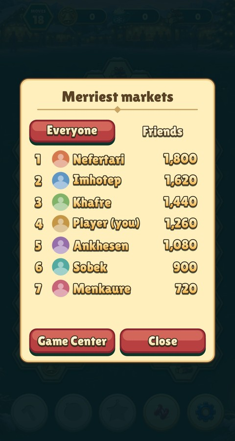
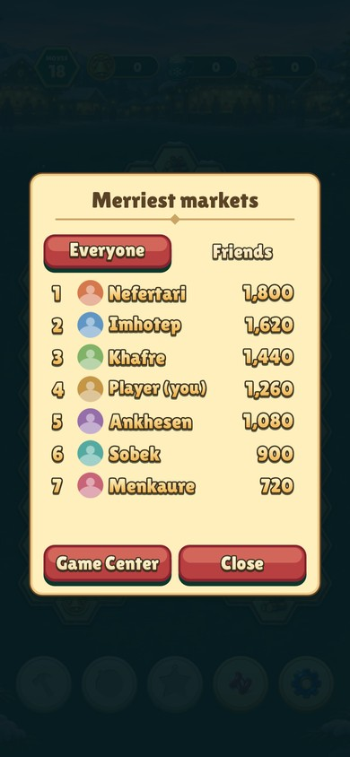

# Christmas at Bellmere

From the repository root, `make -C games/christmas-market ios` builds, signs,
installs and launches on a connected iPhone. The native iOS target is iPhone
only. Set `DEVICE="name or UDID"` to choose one. See the
[device deployment guide](../../tools/xcode/README.md#deploy-to-a-connected-iphone-or-ipad).

An in-progress Christmas market game based on Relic Rush's square match-3 and free-placement city systems. The market has 41 buildings and decorations. Smoke rises from nine working chimneys in town. See the [building catalogue](docs/building-catalogue.md).

The illustrated title screen offers Play and Settings from the first launch.
The early wishes teach swaps, Line Gems, Rainbow Gems and tinsel on the board.
New tools explain how to charge and use them. Collect the first reward to visit
the market. On the first board, Noelle explains how matches fund the market, and Agnes welcomes you in from the cold. Each new stall
gets a short scene as someone moves in, and every five wishes the town gets on
with Christmas ([script](docs/story.md)). **Story** in Settings turns the scenes off. **Main Menu** in Settings takes you back to the title. See the
[title screen](docs/screenshots/main-menu.jpg) and [guided lessons](../../docs/PORTRAIT_GAMES.md#guided-board-lessons).
Both also have [compact title](docs/screenshots/main-menu-phone.jpg) and
[compact board](docs/screenshots/first-launch-phone.jpg) captures.

In an Xcode Debug build for iPhone, the iOS Simulator or macOS, tap **SKIP >>**
at the top right of the board to have the bot finish the level. Claim the reward
and follow the construction prompts. Release builds hide the button.

The [reference sheet](art/building-reference-sheet.png) covers ten of the twenty campaign stalls: Welcome arch, Lumber workshop, Gingerbread bakery, Hot cocoa kiosk, Toymaker's workshop, Gift wrapping pavilion, Candlelight shop, Reindeer carousel, Winter skating rink and Christmas tree. Lantern firs and Snowman bench are repeatable decorations. The build shop adds 25 more objects after the projects: snowmen, presents, a sleigh, reindeer, a gingerbread house, a giant bauble and more.

Direction: snow-covered timber and cream plaster, evergreen garlands, red ribbons, warm amber windows and lights, cool blue snow, readable isometric silhouettes. The Blender models resolve perspective and footprints exactly. The renders can still guide an ImageGen repaint ([#34](https://github.com/corepunch/nile-archive/issues/34)).

The original transparent building atlas and the labeled reference sheet are preserved in `art/`. Built-in ImageGen produced the artwork. Exact generation prompts are in `art/prompts.json` and `art/reference-sheet-prompt.txt`.

The supplied portrait is now the identity reference for Noelle, the main character (`art/noelle-reference.jpg`). Her transparent cutout is used in dialogue. Her [portrait app icon](art/app-icon-1024.png) is installed in the iOS/macOS `AppIcon` catalogue; its opaque square master leaves corner masking to the OS. `python3 games/christmas-market/tools/prepare_character.py` reproduces the portrait resize and all icon sizes. Built-in ImageGen prompts are in `art/character-and-icon-prompts.json`.

Building cards center a large preview of the project above its description,
with the price or shortfall beside the board reward. The card and its contents
lift and fade in together. After a win or loss, the board fades away before the
result card arrives. Cards fade out before moving on, with instant transitions
under Reduce Motion.

Haptics accompany matches, tools, cascades, trickling landings,
results, income collection and confirmed building placement/relocation. Dragging
and previews stay silent. See the [shared haptics contract](../../docs/HAPTICS.md).

The 100 winter wishes use square boards up to 9 × 12. Swap two neighboring treats to match three in a row or column. Every blue pane must light. Single and crossed chains mark treats that need one or two hits before the pane can clear. The last few panes get a trail around their square edges during idle play. The four Advents and Christmas run levels 1–20, 21–40, 41–60, 61–80 and 81–100, and each board has a tier (levels 1–4 teach, then easy, easy, normal, normal, hard, easy, normal, normal, hard, boss per ten). `python3 tools/square_boards.py christmas-market` validates them, `tools/square_trim.py --fill` covers them with panes up to the tier's length and `tools/tune_moves.py` fits their move budgets. Every tier uses the median clear × 1.25, rounded up; slow bot samples do not add moves. The [square campaign guide](docs/square-match3.md) lists the levels and artwork.

## Shared match engine and atlas

Each board spawns five piece kinds. Building the Reindeer stable adds the Farrier's hammer. Match 30 to charge a blow on a chosen cell. The Firework stall upgrades that slot to Firework Bomb and carries over its charge. Each campaign purchase adds one piece or tool. [Compare all 20 rewards with Cradle of Rome 2](../../docs/cradle-of-rome-reference/building-rewards.html).

The puzzle and town share a wallet with a coin, food basket, and logs with stone. Each green resource
capsule has the brass rim and drop shadow of the round buttons. A round moves counter
sits beside the wallet on the puzzle. The deep blue tablets mark the objectives on parchment cells, which meet at
hairline seams; cleared tablets return to parchment. The smaller Pause gear beside the bonuses opens
the Market Keeper's Guide alongside Sound and Reduce Motion.
[Board palette and guide screenshots](docs/screenshots/review/spruce-palette/README.md).

The board starts in Bellmere's village square. Each of the twenty campaign
buildings changes the backdrop on subsequent wishes after its placement is
confirmed.
The first visit shows the full painting briefly before the board appears.
Tap to skip the entrance. Reduce Motion goes straight to the board fade.
Earlier replays show the setting of their own stage, and later wishes keep
the latest available painting. [Backdrop captures](docs/screenshots/review/construction-backdrops/README.md)

The board's art is one atlas per kind in `data/board/`: `pieces.png` (the
market goods and the earlier festive pieces), `blockers.png`, `cells.png`,
`hud.png` and `fx.png`. Backdrops are separate JPEGs in `data/board/backs/`.
Run `python3 tools/match3_atlas.py` to
rebuild the atlases from the registered sprites in `art/registered/`;
[Asset layout](../../docs/ASSET_LAYOUT.md) describes the folders. The three lantern
panes use the board tiles shared with Relic Rush, which `tools/board_tiles.py`
bakes from `engine/art/board-tiles/tiles.json`.
[Asset catalogue](docs/asset-catalogue.md#lantern-panes).

The market keeps Relic Rush's bottom controls in its own skin: Build (the
shop) on the left, a large Play in the middle showing the number of the next
wish, and Settings on the right. A placement shows Cancel and Confirm beside the building. Snow
falls over the village and moves with it when you pan. Dialogue stands the
speaker (and listener) on a full-width bubble in the middle of the screen.

Building bases need one tile of open ground between them. During placement,
cream guides include that clearance and disappear behind buildings that cover
them. Debug `--footprints` shows the full outline over
each sprite. See the [placement captures](docs/review/placement-guides/README.md).

## Market economy

Silver snowflake coins pay 3 Tokens and gold Sun coins pay 5. Snowy firs, knitted mittens and candy canes earn score on the opening board.
The Welcome arch serves mulled wine for Treats. The Lumber workshop introduces brown pine bundles tied with blue ribbon for Materials.
The bakery and cocoa kiosk upgrade the red Treats piece. Each matched piece pays its own value. Each win
banks the goods cleared on the board. Regions and decorations open by
wishes cleared (the purse's fourth slot, `CLEARED`).

When Noelle arrives, Rosa’s old stall is already standing in Welcome Square.
It’s the last stall her gran ran before retiring, and the market Noelle has
come to reopen starts there. The stall can be moved for free. [Opening market](docs/screenshots/opening-market.jpg)

Confirmed placement spends Tokens, Treats and Materials from that wallet.
The Welcome arch is the first campaign purchase.
The town bar puts Play between the round Build button and the Pause gear.
Build opens the shop at the current Advent: its four projects first, under
the Advent's name and how many are built, then the decorations. A trail
circles Build when an open project is affordable. A row that can be bought
goes straight to placement; a project still out of reach opens its card with
the shortfall.
The [color map and construction ladder](docs/market-pieces.md) track the
rewards and the Windows edition of Cradle of Rome 2 purchase order.

Play from the main menu shows the Advent and Christmas medals. Play on the medals screen resumes the current phase. Each phase's twenty boards and four projects lift the fog from one district and show the medals again.

There are no lives: a failed wish can be retried at once.
Snow drifts over the village behind the controls. Reduce Motion keeps the
flakes still.

`make run-christmas-market` launches the native draft. `--showcase` previews the
campaign buildings, `--level 4` previews a Christmas puzzle, and `--opening-town`
shows Rosa's stall. The game has an independent `christmas-market` save namespace.
Native macOS and iOS project files are included.

The build shop and Winter Wishes scroll continuously. Swipe inside either list or
use the mouse wheel. Both are full-screen sheets under the wallet row. The shop
lists one building per row: its art, its name, its price on one line (an amount
you cannot yet cover in red) and, for a project, what it brings. A lock or a
tick over the art marks a locked or built one. Winter Wishes opens near the current puzzle. Both screens share row
templates with Relic Rush.

Pause offers Resume, Restart (it asks first) and Quit to the market, which
keeps the unfinished board for LEVEL or Winter Wishes. Popups open and close
at once.

The game is the same as Relic Rush with other data and art
([docs/PORTRAIT_GAMES.md](../../docs/PORTRAIT_GAMES.md)): every word of the
shared screens is in [`lua/game_config.lua`](lua/game_config.lua), and the flow, dialogs,
shop, effects and debug entry points are the engine's
(`engine/lua/match3/game.lua`). The engine draws the board from the market's
skin atlas and `board` settings. `lua/screens.lua` provides the results card
and guide icons.

The interface look (text palettes, panels, the red buttons and their states, focus) is data in [`lua/skin.lua`](lua/skin.lua), compiled by the engine's `ui.skin`; see [skin files](../../docs/UI_ENGINE.md#skins).

Board, HUD and character art is spatially extracted by `python3 games/christmas-market/tools/prepare_assets.py`. Buildings are rendered by `tools/render_buildings.py` and imported by `tools/prepare_catalogue.py`. See the [asset catalogue](docs/asset-catalogue.md) and the [building catalogue](docs/building-catalogue.md).

## Market projects

Clear panes to bank resources and build twenty projects across the 100 boards. Collect and play the next board on ordinary wins. When a project opens or becomes affordable, Collect takes you to the market.

## Review and validation

| Snowy market | Festive puzzle |
| --- | --- |
|  |  |

Build with `make CFLAGS="-O2 -g -Werror" christmas-market build/test/christmas-market`.
Run `build/test/christmas-market --extended "rules campaign_play" "rules christmas" "smoke game" "smoke campaign"`
under Xvfb on Linux. The extended campaign earns its wallet from real
matches and checks the 100 wishes and twenty purchases. The standard
smoke uses real input for a win, construction, building pickup and movement,
decoration shopping, replay and the next level. The campaign smoke prepares
each board and the wallet for one real winning move, then drives Collect,
region opening, construction and Play through the completion screen.

## Leaderboard

The LEADERBOARD link in Settings opens the overall rankings by winter wishes cleared. The game
updates the total when the player claims a first-clear reward. Use `com.corepunch.christmasmarket.stars`
in [Game Center](../../docs/GAMECENTER.md) and capture the dialog with `--gamecenter-demo --dialog leaderboard`.

| Settings | Merriest markets |
| --- | --- |
|  |  |

`python3 games/christmas-market/tools/check_assets.py` verifies the 125-file runtime inventory (five of them temporary name-card busts), 37 buildings, all forty authored atlas crops and eleven native icon slots. `python3 games/christmas-market/tools/capture_screenshots.py` reproduces the review captures; pass names such as `market phone-market` to capture a subset. Use `xvfb-run -a` on Linux. CI also builds the iOS Simulator target and the WebAssembly game.

## Fast rule tests

Run `make test-christmas-market` from the repository root for this game's tests in one command. The Lua suites use deterministic state injections and need no window or artwork. See [the testing guide](../../docs/TESTING.md) for coverage, test-only `ENGINE_TEST` hooks, extended samples and renderer smoke checks.

Board artwork fills its registered square slots. In dialogue, portraits face each other and slide into place at the edges of the screen. The same engine layout used by Relic Rush centers the text vertically in the full-width bar. The name tag sits just above the bar, and Skip sits the same distance below it. [Dialogue bar captures](docs/review/dialogue-bar/README.md)

The 0.7-second wipe from town reveals the board as it assembles. If dialogue is playing, the entrance waits for it to end. Cells ripple in, treats fall, blockers land and a light sweeps across the board. Tap to skip the entrance. Reduced motion uses a short fade. See [the engine timeline](../../docs/ENGINE.md#board-entrance).
During refills, each treat gives a small bounce when it comes to rest in its slot. Reduce Motion suppresses the bounce.

Popups use measured vertical forms. Every popup uses the shared title panel. Settings shows the current board as its subtitle during play. Results display Tokens, Treats and Materials in three equal columns, with each outlined icon above its outlined amount on the parchment. If a stall is available, the results show either the shortfall or a picture of the funded stall. In reels the result sections still settle on one timeline, which the first tap skips. See [docs/MOTION.md](../../docs/MOTION.md) and the [dialog motion review](docs/review/dialog-motion/README.md).

Placement and move previews show cream ground-footprint guides around the other
buildings, including clearance. Dark contrast edges remain readable on snow.
Guides hide after Confirm/Cancel; the mover's old spot is omitted. See the
[shared review](../../docs/review/city-placement-guides/README.md).

## Town screen

The market is the engine's [shared town screen](../../docs/TOWN.md), laid out by
`lua/town_config.lua`. Tapping a building shows its name in a word bubble; holding
it for half a second lifts it to move.

The town row draws Build, Play, Levels and Pause as enamel buttons sized to their
slots. A single [painted strip](../../art/match3-buttons/README.md) supplies the
128×128 action icons. The board draws its own bonus pieces on the same buttons.

For a local construction walkthrough, launch `./build/christmas-market --debug-walkthrough`.
Tap **Skip level** at the top right of the board, read any scene, then claim the usual reward.
On the island, **Advance** places an earned campaign building or starts the next board.
The walkthrough has its own save. Add `--fresh` to start at the opening without saving.

The Reindeer stable introduces the Farrier's hammer and the Candlelight shop introduces
the lantern. Match them to charge their tools. Stored uses and partial
charge carry between wishes.

### Board

Honey maple, teal panes and brass trim with snowy fir sprigs frame the winter wishes.
