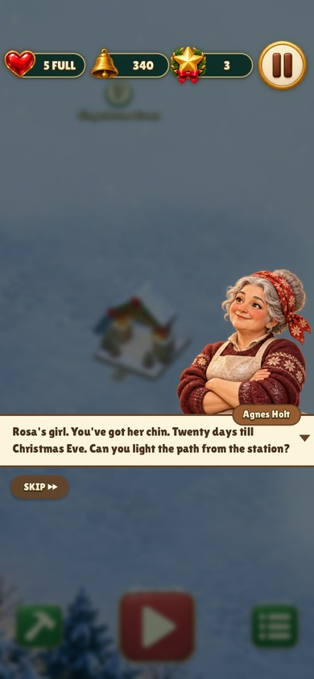
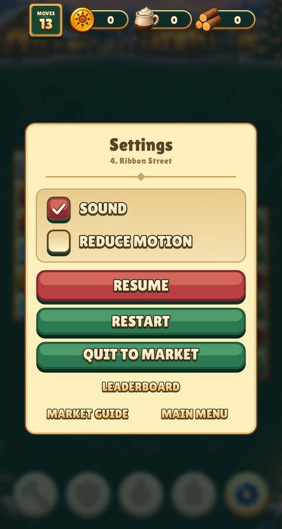
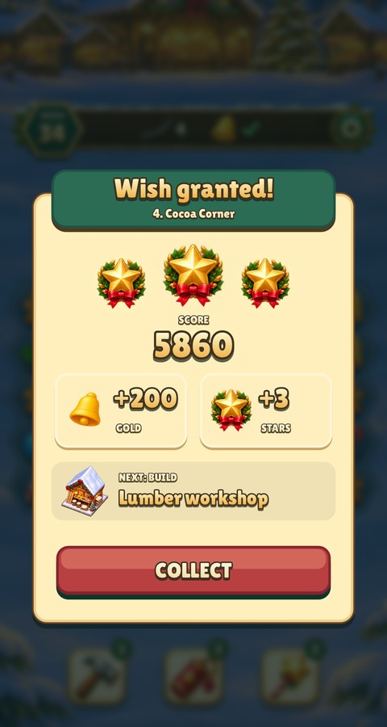
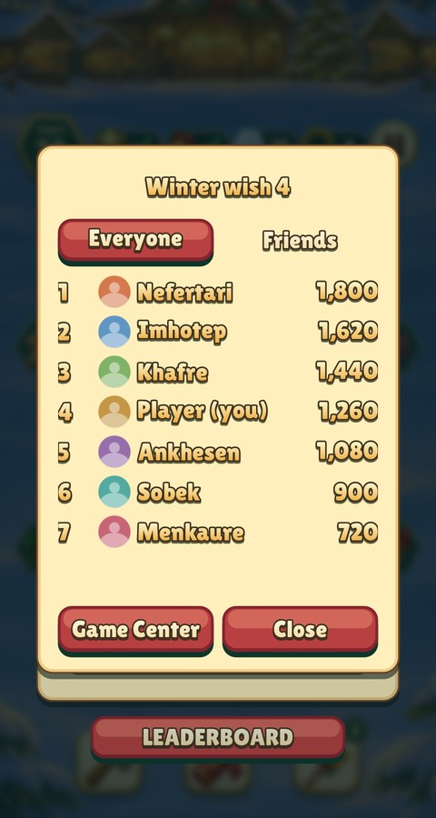

# Christmas Market

From the repository root, `make -C games/christmas-market ios` builds, signs,
installs and launches on the connected iPhone (or iPad when no iPhone is
available). Set `DEVICE="name or UDID"` to choose one. See the
[device deployment guide](../../tools/xcode/README.md#deploy-to-a-connected-iphone-or-ipad).

An in-progress Christmas market game based on Relic Rush's hex straight-line match-3 and free-placement city systems. Its 37 buildings and decorations are modelled and rendered in Blender after the building direction sheet. See the [building catalogue](docs/building-catalogue.md).

The [reference sheet](art/building-reference-sheet.png) covers ten campaign buildings: Welcome arch, Lumber workshop, Gingerbread bakery, Hot cocoa kiosk, Toymaker's workshop, Gift wrapping pavilion, Candlelight shop, Reindeer carousel, Winter skating rink and Christmas tree. Lantern firs and Snowman bench are repeatable decorations. The build shop adds 25 more objects in four tabs (Decorations, Snowy trees, Cottages): snowmen, presents, a sleigh, reindeer, an igloo, a chapel, a log cabin, Santa's workshop and more.

Direction: snow-covered timber and cream plaster, evergreen garlands, red ribbons, warm amber windows and lights, cool blue snow, readable isometric silhouettes. The Blender models resolve perspective and footprints exactly. The renders can still guide an ImageGen repaint ([#34](https://github.com/corepunch/nile-archive/issues/34)).

The original transparent building atlas and the labeled reference sheet are preserved in `art/`. Built-in ImageGen produced the artwork. Exact generation prompts are in `art/prompts.json` and `art/reference-sheet-prompt.txt`.

The supplied portrait is now the identity reference for Noelle, the main character (`art/noelle-reference.jpg`). Her transparent cutout is used in dialogue. Her [portrait app icon](art/app-icon-1024.png) is installed in the iOS/macOS `AppIcon` catalogue; its opaque square master leaves corner masking to the OS. `python3 games/christmas-market/tools/prepare_character.py` reproduces the portrait resize and all icon sizes. Built-in ImageGen prompts are in `art/character-and-icon-prompts.json`.

Building popup images and resource icons follow the panel’s entrance scale,
position and opacity through the shared form skin.

Haptics accompany matches, tools, cascades, trickling landings,
results, income collection and confirmed building placement/relocation. Dragging
and previews stay silent. See the [shared haptics contract](../../docs/HAPTICS.md).

Each of Bellmere's thirty winter wishes asks you to light every red pane.
Cleared panes glow amber. Tinsel ties protect treats for one hit and contribute
to the goal only when they cover a red pane. The lamps lead from the market
arch to Agnes's bakery and along the station walk for Pip's mum. See the
[board progression](docs/board-progression.md) and [story](docs/story.md).

Mrs Alder sets aside a cup of cocoa for the next person who comes in cold.
The guests who share it return with lamps when the wind takes the lights out.
The same market goods appear on the board, from gingerbread at the bakery to
a bright blue mitten that recalls Pip's knitting.

On the first clears of A Ribbon for Home, Word from the Station and The Last Train,
the lit board gives way to a full-board painting and the next scene.
[Story paintings and board captures](docs/asset-catalogue.md#story-floors).

## Shared match engine and atlas

Swap adjacent treats or tap two neighbors to match three or more along a hex
axis. Hammer hits one cell, Firecracker hits a cell and its six neighbors, and
Star Wand hits all treats of the chosen kind. The [engine match-3 module](../../docs/MATCH3_ENGINE.md)
owns swaps, blockers, trickling gravity, cascades, hints, tools and timing.
The game supplies the boards, artwork and straight-match rules.

The puzzle and town use the same wallet and Pause button. The remaining moves
are shown below the wallet on the puzzle. The muted red panes mark the objectives. Spruce faces meet at
hairline seams, and cleared panes turn honey amber. Pause opens
the Market Keeper's Guide alongside Sound and Reduce Motion.
[Board palette and guide screenshots](docs/screenshots/review/spruce-palette/README.md).

`data/match3.png` holds the puzzle backdrop, pieces, blockers and effects.
The HUD and tool controls use `data/match3-hud.png`. Run
`python3 tools/match3_atlas.py` to rebuild the two atlases. The three lantern
panes are drawn by the game from skin colours over a generated grain
(`data/board-grain.png`, made by `tools/board_grain.py`).
[Asset catalogue](docs/asset-catalogue.md#lantern-panes).

The market keeps Relic Rush's bottom controls in its own skin: Build (the
shop) in the left corner, Play in the right and the winter wishes medallion
between them. A placement shows Cancel and Confirm beside the building. Snow
falls over the village and moves with it when you pan. Dialogue stands the
speaker (and listener) on a full-width bubble in the middle of the screen.

Building bases need one tile of open ground between them. During placement,
cream guides include that clearance and disappear behind buildings that cover
them. Debug `--footprints` shows the full outline over
each sprite. See the [placement captures](docs/review/placement-guides/README.md).

## Draft implementation

Matches earn **Gold** from bells, **Treats** from candy canes and
gingerbread, and **Supplies** from holly, mittens and baubles. Each win
banks the resources and awards up to 40 Gold for the moves left. Three
Christmas Stars come with each first clear and open more land and shop items.
The town and board share the same wallet. On the board it shows the current
attempt's earnings as you play.

Story stalls draw from those same balances. Neighbors make up any shortfall
on the first clear that earns a stall, and the shop reserves its cost until
you build. A 20-Gold lamp post also takes 4 Supplies. [Full price list](docs/building-catalogue.md).

A failed wish uses a life. One returns every 30 minutes up to five.
Snow drifts over the village behind the controls. Reduce Motion keeps the
flakes still.

`make run-christmas-market` launches the native draft. `--showcase` previews the ten buildings; `--level 4` previews a Christmas puzzle. It has an independent `christmas-market` save namespace. The draft opens on the snowy market and has thirty puzzles in three story episodes, funded construction, player-chosen placement, land expansion, a resource shop and Noelle's dialogue. Native macOS and iOS project files are included.

The build shop and Winter Wishes scroll continuously. Swipe inside either list or
use the mouse wheel. The shop shows three cards per row and keeps its category
arrows. Winter Wishes opens near the current puzzle. Both screens share row
templates with Relic Rush.

Pause offers Resume, Restart (it asks first) and Quit to the market, which
keeps the unfinished board for LEVEL or Winter Wishes. Popups open and close
at once. With no lives left, Try Again waits and says when one returns.

The game is the same as Relic Rush with other data and art
([docs/PORTRAIT_GAMES.md](../../docs/PORTRAIT_GAMES.md)): every word of the
shared screens is in [`data/game.json`](data/game.json), and the flow, dialogs,
shop, level list, effects and debug entry points are the engine's
(`engine/match3_game.lua`). `lua/board.lua` and `lua/screens.lua` paint only
the market's own art: cells, treats, the results card and guide icons.

The interface look (text palettes, panels, the red buttons and their states, focus) is data in [`lua/skin.lua`](lua/skin.lua), compiled by the engine's `ui.skin`; see [skin files](../../docs/UI_ENGINE.md#skins).

Board, HUD and character art is spatially extracted by `python3 games/christmas-market/tools/prepare_assets.py`. Buildings are rendered by `tools/render_buildings.py` and imported by `tools/prepare_catalogue.py`. See the [asset catalogue](docs/asset-catalogue.md) and the [building catalogue](docs/building-catalogue.md).

## Story

The three-episode script in [docs/story.md](docs/story.md) plays in full: 36 scenes, 198 lines, one per winter wish, from the opening on 4 December to "To be continued" at level 30. Stalls are built at levels 1, 4, 7, 9, 13, 16, 19, 23, 26 and 29. On six wishes, one chip kind becomes a story object for that board. The first clear brings the object back to Bellmere. Most levels without a stall play their scene when you return to the market. Levels 24, 25 and 28 play theirs after the board painting and before Collect. Scenes play once per save, on the first clear, and a scene is only marked seen once it finishes or is skipped. Regions open at levels 6, 9, 15, 21 and 27, each announced by Pip, and tapping a building can show a line that changes as the story moves on. Saves from the ten-level game keep every stall and open episode two with a short recap.

`lua/story_content.lua` is compiled from the script by `python3 games/christmas-market/tools/prepare_story.py`; `--check` catches drift in `make test`. `lua/journey.lua` holds the stall schedule, recap and changing tap lines as data; `lua/narrative.lua` holds the cast. The engine (`engine/match3_game.lua`) keeps the checkpoints and plays the scenes. Preview any scene with `--story-beat before-11`, or `--story-beat after-30 --story-line 15`, and `--frames 240` for fully typed text. All six speakers use painted busts. Sources and export commands are in the [asset catalogue](docs/asset-catalogue.md#story-cast). Review captures are in [docs/review/story](docs/review/story/README.md).

## Review and validation

| Snowy market | Festive puzzle | Noelle |
| --- | --- | --- |
|  |  |  |

Run `make CFLAGS="-O2 -g -Werror"`, `make test`, and `./build/christmas-market --headless --fresh --mute --smoke` (under Xvfb on Linux). The smoke test uses the shared `city.move_test` for building gestures and covers real clicks through a puzzle win, funded construction, pan/hold/move/cancel/confirm, decoration purchase/cancellation, replay, pause and the next level. A separate Lua campaign test verifies all ten building grants fit the land open by their levels, each region opens on the level Pip announces it, and both decoration purchases preserve campaign progress. Its extended run (`make test-extended`) requires the greedy bot to win every one of the thirty levels at least once without tools. `rules christmas_story` follows every first clear through the story scheduler, interruption, save/read, replays and old-save migration. `--smoke --campaign` plays all thirty levels through the real result, Collect, region, stall card, placement, dialogue and Play controls. Each board's goals are met before one real swap, so it checks the flow rather than the boards. All 36 scenes must play once, in script order, and the run must end on the end screen with ten stalls and every region open. It takes about 35 seconds and runs in `make test-full` (CI), or alone with `build/test/christmas-market "smoke campaign"`.

## Leaderboards

Game Center comes from the engine ([docs/GAMECENTER.md](../../docs/GAMECENTER.md)) and is switched on by the
`leaderboard` block of `data/game.json`: a **stars** board for the lifetime Christmas Stars (never spent)
and one board per winter wish (`level_01` to `level_30`) for its best score. Scores are reported when a
reward is claimed. Settings has a LEADERBOARD link for the stars board (the results card has no leaderboard
button); it opens the shared dialog in this game's red and green skin. Create 31
leaderboards in App Store Connect (high to low) as `com.corepunch.christmasmarket.stars` and
`com.corepunch.christmasmarket.level_01` ... `level_30`. Try it with `--gamecenter-demo --dialog leaderboard`.

| Settings | Merriest markets | Results card | Winter wish board |
| --- | --- | --- | --- |
|  |  |  |  |

`python3 games/christmas-market/tools/check_assets.py` verifies the 125-file runtime inventory (five of them temporary name-card busts), 37 buildings, all forty authored atlas crops and eleven native icon slots. `python3 games/christmas-market/tools/capture_screenshots.py` reproduces the review captures; pass names such as `market phone-market` to capture a subset. Use `xvfb-run -a` on Linux. CI also builds the iOS Simulator target and the WebAssembly game.

## Fast rule tests

Run `make test-christmas-market` from the repository root for this game's tests in one command. The Lua suites use deterministic state injections and need no window or artwork. See [the testing guide](../../docs/TESTING.md) for coverage, test-only `ENGINE_TEST` hooks, extended samples and renderer smoke checks.

Board artwork fills its registered hex slots. In dialogue, portraits face each other and slide into place at the edges of the screen. The same engine layout used by Relic Rush centers the text vertically in the full-width bar. [Dialogue bar captures](docs/review/dialogue-bar/README.md)

The board enters after dialogue with a cell ripple, falling treats, blocker landings and a final light sweep. Tap to skip; reduced motion uses a short fade. See [the engine timeline](../../docs/ENGINE.md#board-entrance).

Dialogs arrive and leave on the engine's motion module: the card eases in while the parts of a result settle on one timeline, which the first tap skips. See [docs/MOTION.md](../../docs/MOTION.md) and the [dialog motion review](docs/review/dialog-motion/README.md).

Placement and move previews show cream ground-footprint guides around the other
buildings, including clearance. Dark contrast edges remain readable on snow.
Guides hide after Confirm/Cancel; the mover's old spot is omitted. See the
[shared review](../../docs/review/city-placement-guides/README.md).

## Town screen

The market is the engine's [shared town screen](../../docs/TOWN.md), laid out by
`data/town.json`. Tapping a building shows its name in a word bubble; holding
it for half a second lifts it to move.

Build and Play use authored winter-market navigation badges with five interaction
states. See [market navigation](docs/asset-catalogue.md#market-navigation) for
the source atlas, state mapping, reproduction and pending capture review.

The town bottom row has a large central Play button and equal smaller Build
and Levels buttons, with simplified authored icons and five interaction states.

For a local story walkthrough, launch `./build/christmas-market --debug-walkthrough`.
Tap **Skip level** at the top right of the board, read any scene, then claim the usual reward.
On the island, **Complete task** places an earned story building or starts the next board.
The walkthrough has its own save. Add `--fresh` to start at the opening without saving.

### Homescapes board mechanics

The shared hex board uses original Homescapes pieces and standalone rockets, bombs, planes and rainbow balls, with the existing animations and effects. See [the complete mechanic and atlas reference](../../docs/HOMESCAPES_HEX.md) for generators, blockers, source previews, verification and known art gaps.

The field uses the market's slate-blue hex palette.

Original blocker artwork now covers nuts, statues, cookie stacks and ceramic tiles, with original components for platters, blinds and visible queues. [Source/state inventory](../../docs/HOMESCAPES_ART.md) records all six original jelly layers, both portal rings, the recovered maker dome and the remaining field artwork.

Imported Homescapes fields fit their active-cell bounds to the phone area between HUD and tools. Source-packed inverted objects are corrected during extraction; see the [before/after review](../../docs/review/homescapes-restored-art/README.md). The donut exit uses the original animated arrow, and the maker uses the original base and glass layer offsets. [Portrait captures](../../docs/review/homescapes-arrow-maker/README.md)
