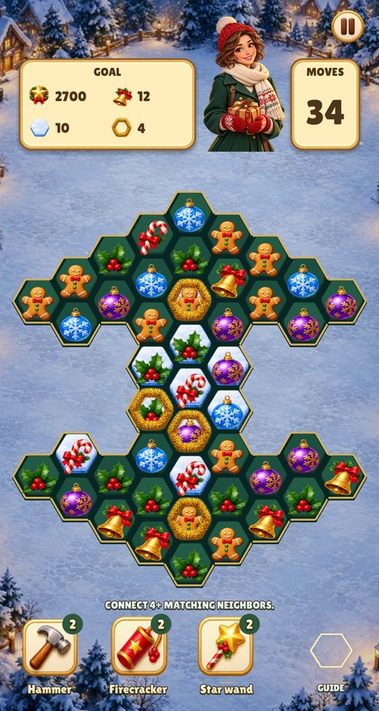
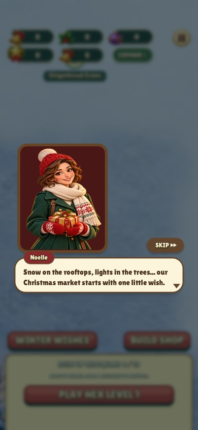
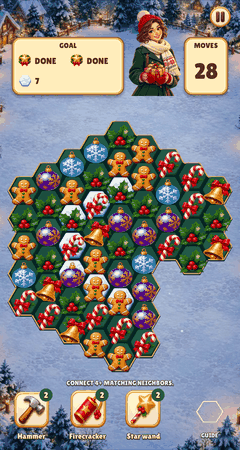

# Christmas Market

From the repository root, `make -C games/christmas-market ios` builds, signs,
installs and launches on the connected iPhone (or iPad when no iPhone is
available). Set `DEVICE="name or UDID"` to choose one. See the
[device deployment guide](../../tools/xcode/README.md#deploy-to-a-connected-iphone-or-ipad).

An in-progress Christmas market game based on Relic Rush's hex match-4 and free-placement city systems. Its 37 buildings and decorations are modelled and rendered in Blender after the building direction sheet. See the [building catalogue](docs/building-catalogue.md).

The [reference sheet](art/building-reference-sheet.png) covers ten campaign buildings: Welcome arch, Lumber workshop, Gingerbread bakery, Hot cocoa kiosk, Toymaker's workshop, Gift wrapping pavilion, Candlelight shop, Reindeer carousel, Winter skating rink and Christmas tree. Lantern firs and Snowman bench are repeatable decorations. The build shop adds 25 more objects in four tabs (Decorations, Snowy trees, Cottages): snowmen, presents, a sleigh, reindeer, an igloo, a chapel, a log cabin, Santa's workshop and more.

Direction: snow-covered timber and cream plaster, evergreen garlands, red ribbons, warm amber windows and lights, cool blue snow, readable isometric silhouettes. The Blender models resolve perspective and footprints exactly. The renders can still guide an ImageGen repaint ([#34](https://github.com/corepunch/nile-archive/issues/34)).

The original transparent building atlas and the labeled reference sheet are preserved in `art/`. Built-in ImageGen produced the artwork. Exact generation prompts are in `art/prompts.json` and `art/reference-sheet-prompt.txt`.

The supplied portrait is now the identity reference for Noelle, the main character (`art/noelle-reference.jpg`). Her transparent cutout is used in dialogue and the puzzle header. Her [portrait app icon](art/app-icon-1024.png) is installed in the iOS/macOS `AppIcon` catalogue; its opaque square master leaves corner masking to the OS. `python3 games/christmas-market/tools/prepare_character.py` reproduces the portrait resize and all icon sizes. Built-in ImageGen prompts are in `art/character-and-icon-prompts.json`.

Building popup images and resource icons follow the panel’s entrance scale,
position and opacity through the shared form skin.

Haptics accompany matches, special activations, cascades, trickling landings,
results, income collection and confirmed building placement/relocation. Dragging
and previews stay silent. See the [shared haptics contract](../../docs/HAPTICS.md).

## Shared match engine and atlas

The [engine match-3 module](../../docs/MATCH3_ENGINE.md) owns all matching,
swaps, blockers, specials, trickling gravity, cascades, hints, tools and board
input/timing. This game provides campaign data, graphics and integer behavior
flags. Every exposed column top (no active cell directly above) spawns gems
vertically. Interior gems fall straight down whenever their cell below is
empty and movable, and slide diagonally only when that cell is occupied,
locked or missing. Locks still route gems around their sides.

All board imagery uses one `data/match3.png` override atlas. The engine embeds
a neutral resource atlas for games without an override; `--default-match3`
previews it. `python3 tools/match3_atlas.py` reproduces both skins while
preserving authored alpha and every control state. See the
[review captures](docs/review/trickling/README.md).

## Draft implementation

`make run-christmas-market` launches the native draft. `--showcase` previews the ten buildings; `--level 4` previews a Christmas puzzle. It has an independent `christmas-market` save namespace. The draft opens on the snowy market and has ten puzzles, funded construction, player-chosen placement, land expansion, a shop and Noelle's dialogue. Native macOS and iOS project files are included.

The interface look (text palettes, panels, the red buttons and their states, focus) is data in [`lua/skin.lua`](lua/skin.lua), compiled by the engine's `ui.skin`; see [skin files](../../docs/UI_ENGINE.md#skins).

Board, HUD and character art is spatially extracted by `python3 games/christmas-market/tools/prepare_assets.py`. Buildings are rendered by `tools/render_buildings.py` and imported by `tools/prepare_catalogue.py`. See the [asset catalogue](docs/asset-catalogue.md) and the [building catalogue](docs/building-catalogue.md).

## Review and validation

| Snowy market | Festive puzzle | Noelle |
| --- | --- | --- |
|  |  |  |

Run `make CFLAGS="-O2 -g -Werror"`, `make test`, and `./build/christmas-market --headless --fresh --mute --smoke` (under Xvfb on Linux). The smoke test uses the shared `city.move_test` for building gestures and covers real clicks through a puzzle win, funded construction, pan/hold/move/cancel/confirm, decoration purchase/cancellation, replay, pause and the next level. A separate Lua campaign test verifies all ten building grants fit on the Christmas map and both decoration purchases preserve campaign progress.

`python3 games/christmas-market/tools/check_assets.py` verifies the 82-file runtime inventory, 37 buildings, all forty authored atlas crops and eleven native icon slots. `python3 games/christmas-market/tools/capture_screenshots.py` reproduces the review captures; pass names such as `market phone-market` to capture a subset. Use `xvfb-run -a` on Linux. CI also builds the iOS Simulator target and the WebAssembly game.

## Fast rule tests

Run `make test-christmas-market` from the repository root for this game's tests in one command. The Lua suites use deterministic state injections and need no window or artwork. See [the testing guide](../../docs/TESTING.md) for coverage, test-only `ENGINE_TEST` hooks, extended samples and renderer smoke checks.

Board artwork fills its registered hex slots. Dialogue portraits slide/fade in and out, and only brighten/dim on speaker changes; no resizing, rotation or idle wobble; the engine owns those transitions. See [motion review](../../docs/review/motion/README.md).

The board enters after dialogue with a cell ripple, falling treats, blocker landings and a final light sweep. Tap to skip; reduced motion uses a short fade. See [the engine timeline](../../docs/ENGINE.md#board-entrance).

Dialogs arrive and leave on the engine's motion module: the card eases in while the parts of a result settle on one timeline, which the first tap skips. See [docs/MOTION.md](../../docs/MOTION.md) and the [dialog motion review](docs/review/dialog-motion/README.md).

