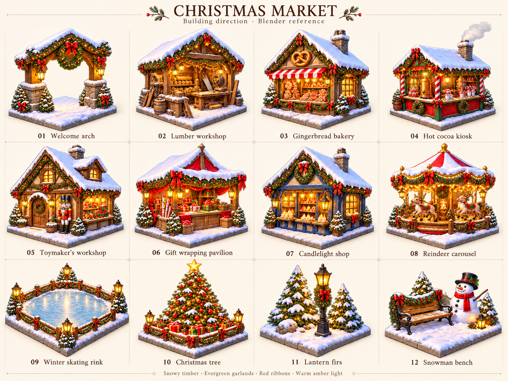

# Christmas Market

An in-progress Christmas market game based on Relic Rush's hex match-4 and free-placement city systems. The building artwork is a direction study pending a Blender scene and rendered image; this PR preserves the playable prototype and approved character/icon work.

The reference sheet covers ten campaign buildings: Welcome arch, Lumber workshop, Gingerbread bakery, Hot cocoa kiosk, Toymaker's workshop, Gift wrapping pavilion, Candlelight shop, Reindeer carousel, Winter skating rink and Christmas tree. Lantern firs and Snowman bench are repeatable decorations.

Direction: snow-covered timber and cream plaster, evergreen garlands, red ribbons, warm amber windows and lights, cool blue snow, readable isometric silhouettes. The paintings establish mood and building identity. Perspective and footprints will be resolved using the supplied Blender scene, then the renders will guide a repaint.

The original transparent building atlas and the labeled reference sheet are preserved in `art/`. Built-in ImageGen produced the artwork. Exact generation prompts are in `art/prompts.json` and `art/reference-sheet-prompt.txt`.

The supplied portrait is now the identity reference for Noelle, the main character (`art/noelle-reference.jpg`). Her transparent cutout is used in dialogue and the puzzle header. Her [portrait app icon](art/app-icon-1024.png) is installed in the iOS/macOS `AppIcon` catalogue; its opaque square master leaves corner masking to the OS. `python3 games/christmas-market/tools/prepare_character.py` reproduces the portrait resize and all icon sizes. Built-in ImageGen prompts are in `art/character-and-icon-prompts.json`.

## Draft implementation

`make run-christmas-market` launches the native draft. `--showcase` previews the ten buildings; `--level 4` previews a Christmas puzzle. It has an independent `christmas-market` save namespace. The draft opens on the snowy market and has ten puzzles, funded construction, player-chosen placement, land expansion, a shop and Noelle's dialogue. Native macOS and iOS project files are included.

Runtime art is spatially extracted by `python3 games/christmas-market/tools/prepare_assets.py`. Sources and registration are retained for replacement after the Blender pass. The Blender replacement and final footprint registration are tracked in [#34](https://github.com/corepunch/nile-archive/issues/34). See [asset catalogue](docs/asset-catalogue.md).

## Review and validation

| Snowy market | Festive puzzle | Noelle |
| --- | --- | --- |
|  |  |  |

Run `make CFLAGS="-O2 -g -Werror"`, `make test`, and `./build/christmas-market --headless --fresh --mute --smoke` (under Xvfb on Linux). The smoke test uses the shared `city.move_test` for building gestures and covers real clicks through a puzzle win, funded construction, pan/hold/move/cancel/confirm, decoration purchase/cancellation, replay, pause and the next level. A separate Lua campaign test verifies all ten building grants fit on the Christmas map and both decoration purchases preserve campaign progress.

`python3 games/christmas-market/tools/check_assets.py` verifies the 57-file runtime inventory, twelve buildings, all forty authored atlas crops and eleven native icon slots. `python3 games/christmas-market/tools/capture_screenshots.py` reproduces the review captures; pass names such as `market phone-market` to capture a subset. Use `xvfb-run -a` on Linux. CI also builds the iOS Simulator target and the WebAssembly game.
