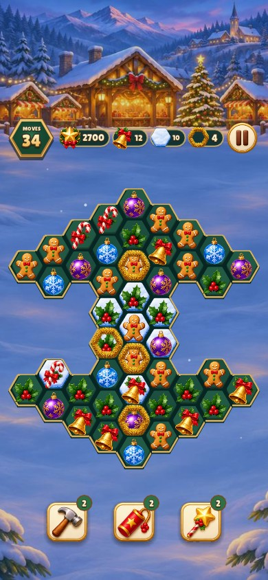
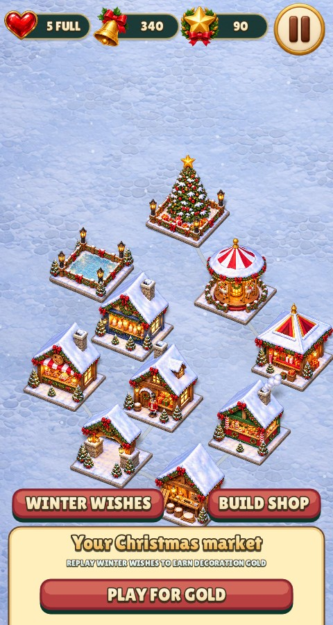
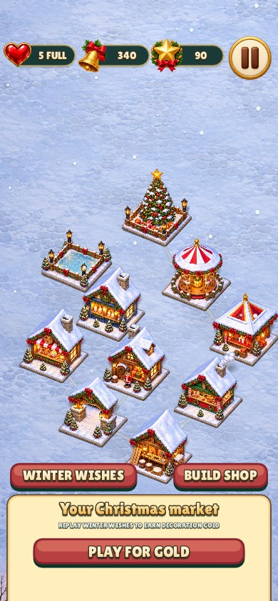
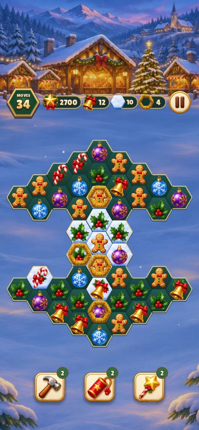
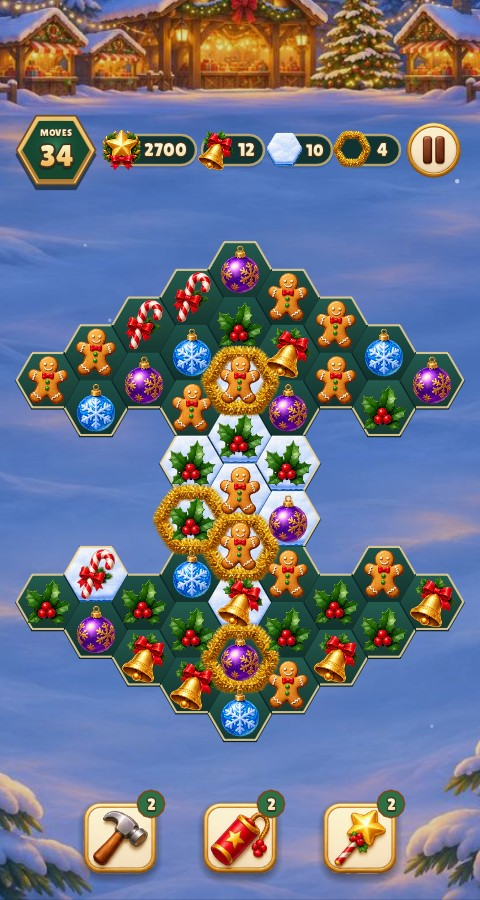
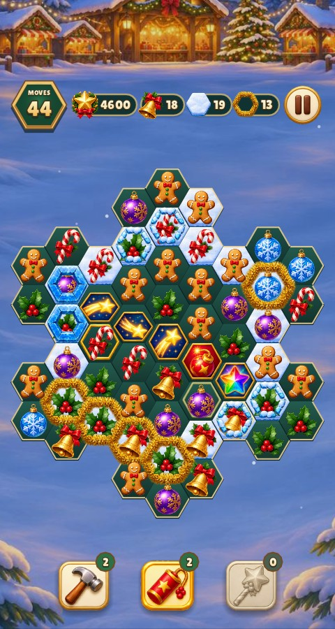

# Christmas art direction catalogue

## Title screen

The painting of Bellmere at blue hour leads into the campaign. Built-in
ImageGen produced the [941 × 1672 source](../art/menu/source.png) from the
[recorded prompt](../art/menu/prompt.txt). The game loads
`data/menu/bellmere.jpg` as a centered full-bleed crop, with one static state.
The title and subtitle are live Lilita One text. Continue, Visit Market and
Settings use the skin's existing primary and link controls across normal,
pressed, hover, keyboard focus and disabled states. Visit Market appears when
the campaign has a clear and Continue leads to a playable board.

Re-encode the source with
`python3 -c "from PIL import Image; Image.open('art/menu/source.png').convert('RGB').save('data/menu/bellmere.jpg', quality=89, optimize=True)"`
from this game's folder. Reviewed captures at [480 × 900](screenshots/main-menu.jpg)
and [390 × 844](screenshots/main-menu-phone.jpg), with [Settings](screenshots/main-menu-settings.jpg).

## Construction backdrops

The campaign's board shows the latest confirmed construction with a painting
for that wish. On the first visit to a newly unlocked backdrop, the full
portrait holds for 0.9 seconds before the board arrives. Both states use the
same painting. Roofs, garlands and foreground props frame the cells. The
9:20 portraits keep their full width on tall iPhones. Shorter screens crop
vertically with the window biased upward to keep the rooflines in view.

| Runtime file in `data/board/backs/` | First eligible wish | Construction | Source panel |
| --- | ---: | --- | --- |
| `bellmere-opening.jpg` | 1 | Opening square | First from left |
| `welcome-arch.jpg` | 2 | Welcome Arch | Second |
| `reindeer-stable.jpg` | 7 | Reindeer Stable | Third |
| `lumber-workshop.jpg` | 12 | Lumber Workshop | Fourth |
| `firework-stall.jpg` | 17 | Firework Stall | Purchases 4–7, panel 1 |
| `gingerbread-bakery.jpg` | 22 | Gingerbread Bakery | Purchases 4–7, panel 2 |
| `snowy-chapel.jpg` | 27 | Snowy Chapel | Purchases 4–7, panel 3 |
| `hot-cocoa-kiosk.jpg` | 32 | Hot Cocoa Kiosk | Purchases 4–7, panel 4 |
| `ice-house.jpg` | 37 | Ice House | Purchases 8–11, panel 1 |
| `lakeside-smokehouse.jpg` | 42 | Lakeside Smokehouse | Purchases 8–11, panel 2 |
| `station-kiosk.jpg` | 47 | Station Kiosk | Purchases 8–11, panel 3 |
| `toymakers-workshop.jpg` | 52 | Toymaker’s Workshop | Purchases 8–11, panel 4 |
| `candlelight-shop.jpg` | 57 | Candlelight Shop | Purchases 12–14, panel 1 |
| `gift-wrapping-pavilion.jpg` | 62 | Gift Wrapping Pavilion | Purchases 12–14, panel 2 |
| `north-pole-post-office.jpg` | 67 | North Pole Post Office | Purchases 12–14, panel 3 |
| `glassblowers-stall.jpg` | 72 | Glassblower’s Stall | Purchases 15–17, panel 1 |
| `reindeer-carousel.jpg` | 77 | Reindeer Carousel | Purchases 15–17, panel 2 |
| `winter-skating-rink.jpg` | 82 | Winter Skating Rink | Purchases 15–17, panel 3 |
| `woodcarvers-hall.jpg` | 87 | Woodcarvers’ Hall | Purchases 18–20, panel 1 |
| `christmas-tree.jpg` | 92 | Christmas Tree | Purchases 18–20, panel 2 |
| `santas-sleigh.jpg` | 97 | Santa’s Sleigh | Purchases 18–20, panel 3 |

Built-in ImageGen painted the four scenes together in the
[initial landscape strip](../art/construction-backdrops/wide-source.png), using the
[scene prompt](../art/construction-backdrops/wide-prompt.txt) and two Cradle of
Rome 2 paintings as composition references. A single
[vertical extension pass](../art/construction-backdrops/prompt.txt) produced the
[initial phone strip](../art/construction-backdrops/source.png).
The [framing pass](../art/construction-backdrops/framed-prompt.txt) used that strip
and the [gameplay concept sheet](../art/construction-backdrops/framing-concept.png)
to produce the [final 1683 × 935 strip](../art/construction-backdrops/framed-source.png).
ImageGen used that final strip as the style reference for five subsequent
[JPEG strips and their prompts](../art/construction-backdrops/) of three or
four paintings each. The [art manifest](../art/manifest.json) records the
source and exact crops for every JPEG. The game loads each scene by name on
first use and keeps it for the rest of the session.
The selection follows the building's existing unlock gate in `lua/economy.lua`.
See the [in-game comparisons and reveal](screenshots/review/construction-backdrops/README.md).

Re-encode the crops from the repository root with Pillow.

```sh
python3 - <<'PY'
import json
from pathlib import Path
from PIL import Image

game = Path("games/christmas-market")
spec = json.loads((game / "art/manifest.json").read_text())["construction_backdrops"]
for frame in spec["frames"].values():
    source = spec["batches"][frame["batch"]]["source"] if "batch" in frame else spec["source"]
    with Image.open(game / source) as sheet:
        sheet.crop(frame["crop"]).convert("RGB").save(
            game / frame["runtime"], quality=91, optimize=True
        )
PY
```

## Square board

The board casts a soft shadow from the full layout of its active cells. The
shadow follows the stepped frame and cutouts and fades in with the frame.
The [before and after captures](screenshots/review/board-shadow/comparison.jpg)
show it at both phone sizes.

The current campaign uses honey maple, frosted teal panes and olive-green
double panes. The [plain maple tile](../art/square-frame/maple-floor.png)
preserves the 128 × 128 paint edit from commit `b6e8c11e`. The packer places
it at native size in the `square-plain` frame. Aged oak forms a narrow rail with rounded outside caps and
bare or leafy inside joins. Built-in ImageGen painted eight original rail
profiles and a holly sprig together in one [transparent sheet](../art/square-frame/variants.png)
from the [recorded prompt](../art/square-frame/prompt.txt).
The [style file](../art/square-frame/styles.json) selects the first profile.
The registrar trims the painted ends, scales the selected profile to
128 × 17 px, blends its ends across six pixels for continuous straight runs,
then wraps the cross-section around the same perimeter masks as Relic Rush.
The sprig is cropped and scaled proportionally and baked into eligible
inside-corner modules. The [atlas registration](../art/match3-atlas.json)
records the exact source crops and offsets. All perimeter modules pack into
`data/board/cells.png`. The [review and reproduction commands](square-match3.md#modular-perimeter)
cover all eight profiles and native views of the selected frame.

## Themed board art

The live campaign uses [the Market goods atlas](#market-goods-and-tools) and
shares the original light-blue mitten with the earlier festive previews.

| Runtime frames | Rule and artwork |
| --- | --- |
| `festive-0` through `festive-5` | Bell, candy cane, holly, knitted mitten, bauble and gingerbread, in atlas order. |
| `booster-star-icon`, `booster-firework-icon` | A turquoise star for a kind clear and three bundled indigo crackers for a 3×3 burst. Both use the matching piece on the toolbar. |

ImageGen painted all six market goods in one [transparent atlas](../art/festive-pieces/source.png)
using the [prompt](../art/festive-pieces/prompt.txt) and
[3×2 layout guide](../art/festive-pieces/layout.png). The atlas packer crops
the six 512 px bays and fits the artwork to the canonical 128 px canvas with
its authored alpha. Each chip uses the same artwork when moved, selected or
hinted. The board animates the pose and uses its existing authored selection,
hint and chain overlays. The [registration manifest](../art/match3-atlas.json)
records the crop and fitted size per chip. Rebuild the `data/board/` atlases with
`python3 tools/match3_atlas.py`.
[Live board and state captures](screenshots/review/market-wishes/README.md).

The [earlier base sheet](../art/board-theme/source.png) and
[accent revision](../art/board-theme/accent-revision.png) document the first
festive palette. The base sheet remains the source for certain reference elements.
[Earlier in-game art review](screenshots/review/board-palette/README.md).

The [retired power-up paintings](screenshots/review/power-up-paint/README.md)
and [Scener models](screenshots/review/scener-power-ups/README.md) document
earlier artwork.

The [edge-mounted hex chains](../../../art/match3-chain-paint/README.md) are retained as legacy previews. [Earlier in-game comparisons](screenshots/review/chain-anchors/README.md).

| Runtime frame in `data/board/blockers.png` | Square state |
| --- | --- |
| `chain-square-1` | One hit left, single silver chain, beveled edge and cast shadow. The Market Keeper's Guide uses this frame. |
| `chain-square-2` | Two hits left, crossed silver chains, beveled edge and cast shadows |
| `ice-square-1` | One hit left, borderless faceted frost with the upper part broken away |
| `ice-square-2` | Two hits left, full borderless frost with diagonal facets |
| `stone-1` | Carved square stone. One adjacent match or direct tool hit clears it. |

Ice is available in board diagnostics. Both games use the same [painted square
blocker sheet and registration](../../../art/match3-square/README.md#blockers).
[Board, guide and particle captures](square-match3.md#blockers-and-target-hints).


The [original hex surfaces](../../../docs/review/match3-elements/README.md)
document earlier board states.


## Campaign board header

The centered, display-only row contains Moves, Tokens, Treats and Materials.
Pending earnings appear in the counters and matched resources fly to their
icons. The board is centered vertically, with four boosters and Pause in
one bottom row. The town shows the resource wallet above the Build, Play,
Wishes and Pause controls.
Play is the largest control.
[480 × 900 board](screenshots/review/winter-boosters/toolbar-480.jpg) · [390 × 844 board](screenshots/review/winter-boosters/toolbar-390.jpg)

## Campaign booster buttons

The four slots use the [shared enamel painter](../../../art/match3-buttons/README.md).
The [asset manifest](../art/manifest.json) assigns a painted frame to each rank.
The full-color artwork and the disabled inset both use its center of opacity.
The engine fills the meter up to one use. [Eight icons in all five button states](screenshots/review/winter-stalls/bonus-states.jpg).

## Market goods and tools

Built-in ImageGen painted the [4×6 winter stalls atlas](../art/market-goods/winter-stalls.png)
in one pass from the [full atlas prompt](../art/market-goods/winter-stalls-prompt.txt).
The [expanded 4×7 atlas](../art/market-goods/winter-stalls-premium.png) repeats
the full set and paints the three late collectibles together in its final row.
Its [prompt](../art/market-goods/winter-stalls-premium-prompt.txt) references the
first atlas, the Rome II comparison strip and the Relic Rush bonus pieces.
The first atlas's wider gutters make it the source for the main set. Dressed
stone reuses the exact painted Relic Rush piece at column five, row one of
[its campaign atlas](../../relic-rush/art/registered/campaign-pieces.png).
The [vase and winter catch atlas](../art/market-goods/vase-and-winter-catch.png)
supplies the three-cracker Firework, broad ice pendant, cobalt vase and smoked trout.
Its [ImageGen prompt](../art/market-goods/vase-and-winter-catch-prompt.txt)
records the complete atlas edit. The pendant and vase remain archived atlas pieces.
The station clock and ice skates were painted in the built-in
ImageGen [purchase piece strip](../art/market-goods/purchase-pieces.png). The
[prompt](../art/market-goods/purchase-pieces-prompt.txt) and the [registration record](../art/market-goods/registration.json)
record the original alpha and the fitted crops. The station clock adds five
moves and ice skates earn Tokens. The strip's first third is a reindeer head
that stood in for the hammer for a few hours on 20 November; it is retired,
and the stable's charge piece is the Farrier's hammer from the
[winter stalls sheet](../art/market-goods/winter-stalls.png) again. [Live boards, the stall card and all tool button states](screenshots/review/building-rewards/README.md).
`market-1` points to the original light-blue `festive-3` frame from row two,
column one of the [festive atlas](../art/festive-pieces/source.png). The campaign,
guide and festive previews share that single registered sprite. The corresponding
bay in the market goods sheet is reserved to keep the other source positions.
[Review the mitten and mulled wine in play](market-pieces.md#in-game-review).
The gold Sun coin uses the first cell of the [Relic Rush campaign atlas](../../relic-rush/art/registered/campaign-pieces.png).
The board, wallet, prices and results all use this shared artwork.
[Compare the coin on the opening board and price card](market-pieces.md#shared-sun-coin-review).
The [registration record](../art/market-goods/registration.json) saves each
source crop, proportional fit, offset and alpha-weighted center in its 128 px
slot. The crop takes the object's solid bounds with four pixels of edge
padding. The fit preserves source alpha inside the square cell's 9 px inset.
Opacity-centered crops align within half a pixel on both axes. The snowy fir
(`market-0`) and the frost shield (`booster-shield-icon`) center on the visible
silhouette, keeping opposite margins equal to within one pixel: the shield's
heavy upper half pulled its opacity center down, so it sat 3 px low. The
registration translates the already fitted art and preserves its size and
painted alpha (`silhouette_centered` in `art/manifest.json`).

| Shield on the board (wish 37) | Before | After |
| --- | --- | --- |
| 480 × 900 | [3 px low](screenshots/review/shield-centre/before-480.jpg) | [Centered](screenshots/review/shield-centre/after-480.jpg) |
| 390 × 844 | [3 px low](screenshots/review/shield-centre/before-390.jpg) | [Centered](screenshots/review/shield-centre/after-390.jpg) |

Toolbar buttons anchor on each icon's recorded center (`lua/match3_skin.lua`),
so the shield button itself does not move.

| Atlas slot | Piece | Dominant color | Role |
| ---: | --- | --- | --- |
| 0 | Snow-dusted fir | Evergreen | Score at the opening. |
| 1 | Knitted mitten | Light blue with cream knitwork | Opening score piece until the Lumber workshop. Shares the `festive-3` frame. |
| 2 | Silver snowflake coin | Silver | +3 Tokens. |
| 3 | Sun coin | Gold | +5 Tokens and the Tokens wallet icon. Shared artwork with Relic Rush. |
| 4 | Bundled pine | Chestnut brown | +5 Materials from the lumber workshop and the Materials wallet icon. |
| 5 | Farrier's hammer | Forged steel and ash handle | +3 charge on the stable's single-cell blow. `market-5` on the board and `booster-hammer` on the card and toolbar. |
| 6 | Toy blocks | Honey wood | +6 Tokens from the later Toymaker's workshop. |
| 7 | Gingerbread man | Baked brown with ivory icing | +4 Treats from the bakery. |
| 8 | Mulled wine | Cranberry | +3 Treats from the Welcome arch. |
| 9 | Wrapped gift | Ruby red and cream | +7 Tokens from the later wrapping pavilion. |
| 10 | Candle lantern | Black iron and amber | +3 Lightning charge from the later Candlelight shop. |
| 11 | Hot cocoa | Ivory and chocolate | +5 Treats from the cocoa kiosk and the Treats wallet icon. |
| 12 | Dressed stone | Slate gray | +7 Materials from the chapel. |
| 13 | Ice pendant | Sapphire blue | Archived. |
| 14 | Glass bauble | Amber gold | +8 Tokens from the Glassblower's stall. |
| 15 | Candy cane | Red and ivory | Score until the Welcome arch. |
| 16 | Firework Bomb | Midnight indigo | Three crackers in a brass band. Replaces the hammer and hits a 3×3 square. |
| 17 | Faceted star | Turquoise | Replaces the lantern and clears the chosen kind. |
| 18 | Frost shield | Fir green and pewter | Hits the chosen row. |
| 19 | Wish cross | Copper orange | Replaces the shield and replenishes a resource or part of another charge. |
| 20 | Station clock | Brass, ivory and navy | Adds five moves. `booster-hourglass-icon` on the board and `booster-clock` on the card and toolbar. |
| 21 | Wind-up top | Royal blue and brass | Replaces the station clock and shuffles the pieces. |
| 22 | Pretzel | Baked amber | Archived. |
| 23 | Ice skates | Burgundy leather and silver | +9 Tokens from the rink. `market-17` on the board and card. |
| 24 | Carved reindeer | Walnut | +10 Tokens from Woodcarvers' hall. |
| 25 | Santa hat | Crimson and ivory | +11 Tokens from Santa's sleigh. |
| 26 | Winter vase | Cobalt glaze | Archived. |
| 27 | Smoked trout | Russet | +6 Treats from the Lakeside smokehouse. |

`python3 games/christmas-market/tools/prepare_market_goods.py` registers the
source crops. `python3 tools/match3_atlas.py` packs `art/registered/market-goods.png`
into `data/board/pieces.png` as
`market-0` through `market-21` and six named `booster-*-icon` frames, with
`market-1` sharing the packed `festive-3` frame. Each base
sprite is used for idle, swap and clear, with the game's selection and hint
overlays and authored tinsel and ice. The eight charging pieces each sit on
the shared enamel face in normal, selected, pressed, hover and disabled states.
The wallet, prices and results share the three currency icons.
[Native board, construction and artwork captures](market-pieces.md#in-game-review).

Live pieces draw their 128 px canvas at 106% of the cell step. The square
registration retains the corners for diagonal tools and keeps silhouettes
inside a cell at the maximum selection scale. The
[size review](square-match3.md#piece-size) shows the live result.

```sh
python3 games/christmas-market/tools/prepare_market_goods.py
python3 tools/match3_atlas.py
python3 games/christmas-market/tools/prepare_market_goods.py --check
```

## Story pieces

Six authored images appear on the first-clear results card. The finds
belong to wishes 9, 16, 19, 24, 25 and 27. The card pulls the matching
picture from `art/registered/story-pieces/`. The [manifest](../art/manifest.json)
records the original ImageGen sheet, prompt, bays, wishes and runtime PNGs.
Reproduce the exports with
`python3 games/christmas-market/tools/prepare_story_pieces.py`. The
[letter result](screenshots/review/cradle-market/letter-result-390.jpg)
shows the picture together with that wish’s three earnings.

## Puzzle backdrop

The [game-screen concept](../art/lantern-panes/concept.png) was generated from
the real festive chips, story pieces and a rendered story board. Its palette
guides the [master dusk painting](../art/lantern-panes/spruce-backdrop.png)
and the three playing surfaces. Snow, fir boughs and amber stall lights frame
a quiet green playing area. The game anchors the scene at the bottom and
crops from the top according to the phone's proportions.

The [background prompt](../art/lantern-panes/spruce-backdrop-prompt.txt) and
output recipe are in the [manifest](../art/manifest.json). From the repository
root, run `python3 games/christmas-market/tools/prepare_assets.py --backdrop`
to fit the painting to a 600×900 JPEG, then `python3 tools/match3_atlas.py`
to pack it. [Before and after on both phone sizes](screenshots/review/spruce-palette/README.md).

## Story floors

The paintings appear on first clears as the pieces fade away over 0.6 seconds.
The image holds for 1.2 seconds before the scene. Reduce Motion shows the
image without the fade. During play and on replays the board shows its regular
tablet and parchment states.

| Level | Rule and story | Built-in ImageGen master and prompt | Runtime |
| --- | --- | --- | --- |
| 24, A Ribbon for Home | The last pane gives way to a lantern-lit view of Noelle's childhood wish ribbon. | [Painting](../art/story-floors/wish-ribbon.png), [prompt](../art/story-floors/wish-ribbon.prompt.txt) | `data/story/floors/wish-ribbon.jpg` |
| 25, Word from the Station | The board gives way to Pip's telegram, with his scarf and a stamp beside it. | [Painting](../art/story-floors/telegram.png), [prompt](../art/story-floors/telegram.prompt.txt) | `data/story/floors/telegram.jpg` |
| 28, The Last Train | A slowly arriving train and lamps in the snow lead into Pip's reunion. | [Painting](../art/story-floors/last-train.png), [prompt](../art/story-floors/last-train.prompt.txt) | `data/story/floors/last-train.jpg` |

The three 1190×1322 RGB masters are downsampled without cropping to fit 720×800
with Lanczos, then encoded as JPEG (quality 91, 4:4:4, optimized). Reproduce
from the repository root with Pillow.

```sh
python3 - <<'PY'
from pathlib import Path
from PIL import Image

game = Path("games/christmas-market")
for master in (game / "art/story-floors").glob("*.png"):
    with Image.open(master) as source:
        image = source.convert("RGB")
        image.thumbnail((720, 800), Image.Resampling.LANCZOS)
        image.save(game / "data/story/floors" / f"{master.stem}.jpg",
                   quality=91, subsampling=0, optimize=True)
PY
```

The renderer center-crops each painting to the active board bounds and uses
the connected board mask. [First-clear review](screenshots/review/lantern-panes/README.md).

## Village snow

Snowfall uses two layers over the village (84 small and 44 large flakes).
Their pattern is anchored to the world origin, so panning carries the flakes
with the market while they keep falling. Larger foreground flakes fall faster,
and both layers fade toward the bottom controls. Reduce
Motion holds the flakes still. The HUD and dialogue draw above the snowfall.

Run `build/test/christmas-market "shot main-character-board" "shot phone-board"
"shot market" "shot phone-market" "shot specials-board"` for both portrait
sizes and a board with blockers and specials.

| View | Before | After |
| --- | --- | --- |
| Board, 480×900 |  |  |
| Board, 390×844 |  |  |
| Village, 480×900 |  |  |
| Village, 390×844 |  |  |

[Board with blockers and specials](screenshots/review/winter-polish/board-specials.jpg)

## Cell and goal alignment

The powder-snow goal uses the full authored sprite. On the board, the renderer
samples its opaque interior and maps it to the exact centre, radius and rotation
of the cell hex. The 128px source rectangle is `18,14,96,95` for Christmas and
`32,35,63,58` for the embedded fallback. The atlas and its source alpha stay intact.
Slate-blue wells shade from light at the top to dark at the bottom. The
spruce `signboard` in `data/board/hud.png` is one static backplate for Moves,
goal counts. Settings is the blue gear at the end of the booster toolbar;
the board never draws a Settings button on the signboard, so none is packed.
The tinsel objective uses a
12% larger icon shifted 2 logical units right, and Lanternlight sits 2 units
farther left. The [ImageGen source](../../../art/match3-signboards/source.png),
[prompt](../../../art/match3-signboards/prompt.txt) and
[atlas registration](../art/match3-atlas.json) document the crop and preserved
alpha. Rebuild with `python3 tools/match3_atlas.py`.
[In-game captures](../../../docs/review/match3-signboards/README.md).

Reproduce with `build/test/christmas-market "shot main-character-board" "shot phone-board" "shot specials-board"`.

| Size | Before | After |
| --- | --- | --- |
| 480×900 |  |  |
| 390×844 |  |  |

[Board with blockers and specials](screenshots/review/cell-and-goals/specials.jpg)

## Tinsel on the cell edge

The board scales the existing `chain` atlas frame around the painted ring's
centreline, measured at 92 × 86 px and centred at (63.5, 59.5) in its 128px
canvas. That line follows the cell perimeter, with gold extending both inward
and outward. The ring draws beneath treats so its overhang leaves adjacent
pieces legible. The goal capsule and guide use the original icon framing.

Reproduce with `build/test/christmas-market "shot main-character-board" "shot phone-board" "shot specials-board"`.

| Size | Before | After |
| --- | --- | --- |
| 480×900 |  |  |
| 390×844 |  |  |

[Adjacent rings among blockers and specials](screenshots/review/tinsel-edge/specials.jpg)

## Striped treats

Line specials (ROW, COLUMN, DIAGONAL) draw the treat itself through
`gfx.image_striped`: four cream bands (`A.stripes` in `lua/art.lua`) at 30°,
90° or 150°, masked to the treat's alpha, exactly as Relic Rush does. The user
asked for stripes instead of shooting stars on 2026-11-09. No new artwork.

## Market navigation

The four town glyphs use painted stone, brass and parchment on the [shared 128 px action icons and enamel faces](../../../art/match3-buttons/README.md).

### Archived painted badges

The **bottom of the town screen** has Build (left), a large Play (center)
and Settings (right). Build and Settings have equal slots; Play is larger and
carries the number of the level it starts as its caption (the skin's `cream`
figure style, set on the `navigation_play` variant). There is no level list:
the `navigation_levels` role and its button were removed. Its `action-levels`
frame is still packed in the pieces atlas, unused. Game boards and
other menus keep their existing controls.

The replacement artwork is deliberately simple: one hammer, one Play triangle,
and one level-list icon, each filling a plain face with a thin rim. No stalls,
roofs, foliage, ribbons, star crests or decorative surrounds. Christmas retains
only a light snow edge; Relic Rush uses jade and amber faces.

Source: `art/navigation/controls.png`, an authored transparent **5×3** atlas;
exact ImageGen prompt: `art/navigation/prompt.txt`; deterministic bounds and
runtime paths: `art/navigation/manifest.json`. Columns are normal, hover,
pressed, selected and disabled; rows are Build, Play and Levels. Pressed faces
are recessed, selected faces have a simple double rim, and disabled icons are
engraved into dull material. All states are authored separately; no runtime
recolouring or procedural icon overlays. Each manifest box is a 324×324
square centred on its atlas column's and row's visible art (the earlier
equal-fifths grid cut the art off-centre and clipped some rims); the row-wide
vertical centre keeps the pressed drop. The crop is scaled evenly into a
160×160 RGBA image under `art/registered/navigation/`, so the visible buttons are
centred in their slots and `town_config.lua`'s `bottom` puts Play's lower edge as
far from the screen edge as Build and Levels are from the sides.

| Role | Runtime state names (all `.png`) |
|---|---|
| `navigation_build` | `build-normal`, `build-hover`, `build-pressed`, `build-selected`, `build-disabled` |
| `navigation_play` | `play-normal`, `play-hover`, `play-pressed`, `play-selected`, `play-disabled` |
| retired with the level list (archived art, no role) | `levels-normal`, `levels-hover`, `levels-pressed`, `levels-selected`, `levels-disabled` |

Reproduce: `python3 games/christmas-market/tools/prepare_hud.py`;
append `--check` to verify exact exported pixels. Runtime inventory and asset
catalogue checks cover the added files. `lua/art.lua` documents all three roles;
`--hud-states` uses the live skin to draw all fifteen states.

**Pending validation:** genuine before/after town captures at 480×900 and
390×844 (safe area 0,47,0,34), plus the existing HUD state shot. Native builds
remain blocked here by missing OpenGL/X11/EGL headers and Xvfb, and Lua lint by
missing `luacheck`. Assets and Lua syntax can be checked independently; no
fabricated game screenshots are supplied. Follow-up tracked by
[#84](https://github.com/corepunch/nile-archive/issues/84). Unpublished review
only; PR publication and merging require user approval.

## Fitted specials and thin tinsel

The bomb, rainbow star, selection and hint use the
same flat-top cell alpha mask. Each authored frame is fitted from its measured
source box in `art/registration.json`. The mask preserves the hollow centres of
selection and hint, and the board draws these frames at the cell face radius.

`art/registered/board-states/chain-board.png` compresses the original tinsel by half on
both sides of its centreline. The board keeps that line on the hex edge and
draws it beneath the treats. The original `chain` frame serves the goal icon
and guide.

Regenerate with `python3 games/christmas-market/tools/prepare_assets.py --board-fit`
and `python3 tools/match3_atlas.py`. Review with
`build/test/christmas-market "shot main-character-board" "shot phone-board" "shot specials-board" "shot guide"`.

| View | Before | After |
| --- | --- | --- |
| Board, 480×900 |  |  |
| Board, 390×844 |  |  |
| Blockers and specials |  |  |

[Fitted art in the Market Keeper’s Guide](screenshots/review/fitted-gold/guide.jpg)

## Lantern panes

The board uses the shared tile set (see the
[Relic Rush catalogue](../../relic-rush/docs/asset-catalogue.md#story-materials)
for all eight). Both games ship identical copies, loaded as `tile-<name>`:

The active [square panes and modular perimeter](square-match3.md#modular-perimeter)
use `square-plain`, `square-target`, `square-double`, `square-grout` and
the `square-frame-*` family. `square-selected` marks the selected cell and
the cells an armed tool can hit. The piece scales up for selection and pulses
for a hint. The [old floor tiles](../../../docs/review/board-tiles/README.md) and
[decorated hex rim](../../../docs/review/board-frame-decorations/front.md)
are archived artwork.

A pane, a double pane's green face or ice shatters when a hit removes it.
The engine cuts that layer's existing tile into shards over billowing smoke
(`engine/lua/match3/shatter.lua`), drawn with the Kenney puff sprites `fx-smoke-0..3`
listed below. The shards are a procedural cut-out with no new states, and Reduce Motion hides it. Capture with
`build/test/all --suite=christmas-market 'reel fx-shatter'`.
[Reviewed frames](screenshots/review/shatter/fx-shatter-480x900.jpg).

## Ice

The [ice archive](../../../art/match3-ice/README.md) records the source,
prompts and portrait captures of the old hex panes. The current ice states
are listed in the square blocker table.

The snow floor (the engine's former `soil` layer) and the snow and ice rims
(`sand-edge`, `ice-1-edge`, `ice-2-edge`) are retired: no screen drew the rims. Their frames
left the atlas. The `art/icons.png` cell for snow keeps its place on the sheet
but is no longer registered. The earlier
[frost-edge review](screenshots/review/frost-edges/after-480x900.jpg) shows the
retired rims.

## Story cast

The original [supporting cast sheet](../art/story-cast.png) used Noelle as its reference. Its prompt is under `story_cast` in [character-and-icon-prompts.json](../art/character-and-icon-prompts.json). The [second ImageGen sheet](../art/new-story-cast.png) adds Mrs Alder, Mr Finch, Mary Larkin and Rosa, using the first sheet and Noelle's cutout for style. [Exact prompt](../art/new-story-cast-prompt.txt) · [Phone review](review/campaign-cast/README.md) · [Issue #110](https://github.com/corepunch/nile-archive/issues/110)

| Character | Runtime | Story cue |
| --- | --- | --- |
| Theo Marsh | `data/story/characters/theo.png` | Tree seller with fir needles, plaid coat and resin-stained gloves |
| Agnes Holt | `data/story/characters/agnes.png` | Baker in a flour-dusted apron with her arms crossed |
| Henrik Strand | `data/story/characters/henrik.png` | Toymaker with white whiskers, leather apron and pencil |
| Pip Larkin | `data/story/characters/pip.png` | Post runner with his satchel and gap-toothed grin |
| Mr Wren | `data/story/characters/wren.png` | Grey-coated sweeper with his broom and tilted head |
| Mrs Alder | `data/story/characters/alder.png` | Plum coat, spectacles and a cocoa cup |
| Mr Finch | `data/story/characters/finch.png` | Fisherman with a slate-blue coat and knitted watch cap |
| Mary Larkin | `data/story/characters/mary.png` | Coastal steamer cook with brown curls and a two-tone knitted scarf |
| Rosa | `data/story/characters/rosa.png` | Noelle's grandmother in a berry bonnet and travelling cape |

Run `python3 games/christmas-market/tools/prepare_story_cast.py` from the root to reproduce the cutouts. The script crops and proportionally resizes the right-facing source art, then bottom-aligns each cutout on a transparent 320×480 canvas. The shared dialogue renderer mirrors the right slot so conversation partners face each other. [Dialogue bar captures](review/dialogue-bar/README.md)

The script also calls for eight optional illustrated panels (six episode panels plus levels 27 and 28). The scenes currently use the live market.

## Main character and app icon review

The user selected the supplied portrait as the main character. Built-in ImageGen used it as the identity reference for the app icon and for transparent background extraction. Exact prompts are preserved in `art/character-and-icon-prompts.json`. Reproduce the runtime exports with `python3 games/christmas-market/tools/prepare_character.py` (also called by the full asset preparation script). All eleven iOS/macOS catalogue entries were checked for the declared pixel dimensions and opaque RGB, and the 64px icon was visually inspected. Xcode project freshness checks pass.

The portrait appears only in dialogue; see the [390×844 dialogue with safe areas](screenshots/main-character-dialogue.jpg) capture.


## Reviewed state coverage

- [All six kinds, three special axes, bomb/prism, snow/tinsel, both ice strengths and all five tool states](screenshots/art-states.jpg).
- [All five pause states, completion medal and Noelle portrait](screenshots/hud-states.jpg).
- [Specials, selection/hint and exhausted tool on an actual board](screenshots/specials-board.jpg).
- All 37 buildings with footprints, four a page: [1](screenshots/building-review-1.jpg), [2](screenshots/building-review-2.jpg), [3](screenshots/building-review-3.jpg), [4](screenshots/building-review-4.jpg), [5](screenshots/building-review-5.jpg), [6](screenshots/building-review-6.jpg), [7](screenshots/building-review-7.jpg), [8](screenshots/building-review-8.jpg), [9](screenshots/building-review-9.jpg), [10](screenshots/building-review-10.jpg), and [market footprints](screenshots/footprints.jpg).
- [Valid placement](screenshots/placement.jpg), [blocked placement](screenshots/blocked-placement.jpg), [shop](screenshots/shop.jpg), [building card](screenshots/building-card.jpg), and [reward](screenshots/reward.jpg).

`art/manifest.json` records hashes for every runtime file. Update it with `python3 games/christmas-market/tools/check_assets.py --update` only alongside the corresponding catalogue/source changes. The full native build with `-Werror`, rule tests, Lua lint (59 files, zero warnings), inventory checks and real-input game smoke pass on macOS. Linux Xvfb, WebAssembly and iOS Simulator coverage run in CI.

Settings uses the shared match-3 form. The checked, unchecked, pressed and
disabled checkbox looks come from `lua/skin.lua`, and the form paints keyboard
focus with the skin's focus style. Sound and Reduce Motion use the same
checkbox control. Review the panel with
`build/test/christmas-market "shot pause" "shot phone-pause"`.

Every popup writes its title on the parchment in flat ink (`popup_title`), with the context line in
the caption colour (`popup_subtitle`) and a thin sand rule threaded through a diamond under both
(`popup_rule`). No artwork is added: the text styles and the rule are skin paint in `lua/skin.lua`,
and the shared `match3.popup_header` lays them out. The title has one state. Reviewed captures:
`pause`, `phone-pause`, `building-card`, `guide` and `leaderboard` in `docs/screenshots`.

Settings has a LEADERBOARD link, which opens the overall rankings in
the engine's shared leaderboard dialog ([docs/GAMECENTER.md](../../../docs/GAMECENTER.md)) in this
game's skin: Everyone / Friends tabs (the chosen one a red button, the other a flat caption), rows of
rank, portrait, name and score, loading / empty / signed-out notes, and Game Center and Close buttons.
No artwork is added: every state is skin paint, and portraits come from Game Center at runtime.
Reviewed captures include Settings and the overall leaderboard at both phone sizes. Capture with
`build/test/christmas-market "shot leaderboard" "shot phone-leaderboard"`.
[Settings](screenshots/pause.jpg) · [Leaderboard](screenshots/leaderboard.jpg) · [390×844 phone](screenshots/phone-leaderboard.jpg)

## Engine match-3 atlas and trickling

`data/board/` holds one atlas per kind of art: `pieces.png` (pieces, bonuses and action icons), `blockers.png`,
`cells.png` (floors and selection/hint frames), `hud.png` (Pause, goal and wallet counters, shop
icons) and `fx.png` (additive effects). Backgrounds are separate files in
`data/board/backs/`. `lua/match3_atlases.lua` gives each frame's pixel
rectangle; `lua/match3_skin.lua` and `lua/match3_hud.lua` choose the atlases for
the board and its HUD. `art/match3-atlas.json` records every atlas and its
source images. Board pieces and objectives also supply their own
icons to the goal display.

The shop's built and locked tiles use `art/registered/expedition-hud/shop-built.png`
(checkmark) and `shop-locked.png` (padlock), packed into the HUD atlas as
`shop-built` and `shop-locked`. The Christmas Market source, prompt and
per-game styling still need to be recorded in
[#90](https://github.com/corepunch/nile-archive/issues/90).

The engine's default resource skin is independent and embedded; both games
normally override it. `python3 tools/match3_atlas.py` reproduces the atlases and
registrations. FALL uses simultaneous one-edge movement steps, with vertical
spawning at every exposed column top. Existing treat artwork squashes and
rebounds briefly on contact with its resting slot (`engine/lua/match3.lua`). Reduced
motion omits the bounce. Capture with
`build/test/all --suite=christmas-market 'reel christmas-market-top-edge-refill'`.

At one to three remaining panes, `engine/lua/match3/vfx.lua` layers a soft floor
wash with a clockwise sweep along all four edges. It uses Cradle of Rome 2's `Star_02_16.png` and
`Star_16.png`, packed unchanged as `fx-tablet-glow` and `fx-tablet-spark` in
`data/board/fx.png`. Green uses the same pulse until its first hit turns the pane
blue. The first pulse starts with the move suggestion and repeats every nine
seconds until board input. Reduce Motion hides it. Reproduce the mixed-pane
capture with `build/test/all --suite=christmas-market 'frame christmas-market-tablet-hints'`.
[Source and extraction](../../../docs/cradle-of-rome-reference/README.md#last-puzzle-tile-glow).

When a swap is rejected by a tinsel tie, ice or a carved stone, only the incoming
treat slides toward the blocker and back. The shared `engine/lua/match3.lua`
animation moves the existing artwork and plays the normal reject haptic. Review
the same motion with
`build/test/all --suite=relic-rush 'reel chain-reject' 'reel ice-reject' 'reel stone-reject'`.

See [checked in-game captures and commands](review/trickling/README.md) and the
[engine contract](../../../docs/MATCH3_ENGINE.md). The default atlas's source,
prompt, all supported states and crop/rotation registration are catalogued in
`engine/art/match3/manifest.json` at repository root.


### Cell registration and dialogue motion

Board state canvases now span the complete hex diameter. The authored 112px
piece interior on a 128px canvas is registered explicitly: hex silhouettes fill
the hex, other objects fit its inscribed square. Guide and HUD sizes retain their
own registration. Artwork and its alpha remain unchanged. Reproduce the reviewed
boards with the test suite's `resource-icons`, `atlas-` and `trickling-` filters.

Portraits retain finite entrance/exit slides and fades. An independent colour
tween brightens/dims active/listener states without replaying the slide. Size is
constant for speaker/listener, with no scale/rotation animation or idle wobble. See [motion, captures and timing review](../../../docs/review/motion/README.md).

## Particle sprites

Seven sprites from Kenney's CC0 [Particle Pack](https://opengameart.org/content/particle-pack-80-sprites)
texture the impact, spark and bomb effects, as in Relic Rush. The original
black-background PNGs and `License.txt` are retained in `art/particles/kenney/`;
`python3 tools/match3_atlas.py` packs the seven `fx-*` frames into
`data/board/fx.png`. Registration resizes the sources and uses their brightness as
alpha on white. `engine/lua/match3/vfx.lua` draws them additively,
tinted with each piece's effect colour. They are transient effect sprites with no
interaction states. Shooting-star beams, prism links, special births and the
bomb's leading ring stay procedural.

| Sprite | Kenney source | Use |
| --- | --- | --- |
| `shock` | `circle_03` | Soft outer band of the bomb shockwave |
| `flash` | `light_01` | Bomb bloom |
| `burst` | `star_09` | Bomb centre flare, under the glint |
| `ring` | `circle_02` | Per-cell impact ring |
| `glint` | `star_07` | Four-point twinkle on impacts, the bomb centre, beam tips and births |
| `twinkle` | `star_06` | Spark particles and shard heads |
| `streak` | `trace_06` | Shard particles, aligned to their velocity |
| `smoke-0`, `smoke-1`, `smoke-2`, `smoke-3` | `whitePuff00`, `04`, `08`, `12` | Alpha-blended smoke for breaking layers and working chimneys. Kenney CC0 [Smoke particle assets](https://opengameart.org/content/smoke-particle-assets) in `engine/art/match3/kenney-smoke/` |

Town smoke reuses these four atlas frames. `lua/chimney_smoke.lua` rises, expands and fades them from the openings registered in `lua/chimney_flues.lua`. The effect follows the city camera and the placement bounce. Reduce Motion hides the plume. [Chimney source and registration](building-catalogue.md#open-chimneys-and-live-smoke) · [In-game captures and reel](review/chimneys/README.md)

Review: [kenney-particles](review/kenney-particles/README.md) (bomb and shooting-star frames
before and after; those special pieces and their `--fx` modes have since been removed, only
`--fx shatter` remains).

## Board entrance

After any dialogue the board presents itself on the engine's shared timeline
(`engine/lua/board_intro.lua`, see [the engine guide](../../../docs/ENGINE.md#board-entrance)):
the goal card and tools land, Noelle springs up behind the card, cells ripple
out, treats rain down their columns, ice and tinsel slam on and a sheen runs
across. It moves existing artwork with transient glows and sparks, so it adds no
new assets. A tap skips it and reduced motion makes it a short fade. Capture:
`build/test/christmas-market board-intro` (`--level 4 --present --reel`), frames
in `build/shots/frames/`.

When no move is available, the shared shuffle (`engine/lua/match3.lua`) flies
the existing treat sprites and their shadows along staggered curves to their new
cells. Tinsel, ice and floor artwork stay put. Reduce Motion settles the
permutation immediately. Review with `build/test/all --suite=christmas-market shuffle`
at 390×844. Frames go to `build/shots/frames/`.

Pressing Play in the market (and returning to it) runs the shared town <-> board
transition (`wipe` in `engine/lua/match3/dive.lua`): a diagonal edge sweeps left to
right over 1.4 seconds, the market on one side and the board on the other. It is
procedural (a masked draw of both screens) and adds no art;
input waits for it and reduced motion skips it. Capture:
`build/test/christmas-market christmas-market-town-dive` (`--city 3 --dive --reel`),
frames in `build/shots/frames/`.

## Current-camera building paint pass

All registered buildings and decorations use the painted-v1 sources, normal sprite
and unchanged engine placement/lift/validity states documented in the
[building catalogue](building-catalogue.md) and
[review gallery](review/painted-buildings/current-camera/README.md).
Slab-based sprites register their painted foundations to the 3D
ground-contact edges. See the [adjacent foundation captures](review/foundations/README.md).

## Placement alignment guides

The shared `engine/src/city.c` renderer draws cream outlines around occupied
ground during placement. Building sprites cover the lines behind them. The
building in hand retains its green/red footprint, and the old plot of a
building being moved is free. Confirm or Cancel hides the guides. Debug
`--footprints` draws the full outlines above the sprites. See the
[phone captures](review/placement-guides/README.md).

## Stall card: what a stall adds

The stall card lists its price and one item side by side as icon-and-figure
amounts. `R.building_reward` in `lua/screens.lua` uses the painted board piece
or charging piece from the same ladder that drives the board.

| Unlock | Caption | Icon | Figure |
|---|---|---|---|
| New piece | YOU GET | the piece, `market-<kind>` | `+N` beside the currency it banks |
| Bonus rank | YOU GET | the piece that charges the slot | |

Reproduce the reviewed states with `build/test/all --suite=christmas-market 'shot purchase-'`.
The stable card and board were checked at 480×900 and 390×844.

### Line gems and rainbow gems

The campaign enables the engine's `striped` and `color_bomb` rules
(`special_rules` in `lua/campaign.lua`; see [Line gems and rainbow gems](square-match3.md#line-gems-and-rainbow-gems)).

| Piece | Rule meaning | Visual states | Source and runtime path |
| --- | --- | --- | --- |
| Line gem, row | Four in a row. Matches as its kind and sweeps its row when cleared | Any board piece under four horizontal cream bands | The piece's own frame in `data/board/pieces.png`, banded at draw time by `gfx.image_striped` (repeats 4, width 0.44, ink 255/250/224), masked to the painted alpha |
| Line gem, column | Four in a column. Sweeps its column | The same piece under vertical bands | As above, turned a quarter |
| Rainbow gem | Five or more in a line. Matches nothing; a swap clears the partner's kind | One painted ball | Slot 1 of `data/board/match-specials.png` |

The bands are the engine's catalogued procedural state for a colored special:
they follow the piece through selection, swap, fall and squash, and need no
per-kind artwork, so every current and future piece kind has both axes. This
restores the striped treats the board used until the 12 November
Homescapes-style pass. A new gem swells in over 0.24 s where its line was
made. Firing draws the shared axis sweep, and the rainbow gem an impact ring
and colored burst, from the engine's activation events; Reduce Motion skips
those overlays. The Market keeper's guide shows a banded coin and the rainbow
ball ([guide](screenshots/review/line-gems/guide-480.jpg)).

Reproduce the state sheet (both axes of the board's five kinds and a rainbow
gem) with
`./build/christmas-market --headless --mute --fresh --size 480x900 --level 30 --special-states --frames 60 --shot out.png`.
Reviewed in game at [480 × 900](screenshots/review/line-gems/states-480.jpg)
and [390 × 844](screenshots/review/line-gems/states-390.jpg).
[Cross, rainbow and rainbow with a line gem](screenshots/review/line-gems/combos.jpg),
each two frames of `--special-fire cross`, `rainbow` and `recolor` (before the sweep was clipped to the board's edge).

`data/board/match-specials.png` holds the optional T bomb, rainbow gem and
paper plane in three 128 px slots. The T bomb and rainbow gem come from the
[painted power-up master](../../../art/match3-power-up-paint/source.png).
The paper plane comes from Christmas Market's `art/board-theme/source.png`.
The original three striped-axis paintings stay in the master. Both campaigns
stripe the existing piece along its square row or column.
Regenerate the atlases with `python3 tools/pack_match_specials.py`.

## Building resident portrait

The confirmed purchase introduces **Ada Pike at the Glassblower’s stall**. The same authored bust appears in three later level conversations once the player has met the resident. The dialogue renderer handles speaker position and mirroring. The [source sheet](../../../art/match3-residents/source.png) and [ImageGen prompt](../../../art/match3-residents/prompt.txt) produce `data/story/characters/ada.png` with `python3 tools/resident_portraits.py`. The crop retains the authored alpha and fits the dialogue canvas at 320 × 480. [Arrival](screenshots/resident-arrival.jpg) · [Return](screenshots/resident-return.jpg)

The Station Kiosk introduces **Otis Bell**. The speaking and listening states share the authored bust and use the dialogue renderer’s slot mirroring. The [source sheet](../../../art/match3-residents/chart-and-clock.png) and [ImageGen prompt](../../../art/match3-residents/chart-and-clock.prompt.txt) register to `data/story/characters/otis.png` with `python3 tools/resident_portraits.py`. The right crop keeps the painted alpha on a 320 × 480 canvas. [Arrival](screenshots/otis-arrival.jpg) · [Visit](screenshots/otis-questions.jpg) · [Ordinary reply](screenshots/otis-unasked.jpg) · [Remembered reply](screenshots/otis-remembered.jpg)

## Resident keepsake

Pip’s red knitted mitten holds the glass button he won from Ada, with Otis’s checked tin lid underneath. The runtime picture is `data/story/scenes/pips-blue-button.jpg`. The entry for `meeting-station_kiosk-glassblower.after-85` in `lua/art.lua` connects it to the two homes. A resident’s completed closing answer reveals it there. The same illustration appears with remaining questions or in the building description. [Original sheet, prompt and export](../../../art/resident-keepsakes/README.md) · [Town visit](screenshots/resident-keepsake.jpg) · [Other home](screenshots/resident-keepsake-phone.jpg) · [Remaining questions](screenshots/resident-keepsake-choices.jpg)

## Unheard resident visit

The Glassblower’s Stall displays a three-dot speech bubble when Ada has new dialogue. The shared town screen anchors the existing `story.bubble_shape` to the live roof position and draws the dots with the town skin. This is a live UI element. It appears after the introduction and after a newly witnessed story checkpoint, and hides during dialogue, placement and overlays. Tapping the building or bubble asks a sole remaining question directly. Multiple questions open the existing town popup. Each question is available once. After the last question, the bubble clears and a tap shows the building description. Reproduce both phone captures with `build/test/all --suite=christmas-market "shot unheard-visit"`. [480 × 900](review/resident-markers/unheard-visit-480-after.jpg) · [390 × 844](review/resident-markers/unheard-visit-390-after.jpg)

Capture the question menu with the same command filtered to "shot resident-questions". [First questions](screenshots/resident-questions-480.jpg) · [Last question starts directly](screenshots/resident-questions-390.jpg)

Five one-time questions share a single **Back to town** control. [480 × 900](screenshots/resident-full-menu.jpg) · [390 × 844](screenshots/resident-full-menu-phone.jpg)
