# Christmas art direction catalogue

## Additional board elements

The 48-cell [surface master](../../../engine/art/match3-elements/source.png) and
[exact prompt](../../../engine/art/match3-elements/prompt.txt) contain both games'
24-state families in one ImageGen call. The full-bleed tile faces are cropped,
resized and registered with the [canonical engine hex mask](../../../engine/art/hex-tile/README.md).
The two free-standing delivery pieces retain their authored alpha from the earlier
[master](../../../engine/art/match3-elements/source-v1.png) and
[prompt](../../../engine/art/match3-elements/prompt-v1.txt). The
[registration manifest](../../../engine/art/match3-elements/manifest.json) records
all sources, crops and runtime paths. From the repository root, reproduce the
states with `python3 tools/match3_elements_art.py`, then pack the runtime atlas
with `python3 tools/match3_atlas.py`. No colour or damage state is generated by
tinting; each was authored. The registration check verifies all 46 full-cell
states against the canonical mask.

| Role | Runtime atlas keys | Rule and visual states |
| --- | --- | --- |
| Stone | `stone-1`, `stone-2`, `stone-3` | Solid; adjacent matches or direct special effects reduce its remaining hits. |
| Coloured crate | `crate-0-1` through `crate-5-2` | Six matching kinds, each with one- and two-hit authored states; an adjacent matching colour or a direct effect damages it. |
| Tunnel | `tunnel-in`, `tunnel-out` | Fixed entry and exit; pieces transfer between them during a fall. |
| Hidden object | `hidden-covered`, `hidden-partial`, `hidden-revealed`, `object-goal` | One image per footprint, beneath the covering; its goal completes when all footprint cells are cleared. |
| Growth | `growth` | One-hit overlay on a piece; it spreads after a turn in which no growth was damaged. |
| Delivery | `delivery`, `delivery-exit` | A nonmatching movable piece and its fixed destination. |

Board rendering, guide icons and goal icons use the same named atlas artwork;
the neutral skin preview falls back to this game's authored element sprites.
Review all strengths, colours and object states on the actual board with
`--element-states --headless --fresh --mute --size 480x900`, and at 390×844.
The reviewed captures are [full size](../../../docs/review/match3-elements/christmas-market-states.png)
and [narrow](../../../docs/review/match3-elements/christmas-market-state-narrow.png).

Current puzzle rules: adjacent swaps create straight runs of 3+ along the three
hex axes, matching Relic Rush. Four creates a striped treat (engine stripes
masked to the treat, as in Relic Rush; the old shooting-star frames remain in
the atlas but are no longer drawn on the board); five or more creates the existing rainbow-star state. Bent clusters do
not match. Existing bomb artwork remains available to review boards and tools;
there is no bent-group bomb recipe. New obstacles, discoveries, tunnels, growth and deliveries use the authored
state atlas described below. The guide and campaign lessons describe the rules.
Reviewed board and guide captures are in the
[straight-line match-3 review](review/straight-line-match3/README.md).

Status: the buildings are Blender renders with projected registration (see the [building catalogue](building-catalogue.md)); the board, HUD and character art are directional ImageGen artwork. The planned ImageGen repaint of the renders and special-colour readability remain in [#34](https://github.com/corepunch/nile-archive/issues/34).

| Asset | Source | Draft runtime | Meaning and supported states |
| --- | --- | --- | --- |
| 37 buildings and decorations | `art/building-catalogue/` (Blender scene, catalogue, registration) | `data/buildings/<key>.png` | Ten sequential construction milestones, 15 decorations, 4 trees and 6 cottages, one Blender render each; placed and placement-preview use the same sprite, with engine lift/footprint feedback. See the [building catalogue](building-catalogue.md) |
| Original building atlas | `art/buildings.png` | Retired | The first directional paintings of the twelve designs; no longer extracted |
| Labeled building sheet | `art/building-reference-sheet.png` | Reference only | All twelve designs, numbered and captioned: the Blender models follow it |
| Six festive puzzle kinds | `art/icons.png`, cells 0–5 | `data/tile-sets/festive/` | Bell, candy cane, holly, blue ornament, purple bauble, gingerbread; bell objective, candy canes thaw nearby ice. On the board the bell (12/128), holly (7/128) and both ornaments (11/128) are drawn higher (`art.piece_lift`) so the main shape, not its bow, leaves or hanging cap, is centred in the hex |
| Specials and board layers | `art/icons.png`, cells 6–18 | `data/board-states/` | Three shooting-star axes, firework bomb, rainbow prism, snow, tinsel, two ice strengths, selection, hint, guide and the original atlas cell mask |
| Tools | `art/icons.png`, cells 19–33 | `data/board-states/` | Hammer, firecracker and star wand: normal, selected, pressed, hover and disabled, authored together in one atlas |
| Pause and completion | `art/icons.png`, cells 34–39 | `data/expedition-hud/` | Five authored pause states and a completion medal; medal also represents cumulative Christmas Stars |
| Goal met | Engine skin (`ui_skin.lua`, `done`) | Procedural | A met goal's count becomes a plain green tick, as in Candy Crush. Its size follows the capsule height, and every goal capsule is the same component (`match3.GOAL_W`, 70 × 30), so every tick matches. Capture: `--level 5 --goals-met`, `--hud-states` |
| Lives | Relic Rush's [authored heart](../../relic-rush/art/expedition-hud/manifest.json), copied unchanged | `data/expedition-hud/life.png` | One static life counter icon. The capsule uses the existing skin press state |
| Buildable market terrain | `art/terrain.png` | `data/island.jpg` | Empty snowy market ground used for building placement |
| Market streets | `tools/roads.py christmas-market` (Scener model; palette in `art/roads.json`) | `data/roads.png` | Fifteen paved road pieces, one per combination of joined neighbours, with rounded turns and junction corners, plus eight looks of each straight direction so a long street does not repeat (8 × 4 atlas): grey-brown setts, stone kerbs and a snow shoulder. The engine lays them from every building's front and joins them ([Roads](../../../docs/BUILDINGS.md#roads)); no interaction states. Captures: `screenshots/market.jpg`, `screenshots/phone-market.jpg` |
| Market streets, second look | `tools/roads.py christmas-market --style sandstone` (palette in `art/roads-sandstone.json`, copied from Relic Rush's first sandstone streets) | `data/roads-sandstone.png` | The same pieces as warm sandstone setts with pale kerbs and no snow shoulder. An option under review, not the default: start the game with `--roads sandstone` to see it. Capture: `screenshots/market-sandstone.jpg` |
| Puzzle backdrop | Built-in ImageGen, `art/winter-market.png` | `data/winter.jpg` → `data/match3.png` | One static night market painting for all puzzles |
| Main character | User-supplied `art/noelle-reference.jpg`; ImageGen transparent cutout `art/noelle.png` | `data/characters/noelle.png` | Noelle's static dialogue and board portrait; original direction retained as `art/noelle-direction-v1.png` |
| Story cast | Built-in ImageGen, `art/story-cast.png` | `data/characters/{theo,agnes,henrik,pip,wren}.png` | Five painted dialogue busts on Noelle’s 320×480 canvas. See [Story cast](#story-cast) |
| Portrait app icon | `art/app-icon-source.png` | `Assets.xcassets/AppIcon.appiconset/` | One authored portrait composition, spatially resized for all iOS/macOS slots; opaque RGB square, no baked corner mask, no interaction states |
| Interface controls | `lua/skin.lua` (engine `ui.skin`) | Engine geometry | Four outlined Lilita text palettes, the parchment panel, the festive red button (normal, pressed sinks 2 units, disabled drains the colour; flat text variant), toggle and focus ring. Hover and selected match normal because touch has no hover; no bitmap or derived state. Captures are pixel-identical to the paint code this replaced |
| Snowfall and feedback | Lua renderer | Procedural | Two world-anchored layers of village snowfall, mission banner, kudos, collection particles, beams, lift and placement feedback |
| Effect sprites | CC0 Kenney Particle Pack, `art/particles/kenney/` | `data/particles.png` | Seven tinted additive sprites for impacts, sparks, shards and the bomb's bloom; see [Particle sprites](#particle-sprites) |

Built-in ImageGen generated all new paintings except the buildings, which are Blender renders. `art/prompts.json` records the exact source prompts; `art/reference-sheet-prompt.txt` records the labeled-sheet prompt. `art/registration.json` records the icon atlas crops and output sizing; building registration lives in `art/building-catalogue/`. Original source RGB and alpha are preserved for the original free-standing artwork and controls. The additional full-cell states use the canonical mask as described above. Control states are directly cropped from the authored atlas. The six pieces, the three tools' states, Pause and the goal star are cropped square around their own artwork, with one side per family, and scaled evenly to 128×128. That keeps their authored proportions: the earlier unequal source cells stretched them tall. Hex board states keep their whole source cell, because it registers them to the board slot.

Reproduce draft runtime extraction with `python3 games/christmas-market/tools/prepare_assets.py`; launch previews with `make run-christmas-market ARGS="--showcase --fresh --mute"` or `ARGS="--level 4 --fresh --mute"`. The PR captures all screens at 480×900, plus the market, board and dialogue at 390×844 with safe areas. All twelve directional building footprints are included across three review pages. Every building footprint is now projected from the Blender scene and checked in the ten review pages.

The font and its license are inherited unmodified from Relic Rush in `data/fonts/`. Gameplay modules were adapted locally from Relic Rush; its original archaeological paintings are not used in this draft.

## Town HUD

Lives, Gold and Christmas Stars use the same single-row layout and hit areas as
Relic Rush. Lives reuse its heart, Gold uses the festive bell and Stars use
the Christmas completion medal. Copy the heart from
`games/relic-rush/data/expedition-hud/life.png`, then run
`python3 tools/match3_atlas.py` to reproduce the atlas and registration. Region
markers open their map cards. Stars qualify the player for a region and stay
in the wallet when the region opens.

[Town, region, building and reward captures](screenshots/review/town-wallet/README.md)
show the change in the game renderer.

## Puzzle backdrop

Lantern-lit stalls and a decorated tree fill the strip above the goals. The
center stays open snow for the hex grid, and fir boughs frame the bottom
corners. The engine anchors the painting to the bottom and crops its upper
edge on shorter phones. The stalls and tree sit low enough to read at both
reviewed sizes.

The [ImageGen prompt](../art/winter-market.prompt.txt) and [master painting](../art/winter-market.png)
are retained. From the repository root, run
`python3 games/christmas-market/tools/prepare_assets.py` to resize the opaque
2:3 master to 600×900, then `python3 tools/match3_atlas.py` to pack it. Run
`build/test/christmas-market "shot main-character-board" "shot phone-board"`
for the level 4 captures.

| Size | Before | After |
| --- | --- | --- |
| 480×900 | 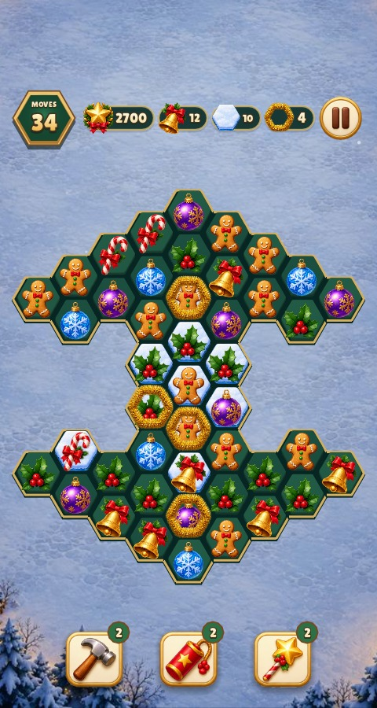 |  |
| 390×844 with safe areas | 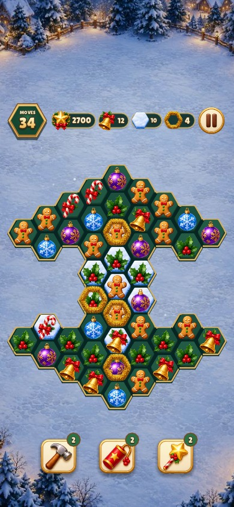 |  |

## Board trim and village snow

The live board paints flat spruce-green hex wells with a fine champagne edge
on exposed sides. The original painted cell mask remains in the atlas. The
authored snow, tinsel, ice, special, selection and hint sprites retain their
registration over the wells.

Snowfall uses two layers over the village (84 small and 44 large flakes).
Their pattern is anchored to the world origin, so panning carries the flakes
with the market while they keep falling. Larger foreground flakes fall faster,
and both layers fade toward the bottom controls. Reduce
Motion holds the flakes still. The HUD and dialogue draw above the snowfall.

Run `build/test/christmas-market "shot main-character-board" "shot phone-board"
"shot market" "shot phone-market" "shot specials-board"` for both portrait
sizes and a board with blockers and specials.

| View | Before | After |
| --- | --- | --- |
| Board, 480×900 | 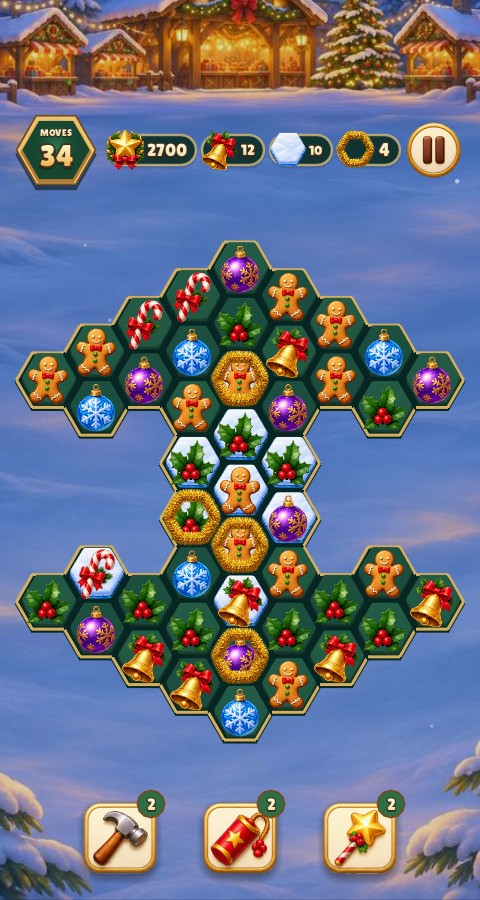 |  |
| Board, 390×844 | 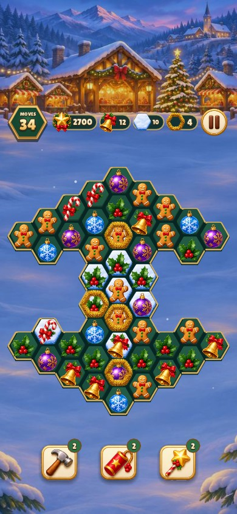 |  |
| Village, 480×900 | 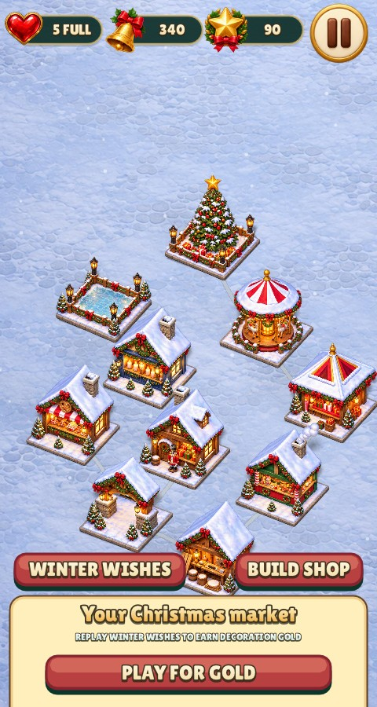 |  |
| Village, 390×844 |  | 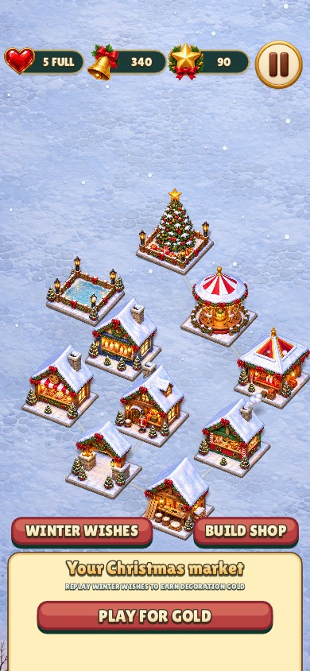 |

[Board with blockers and specials](screenshots/review/winter-polish/board-specials.jpg)

## Cell and goal alignment

The powder-snow goal uses the full authored sprite. On the board, the renderer
samples its opaque interior and maps it to the exact centre, radius and rotation
of the cell hex. The 128px source rectangle is `18,14,96,95` for Christmas and
`32,35,63,58` for the embedded fallback. The atlas and its source alpha stay intact.
Exposed green wells shade from light at the top to dark at the bottom. Goal icons
sit 3.6 logical units farther left, and collection flights land at that same position.

Reproduce with `build/test/christmas-market "shot main-character-board" "shot phone-board" "shot specials-board"`.

| Size | Before | After |
| --- | --- | --- |
| 480×900 |  | 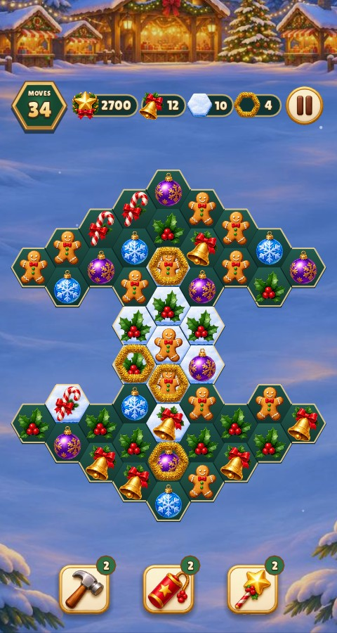 |
| 390×844 |  |  |

[Board with blockers and specials](screenshots/review/cell-and-goals/specials.jpg)

## Tinsel on the cell edge

The board scales the existing `chain` atlas frame around the painted ring's
centreline, measured at 92 × 86 px and centred at (63.5, 59.5) in its 128px
canvas. That line follows the cell perimeter, with gold extending both inward
and outward. The ring draws beneath treats so its overhang leaves adjacent
pieces legible. The goal capsule and guide use the original icon framing.

Reproduce with `build/test/christmas-market "shot main-character-board" "shot phone-board" "shot specials-board"`.

| Size | Before | After |
| --- | --- | --- |
| 480×900 |  | 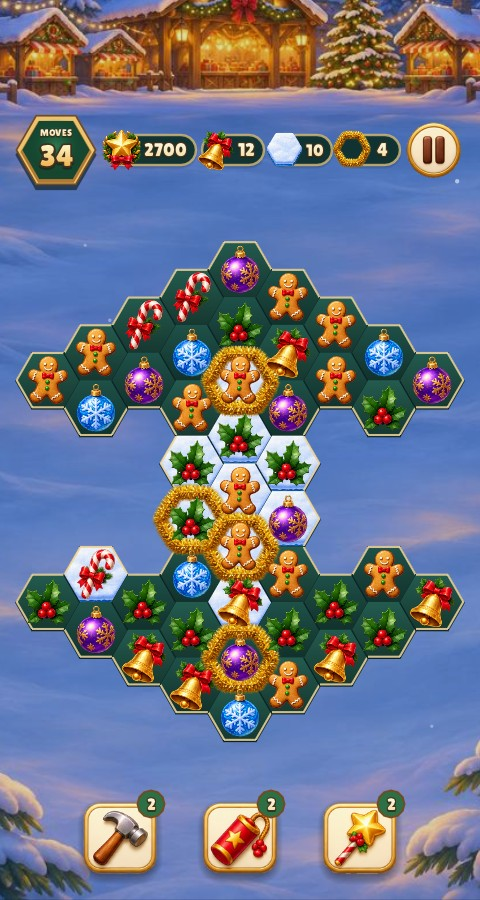 |
| 390×844 |  | 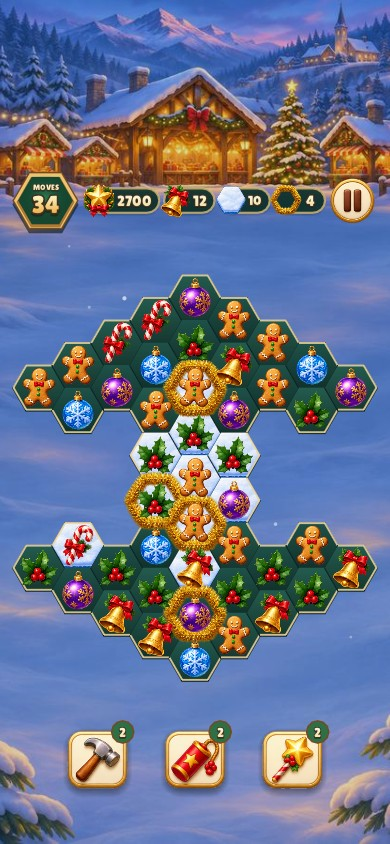 |

[Adjacent rings among blockers and specials](screenshots/review/tinsel-edge/specials.jpg)

## Striped treats

Line specials (ROW, COLUMN, DIAGONAL) draw the treat itself through
`gfx.image_striped`: four cream bands (`A.stripes` in `lua/art.lua`) at 30°,
90° or 150°, masked to the treat's alpha, exactly as Relic Rush does. The user
asked for stripes instead of shooting stars on 2026-11-09. No new artwork.

## Market navigation

The **bottom of the town screen** now has Build (left), a large Play (center),
and Levels (right). Build and Levels have equal 88×88 slots; Play has a 144×144
slot. The shared `town` form centers the controls and routes Levels to the
existing expedition / winter-wishes level-selection action. Game boards and
other menus keep their existing controls.

The replacement artwork is deliberately simple: one hammer, one Play triangle,
and one level-list icon, each filling a plain face with a thin rim. No stalls,
roofs, foliage, ribbons, star crests or decorative surrounds. Christmas retains
only a light snow edge; Relic Rush uses jade and amber faces.

Source: `art/navigation/controls.png`, an authored transparent **5×3** atlas;
exact ImageGen prompt: `art/navigation/prompt.txt`; deterministic bounds and
runtime paths: `art/navigation/manifest.json`. Columns are normal, hover,
pressed, selected and disabled; rows are Build, Play and Levels. Pressed faces
are recessed, selected faces have a simple double rim, and disabled icons are
engraved into dull material. All states are authored separately; no runtime
recolouring or procedural icon overlays. Each manifest box is a 324×324
square centred on its atlas column's and row's visible art (the earlier
equal-fifths grid cut the art off-centre and clipped some rims); the row-wide
vertical centre keeps the pressed drop. The crop is scaled evenly into a
160×160 RGBA image under `data/navigation/`, so the visible buttons are
centred in their slots and `town.json`'s `bottom` puts Play's lower edge as
far from the screen edge as Build and Levels are from the sides.

| Role | Runtime state names (all `.png`) |
|---|---|
| `navigation_build` | `build-normal`, `build-hover`, `build-pressed`, `build-selected`, `build-disabled` |
| `navigation_play` | `play-normal`, `play-hover`, `play-pressed`, `play-selected`, `play-disabled` |
| `navigation_levels` | `levels-normal`, `levels-hover`, `levels-pressed`, `levels-selected`, `levels-disabled` |

Reproduce: `python3 games/christmas-market/tools/prepare_hud.py`;
append `--check` to verify exact exported pixels. Runtime inventory and asset
catalogue checks cover the added files. `lua/art.lua` documents all three roles;
`--hud-states` uses the live skin to draw all fifteen states.

**Pending validation:** genuine before/after town captures at 480×900 and
390×844 (safe area 0,47,0,34), plus the existing HUD state shot. Native builds
remain blocked here by missing OpenGL/X11/EGL headers and Xvfb, and Lua lint by
missing `luacheck`. Assets and Lua syntax can be checked independently; no
fabricated game screenshots are supplied. Follow-up tracked by
[#84](https://github.com/corepunch/nile-archive/issues/84). Unpublished review
only; PR publication and merging require user approval.

## Fitted specials and thin tinsel

The bomb, rainbow star, selection and hint use the
same flat-top cell alpha mask. Each authored frame is fitted from its measured
source box in `art/registration.json`. The mask preserves the hollow centres of
selection and hint, and the board draws these frames at the cell face radius.

`data/board-states/chain-board.png` compresses the original tinsel by half on
both sides of its centreline. The board keeps that line on the hex edge and
draws it beneath the treats. The original `chain` frame serves the goal icon
and guide.

Regenerate with `python3 games/christmas-market/tools/prepare_assets.py --board-fit`
and `python3 tools/match3_atlas.py`. Review with
`build/test/christmas-market "shot main-character-board" "shot phone-board" "shot specials-board" "shot guide"`.

| View | Before | After |
| --- | --- | --- |
| Board, 480×900 |  | 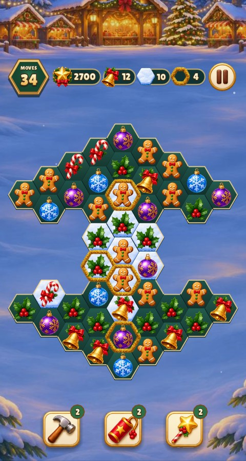 |
| Board, 390×844 |  | 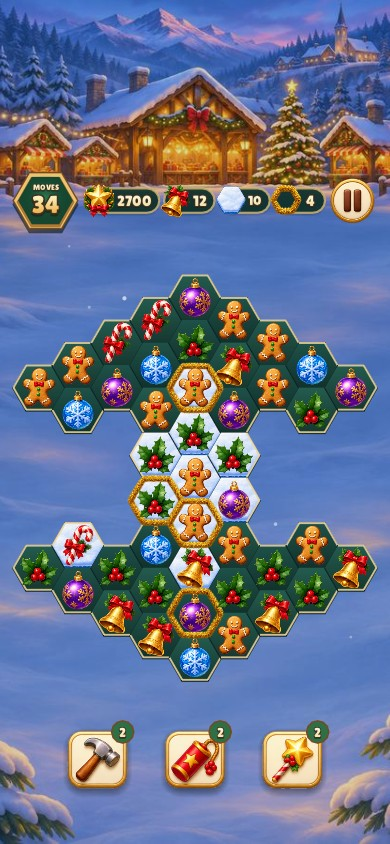 |
| Blockers and specials | 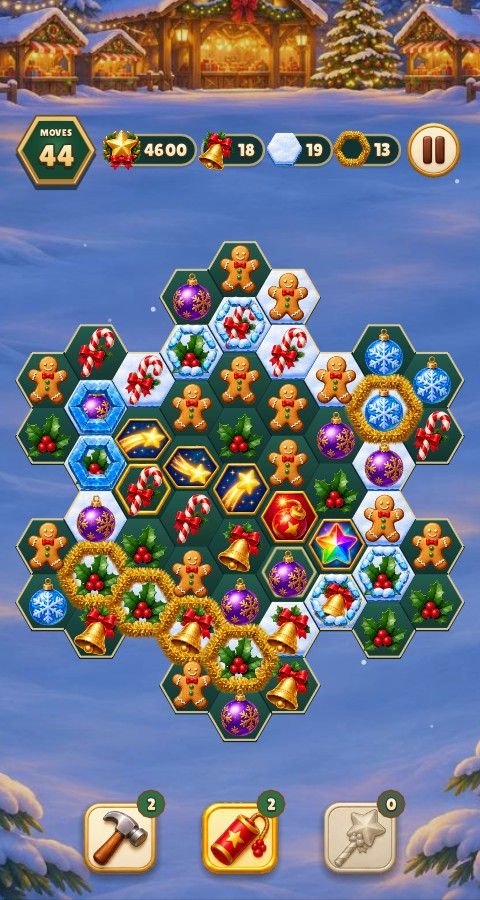 |  |

[Fitted art in the Market Keeper’s Guide](screenshots/review/fitted-gold/guide.jpg)

## Snow and ice rims

`sand-edge` takes a narrow white band from the authored powder-snow texture.
`ice-1-edge` compresses the broken ice ring and `ice-2-edge` compresses the
solid blue ice ring. All three share tinsel's flat-top centreline. Snow moves
inward when ice or tinsel shares its cell, leaving both materials visible.
The guide illustrates the rims and the goal capsule uses the full snow icon.

The live board's one-layer ice is the original Homescapes shell fragment. It is
the lower part of the full shell, so `tools/homescapes_atlas.py` rests it on
the full shell's bottom edge (`ice-2`) instead of centring it. The piece shows
above the cracked cup, as in Homescapes. Regenerate with
`python3 tools/match3_atlas.py`.

Regenerate the board edges and atlases with `python3 tools/fit_match3_edges.py`.
The source is `art/icons.png` through the registered `sand` and `ice-1` /
`ice-2` board-state crops. The transform preserves the original paint and
uses a transparent hex-band mask for the filled snow.

| Size | Before | After |
| --- | --- | --- |
| 480×900 | 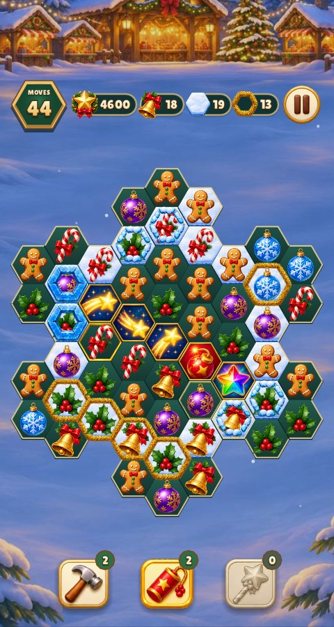 | 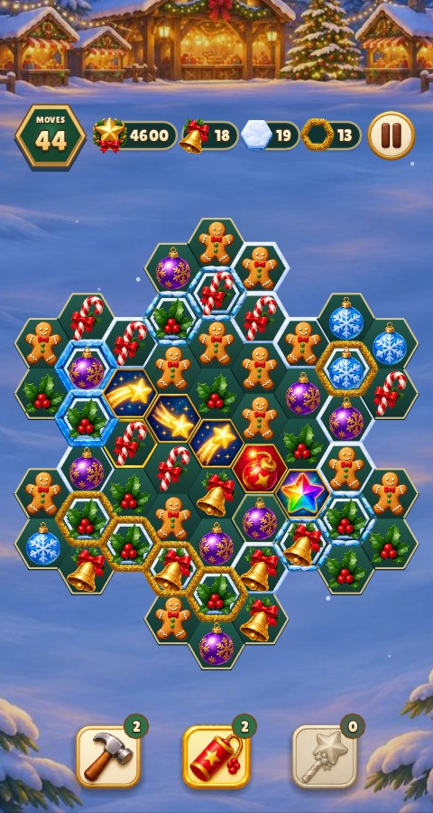 |
| 390×844 | 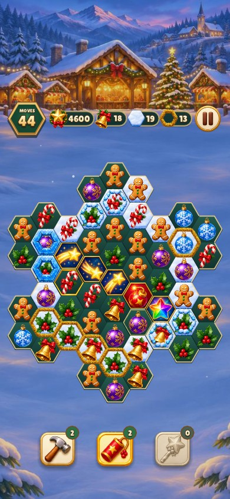 | 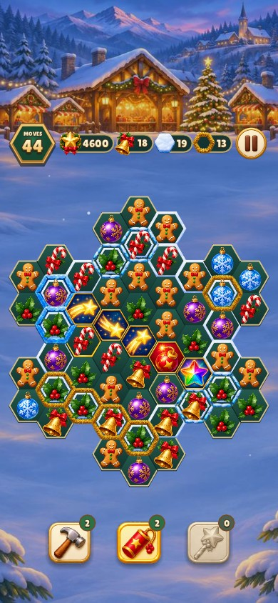 |

[Market Keeper’s Guide](screenshots/review/frost-edges/guide.jpg)

## Story cast

All six speaking characters have painted busts. One built-in ImageGen pass produced the [supporting cast sheet](../art/story-cast.png), using Noelle's existing cutout as the style reference. The exact prompt is under `story_cast` in [character-and-icon-prompts.json](../art/character-and-icon-prompts.json). These five exports replace the cards tracked in [issue #76](https://github.com/corepunch/nile-archive/issues/76).

| Character | Runtime | Story cue |
| --- | --- | --- |
| Theo Marsh | `data/characters/theo.png` | Tree seller with fir needles, plaid coat and resin-stained gloves |
| Agnes Holt | `data/characters/agnes.png` | Baker in a flour-dusted apron with her arms crossed |
| Henrik Strand | `data/characters/henrik.png` | Toymaker with white whiskers, leather apron and pencil |
| Pip Larkin | `data/characters/pip.png` | Post runner with his satchel and gap-toothed grin |
| Mr Wren | `data/characters/wren.png` | Grey-coated sweeper with his broom and tilted head |

Run `python3 games/christmas-market/tools/prepare_story_cast.py` from the root to reproduce the cutouts. The script crops and proportionally resizes the right-facing source art, then bottom-aligns each cutout on a transparent 320×480 canvas. The shared dialogue renderer mirrors the right slot so conversation partners face each other. [Dialogue bar captures](review/dialogue-bar/README.md)

The script also calls for eight optional illustrated panels (six episode panels plus levels 27 and 28). The scenes currently use the live market.

## Main character and app icon review

The user selected the supplied portrait as the main character. Built-in ImageGen used it as the identity reference for the app icon and for transparent background extraction. Exact prompts are preserved in `art/character-and-icon-prompts.json`. Reproduce the runtime exports with `python3 games/christmas-market/tools/prepare_character.py` (also called by the full asset preparation script). All eleven iOS/macOS catalogue entries were checked for the declared pixel dimensions and opaque RGB, and the 64px icon was visually inspected. Xcode project freshness checks pass.

The portrait appears only in dialogue; see the [390×844 dialogue with safe areas](screenshots/main-character-dialogue.jpg) capture.

## Reviewed state coverage

- [All six kinds, three special axes, bomb/prism, snow/tinsel, both ice strengths and all five tool states](screenshots/art-states.jpg).
- [All five pause states, completion medal and Noelle portrait](screenshots/hud-states.jpg).
- [Specials, selection/hint and exhausted tool on an actual board](screenshots/specials-board.jpg).
- All 37 buildings with footprints, four a page: [1](screenshots/building-review-1.jpg), [2](screenshots/building-review-2.jpg), [3](screenshots/building-review-3.jpg), [4](screenshots/building-review-4.jpg), [5](screenshots/building-review-5.jpg), [6](screenshots/building-review-6.jpg), [7](screenshots/building-review-7.jpg), [8](screenshots/building-review-8.jpg), [9](screenshots/building-review-9.jpg), [10](screenshots/building-review-10.jpg), and [market footprints](screenshots/footprints.jpg).
- [Valid placement](screenshots/placement.jpg), [blocked placement](screenshots/blocked-placement.jpg), [shop](screenshots/shop.jpg), [building card](screenshots/building-card.jpg), and [reward](screenshots/reward.jpg).

`art/manifest.json` records hashes for every runtime file. Update it with `python3 games/christmas-market/tools/check_assets.py --update` only alongside the corresponding catalogue/source changes. The full native build with `-Werror`, rule tests, Lua lint (59 files, zero warnings), inventory checks and real-input game smoke pass on macOS. Linux Xvfb, WebAssembly and iOS Simulator coverage run in CI.

Settings uses the shared match-3 form. The checked, unchecked, pressed and
disabled checkbox looks come from `lua/skin.lua`, and the form paints keyboard
focus with the skin's focus style. Sound and Reduce Motion use the same
checkbox control. Review the panel with
`build/test/christmas-market "shot pause" "shot phone-pause"`.

Settings also has a LEADERBOARD link and the results card a LEADERBOARD button, which open
the engine's shared leaderboard dialog ([docs/GAMECENTER.md](../../../docs/GAMECENTER.md)) in this
game's skin: Everyone / Friends tabs (the chosen one a red button, the other a flat caption), rows of
rank, portrait, name and score, loading / empty / signed-out notes, and Game Center and Close buttons.
No artwork is added: every state is skin paint, and portraits come from Game Center at runtime.
Reviewed captures: [Settings](screenshots/pause.jpg), [the stars board](screenshots/leaderboard.jpg),
[a wish's board](screenshots/level-leaderboard.jpg), [the 390×844 phone](screenshots/phone-leaderboard.jpg)
and [the results card](screenshots/reward.jpg), from `build/test/christmas-market "shot leaderboard"` ...
with `--gamecenter-demo`.

## Engine match-3 atlas and trickling

`data/match3.png`, registered by `lua/match3_skin.lua` and
`art/match3-atlas.json`, contains all match-board backgrounds, pieces, special
axes, blockers, selection/hint/guide frames, HUD icons and all five authored
states of each tool and Pause. The Christmas override additionally contains
its board portrait; Relic Rush includes all three piece packs and both scenes.
Existing source artwork and alpha are copied without modifying states. The
64px cubic radial light is the existing procedural transient effect, packed
in the same atlas and drawn with a per-view additive flag.

The shop's built and locked tiles use `data/expedition-hud/shop-built.png`
(checkmark) and `shop-locked.png` (padlock), packed into the same atlas as
`shop-built` and `shop-locked`. Relic Rush and Christmas Market ship the same
two files. Their source, prompt and per-game styling are not yet recorded:
[#90](https://github.com/corepunch/nile-archive/issues/90).

The engine's default resource skin is independent and embedded; both games
normally override it. `python3 tools/match3_atlas.py` reproduces the atlases and
registrations, and `make gen` embeds the default. No new game icon designs were
generated. FALL uses engine-authored simultaneous one-edge movement steps,
straight-down priority with blocked-down diagonal fallback, vertical spawning at every exposed column top and a short landing squash; static states
continue to use the existing artwork. Input and animation timing are shared.

See [checked in-game captures and commands](review/trickling/README.md) and the
[engine contract](../../../docs/MATCH3_ENGINE.md). The default atlas's source,
prompt, all supported states and crop/rotation registration are catalogued in
`engine/art/match3/manifest.json` at repository root.

### Cell registration and dialogue motion

Board state canvases now span the complete hex diameter. The authored 112px
piece interior on a 128px canvas is registered explicitly: hex silhouettes fill
the hex, other objects fit its inscribed square. Guide and HUD sizes retain their
own registration. Artwork and its alpha remain unchanged. Reproduce the reviewed
boards with the test suite's `resource-icons`, `atlas-` and `trickling-` filters.

Portraits retain finite entrance/exit slides and fades. An independent colour
tween brightens/dims active/listener states without replaying the slide. Size is
constant for speaker/listener, with no scale/rotation animation or idle wobble. See [motion, captures and timing review](../../../docs/review/motion/README.md).

## Particle sprites

Seven sprites from Kenney's CC0 [Particle Pack](https://opengameart.org/content/particle-pack-80-sprites)
texture the impact, spark and bomb effects, as in Relic Rush. The original
black-background PNGs and `License.txt` are retained in `art/particles/kenney/`;
`python3 tools/pack_particles.py christmas-market` (from the repository root)
resizes them, turns brightness into alpha on white and writes `data/particles.png`
with its contract `lua/particle_skin.lua`. `engine/match3_vfx.lua` draws them additively,
tinted with each piece's effect colour. They are transient effect sprites with no
interaction states. Shooting-star beams, prism links, special births and the
bomb's leading ring stay procedural.

| Sprite | Kenney source | Use |
| --- | --- | --- |
| `shock` | `circle_03` | Soft outer band of the bomb shockwave |
| `flash` | `light_01` | Bomb bloom |
| `burst` | `star_09` | Bomb centre flare, under the glint |
| `ring` | `circle_02` | Per-cell impact ring |
| `glint` | `star_07` | Four-point twinkle on impacts, the bomb centre, beam tips and births |
| `twinkle` | `star_06` | Spark particles and shard heads |
| `streak` | `trace_06` | Shard particles, aligned to their velocity |

Review: [kenney-particles](review/kenney-particles/README.md) (bomb and shooting-star frames
before and after, `--fx bomb|ray --frames N`).

## Board entrance

After any dialogue the board presents itself on the engine's shared timeline
(`engine/board_intro.lua`, see [the engine guide](../../../docs/ENGINE.md#board-entrance)):
the goal card and tools land, Noelle springs up behind the card, cells ripple
out, treats rain down their columns, ice and tinsel slam on and a sheen runs
across. It moves existing artwork with transient glows and sparks, so it adds no
new assets. A tap skips it and reduced motion makes it a short fade. Capture:
`build/test/christmas-market board-intro` (`--level 4 --present --reel`), frames
in `build/shots/frames/`.

Pressing Play in the market (and returning to it) runs the shared town <-> board
dive in `engine/match3_game.lua`: the screen being left blurs into a warm flash
while the market's camera zooms into its newest stall, then the other settles out
of the blur. It is procedural (`gfx.backdrop` and a camera zoom) and adds no art;
input waits for it and reduced motion skips it. Capture:
`build/test/christmas-market christmas-market-town-dive` (`--city 3 --dive --reel`),
frames in `build/shots/frames/`.

## Current-camera building paint pass

All registered buildings and decorations use the painted-v1 sources, normal sprite
and unchanged engine placement/lift/validity states documented in the
[building catalogue](building-catalogue.md) and
[review gallery](review/painted-buildings/current-camera/README.md).
The 18 slab-based sprites register their painted foundations to the 3D
ground-contact edges. See the [adjacent foundation captures](review/foundations/README.md).

## Placement alignment guides

The shared `engine/city.c` renderer draws cream outlines around occupied
ground during placement. Building sprites cover the lines behind them. The
building in hand retains its green/red footprint, and the old plot of a
building being moved is free. Confirm or Cancel hides the guides. Debug
`--footprints` draws the full outlines above the sprites. See the
[phone captures](review/placement-guides/README.md).

## Original Homescapes board atlas

Current board art supersedes the earlier striped-gem and themed-piece mappings below/above. `ray-row`, `ray-column`, `ray-diagonal`, `bomb`, `prism` and `plane` are standalone original power-ups; all piece packs alias `kind-0` through `kind-5`. Original cookies, donut, cherry, box strengths, ice and chain variants share `data/match3.png` with retained board controls. No new art was generated and no states were recolored.

See [the shared feature/asset catalogue](../../../docs/HOMESCAPES_HEX.md) and `art/match3-atlas.json` for source PNGs, original regions, exact registration transforms, hashes, reproduction command and reviewed captures. Diagnostic blocker/generator states are tracked in [issue #98](https://github.com/corepunch/nile-archive/issues/98); these are not finished 1:1 artwork. Existing selected/hint/pressed/hover/disabled control artwork remains in the atlas.

Live field correction: removed all legacy gold/snow/sand edges, selection/hint frames and ice badges. Only original Homescapes sprites plus the temporarily retained quest resource appear on the flat hex field. Surrounding interface artwork is retained by explicit user choice. Portals use the original yellow entrance and blue output rings. The donut collection exit remains diagnostic under issue #98.

## Recovered original blocker and generator artwork

The shared [source/state inventory](../../../docs/HOMESCAPES_ART.md) records every added state, the 9.2.601/3.5.9 source versions, exact crops/rotations/hashes, original goal icons, manually registered group composites, reproduction commands and unresolved requirements under issue #98. [Actual game review](../../../docs/review/homescapes-restored-art/README.md) includes both portrait sizes. No state recoloring or generated artwork was used. All six jelly layers, the glass dome and the colored-box goal icon use original parts. Exact maker charge poses and colored-box field artwork remain open. [Jelly, portal and maker captures](../../../docs/review/homescapes-jelly-portals/README.md).

Original atlas orientation: statues, nuts, cookie stacks, platter, maker base, blind header and queue shell use recorded 180° extraction rotations. Active source fields now fit the available phone area; both sizes and pointer registration are covered in the [review](../../../docs/review/homescapes-restored-art/README.md).

The donut exit uses the original `CarryExitForAnim` sprite. The maker base and
both glass layers use the original shared-frame offsets. See the [source
registration and portrait review](../../../docs/review/homescapes-arrow-maker/README.md).

The Windows 9.2.601 x64 atlas supplies all 36 colored-box states and the
classic donut maker charge layers. See the [source registration and portrait
review](../../../docs/review/homescapes-windows-art/README.md).

The maker plays queued, approximate source-video stage transitions on the field;
[durations, uncertainty and review command](../../../docs/HOMESCAPES_ART.md)
are recorded in the shared inventory. Original particle curves remain open in
[issue #98](https://github.com/corepunch/nile-archive/issues/98).
