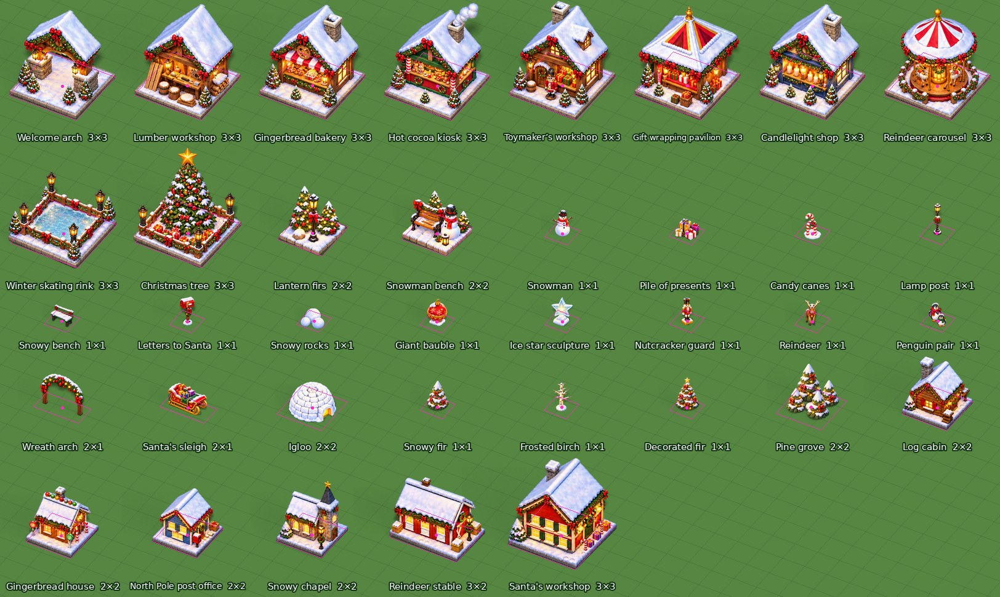

# Building catalogue

Christmas Market has **37 objects**, all modelled and rendered in Blender as
[docs/BUILDING_ART.md](../../../docs/BUILDING_ART.md) describes:

- **10 market wishes**: the campaign buildings, one per completed puzzle, in story order.
- **15 decorations**: Lantern firs and Snowman bench, plus 13 more.
- **4 snowy trees.**
- **6 cottages.**

The first twelve follow the building direction sheet
(`art/building-reference-sheet.png`). They keep their identities, names and
footprints, and keep their row order, which is save data. The 25 rows after them
are new shop objects. The Blender renders are the runtime art. The
ImageGen repaint that [#34](https://github.com/corepunch/nile-archive/issues/34)
plans is still to come.



## Source and pipeline

| Step | File |
| --- | --- |
| Catalogue: key, name, category, footprint, cost, Star unlock, description | `art/building-catalogue/catalogue.json` |
| Models, one builder per key | `art/building-catalogue/market_wishes.py` for the first twelve, `build_scene.py` for the rest |
| Master scene, one collection per object, named after its key | `art/building-catalogue/christmas_market_buildings.blend` |
| Render, one sprite and shadow per object at 100 px a tile side | `make buildings GAME=christmas-market` |
| Pivot and base width | `art/building-catalogue/registration.json` |
| `lua/buildings.lua`, manifest | `tools/prepare_catalogue.py` |

- **Modelling.** One Blender unit is one tile side and the pivot is the
  footprint's ground centre. The [city camera](../../../docs/BUILDINGS.md#the-camera)
  is the same as every other game's.
- **Bases.** The ten wishes and the two original decorations stand on a
  snow-covered brick slab that is exactly the footprint. Cottages stand on a
  cobble slab. The other decorations and the trees stand on the snow, and
  their footprint is a virtual base.
- **Style.** Every vertex is clamped to the footprint. The shared kit adds
  evergreen garlands with warm bulbs, red bows, iron lanterns and snow-capped
  firs.
- **Lighting.** Warm sun, blue fill and Cycles on the CPU at 64 samples, with
  transparent film. There is no shadow catcher.
- **Registration.** Each sprite's pivot and `base_width = (w + h) × 64` are
  projected, not measured. `tools/footprint.py` agrees to within one pixel
  on the slab buildings, for example bakery `vec2(192, 248)` / 383 measured
  against `vec2(193, 249)` / 384 projected.

The city tile stays `size2(40, 20)` with `clearance = size2(1, 1)`.
Every sprite is drawn at 40/64 = 0.625 scale.

The old ImageGen atlas (`art/buildings.png`) and its crops are retired. The
atlas stays in `art/` as the direction source, and `tools/prepare_assets.py`
no longer extracts buildings.

## Presentation and interaction states

Every object has one finished normal sprite. There are no construction,
damaged, upgrade, hover, pressed or disabled sprites. Placement, lift and the
valid/invalid footprint grid stay the engine's transient effects. Shop rows and
the building card show the normal sprite untinted, and the button captions
carry locked or unaffordable states. Lights, glowing windows and the tree's star
are baked into the sprites. Nothing is animated yet.

The shop has five categories: all, Market wishes, Decorations, Snowy trees and
Cottages. Decorations, trees and cottages cost Gold, paid once on confirmation,
and some need Christmas Stars. Stars unlock them and are never spent.

## Reproduce and verify

```sh
make buildings GAME=christmas-market REBUILD=1     # add KEYS="a b" to render a few
python3 games/christmas-market/tools/prepare_catalogue.py --inventory
make && make test     # runs prepare_catalogue.py --check and check_assets.py
xvfb-run -a make test ONLY="building-review shop market"
```

Without a Blender binary, use the `bpy` module from PyPI (see BUILDING_ART.md).
To inspect or tweak the scene in a running Blender, send `build_scene.py` through
the MCP socket bridge:
`python3 games/volcano/source/tools/blender_mcp.py games/christmas-market/art/building-catalogue/build_scene.py`.
It builds the collections there and does not overwrite the open file.
A full render of all 37 objects takes about two minutes on four CPU cores.

## Runtime inventory

| ID / key | Name | Category | Tiles | Cost (gold / holly / baubles) | Stars | Reviewed city capture |
| --- | --- | --- | --- | --- | ---: | --- |
| 0 / `arch` | Welcome arch | wonder | 3 x 3 | 60 / 10 / 5 | 0 | [Page 1](screenshots/building-review-1.jpg) |
| 1 / `lumber` | Lumber workshop | wonder | 3 x 3 | 80 / 15 / 15 | 0 | [Page 1](screenshots/building-review-1.jpg) |
| 2 / `bakery` | Gingerbread bakery | wonder | 3 x 3 | 100 / 25 / 15 | 0 | [Page 1](screenshots/building-review-1.jpg) |
| 3 / `cocoa` | Hot cocoa kiosk | wonder | 3 x 3 | 120 / 25 / 25 | 0 | [Page 1](screenshots/building-review-1.jpg) |
| 4 / `toys` | Toymaker’s workshop | wonder | 3 x 3 | 140 / 30 / 30 | 0 | [Page 2](screenshots/building-review-2.jpg) |
| 5 / `gifts` | Gift wrapping pavilion | wonder | 3 x 3 | 160 / 35 / 35 | 0 | [Page 2](screenshots/building-review-2.jpg) |
| 6 / `candles` | Candlelight shop | wonder | 3 x 3 | 180 / 35 / 45 | 0 | [Page 2](screenshots/building-review-2.jpg) |
| 7 / `carousel` | Reindeer carousel | wonder | 3 x 3 | 200 / 40 / 50 | 0 | [Page 2](screenshots/building-review-2.jpg) |
| 8 / `rink` | Winter skating rink | wonder | 3 x 3 | 220 / 45 / 55 | 0 | [Page 3](screenshots/building-review-3.jpg) |
| 9 / `tree` | Christmas tree | wonder | 3 x 3 | 250 / 50 / 60 | 0 | [Page 3](screenshots/building-review-3.jpg) |
| 10 / `firs` | Lantern firs | building | 2 x 2 | 45 | 0 | [Page 3](screenshots/building-review-3.jpg) |
| 11 / `bench` | Snowman bench | building | 2 x 2 | 60 | 0 | [Page 3](screenshots/building-review-3.jpg) |
| 12 / `snowman` | Snowman | building | 1 x 1 | 35 | 0 | [Page 4](screenshots/building-review-4.jpg) |
| 13 / `presents` | Pile of presents | building | 1 x 1 | 40 | 0 | [Page 4](screenshots/building-review-4.jpg) |
| 14 / `candy_canes` | Candy canes | building | 1 x 1 | 30 | 0 | [Page 4](screenshots/building-review-4.jpg) |
| 15 / `lamp_post` | Lamp post | building | 1 x 1 | 35 | 0 | [Page 4](screenshots/building-review-4.jpg) |
| 16 / `snowy_bench` | Snowy bench | building | 1 x 1 | 30 | 0 | [Page 5](screenshots/building-review-5.jpg) |
| 17 / `mailbox` | Letters to Santa | building | 1 x 1 | 40 | 3 | [Page 5](screenshots/building-review-5.jpg) |
| 18 / `snow_rocks` | Snowy rocks | building | 1 x 1 | 20 | 0 | [Page 5](screenshots/building-review-5.jpg) |
| 19 / `giant_ornament` | Giant bauble | building | 1 x 1 | 60 | 3 | [Page 5](screenshots/building-review-5.jpg) |
| 20 / `ice_star` | Ice star sculpture | building | 1 x 1 | 70 | 6 | [Page 6](screenshots/building-review-6.jpg) |
| 21 / `nutcracker` | Nutcracker guard | building | 1 x 1 | 80 | 6 | [Page 6](screenshots/building-review-6.jpg) |
| 22 / `reindeer` | Reindeer | building | 1 x 1 | 90 | 9 | [Page 6](screenshots/building-review-6.jpg) |
| 23 / `penguins` | Penguin pair | building | 1 x 1 | 80 | 9 | [Page 6](screenshots/building-review-6.jpg) |
| 24 / `wreath_arch` | Wreath arch | building | 2 x 1 | 90 | 6 | [Page 7](screenshots/building-review-7.jpg) |
| 25 / `sleigh` | Santa's sleigh | building | 2 x 1 | 150 | 12 | [Page 7](screenshots/building-review-7.jpg) |
| 26 / `igloo` | Igloo | building | 2 x 2 | 120 | 9 | [Page 7](screenshots/building-review-7.jpg) |
| 27 / `fir_snowy` | Snowy fir | tree | 1 x 1 | 25 | 0 | [Page 7](screenshots/building-review-7.jpg) |
| 28 / `birch` | Frosted birch | tree | 1 x 1 | 30 | 0 | [Page 8](screenshots/building-review-8.jpg) |
| 29 / `fir_decorated` | Decorated fir | tree | 1 x 1 | 50 | 3 | [Page 8](screenshots/building-review-8.jpg) |
| 30 / `pine_grove` | Pine grove | tree | 2 x 2 | 80 | 6 | [Page 8](screenshots/building-review-8.jpg) |
| 31 / `log_cabin` | Log cabin | cottage | 2 x 2 | 180 | 6 | [Page 8](screenshots/building-review-8.jpg) |
| 32 / `gingerbread_house` | Gingerbread house | cottage | 2 x 2 | 200 | 9 | [Page 9](screenshots/building-review-9.jpg) |
| 33 / `post_office` | North Pole post office | cottage | 2 x 2 | 220 | 12 | [Page 9](screenshots/building-review-9.jpg) |
| 34 / `chapel` | Snowy chapel | cottage | 2 x 2 | 260 | 15 | [Page 9](screenshots/building-review-9.jpg) |
| 35 / `reindeer_stable` | Reindeer stable | cottage | 3 x 2 | 280 | 18 | [Page 9](screenshots/building-review-9.jpg) |
| 36 / `santa_workshop` | Santa's workshop | cottage | 3 x 3 | 320 | 21 | [Page 10](screenshots/building-review-10.jpg) |
