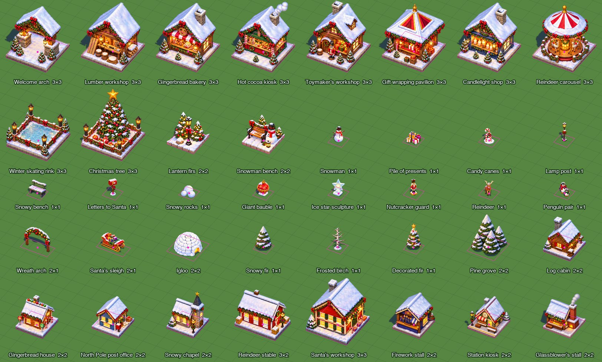

# Building catalogue

Christmas Market has **37 objects**, all modelled and rendered in Blender as
[docs/BUILDING_ART.md](../../../docs/BUILDING_ART.md) describes:

- **20 market stalls on the campaign ladder**: the 10 market wishes in story order and
  10 stalls between them (stable, gingerbread house, Santa's workshop, post office,
  log cabin, chapel, igloo, sleigh, giant bauble and presents), each placed once.
  See the [ladder](resource-prototype.md#the-twenty-stall-ladder).
- **15 decorations**: Lantern firs and Snowman bench, plus 13 more.
- **4 snowy trees.**
- **6 cottages.**

The first twelve follow the building direction sheet
(`art/building-reference-sheet.png`). They keep their identities, names and
footprints, and keep their row order, which is save data. The 25 rows after them
are new shop objects. All 37 runtime sprites now have a category ImageGen
paint-over on the current Blender renders, matching the direction sheet's timber,
snow, garlands, ribbons and warm amber lighting. This addresses the building paint
portion of [#34](https://github.com/corepunch/nile-archive/issues/34).



The build shop scrolls through the selected category. Its rows show each object's
sprite, footprint, ownership and price, with a disabled action for unavailable
stock. The category arrows stay above the list.

Prices show the Gold, Food and Supplies deducted at confirmed placement.
The bakery costs 300 Gold and 200 Supplies. The shop reserves the cost of
earned stalls when checking decoration purchases. Older saves retain their
wallet and buildings and can afford any previously earned stall.
[First 20 wishes and price sources](resource-prototype.md)

## Source and pipeline

| Step | File |
| --- | --- |
| Catalogue: key, name, category, footprint, cost, Star unlock, description | `art/building-catalogue/catalogue.json` |
| Models, one builder per key | `art/building-catalogue/market_wishes.py` for the first twelve, `build_scene.py` for the rest |
| Master scene, one collection per object, named after its key | `art/building-catalogue/christmas_market_buildings.blend` |
| Render, one sprite and shadow per object at 100 px a tile side | `make buildings GAME=christmas-market` |
| Pivot and base width | `art/building-catalogue/registration.json` |
| `lua/buildings.lua`, manifest | `tools/prepare_catalogue.py` |

- **Modelling.** One Blender unit is one tile side and the pivot is the
  footprint's ground centre. The [city camera](../../../docs/BUILDINGS.md#the-camera)
  is the same as every other game's.
- **Bases.** The ten wishes and the two original decorations stand on a
  snow-covered brick slab that is exactly the footprint. Cottages stand on a
  cobble slab. The other decorations and the trees stand on the snow, and
  their footprint is a virtual base.
- **Style.** Every vertex is clamped to the footprint. The shared kit adds
  evergreen garlands with warm bulbs, red bows, iron lanterns and snow-capped
  firs.
- **Lighting.** Warm sun, blue fill and Cycles on the CPU at 64 samples, with
  transparent film. Ground shadows are a separate pass with their own sun, direction, blue tint and strength (see
  [Ground shadows](../../../docs/BUILDING_ART.md#ground-shadows)).
- **Painted registration.** The current camera projects a footprint's width as
  `(w * cos(yaw) + h * sin(yaw)) * ppt`. The importer projects the model's slab
  corners at ground level and resamples the painted stone and snow onto the
  visible contact edges. It rejects gaps in the projected slab and edge errors
  greater than one source pixel. `city.tile` is 56 with
  `clearance = size2(1, 1)`, reserving half a tile around each base.

`art/building-catalogue/painted-v1/` retains every input/output atlas, prompt, cell
layout, original render registration and per-key crop/scale/translation in
`imports.json`. The import record also identifies which sprites use projected
foundation edges. Decorations with a virtual base use the authored RGBA crop.
Reproduce with `python3 tools/import_painted_buildings.py christmas-market`.
See the [painted catalogue review](review/painted-buildings/current-camera/README.md)
and the [adjacent foundation review](review/foundations/README.md).

The old ImageGen atlas (`art/buildings.png`) and its crops are retired. The
atlas stays in `art/` as the direction source, and `tools/prepare_assets.py`
no longer extracts buildings.

## Presentation and interaction states

Every object has one finished normal sprite. There are no construction,
damaged, upgrade, hover, pressed or disabled sprites. Placement, lift and the
valid/invalid footprint grid stay the engine's transient effects. Shop rows and
the building card show the normal sprite untinted, and the button captions
carry locked or unaffordable states. Lights, glowing windows and the tree's star
are baked into the sprites. Nothing is animated yet.

The shop has five categories: all, Market wishes, Decorations, Snowy trees and
Cottages. The listed resources are paid once on confirmation. Some items
also need Christmas Stars. Stars unlock them and are never spent.

## Reproduce and verify

```sh
make buildings GAME=christmas-market REBUILD=1     # add KEYS="a b" to render a few
python3 games/christmas-market/tools/prepare_catalogue.py --inventory
make && make test     # runs prepare_catalogue.py --check and check_assets.py
xvfb-run -a make test ONLY="building-review shop market"
```

Without a Blender binary, use the `bpy` module from PyPI (see BUILDING_ART.md).
To inspect or tweak the scene in a running Blender, send `build_scene.py` through
the MCP socket bridge:
`python3 games/emergency/source/tools/blender_mcp.py games/christmas-market/art/building-catalogue/build_scene.py`.
It builds the collections there and does not overwrite the open file.
A full render of all 37 objects takes about two minutes on four CPU cores.

## Runtime inventory

| ID / key | Name | Category | Tiles | Cost (Gold / Food / Supplies) | Stars | Reviewed city capture |
| --- | --- | --- | --- | --- | ---: | --- |
| 0 / `arch` | Welcome arch | wonder | 3 x 3 | 50 / 0 / 0 | 0 | [Page 1](review/painted-buildings/current-camera/after-building-review-1.jpg) |
| 1 / `lumber` | Lumber workshop | wonder | 3 x 3 | 100 / 0 / 100 | 0 | [Page 1](review/painted-buildings/current-camera/after-building-review-1.jpg) |
| 2 / `bakery` | Gingerbread bakery | wonder | 3 x 3 | 300 / 0 / 200 | 0 | [Page 1](review/painted-buildings/current-camera/after-building-review-1.jpg) |
| 3 / `cocoa` | Hot cocoa kiosk | wonder | 3 x 3 | 400 / 0 / 500 | 0 | [Page 1](review/painted-buildings/current-camera/after-building-review-1.jpg) |
| 4 / `toys` | Toymaker’s workshop | wonder | 3 x 3 | 300 / 200 / 300 | 0 | [Page 2](review/painted-buildings/current-camera/after-building-review-2.jpg) |
| 5 / `gifts` | Gift wrapping pavilion | wonder | 3 x 3 | 500 / 400 / 400 | 0 | [Page 2](review/painted-buildings/current-camera/after-building-review-2.jpg) |
| 6 / `candles` | Candlelight shop | wonder | 3 x 3 | 500 / 500 / 600 | 0 | [Page 2](review/painted-buildings/current-camera/after-building-review-2.jpg) |
| 7 / `carousel` | Reindeer carousel | wonder | 3 x 3 | 700 / 600 / 700 | 0 | [Page 2](review/painted-buildings/current-camera/after-building-review-2.jpg) |
| 8 / `rink` | Winter skating rink | wonder | 3 x 3 | 180 / 450 / 60 | 0 | [Page 3](review/painted-buildings/current-camera/after-building-review-3.jpg) |
| 9 / `tree` | Christmas tree | wonder | 3 x 3 | 250 / 600 / 80 | 0 | [Page 3](review/painted-buildings/current-camera/after-building-review-3.jpg) |
| 10 / `firs` | Lantern firs | building | 2 x 2 | 55 / 0 / 8 | 0 | [Page 3](review/painted-buildings/current-camera/after-building-review-3.jpg) |
| 11 / `bench` | Snowman bench | building | 2 x 2 | 65 / 0 / 10 | 0 | [Page 3](review/painted-buildings/current-camera/after-building-review-3.jpg) |
| 12 / `snowman` | Snowman | building | 1 x 1 | 0 / 3 / 3 | 0 | [Page 4](review/painted-buildings/current-camera/after-building-review-4.jpg) |
| 13 / `presents` | Pile of presents | wonder | 1 x 1 | 200 / 500 / 60 | 0 | [Page 4](review/painted-buildings/current-camera/after-building-review-4.jpg) |
| 14 / `candy_canes` | Candy canes | building | 1 x 1 | 25 / 4 | 0 | [Page 4](review/painted-buildings/current-camera/after-building-review-4.jpg) |
| 15 / `lamp_post` | Lamp post | building | 1 x 1 | 20 / 0 / 4 | 0 | [Page 4](review/painted-buildings/current-camera/after-building-review-4.jpg) |
| 16 / `snowy_bench` | Snowy bench | building | 1 x 1 | 25 / 0 / 4 | 0 | [Page 5](review/painted-buildings/current-camera/after-building-review-5.jpg) |
| 17 / `mailbox` | Letters to Santa | building | 1 x 1 | 55 / 0 / 6 | 3 | [Page 5](review/painted-buildings/current-camera/after-building-review-5.jpg) |
| 18 / `snow_rocks` | Snowy rocks | building | 1 x 1 | 15 | 0 | [Page 5](review/painted-buildings/current-camera/after-building-review-5.jpg) |
| 19 / `giant_ornament` | Giant bauble | wonder | 1 x 1 | 160 / 400 / 50 | 0 | [Page 5](review/painted-buildings/current-camera/after-building-review-5.jpg) |
| 20 / `ice_star` | Ice star sculpture | building | 1 x 1 | 85 / 0 / 8 | 6 | [Page 6](review/painted-buildings/current-camera/after-building-review-6.jpg) |
| 21 / `nutcracker` | Nutcracker guard | building | 1 x 1 | 95 / 0 / 15 | 6 | [Page 6](review/painted-buildings/current-camera/after-building-review-6.jpg) |
| 22 / `reindeer` | Reindeer | building | 1 x 1 | 110 / 12 | 9 | [Page 6](review/painted-buildings/current-camera/after-building-review-6.jpg) |
| 23 / `penguins` | Penguin pair | building | 1 x 1 | 100 / 8 | 9 | [Page 6](review/painted-buildings/current-camera/after-building-review-6.jpg) |
| 24 / `wreath_arch` | Wreath arch | building | 2 x 1 | 125 / 0 / 20 | 6 | [Page 7](review/painted-buildings/current-camera/after-building-review-7.jpg) |
| 25 / `sleigh` | Santa's sleigh | wonder | 2 x 1 | 150 / 350 / 50 | 0 | [Page 7](review/painted-buildings/current-camera/after-building-review-7.jpg) |
| 26 / `igloo` | Igloo | wonder | 2 x 2 | 130 / 300 / 40 | 0 | [Page 7](review/painted-buildings/current-camera/after-building-review-7.jpg) |
| 27 / `fir_snowy` | Snowy fir | tree | 1 x 1 | 20 | 0 | [Page 7](review/painted-buildings/current-camera/after-building-review-7.jpg) |
| 28 / `birch` | Frosted birch | tree | 1 x 1 | 25 | 0 | [Page 8](review/painted-buildings/current-camera/after-building-review-8.jpg) |
| 29 / `fir_decorated` | Decorated fir | tree | 1 x 1 | 70 / 0 / 12 | 3 | [Page 8](review/painted-buildings/current-camera/after-building-review-8.jpg) |
| 30 / `pine_grove` | Pine grove | tree | 2 x 2 | 105 / 0 / 10 | 6 | [Page 8](review/painted-buildings/current-camera/after-building-review-8.jpg) |
| 31 / `log_cabin` | Log cabin | wonder | 2 x 2 | 250 / 350 / 100 | 0 | [Page 8](review/painted-buildings/current-camera/after-building-review-8.jpg) |
| 32 / `gingerbread_house` | Gingerbread house | wonder | 2 x 2 | 150 / 0 / 80 | 0 | [Page 9](review/painted-buildings/current-camera/after-building-review-9.jpg) |
| 33 / `post_office` | North Pole post office | wonder | 2 x 2 | 250 / 250 / 100 | 0 | [Page 9](review/painted-buildings/current-camera/after-building-review-9.jpg) |
| 34 / `chapel` | Snowy chapel | wonder | 2 x 2 | 120 / 250 / 40 | 0 | [Page 9](review/painted-buildings/current-camera/after-building-review-9.jpg) |
| 35 / `reindeer_stable` | Reindeer stable | wonder | 3 x 2 | 60 / 0 / 20 | 0 | [Page 9](review/painted-buildings/current-camera/after-building-review-9.jpg) |
| 36 / `santa_workshop` | Santa's workshop | wonder | 3 x 3 | 200 / 150 / 100 | 0 | [Page 10](review/painted-buildings/current-camera/after-building-review-10.jpg) |

## Style and prompt provenance

See the [shared building style guide](../../../docs/BUILDING_STYLE.md) for the
accepted palette, materials, polish and review criteria, and the
[reference index](../art/building-catalogue/painted-v1/references.json) for exact
prompts, ordered input images, hashes and accepted versions.

## Enlarged painted sprites

The enlarged objects `snowy_bench`, `fir_snowy`, `birch`, `fir_decorated`, `pine_grove` use the `z-enlarged` painted atlas, based on the registered Blender renders at `ef26de3`. Normal world state only; interaction feedback remains an engine effect. Sources, exact ImageGen prompt, layout, import transforms and reproduction command are recorded in [painted-v1](../art/building-catalogue/painted-v1/README.md); [in-game footprint review](review/painted-buildings/enlarged/README.md).
