# Blender buildings: before and after

Actual game captures at 480 × 900 with the software renderer. Before: the
ImageGen atlas crops on `main` at c6099b0. After: the Blender renders (see the
[building catalogue](../../building-catalogue.md)).

| | Before | After |
| --- | --- | --- |
| Market |  | 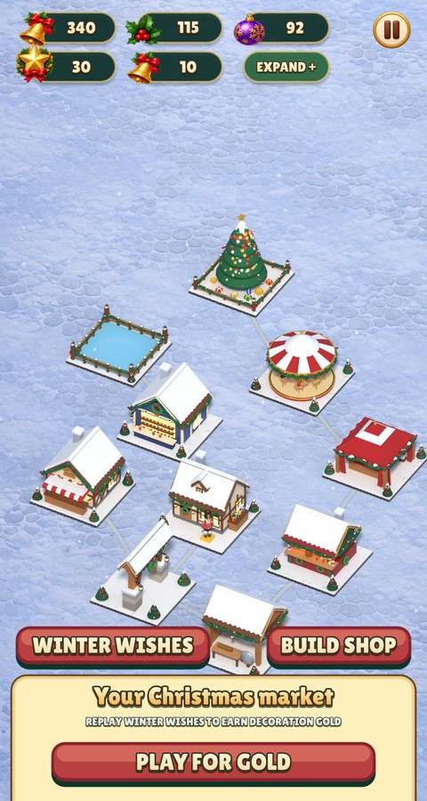 |
| Footprints | 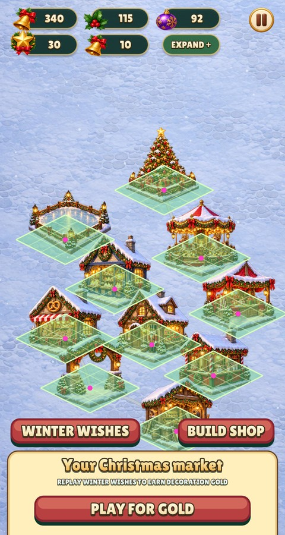 | 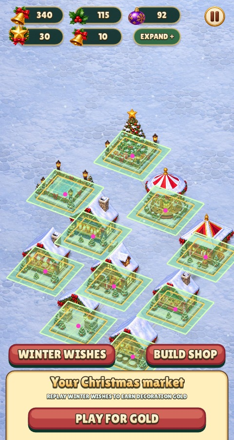 |
| Shop | 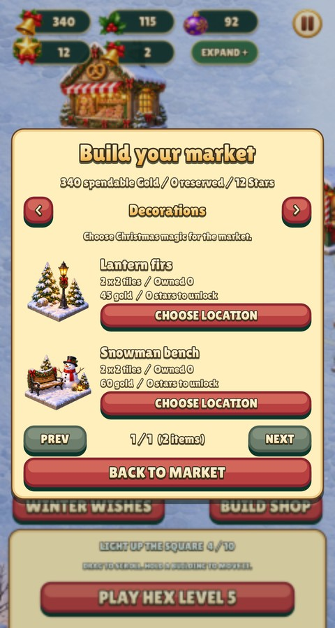 | 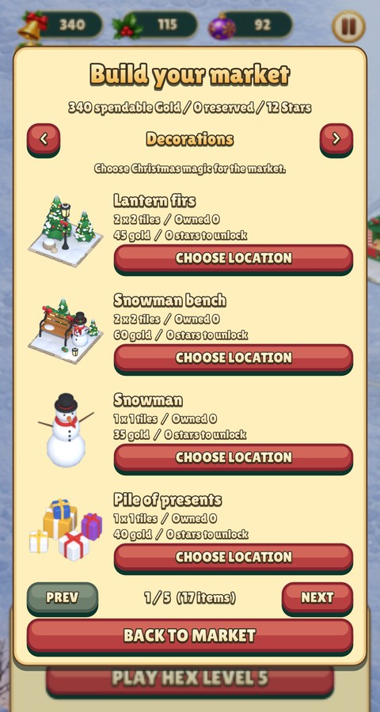 |
| Building card |  |  |
| Placement | 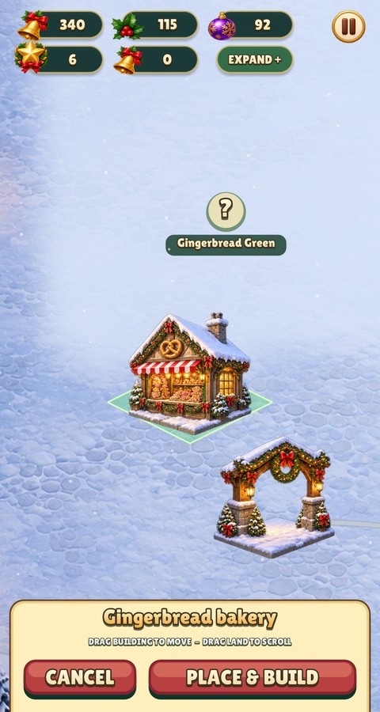 | 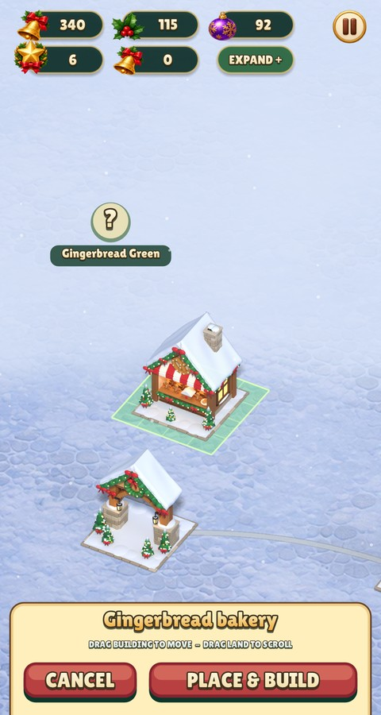 |

Every footprint, four objects a page:

| | | | | |
| --- | --- | --- | --- | --- |
| 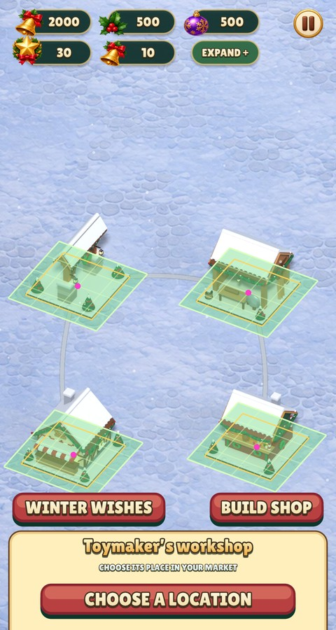 | 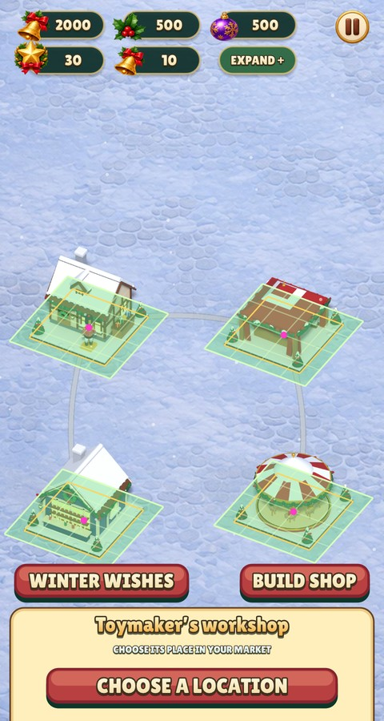 | 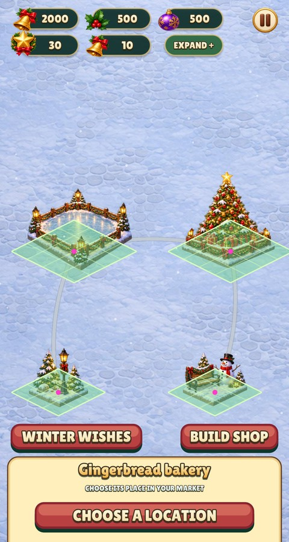 | 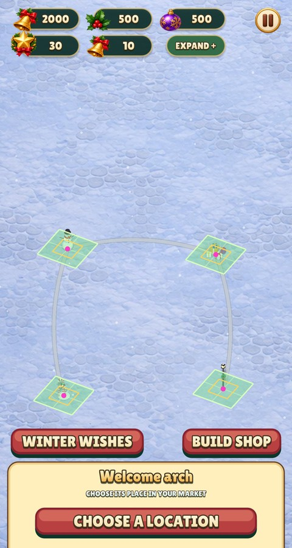 | 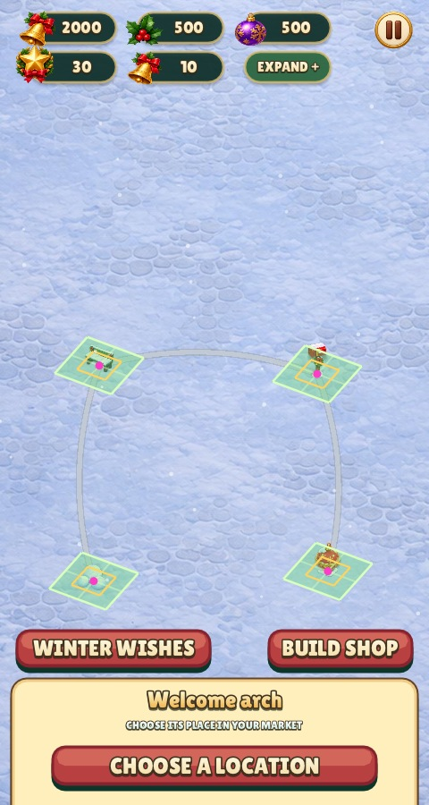 |
| 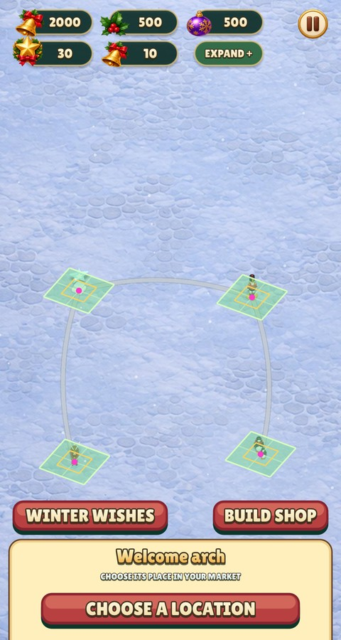 | 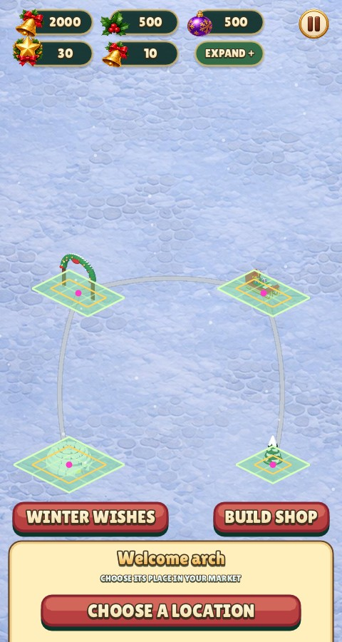 | 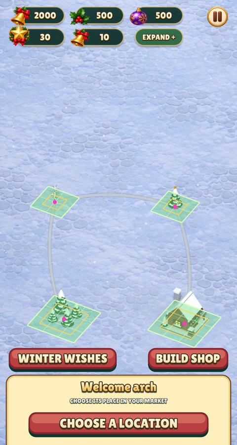 | 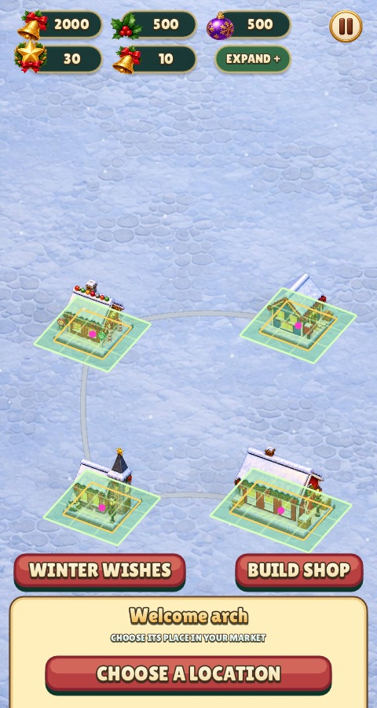 | 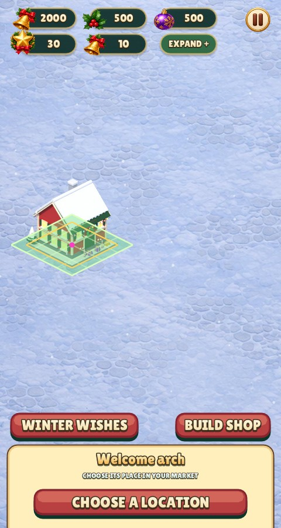 |

The contact sheet of all 37 objects:

