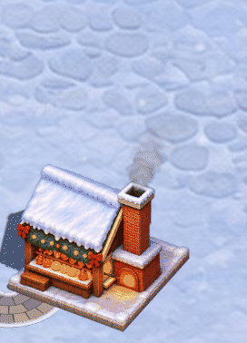

# Christmas Market chimney review

Each comparison shows the earlier sprites on the left and the open flues with live smoke on the right. The native game renders every image. The close-up reel follows the Glassblower's stall for one smoke cycle.

| Buildings | Capture |
| --- | --- |
| Gingerbread bakery and Hot cocoa kiosk | [480×900 before and after](page-1.jpg) |
| Toymaker's workshop and Candlelight shop | [480×900 before and after](page-2.jpg) |
| Lakeside smokehouse | [480×900 before and after](page-8.jpg) |
| Gingerbread house | [480×900 before and after](page-9.jpg) |
| Woodcarvers' hall, Station kiosk and Glassblower's stall | [480×900 before and after](page-10.jpg) · [390×844 before and after](phone.jpg) |

The source models show complete flues and snow on the rims. [Blender review](model-flues.jpg) · [Artwork and import instructions](../../building-catalogue.md#open-chimneys-and-live-smoke)

Run the registered captures with `build/test/all --suite=christmas-market "shot chimney-" "reel chimney-smoke"`.
