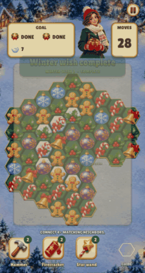

# Dialog motion on the tween module

The dialogs' entrance, exit and the result screen's parts moved from a hand-kept
clock (`R.modal_clock`, `R.modal_exit`) onto the engine's motion module
([docs/MOTION.md](../../../../../docs/MOTION.md)). The look is unchanged: the
settled stills (`pause`, `guide`, `failed`, `reward`) are pixel-identical to
the previous build, and the entrance below differs only by the one frame a
tween takes to start on the next engine tick.

| Before | After |
| --- | --- |
|  |  |

`--victory --reel`, 480×900, 16 pictures 6 frames apart.
