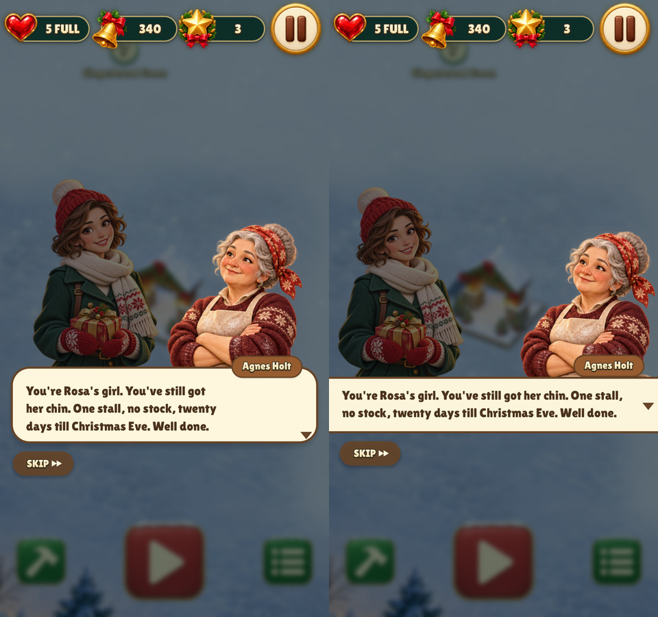
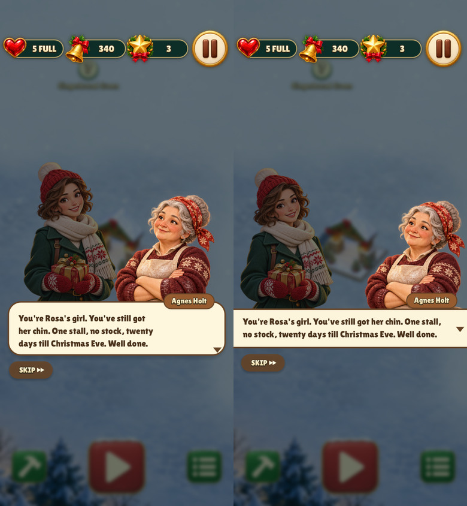

# Christmas Market dialogue bar

Christmas Market and Relic Rush use the same dialogue layout in the engine.
On phones, the portraits stand at the screen edges and face each other. The
text is centered vertically in the full-width bar, with the speaker's name above it.

Each comparison shows the previous layout on the left and the shared layout on
the right.

| Size | Noelle and Agnes |
| --- | --- |
| 480×900 |  |
| 390×844 with safe areas |  |

Reproduce the captures with `build/test/christmas-market 'shot dialogue-bar-'`.
