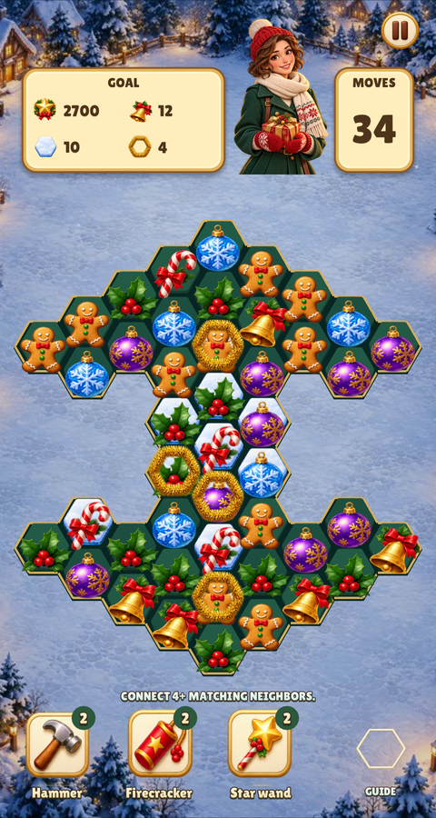
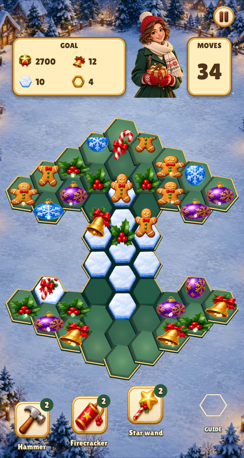
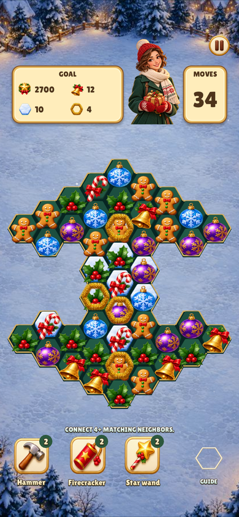
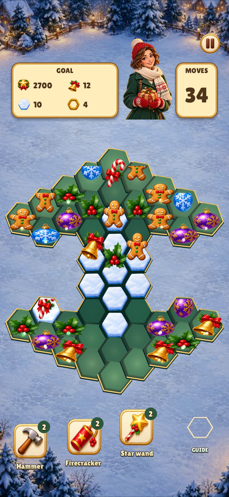
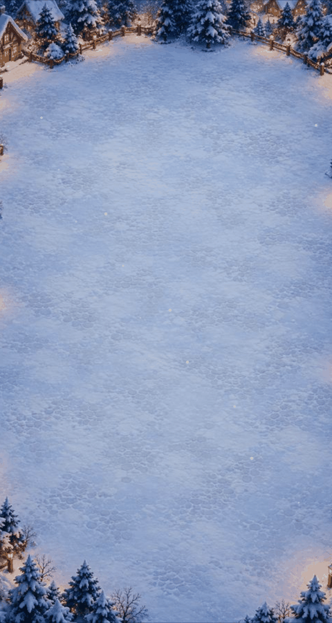

# christmas-market: board entrance review

The board's existing artwork enters on `engine/board_intro.lua`'s shared clock.
The goal panel and tools arrive first; cells ripple from the centre, pieces drop
down their column segments, blockers land and a light sweep completes the entrance.
The same shared match engine continues to own moves, cascades and diagonal refill.

| Size | Before (settled board immediately) | After (entrance at frame 31) |
| --- | --- | --- |
| 480×900 |  |  |
| 390×844, safe areas |  |  |

| 480×900 timeline | 390×844 timeline |
| --- | --- |
|  |  |

The final boards are [480×900](settled-480x900.png) and
[390×844](settled-390x844.png). Every frame was inspected, including HUD arrival,
column masking, holes, blockers and the completed board.

Reproduce the current animation with `build/test/christmas-market board-intro`.
The manifest renders both sizes in one process. The 480×900 reel captures 18
frames at six-frame intervals; the phone reel captures 12 at eight-frame intervals.
Before captures use the parent revision's game Lua at the same level, frame and
screen size. Relic Rush uses level 5; Christmas Market uses level 4.
The phone uses `--safe-area 0,47,0,34`. The comparison uses `--frames 31`,
and the current version adds `--present`. PNGs are registered to logical size;
GIFs retain the same aspect and ordering. No artwork is generated or retinted.

A tap skips without selecting a piece or spending a move. Dialogue, modals and
the island pause the clock; reduced motion uses a quarter-second fade.
Tests cover those lifecycle transitions and board reset, alongside the games'
real input smoke runs and all existing atlas/state checks.
