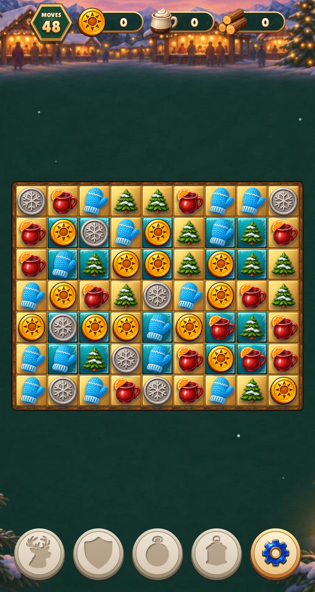
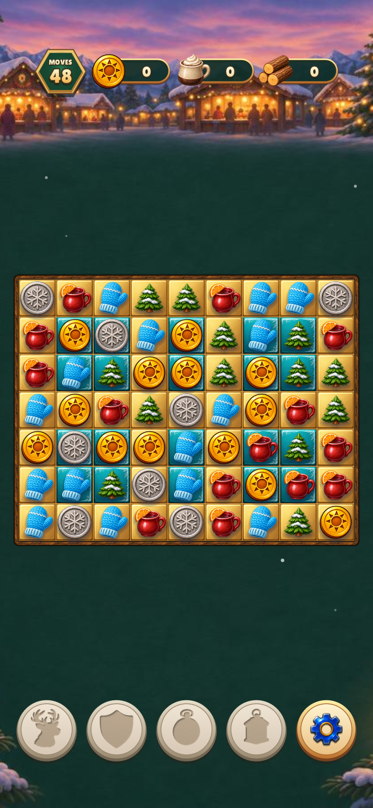
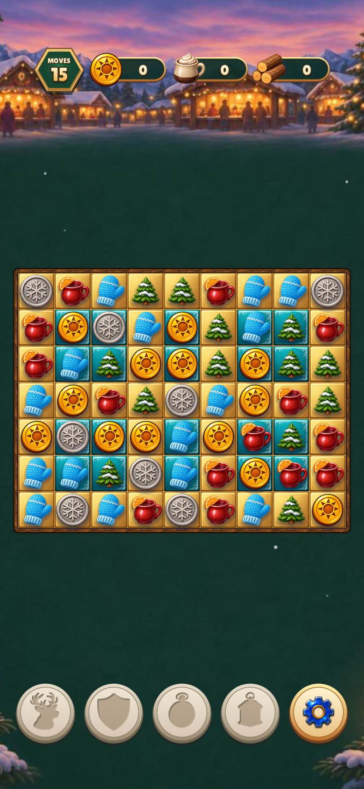

# Level 3 move-budget correction

Window Lights had a 12-move bot median but a 48-move budget: the old fitter
used a 2.5 tutorial multiplier and then expanded to cover 90% of bot starts.
Every tier now gets `ceil(median * 1.25)`, without a percentile override.
Level 3 therefore gets **15 moves**. Of the 40 calibration starts, 28 finish
within that budget without tools. This is a bot sample, not a human win rate.

The shared reference bot prioritizes target-layer and blocker progress over
incidental score. Its fallback rewards nearby refill opportunities more than
distant clears. Decisions use the visible board without random-refill lookahead.
Regression tests cover taking an available win over two larger incidental
matches, independence from hidden RNG, unchanged live state, rounding and
outlier-resistant fitting.

Both campaigns' 100 budgets and twenty purchase prices were refitted with 40
starts per board. Layouts and resource currency mixes are unchanged. Both full
campaign rule playthroughs place all twenty purchases on schedule with zero
replays for income.

| Size | Before | After |
| --- | --- | --- |
| 480 × 900 |  |  |
| 390 × 844, safe area |  |  |

All four native game captures were visually reviewed. Capture reproduction:
`build/test/christmas-market "shot balance-window-lights"`.
Budget and price reproduction: `make balance GAME=christmas-market` and
`make balance GAME=relic-rush` (40 starts by default).

Verification on 2026-11-20, elapsed seconds:

- Build: `make CFLAGS="-O2 -g -Werror" all build/test/all`, 0.18 s (up to date).
- Budget sampling: 42 s Christmas Market, 41 s Relic Rush (tool-reported rounded times).
- Income and price fitting for both games: 57.85 s.
- Tests: `make test`, 7.70 s inside its ten-second budget. All 91 engine/game
  tests passed. Two preflight checks failed on the separately modified,
  pre-existing `games/christmas-market/data/board/pieces.png`: Christmas asset
  inventory and atlas provenance. That artwork edit is outside this change.
- Campaign tests: `build/test/all --suite=relic-rush --suite=christmas-market
  --extended "rules campaign_play"`, 9.20 s, both passed.
- Captures: before 1.68 s; after 2.02 s, both pairs passed.
- Lint: `make lint`, 1.58 s, zero warnings/errors.
