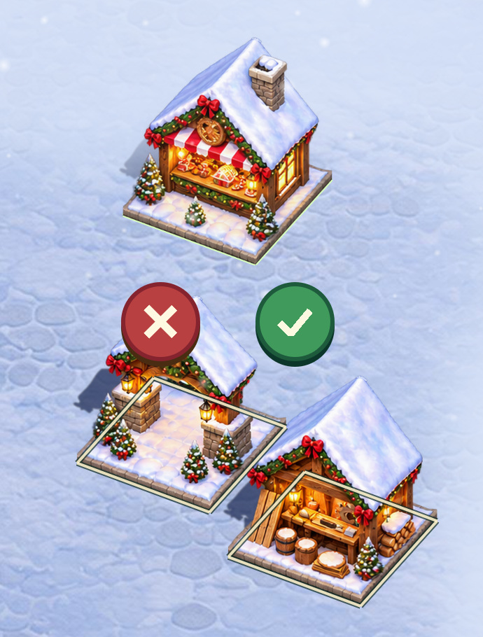
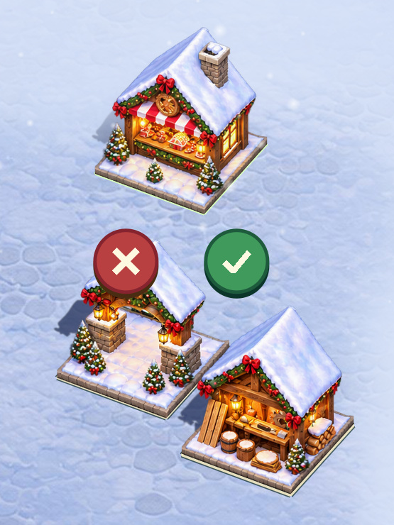

# Christmas Market placement guides

The Welcome Arch and Lumber Workshop cover the rear placement guides where
their sprites are opaque. The front guide edges remain visible at ground
level. Debug footprints show all four edges over the building art.

| Phone viewport | Before | After | Debug |
| --- | --- | --- | --- |
| 480 × 900 |  |  | [Full outlines](debug-480x900.jpg) |
| 390 × 844 |  |  | [Full outlines](debug-390x844.jpg) |

The before and after captures are cropped around the placement controls and
the three buildings. Reproduce the full views with:

```sh
build/test/christmas-market "shot placement" "shot phone-placement" "shot footprints" "shot phone-footprints"
```
