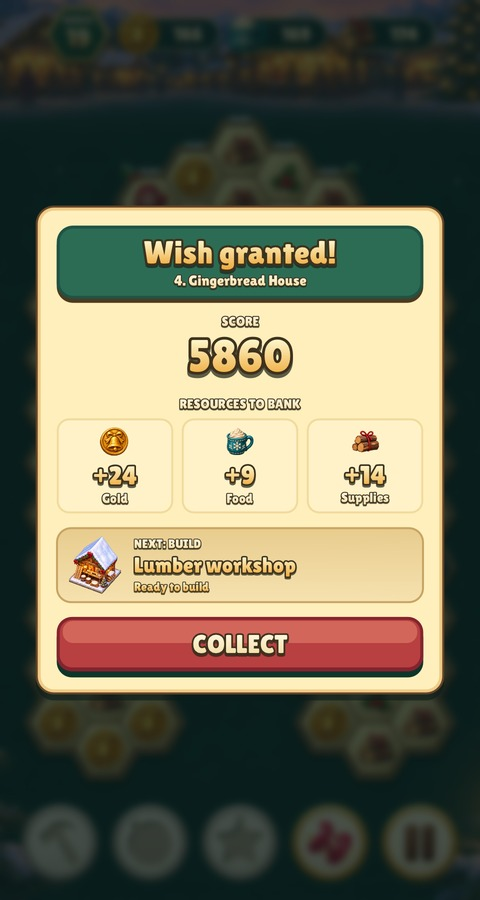

# Measured Results popup

Christmas Market uses the shared vertical Results form. The card measures the
three-column payout and the next step before placing Collect. The game still
supplies the goods, story-object and restoration data.

| 480 × 900 | 390 × 844 with safe areas |
| --- | --- |
|  |  |

Capture filter is `"shot result-layer"`.
