# Three-episode story review

The full script ([docs/story.md](../../story.md)) now plays: 36 scenes and 198 lines over thirty winter wishes. Noelle keeps her painted bust. Theo, Agnes, Henrik, Pip and Mr Wren now use painted portraits ([asset catalogue](../../asset-catalogue.md#story-cast)). Scenes play over the live market and boards. No building sprite, camera, footprint or pivot changed.

Captured with the existing single-process manifest:

```sh
make CFLAGS="-O2 -g -Werror" christmas-market build/test/christmas-market
xvfb-run -a ./build/test/christmas-market "shot story-" "shot phone-story-" "shot reward"
```

Raw frames are under `build/shots/christmas-market/`. Preview any scene with `--story-beat before-11`, or `--story-beat after-30 --story-line 15`, and `--frames 240` for fully typed text. Every image here was inspected.

| Scene | 480×900 | 390×844 |
| --- | --- | --- |
| Before: Noelle's old opening | 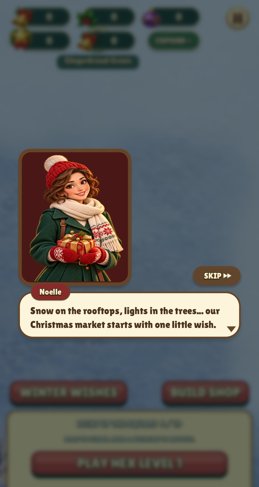 | 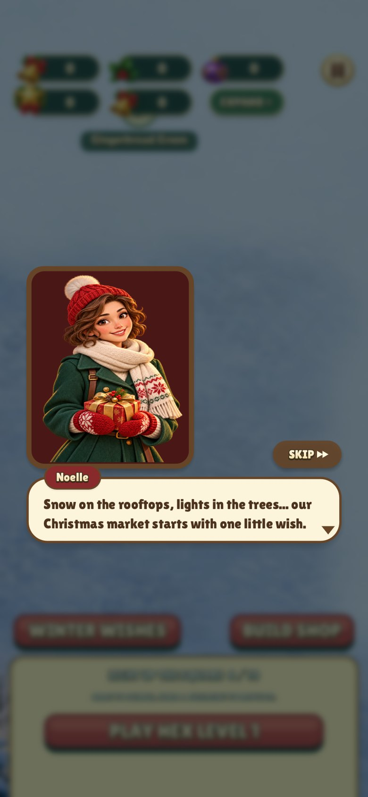 |
| Opening, the longest line (a thought) | 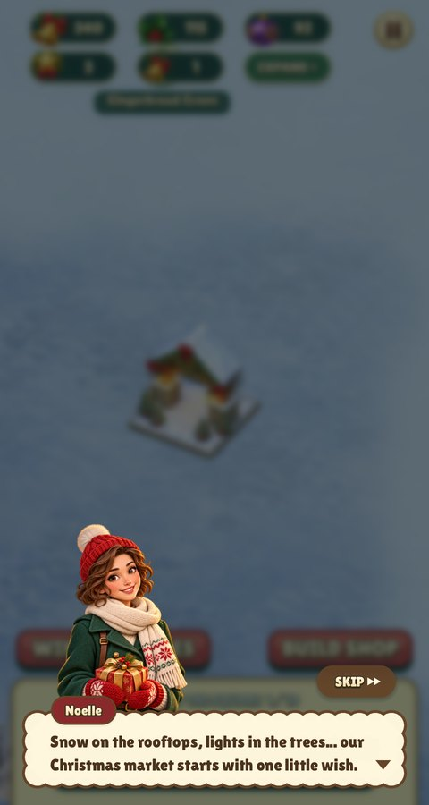 | 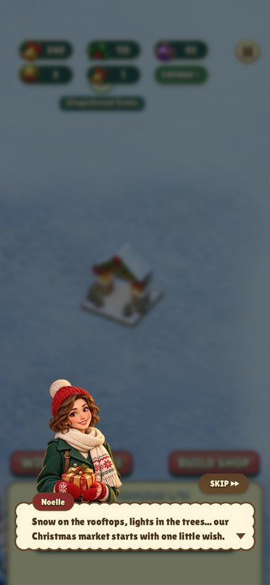 |
| Last finale line | 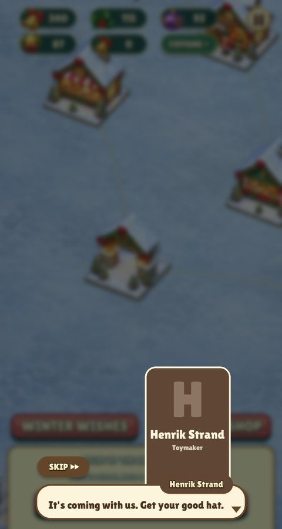 | 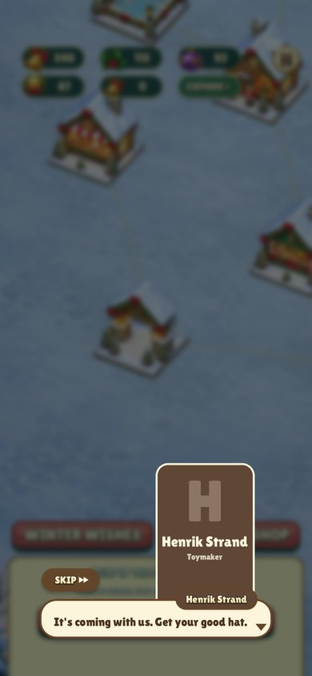 |
| End screen (before: [old finale](finale-before.jpg)) | 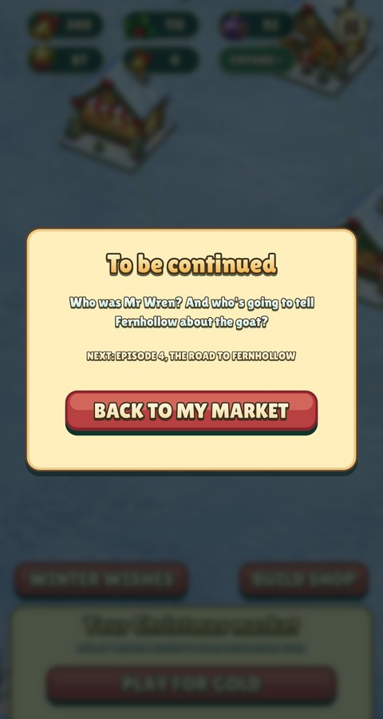 | 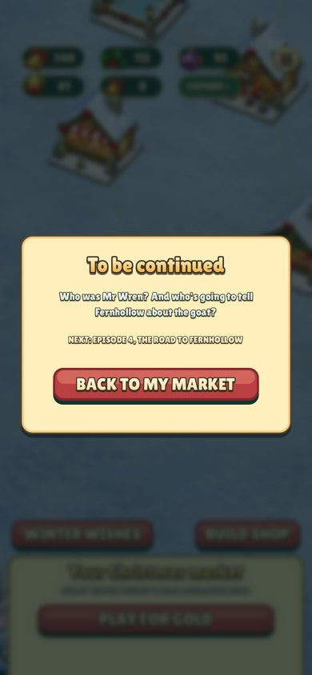 |

Results: [a stall-funding wish](reward.jpg) and [a story-only wish](reward-story.jpg). The story-only result shows spare Gold and "The market has news" instead of a stall. Later boards: [level 20, the ring](story-level-20.jpg), and [level 30, the star, on the phone](phone-story-level-30.jpg).

Busts are drawn without a frame or plate behind them. Each alpha cutout stands on the dialogue box, which hides the hard cut along the bottom of the image (the engine's unframed `story_style`). The after captures above show this.

## Supporting cast

| Speaker | 480×900 | 390×844 |
| --- | --- | --- |
| Agnes Holt | 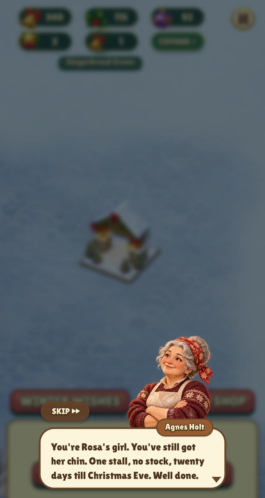 | 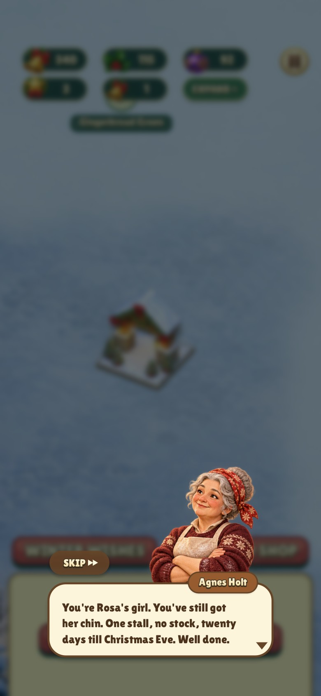 |
| Theo Marsh | 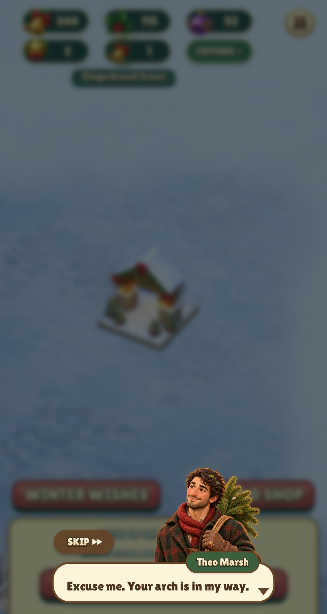 | 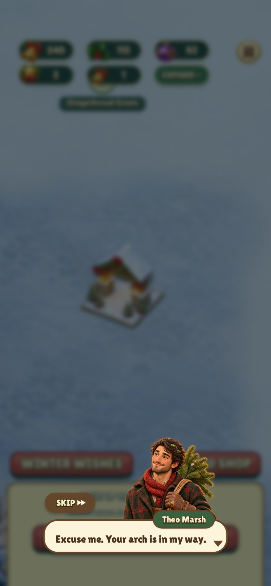 |
| Henrik Strand | 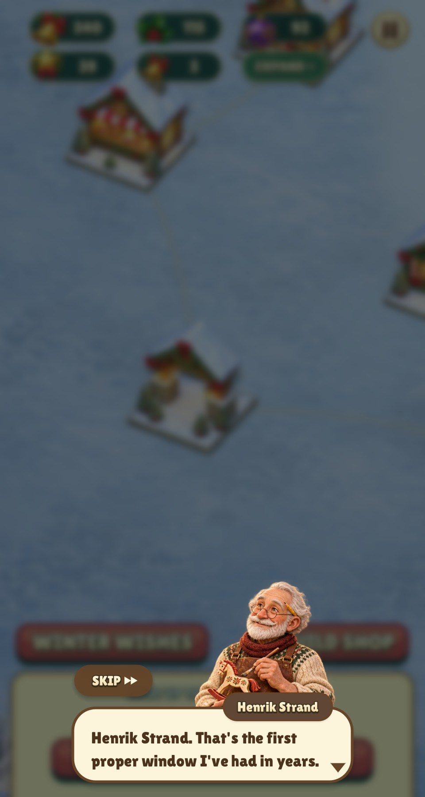 | 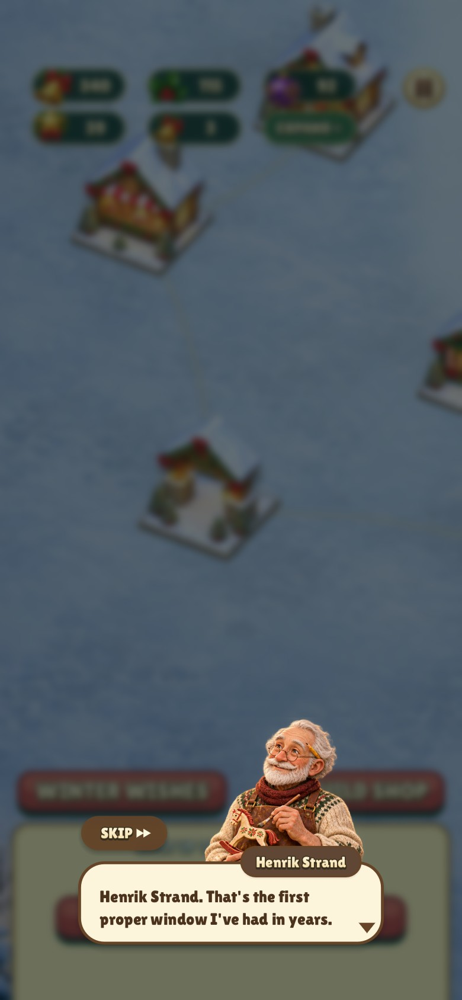 |
| Pip Larkin (shout) | 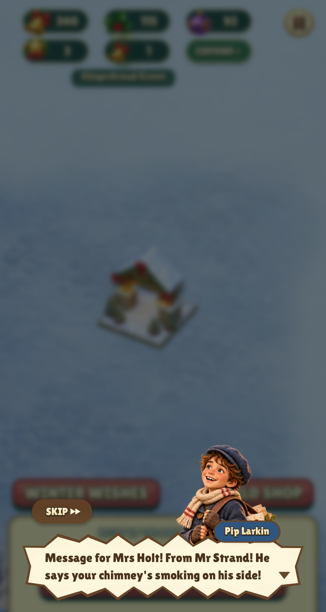 | 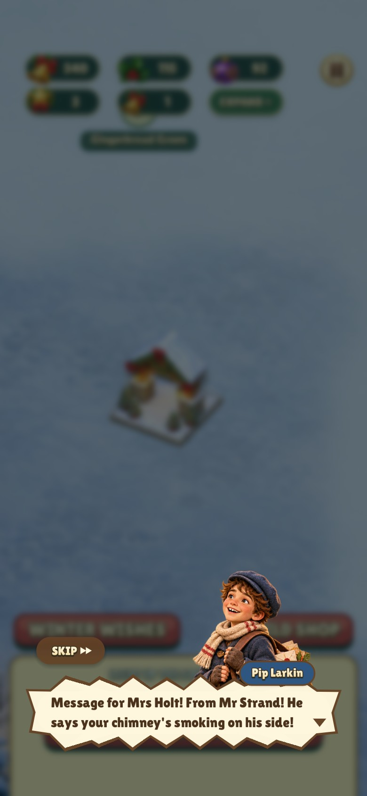 |
| Mr Wren | 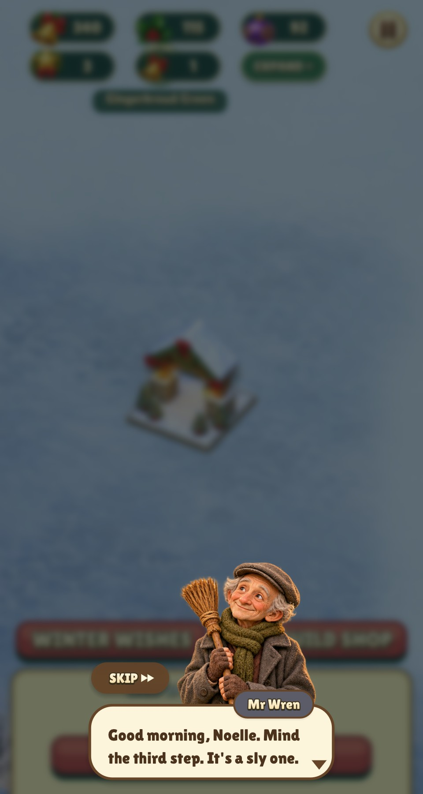 | 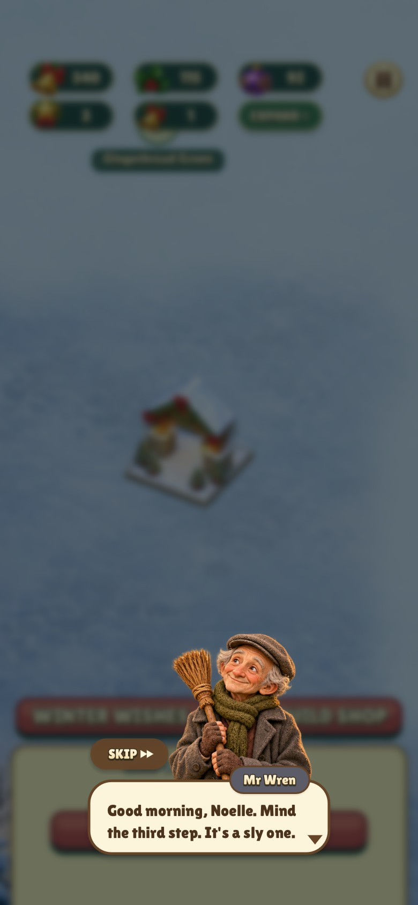 |

Agnes’s earlier name cards are available for comparison at [480×900](story-name-card.jpg) and [390×844](phone-story-name-card.jpg).
