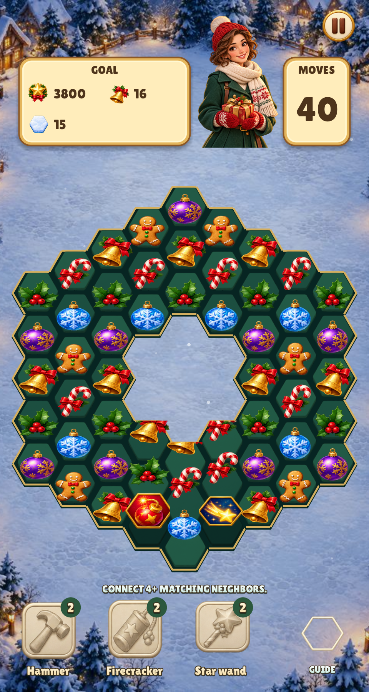
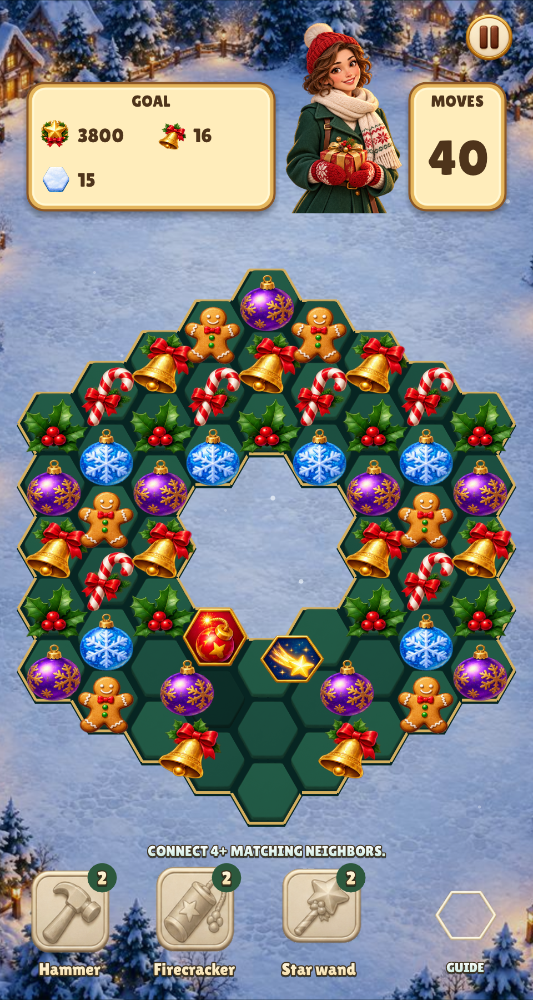
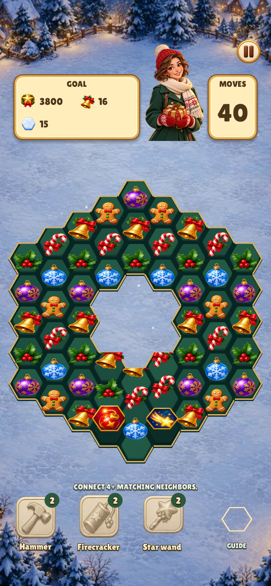
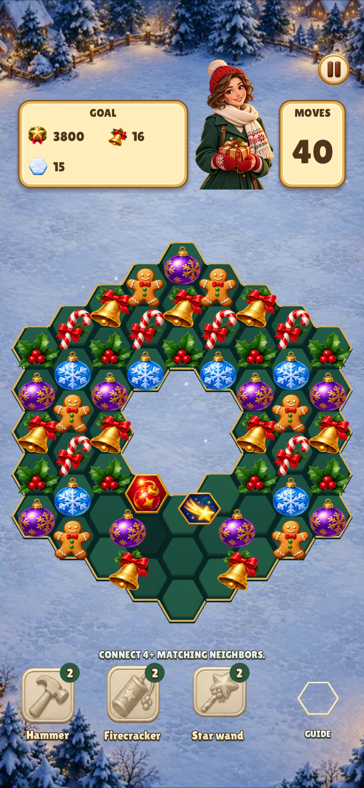
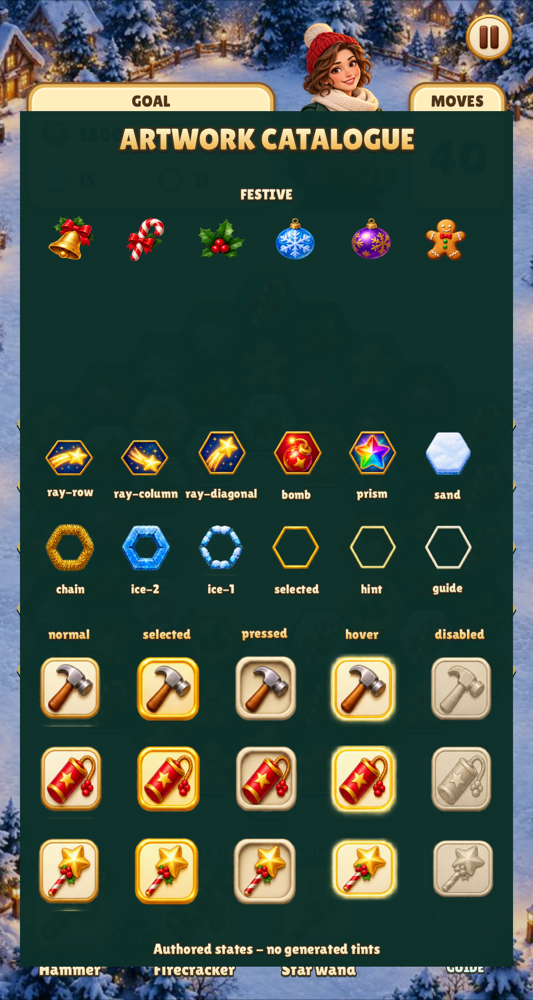
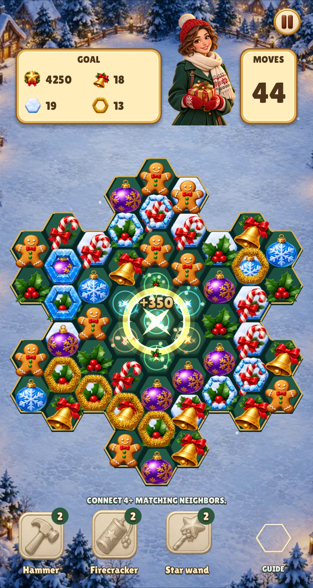

# Diagonal trickling and engine atlas review

Historical migration captures below show the former diagonal-first behavior.
Current gravity prefers straight down and permits a diagonal only when the
donor’s cell below is occupied, locked or missing.

The engine now owns the hex match rules and board interaction. The game supplies
campaign data, graphics and integer behavior flags. Both games use a single
atlas override; the neutral engine resource skin is available without one.
See [the engine contract](../../../../../docs/MATCH3_ENGINE.md).

The same seeded ring board has its lower centre cleared. The upper-left bomb
and upper-right directional special make sideways travel easy to see beneath
the large hole. Before is the preserved pre-change game capture, midway through its column
fall; after samples the shared engine halfway through its first 80ms neighbor
step. The new runner also records NO_TRICKLE vertical-reference frames. Later empty slots deliberately remain visible in this animation still:
they wait for gems from the sides instead of receiving pieces directly from
above the hole. Both layouts use the actual game renderer; phone captures
include 47px top / 34px bottom safe-area insets. macOS renders these at 2×.

| Size | Before: columns refill independently | After: reachable diagonals first |
| --- | --- | --- |
| 480×900 |  |  |
| 390×844 |  |  |

## Atlas audit

The packed frames preserve the source canvases and alpha exactly. These live
captures cover all piece packs, special axes, bomb/prism, blocker strengths,
selection/hint, all five states of each tool/Pause, and additive effects using
the same atlas as the ordinary pieces. No artwork gap was introduced.

| Board packs/layers/tool states | HUD/Pause states | Packed additive effects |
| --- | --- | --- |
|  |  |  |

Reproduce with `python3 tools/match3_atlas.py`, `make gen`,
`python3 tools/capture_trickling.py`, and
`python3 tools/capture_match3_default.py` (use Xvfb on Linux).
The capture script starts each test suite once; tests/games declares all cases
and tests/fixtures/trickling freezes the seeded board using engine flags.

Validation: `make CFLAGS="-O2 -g -Werror"`, `make test`, `make lint`, each game's
real-input `--smoke`, and native renderer tests. Shared regressions now cover
straight-down priority, blocked-down diagonal fallback, voids, ice/chains, inlet spawning, competing
destinations, conservation, deterministic replay and all ten masks. The
update-loop regression waits for every fall step in normal/reduced motion.
