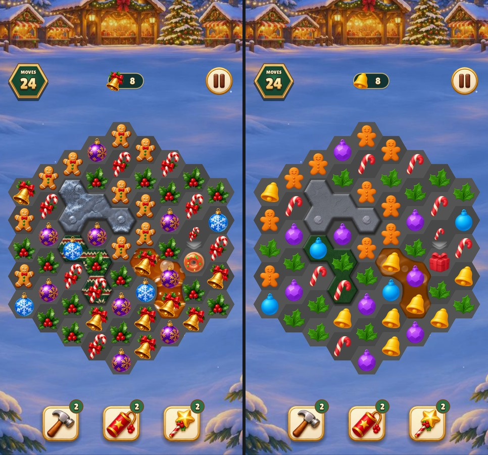
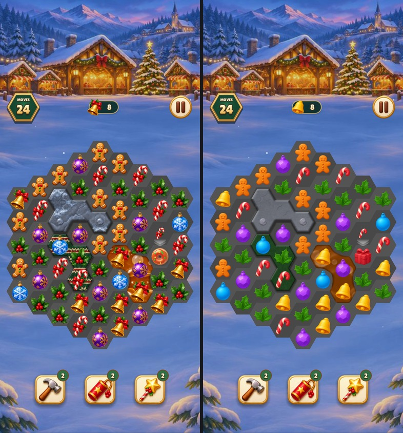
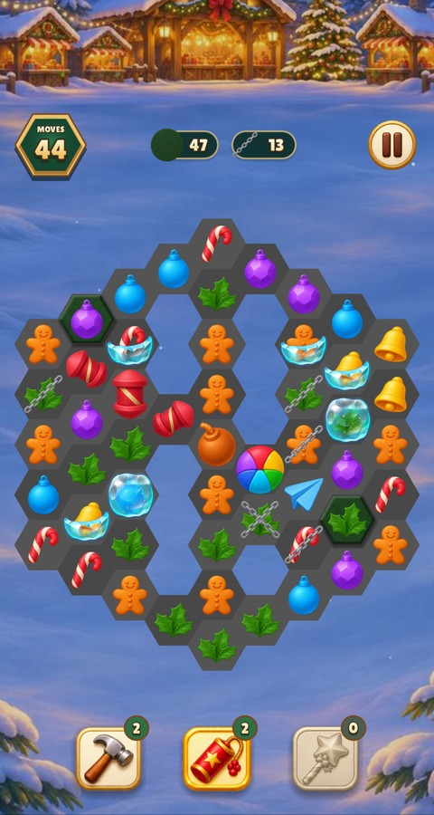
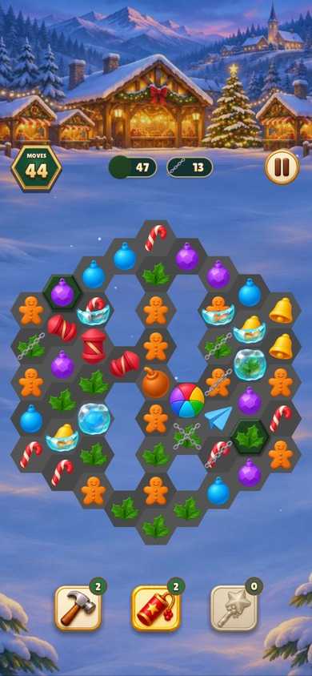

# Christmas Market board palette

The surface comparisons show the previous artwork on the left and the new
palette on the right. The power-up captures show the three rocket axes, bomb,
rainbow ball, plane, one- and two-layer chains and the existing tools.

| Board | 480 × 900 | 390 × 844 |
| --- | --- | --- |
| Before and after |  |  |
| Power-ups |  |  |

The game rendered these boards using the existing \`--element-states\` and
\`--art-board\` captures. The source images, prompts and registrations are in
the [asset catalogue](../../../asset-catalogue.md#themed-board-art).
