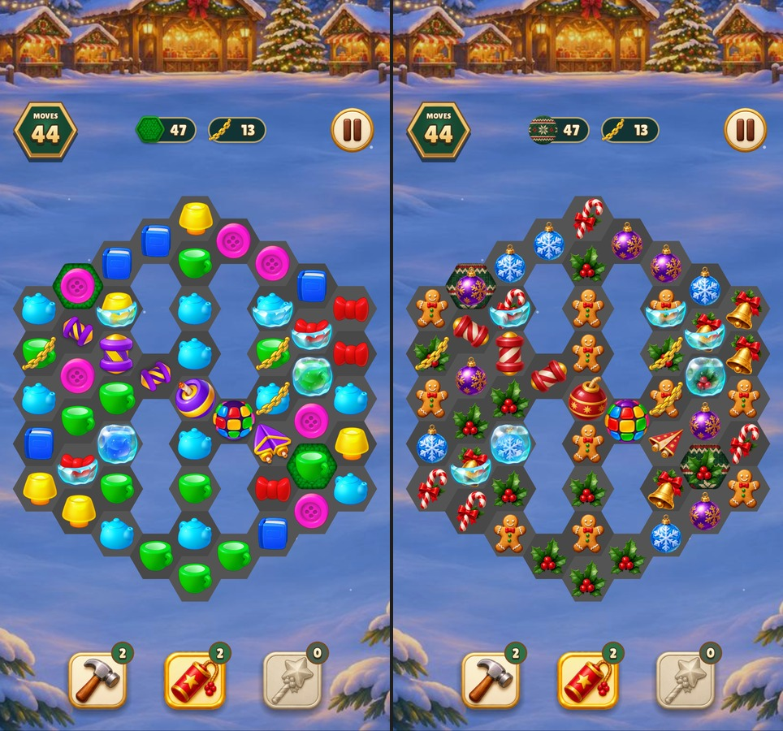
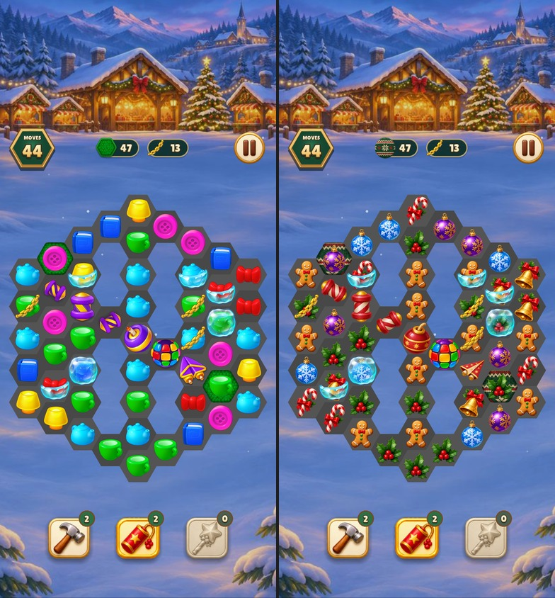
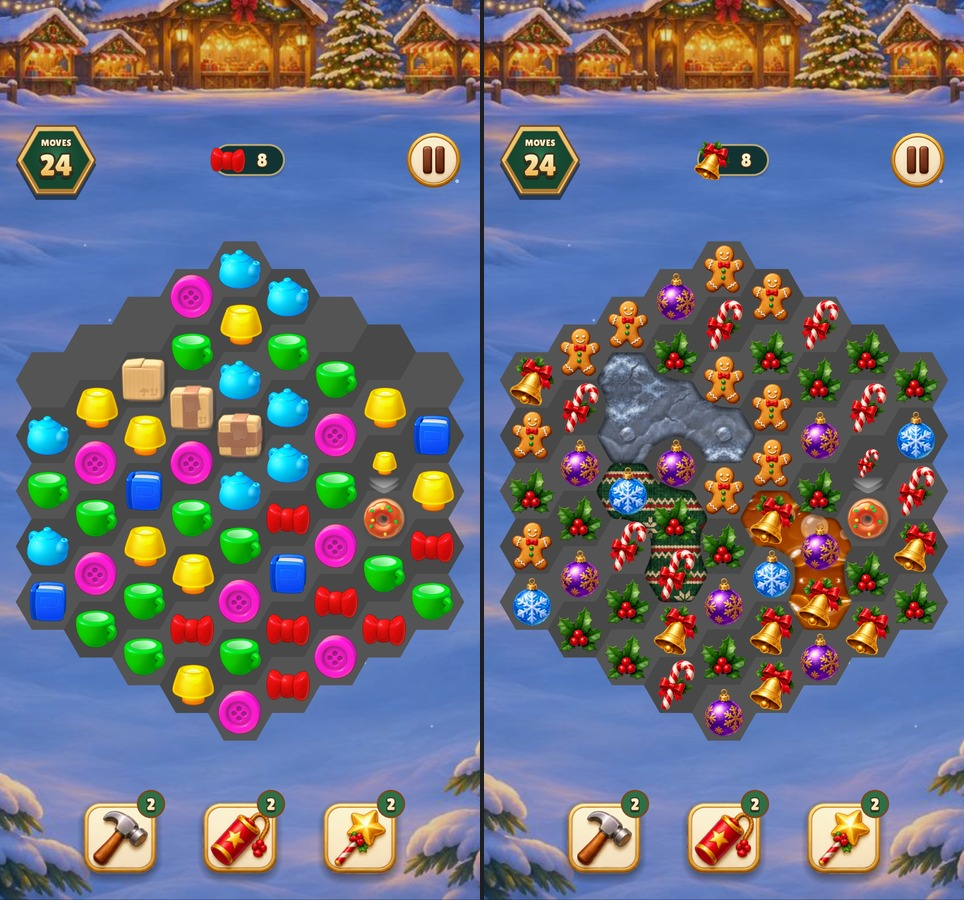
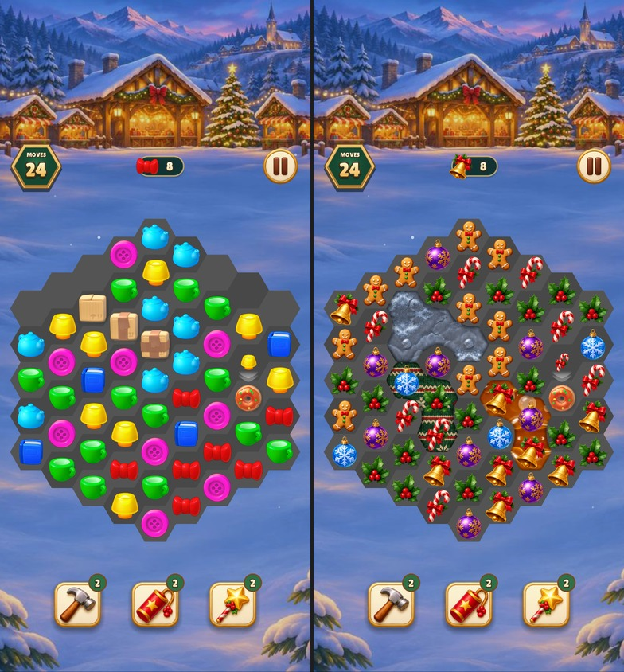

# Christmas Market board art review

Each capture shows the previous board on the left and the themed board on the right.
The specials board shows all three rockets, bomb, rainbow ball, paper plane and
ordinary chips. The surface board shows neighboring stones with one, two and
three hits remaining, connected carpet and oil, and the ordinary chips.

| Board | 480 × 900 | 390 × 844 |
| --- | --- | --- |
| Specials |  |  |
| Surfaces |  |  |

Reproduce with the existing \`--art-board\` and \`--element-states\` captures.
