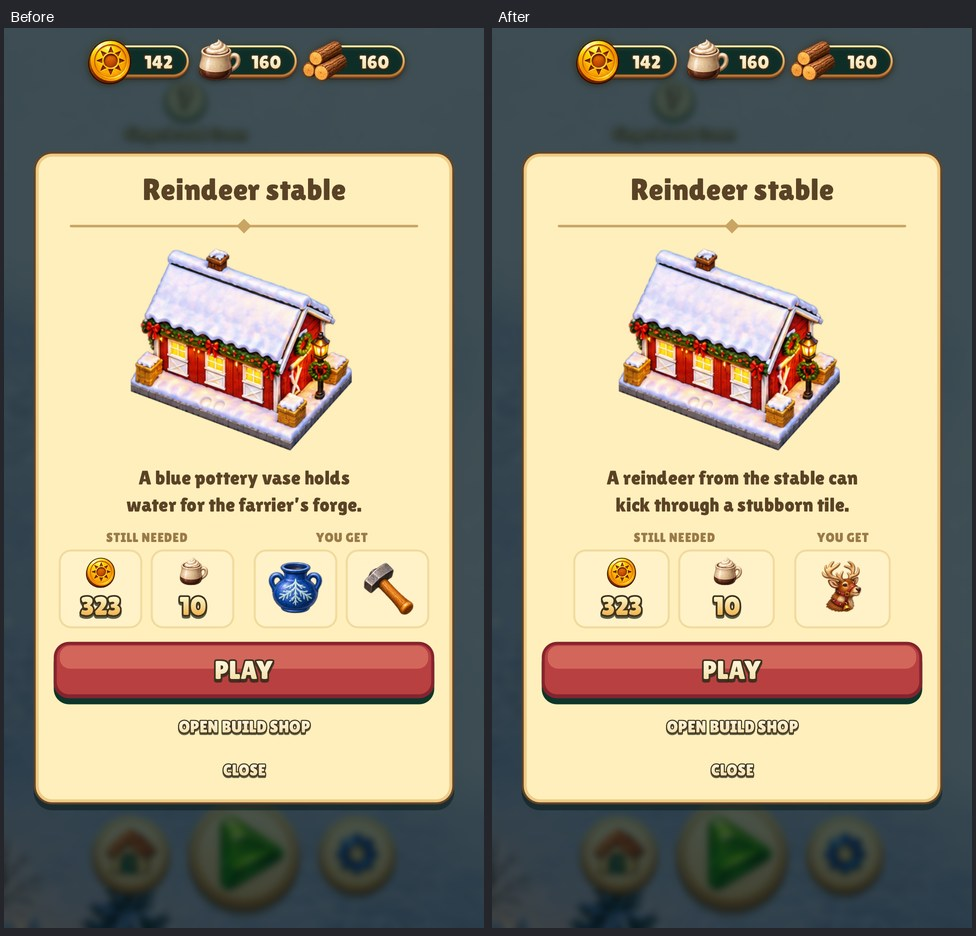
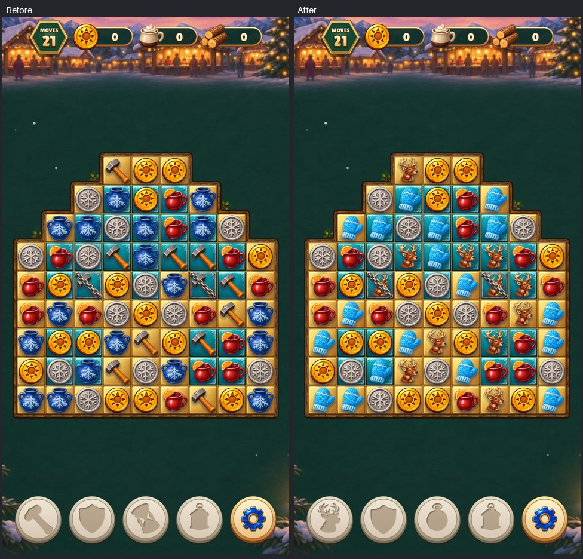
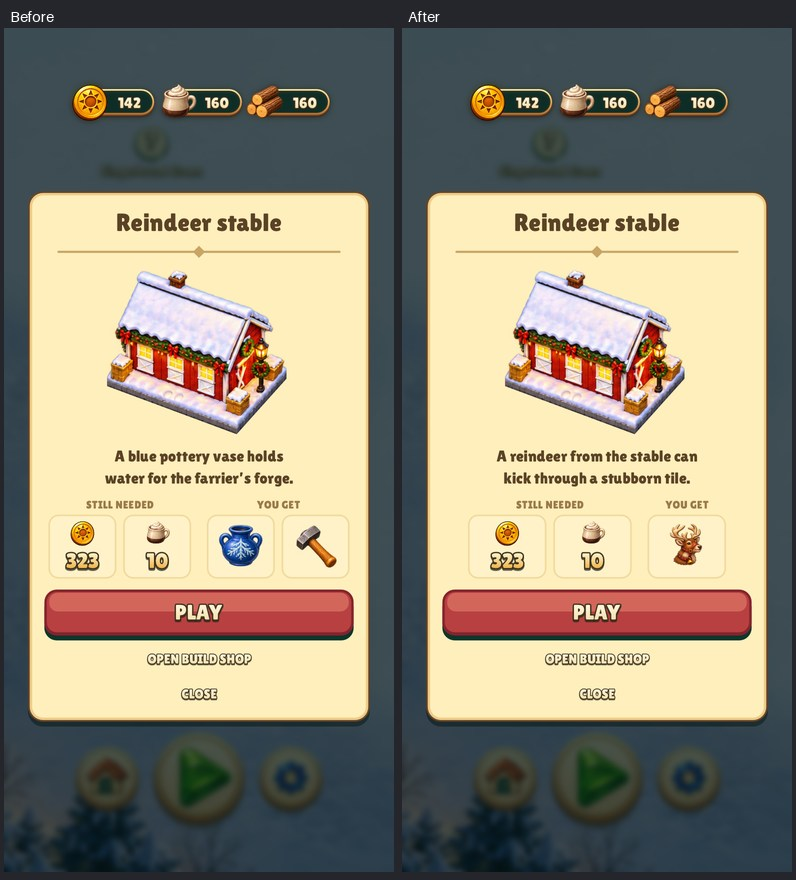
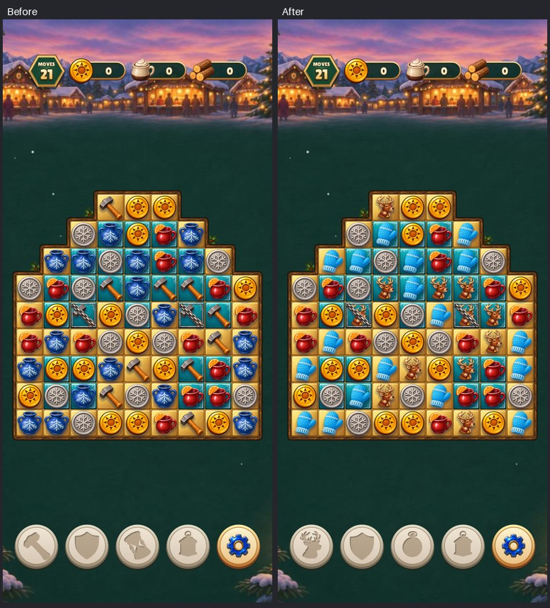
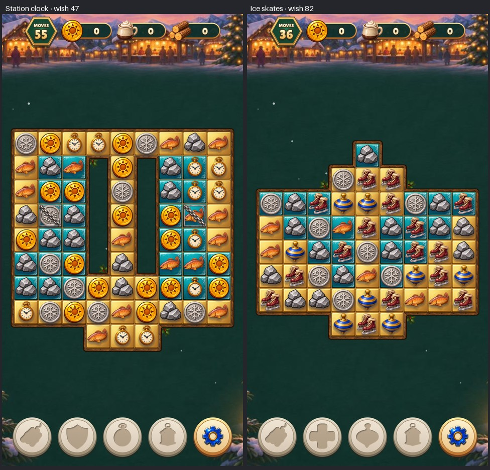
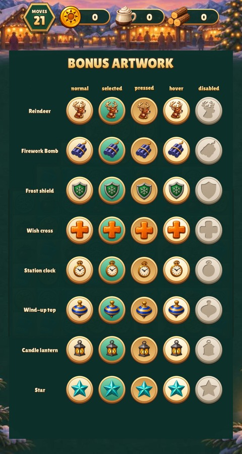

# Building rewards in play

The Reindeer stable introduces the reindeer. Matching 30 charges a kick on one cell. The station clock adds five moves, and matching ice skates pays Tokens. [All 20 purchases alongside Cradle of Rome 2](../../../../../../docs/cradle-of-rome-reference/building-rewards.html).

| Size | Stable card | Wish 7 board |
| --- | --- | --- |
| 480 × 900 |  |  |
| 390 × 844 |  |  |

Reproduce the in-game captures with `build/test/all --suite=christmas-market 'shot purchase-'`.
