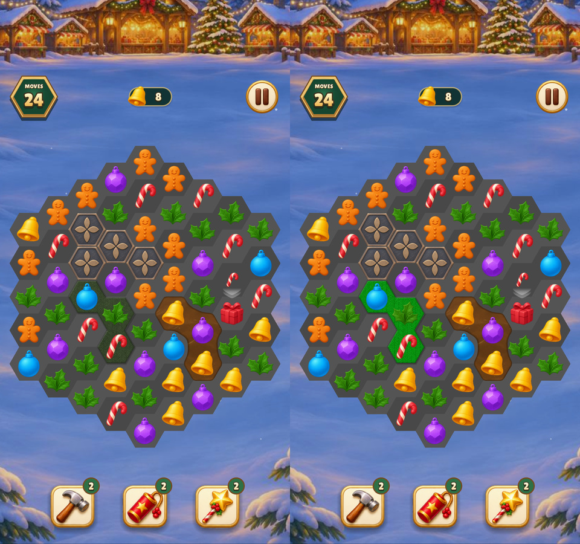
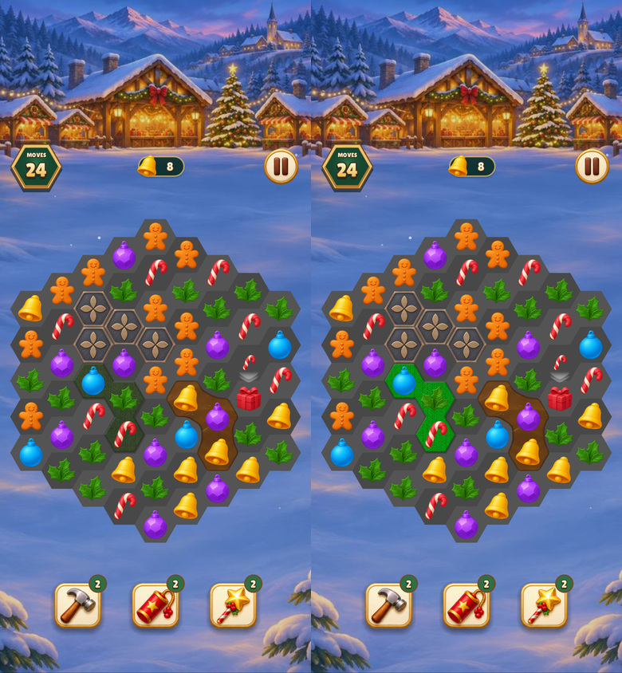

# Homescapes carpet color

The previous carpet is on the left. The grass-green carpet is on the right.
The woven patch and rolled goal icon use the
[Homescapes palette](../../../../../../engine/art/homescapes/sprites/carpet-swatch.png).
The [paint sheet](../../../../../../art/match3-carpet-paint/source.png) and
[prompts](../../../../../../art/match3-carpet-paint/prompt.txt) record the edit.

| Phone size | Before and after |
| --- | --- |
| 480×900 |  |
| 390×844 |  |

```sh
python3 tools/match3_atlas.py
./build/test/all --suite=christmas-market 'shot element-states' 'shot phone-element-states'
```
