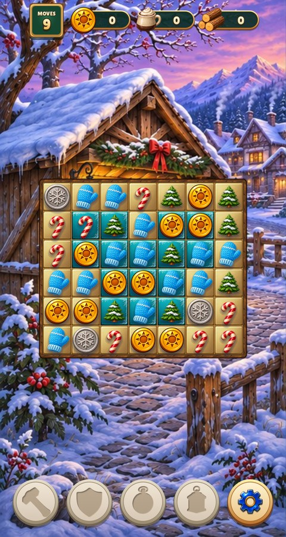
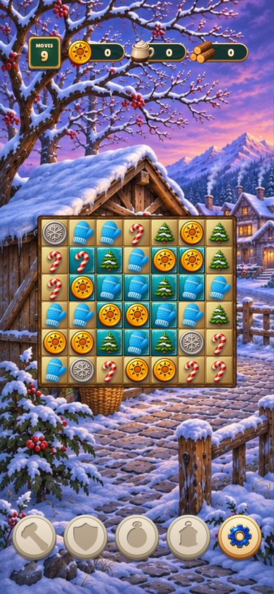
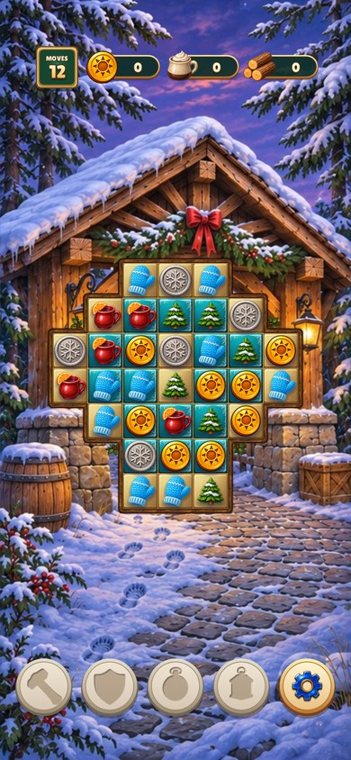
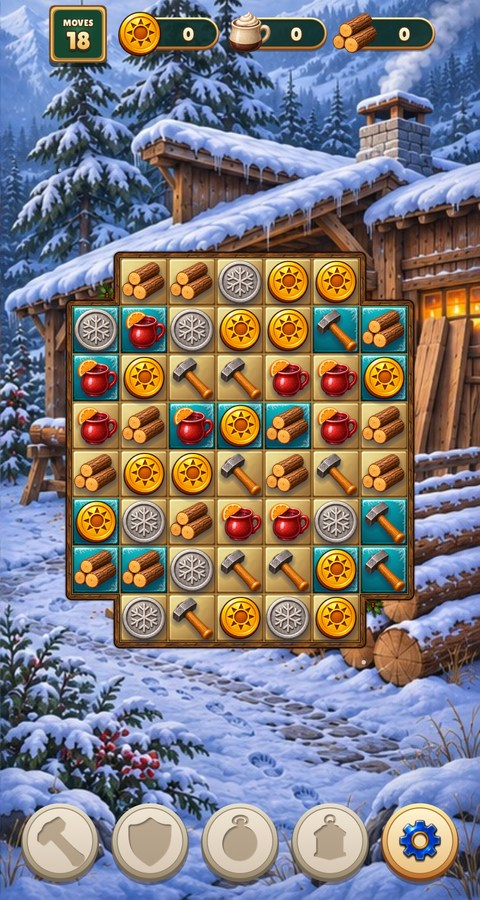
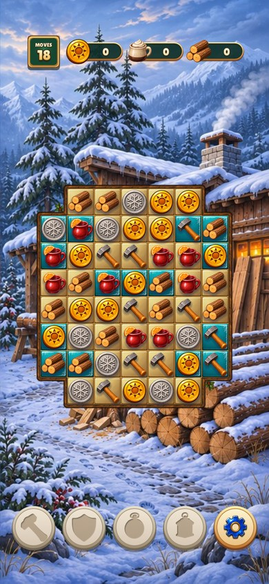

# Bellmere's first four board backdrops

The first wish shows the village square. The next three scenes appear on the
first eligible wish after the matching building is confirmed. Later wishes
retain the workshop scene until another backdrop is added.

| Wish | 480 × 900 | 390 × 844 with phone safe area |
| --- | --- | --- |
| 1 · Opening square |  |  |
| 2 · Welcome Arch |  |  |
| 7 · Reindeer Stable |  |  |
| 12 · Lumber Workshop |  |  |

```sh
make christmas-market build/test/christmas-market
build/test/christmas-market 'rules christmas' 'smoke walkthrough-pointer' \
  'shot lantern-opening' 'shot purchase-stable-board' 'shot construction-backdrop'
```
