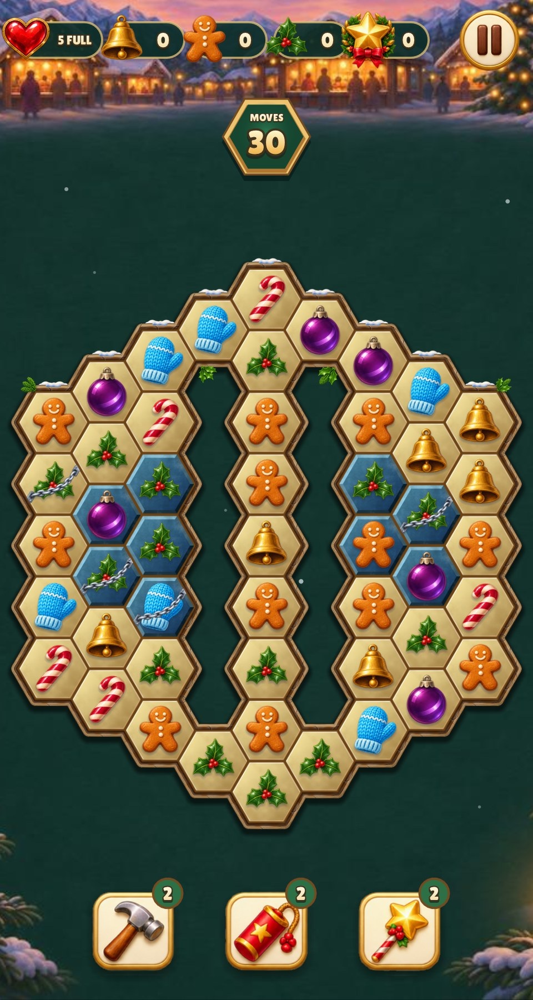
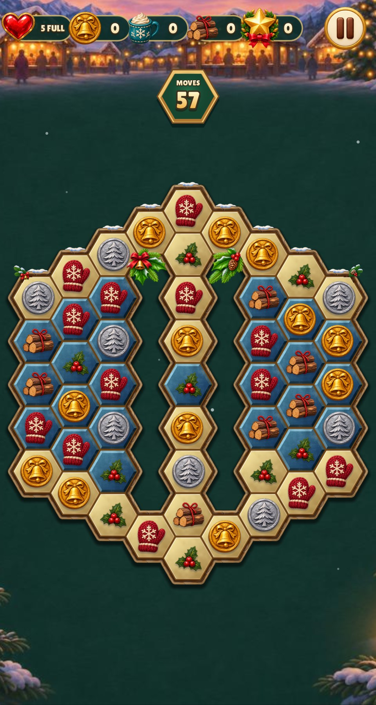
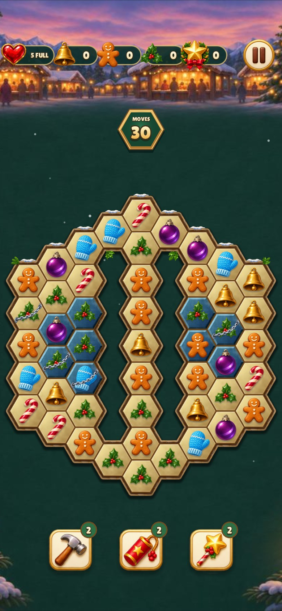
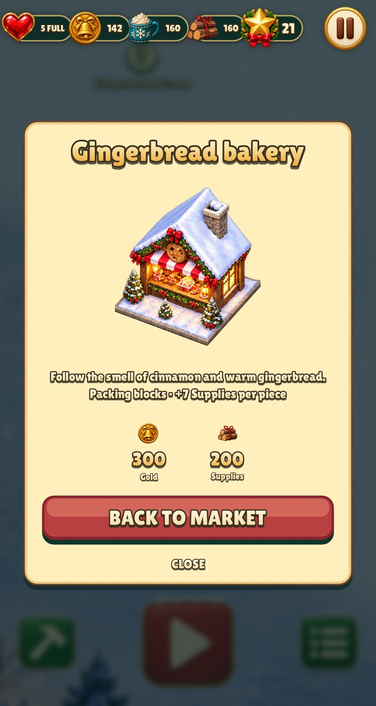
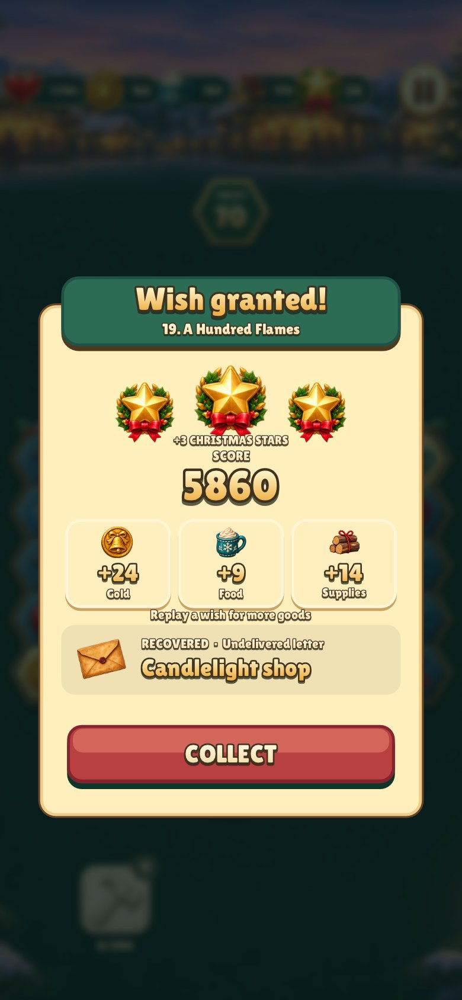
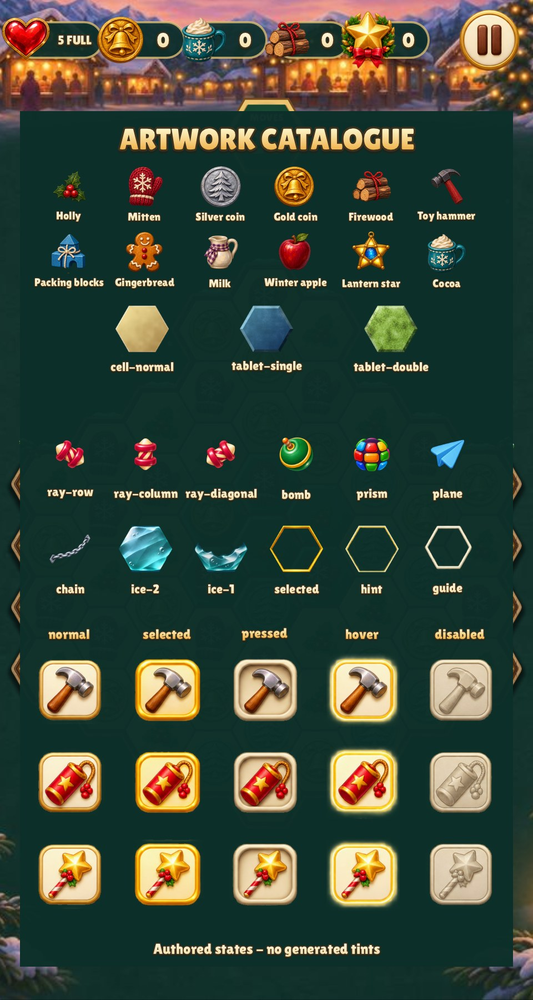
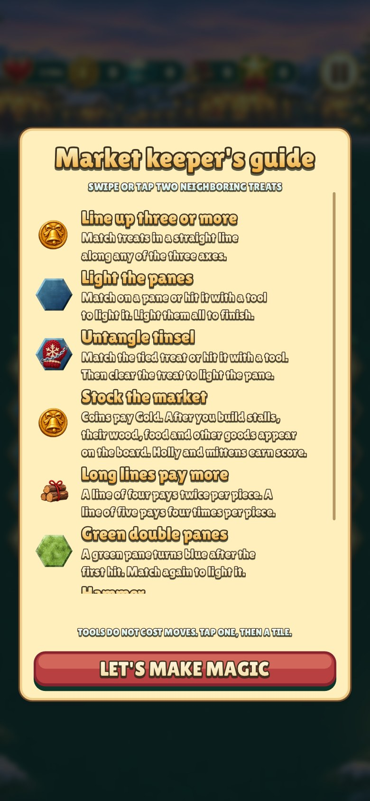

# Christmas Market · the resource prototype in game

Wish 4 shows the firewood earned after building the arch and the expanded
pane pattern. The first tool arrives after Theo’s workshop, so there is no
tool row on this wish.

| Size | Previous campaign | Resource prototype |
| --- | --- | --- |
| 480×900 |  |  |
| 390×844 |  |  |

| Wish 20 · green double panes and Lightning | Bakery · price and new piece | Wish 19 · letter and earnings |
| --- | --- | --- |
|  |  |  |

The results screenshot uses the standard victory fixture. The actual
campaign payouts are in the [20-wish record](../../../resource-prototype.md).

| Registered pieces and tool states | Guide |
| --- | --- |
|  |  |

Capture the current screens from the repository root using one test process.

```sh
build/test/christmas-market "shot main-character-board" "shot phone-board" \
  "shot story-level-20" "shot building-card" "shot find-letter-reward" \
  "shot art-states" "shot phone-guide"
```
