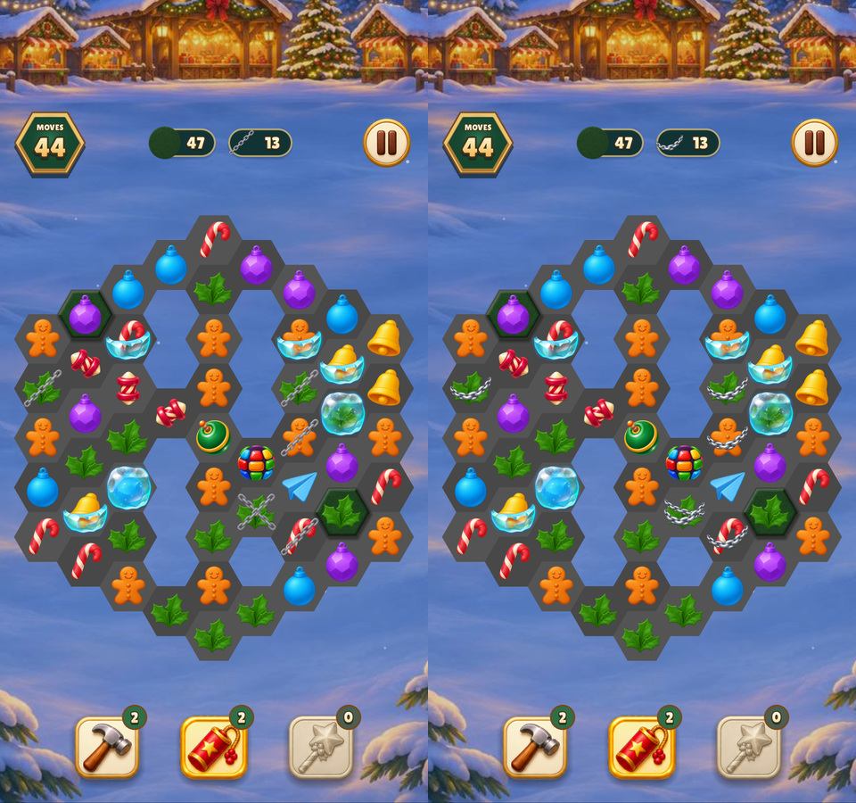
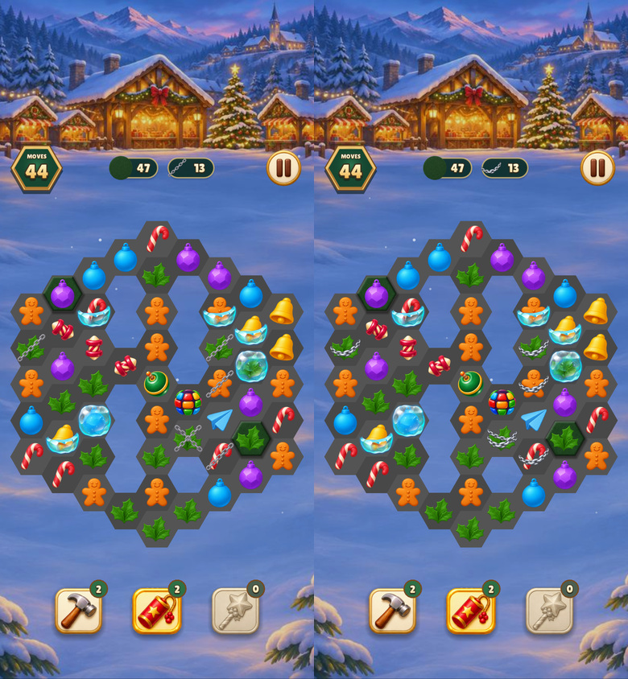
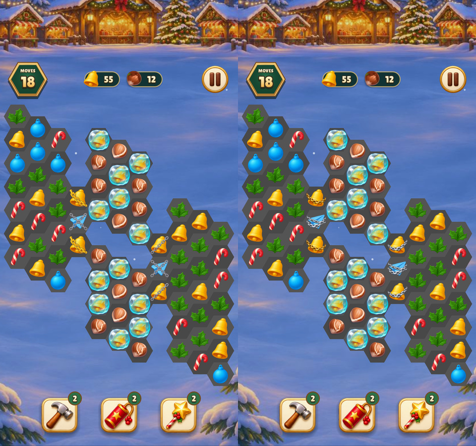

# Curved chain overlays

The left side shows the previous chains. The right side shows the hanging
curves painted to wrap around the front of the chip. The campaign board shows
one and two silver strands. The source board also shows the mirrored gold strand.

| Board | Before and after |
| --- | --- |
| Campaign at 480×900 |  |
| Campaign at 390×844 |  |
| Source board at 480×900 |  |

```sh
python3 tools/match3_atlas.py
./build/test/all --suite=christmas-market 'shot pieces-board' 'shot phone-pieces-board'
```
