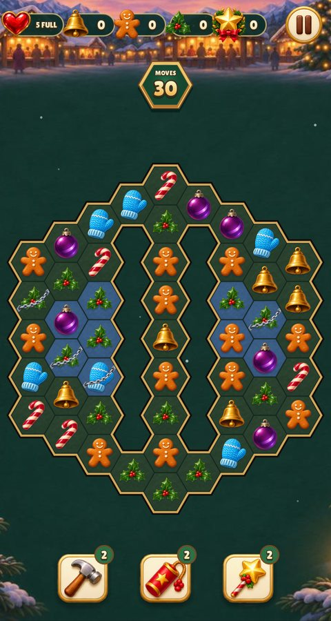
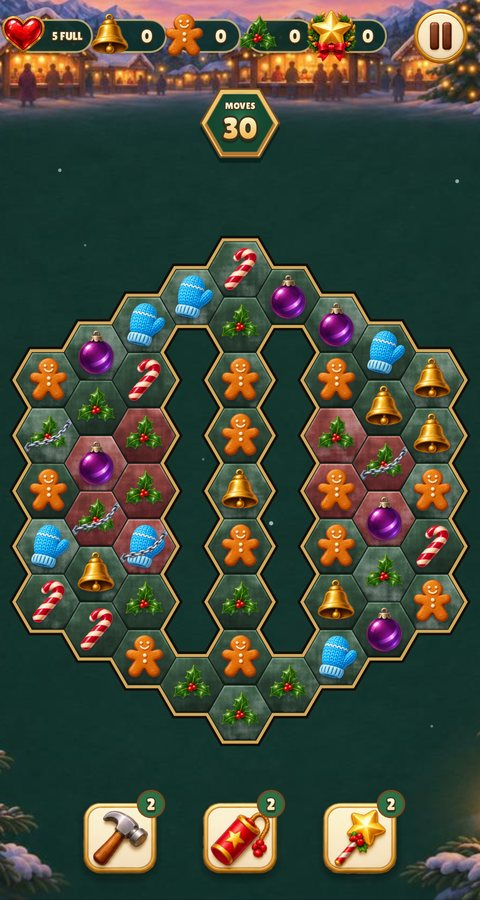
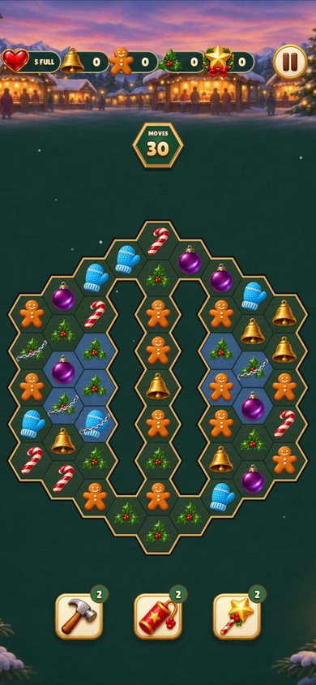
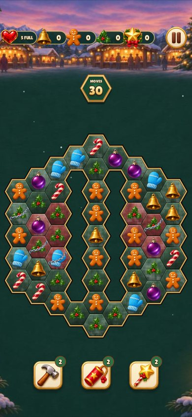
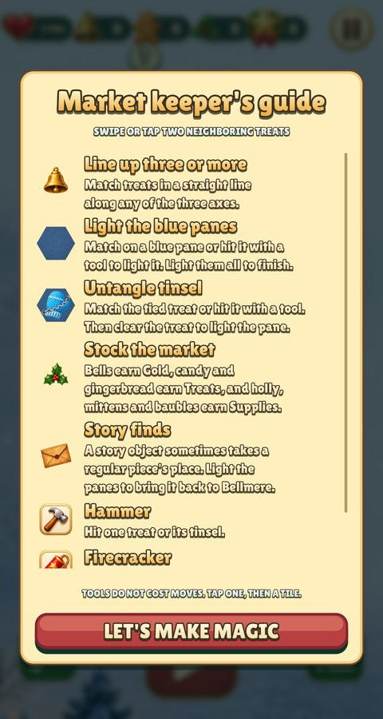
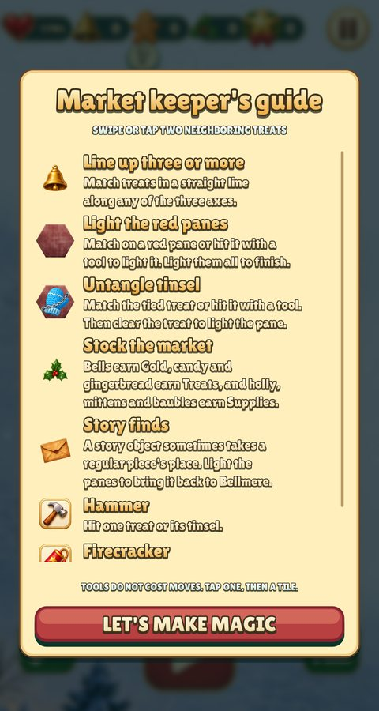
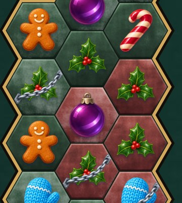
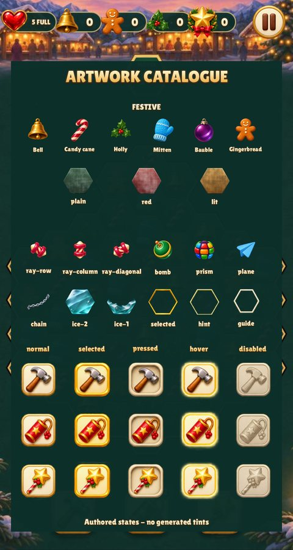

# Drawn lantern panes

The three lantern panes are drawn by the game instead of painted bitmaps, the
same way as Relic Rush's plaques: lit from above with a bevelled edge and
frosted by a neutral grain. Panes to light are muted cranberry red beside
muted spruce green, and cleared panes glow honey amber; all three are skin
colours. "Before" is the painted spruce and slate-blue panes.

| Screen | Before | After |
| --- | --- | --- |
| Level 4, 480×900 |  |  |
| Level 4, 390×844 |  |  |
| Market keeper's guide |  |  |

| Cell detail, 2× | Artwork catalogue (all three panes) |
| --- | --- |
|  |  |

```sh
python3 tools/board_grain.py games/christmas-market/data/board-grain.png --seed 11
./build/christmas-market --headless --mute --fresh --size 480x900 --level 4 --shot board.png
./build/christmas-market --headless --mute --fresh --size 480x900 --art-states --shot materials.png
```
