# Lantern panes

Cocoa Corner shows blue panes both with and without one-hit tinsel. The board
surface has hairline seams. The town wallet and Pause control follow the same
layout on the board. The guide shows the blue pane, tinsel and the three tools.

| Screen | Before | After |
| --- | --- | --- |
| Cocoa Corner, 480×900 | 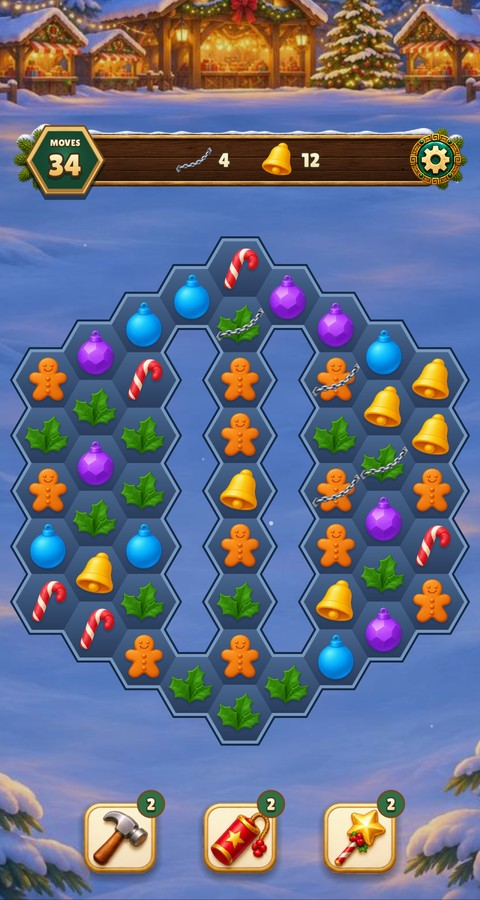 | 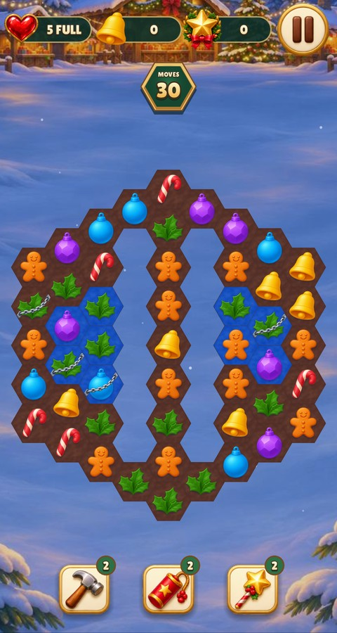 |
| Cocoa Corner, 390×844 | 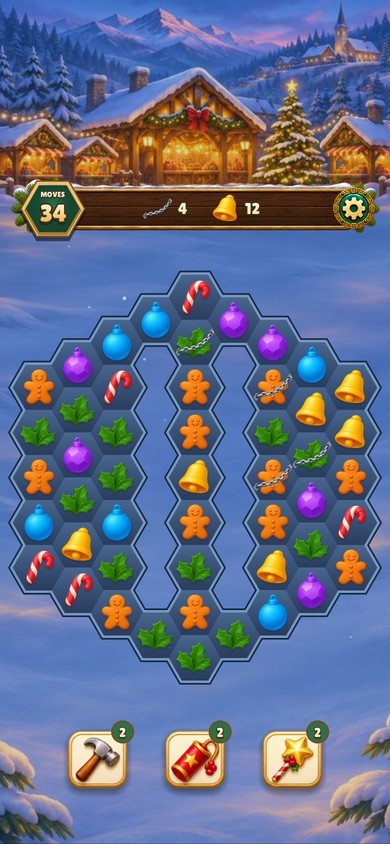 | 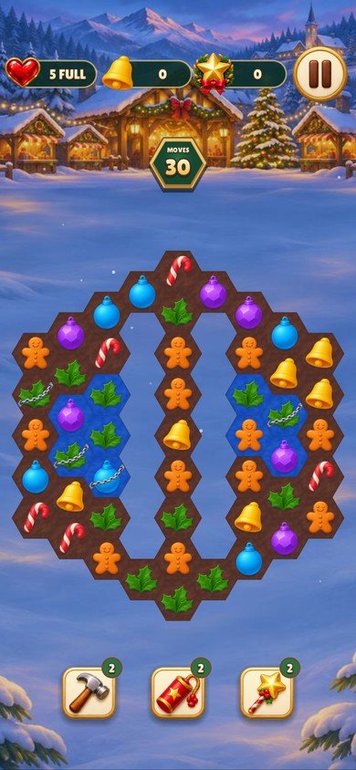 |
| Guide, 480×900 | 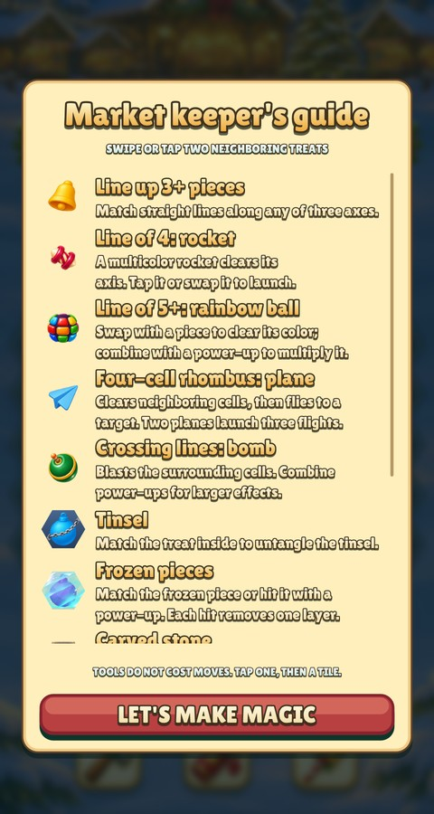 | 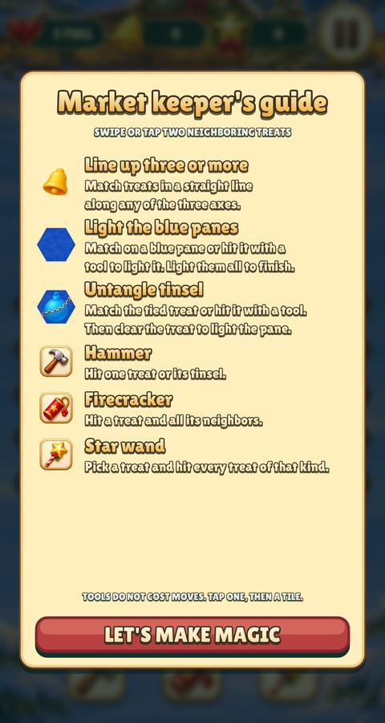 |
| Guide, 390×844 | 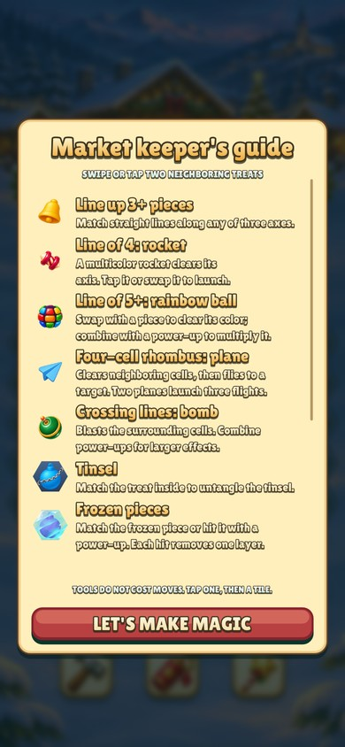 | 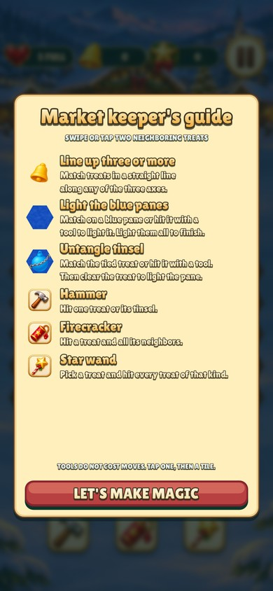 |

| Welcome Lights | The Last Train, partway through | Finale |
| --- | --- | --- |
| 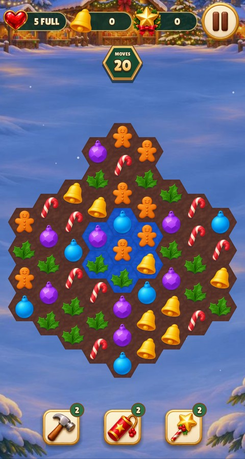 | 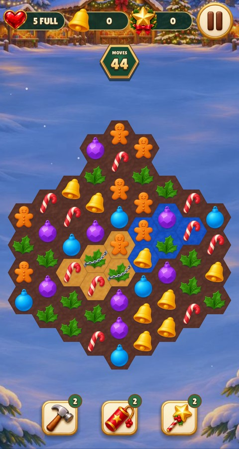 | 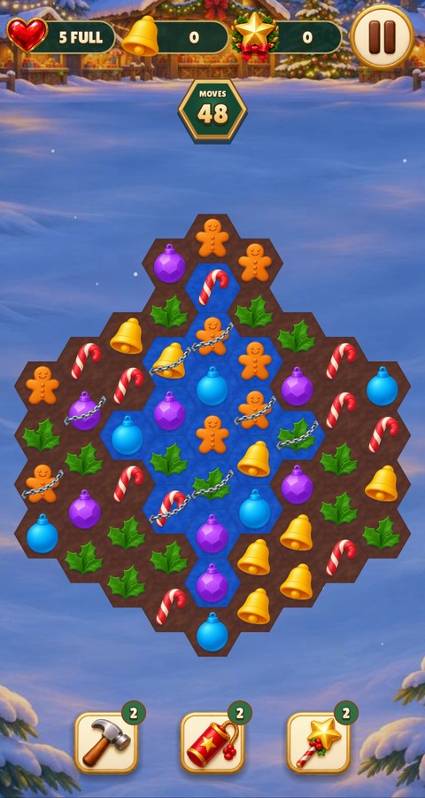 |

| A Ribbon for Home | Word from the Station | The Last Train |
| --- | --- | --- |
| 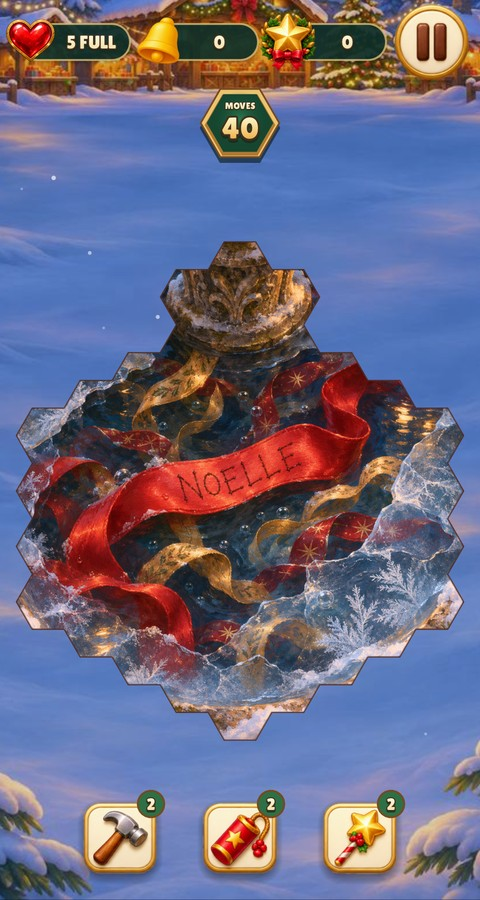 | 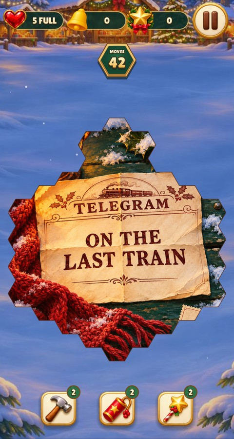 | 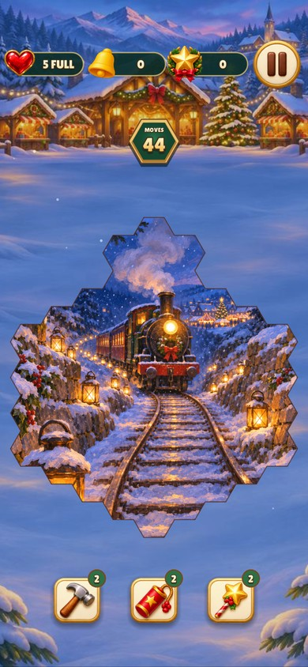 |

[Pip spots his mum after the painting](train-scene.jpg).
[The same wallet in the market](market.jpg).
[Runtime art and authored tool states](art-states.jpg).

Capture with the software renderer in one test run.

```sh
make christmas-market build/test/christmas-market
build/test/christmas-market "shot main-character-board" "shot phone-board" "shot guide" "shot phone-guide" \
  "shot lantern-opening" "shot tree-finale" "shot story-floor-train-half" "shot story-floor-train-scene" \
  "shot story-floor-24-480x900" "shot story-floor-25-480x900" "shot story-floor-28-390x844" \
  "shot art-states" "shot market"
```
