# Christmas Market goods, prices and story

| Screen | Before | After |
| --- | --- | --- |
| Cocoa Corner, 480×900 | 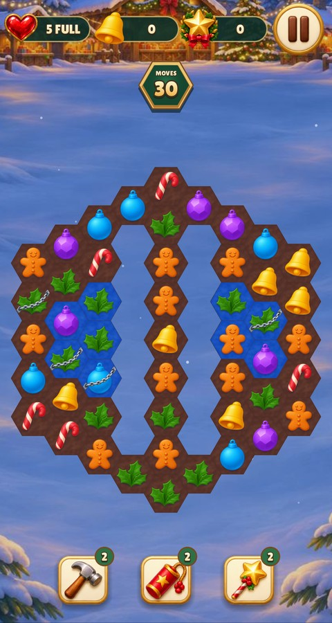 | 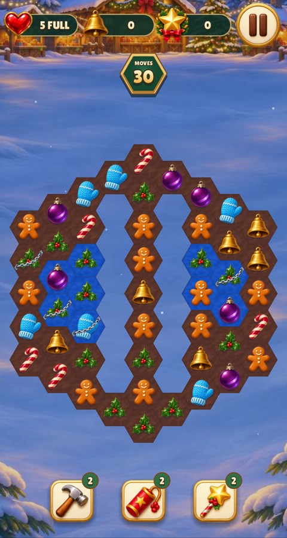 |
| Cocoa Corner, 390×844 | 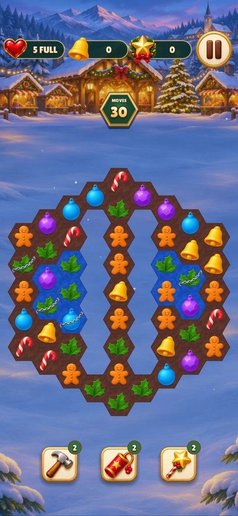 | 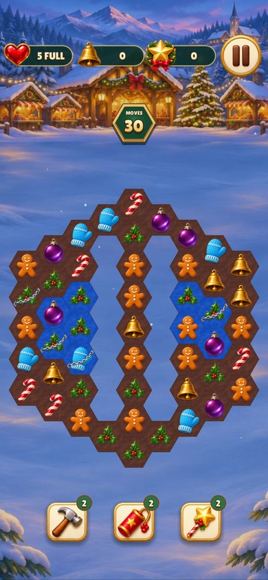 |
| Build shop, 480×900 | 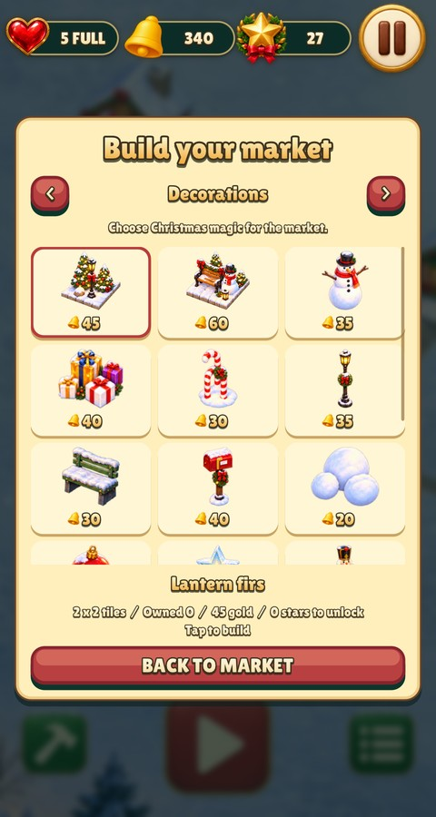 | 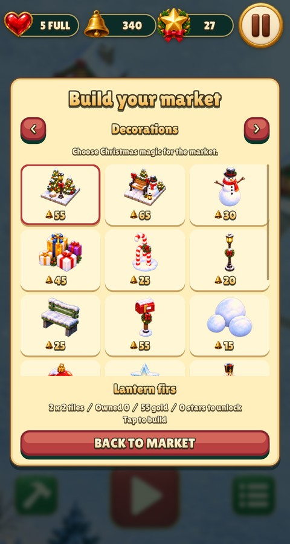 |
| Build shop, 390×844 | 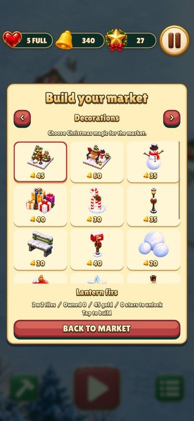 | 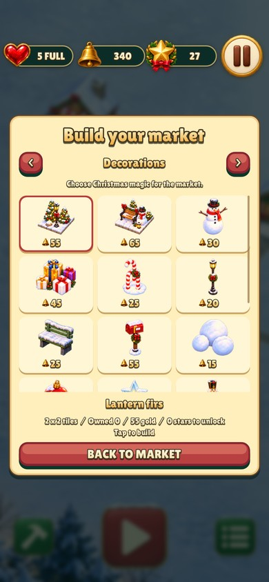 |
| First-clear reward | 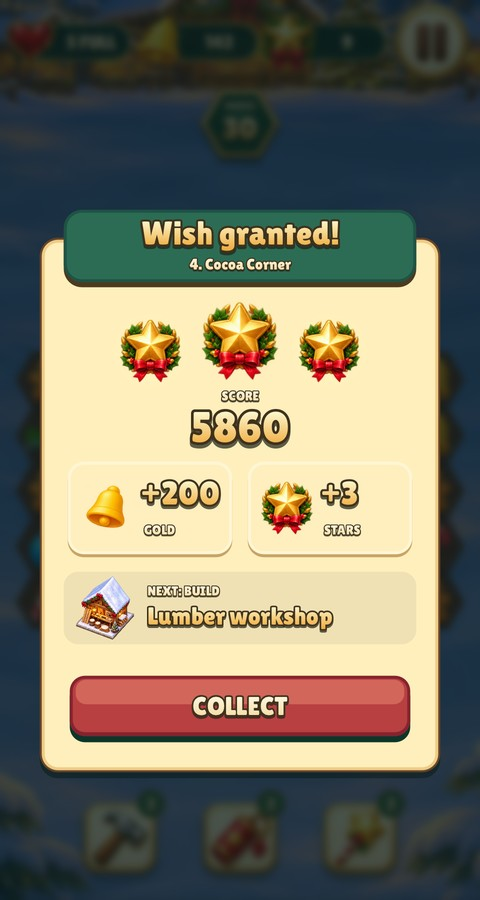 | 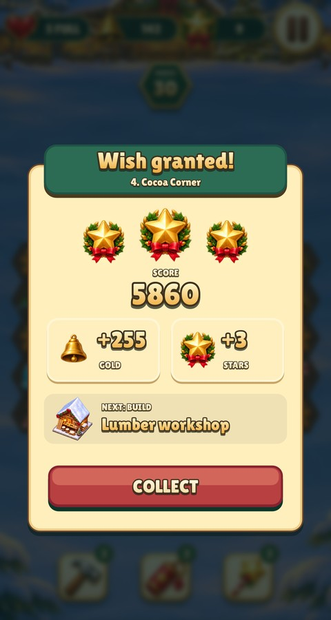 |

| Opening | The neighbors' lamps | Noelle's decision |
| --- | --- | --- |
| 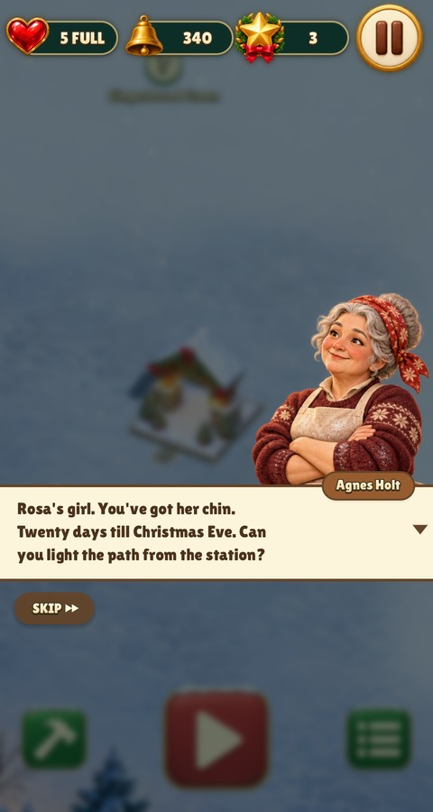 | 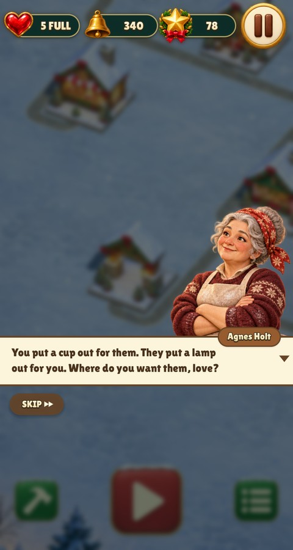 | 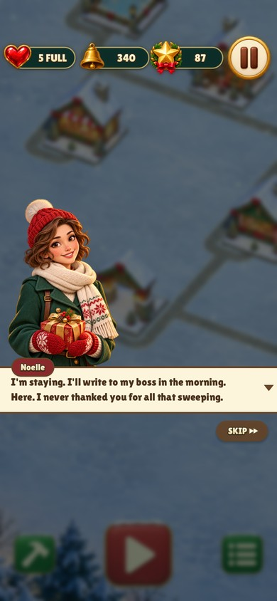 |

[Opening on the narrow phone](opening-390.jpg), [the updated Market Guide](guide.jpg),
[art and control states](art-states.jpg), and [the end screen](finale.jpg).

Capture with the software renderer in one test run.

```sh
make christmas-market build/test/christmas-market
build/test/christmas-market "shot main-character-board" "shot phone-board" "shot shop" "shot phone-shop" \
  "shot reward" "shot guide" "shot art-states" "shot story-agnes" "shot phone-story-agnes" \
  "shot story-borrowed-lamps" "shot story-staying" "shot finale"
```
