# Christmas Market resources and story finds

The town and puzzle share the wallet. Shop cards and first-clear rewards use
the same Gold, Treats and Supplies icons. Cocoa Corner shows the regular
palette with a chain over a blue pane.

| Screen | Before | After |
| --- | --- | --- |
| Puzzle, 480×900 | 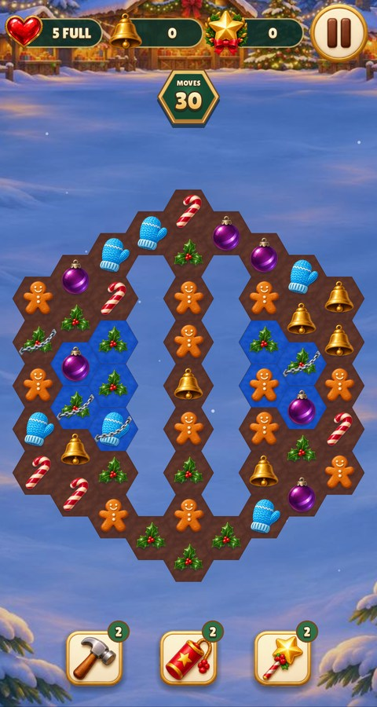 | 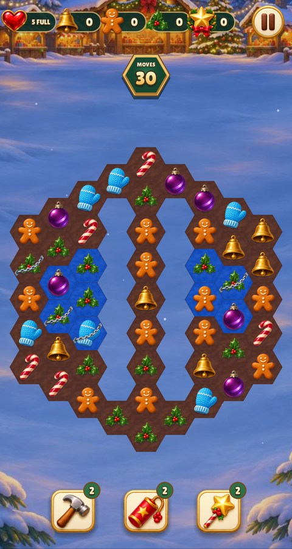 |
| Puzzle, 390×844 | 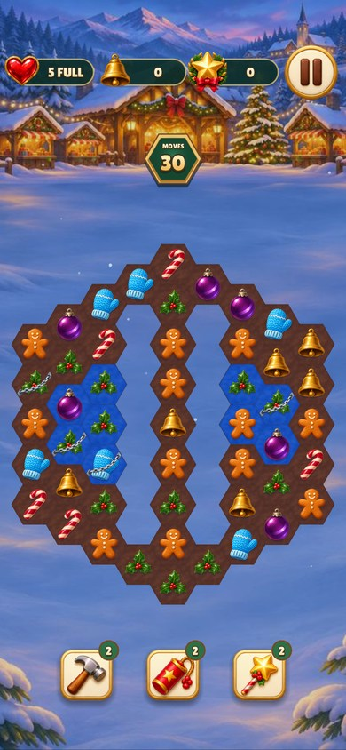 | 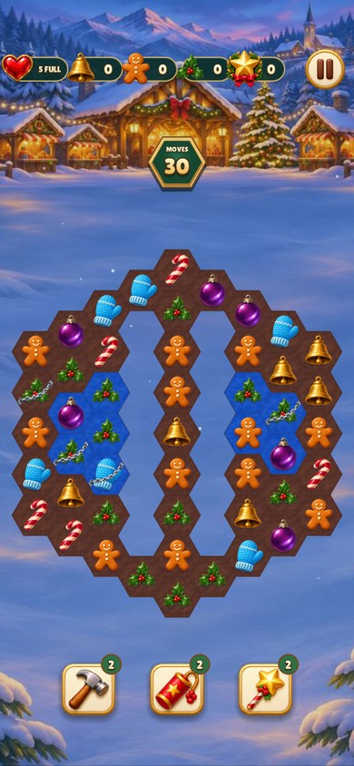 |
| Shop, 480×900 | 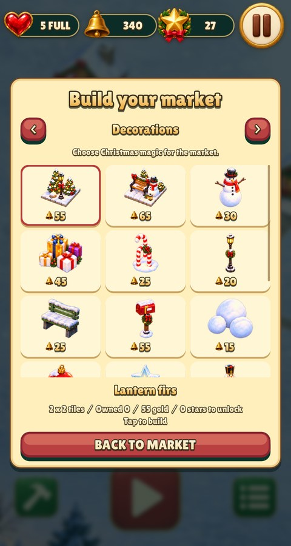 | 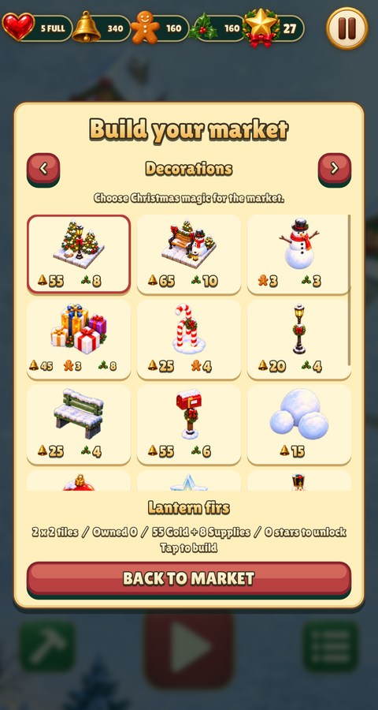 |
| Shop, 390×844 | 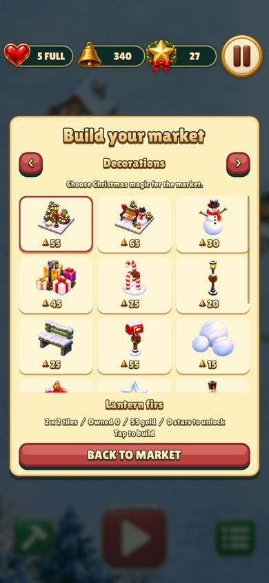 | 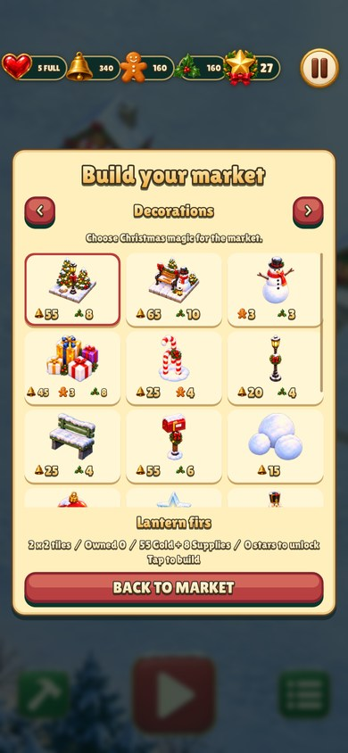 |
| Result | 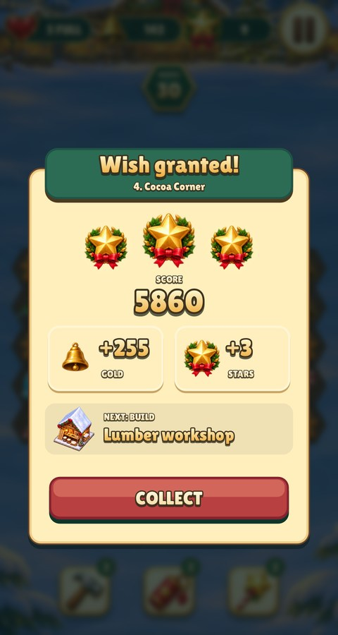 | 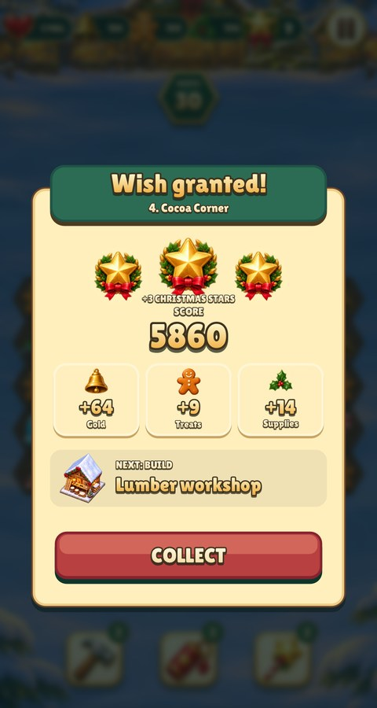 |
| Town, 480×900 | 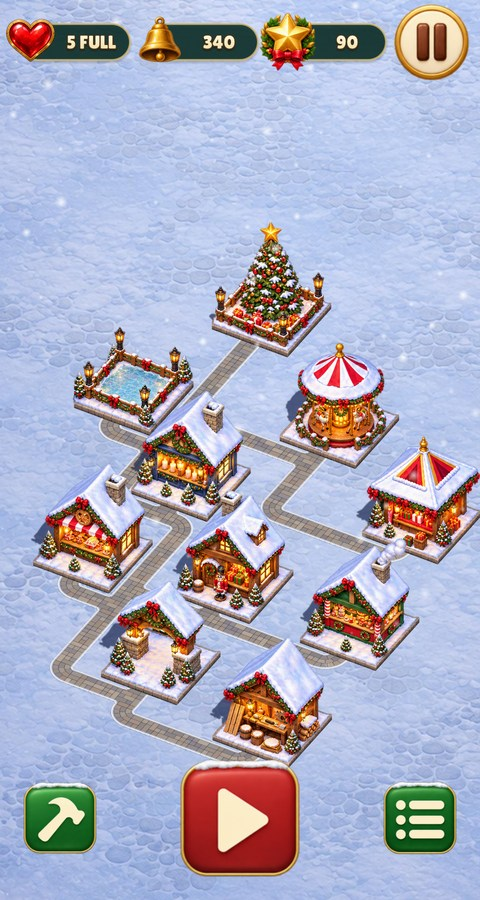 | 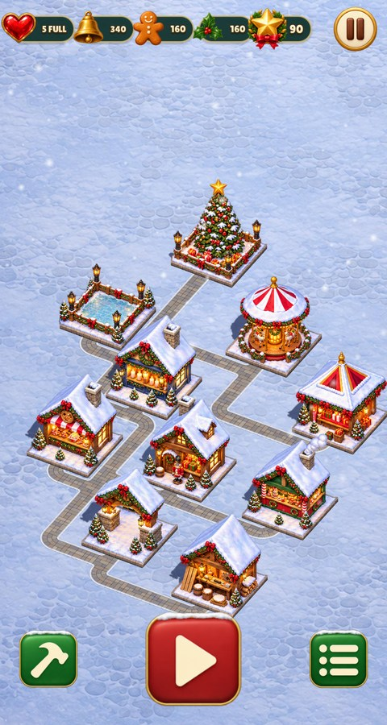 |

[The town wallet at 390×844](market-390.jpg) and [the revised Market Guide](guide.jpg).

| Cocoa mug | Blue practice scarf | Undelivered letter |
| --- | --- | --- |
| 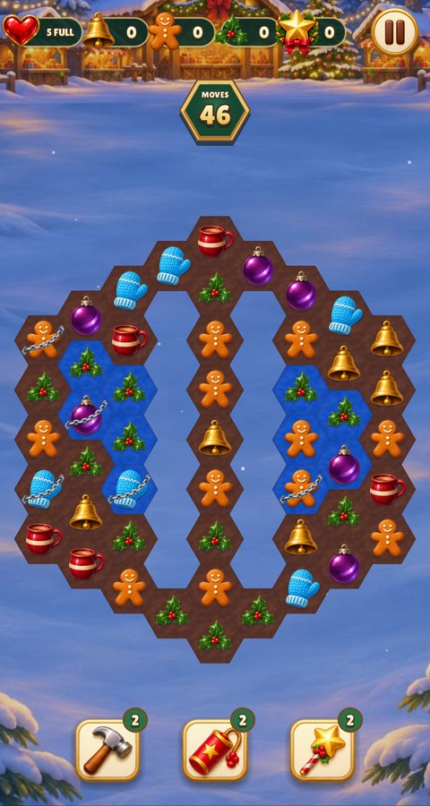 | 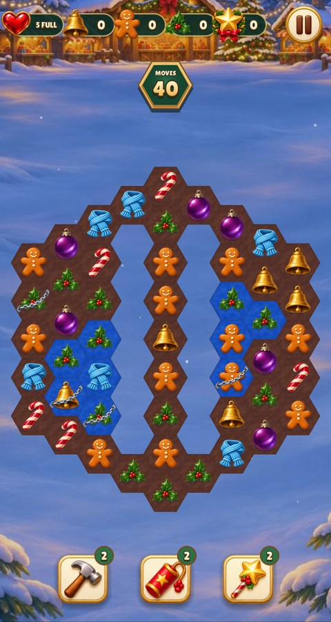 | 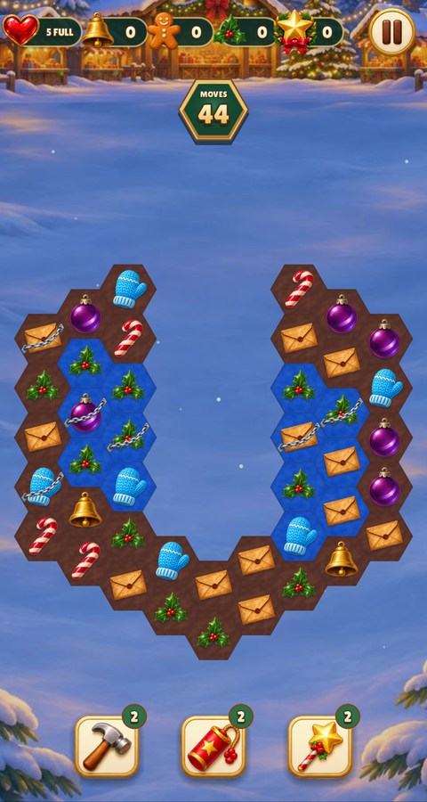 |

| Wish ribbon | Station telegram | Borrowed lantern |
| --- | --- | --- |
| 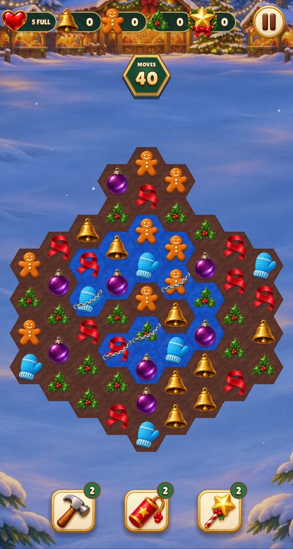 | 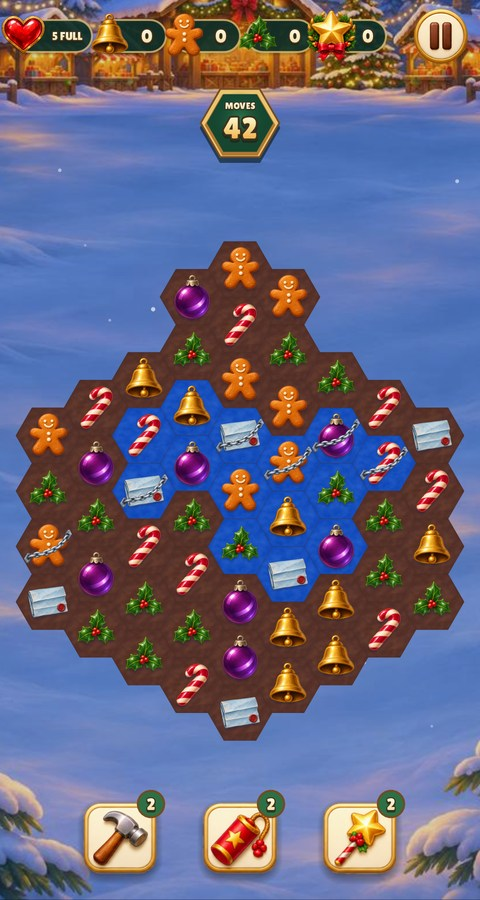 | 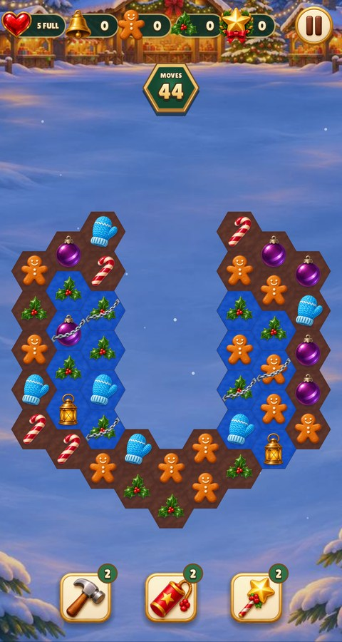 |

[Letter board at 390×844](letter-390.jpg) and [first-clear reward with the letter](letter-reward.jpg).

Capture the actual game in one test run.

```sh
make christmas-market build/test/christmas-market
build/test/christmas-market "shot main-character-board" "shot phone-board" "shot shop" "shot phone-shop" \
  "shot market" "shot phone-market" "shot reward" "shot guide" "shot find-"
```
