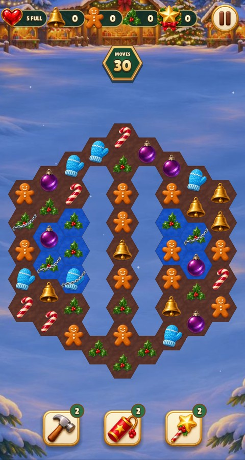
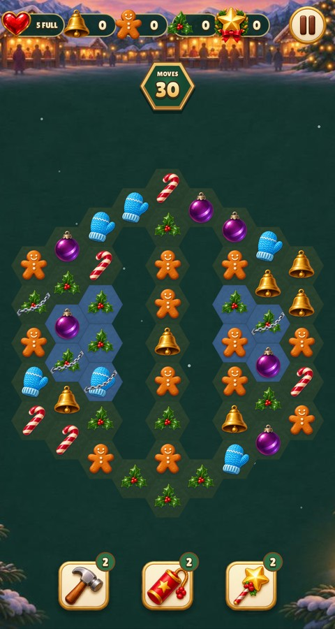
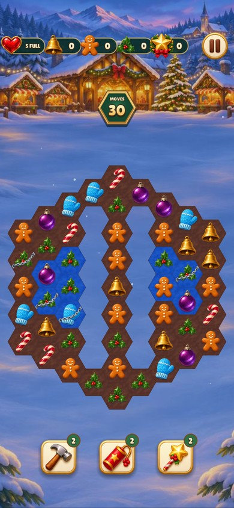
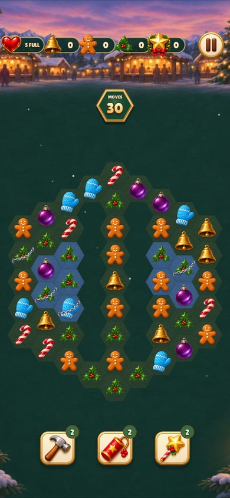
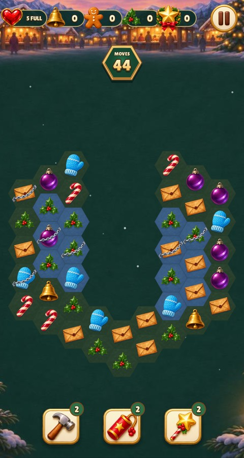
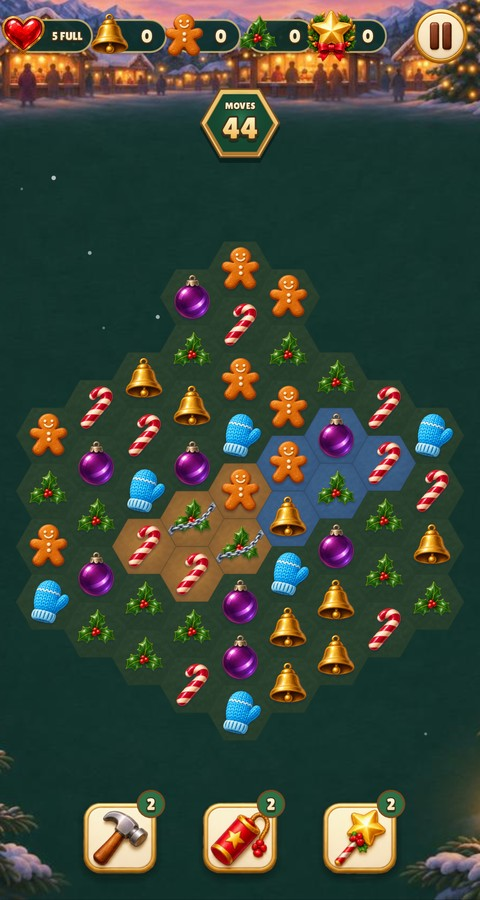
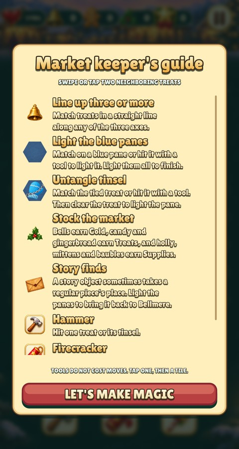

# Spruce board palette

ImageGen used the ordinary chips, the six story replacements and a screenshot
of the letter board to make the [palette concept](../../../../art/lantern-panes/concept.png).
The in-game backdrop and spruce, slate-blue and honey-amber tile artwork were
painted from that reference.

| Size | Before | In game |
| --- | --- | --- |
| 480×900 |  |  |
| 390×844 |  |  |

| With story pieces | Partway through The Last Train | Market Guide |
| --- | --- | --- |
|  |  |  |

Capture with the native renderer in one test run.

```sh
make christmas-market build/test/christmas-market
build/test/christmas-market "shot main-character-board" "shot phone-board" \
  "shot find-letter-480" "shot story-floor-train-half" "shot guide"
```
