# Story floors

The first clear reveals the painting in the board's own silhouette, then leads
into the existing scene. The partial captures show four snow cells removed on
level 25 and half the lanternlight spread on levels 24 and 28.

## 480×900

| Board | Before | Partial | First clear |
| --- | --- | --- | --- |
| Frozen Fountain | 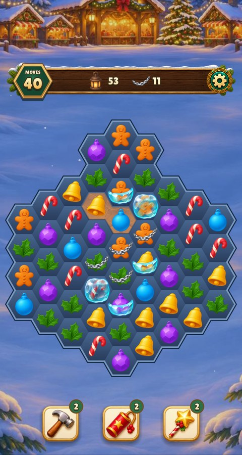 | 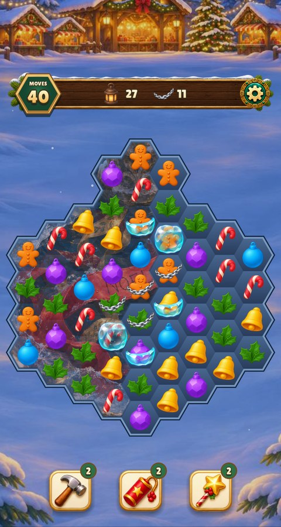 | 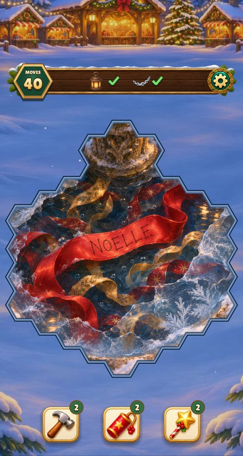 |
| Snow on the Line | 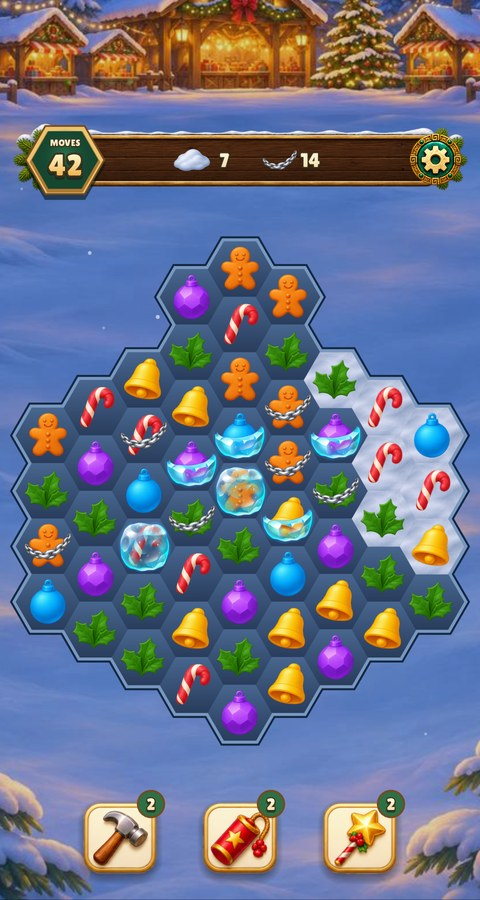 | 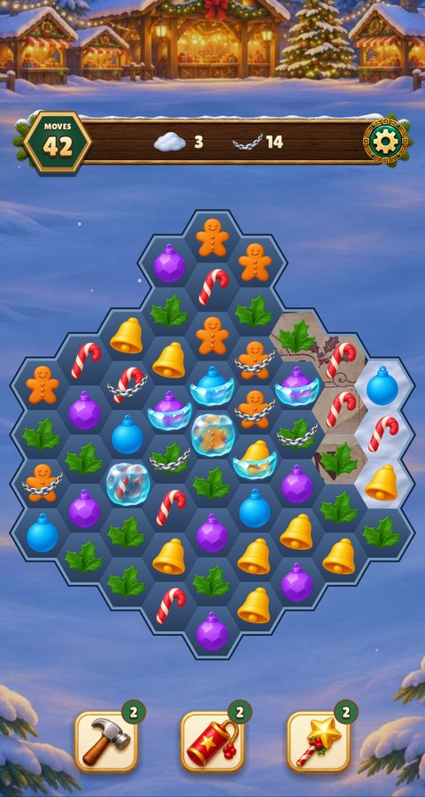 | 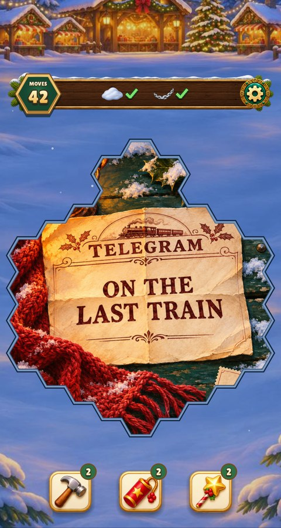 |
| The Last Train | 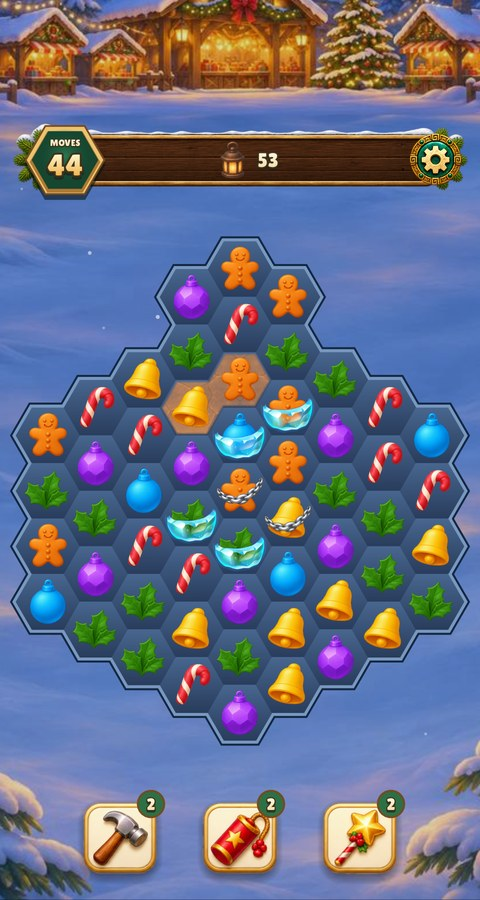 | 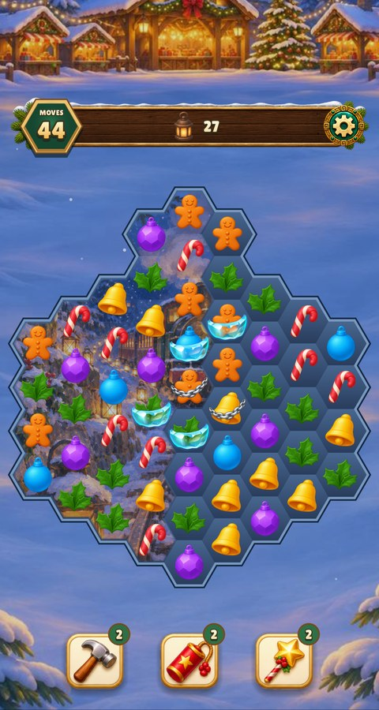 | 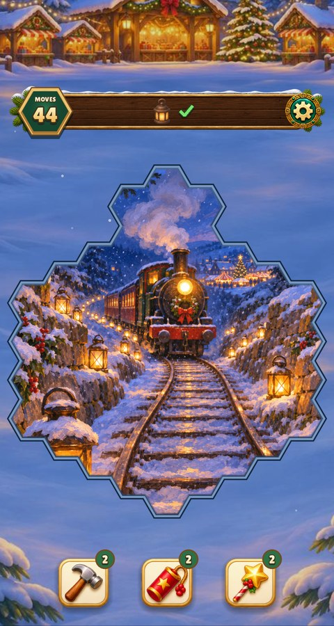 |

## 390×844 with safe areas

| Board | Before | First clear |
| --- | --- | --- |
| Frozen Fountain | 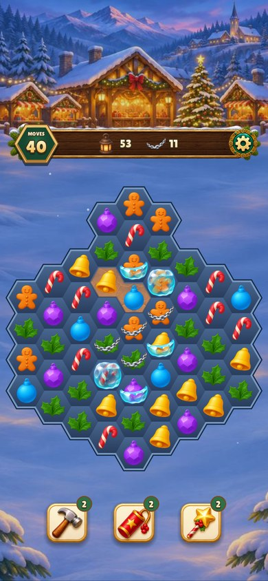 | 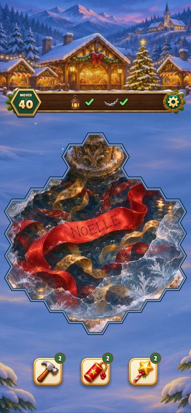 |
| Snow on the Line | 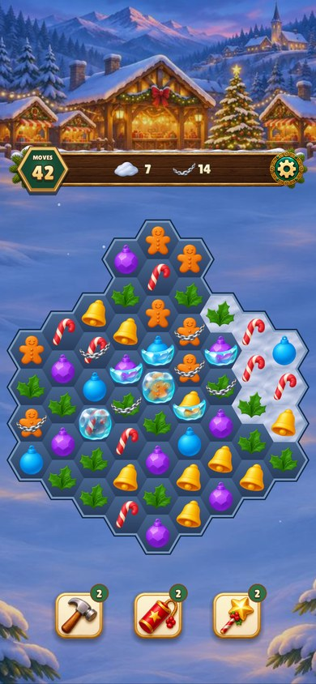 | 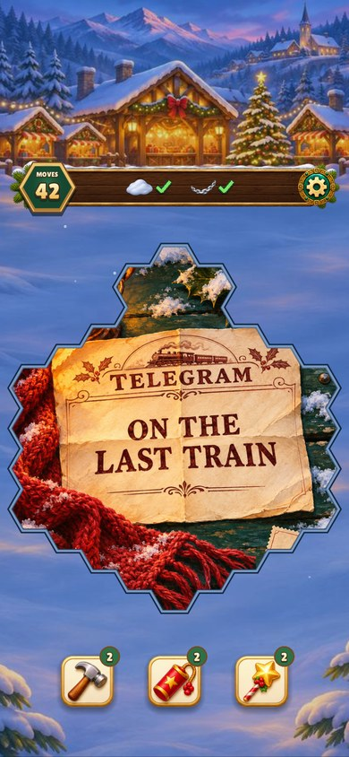 |
| The Last Train | 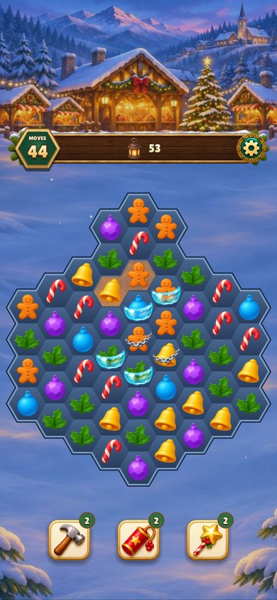 | 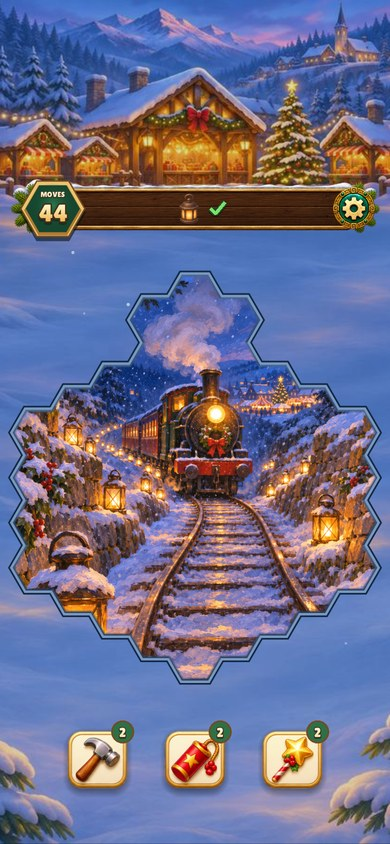 |

| Win fade and hold | Pip's first line |
| --- | --- |
| 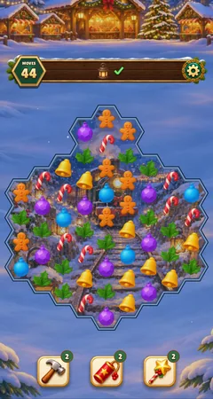 | 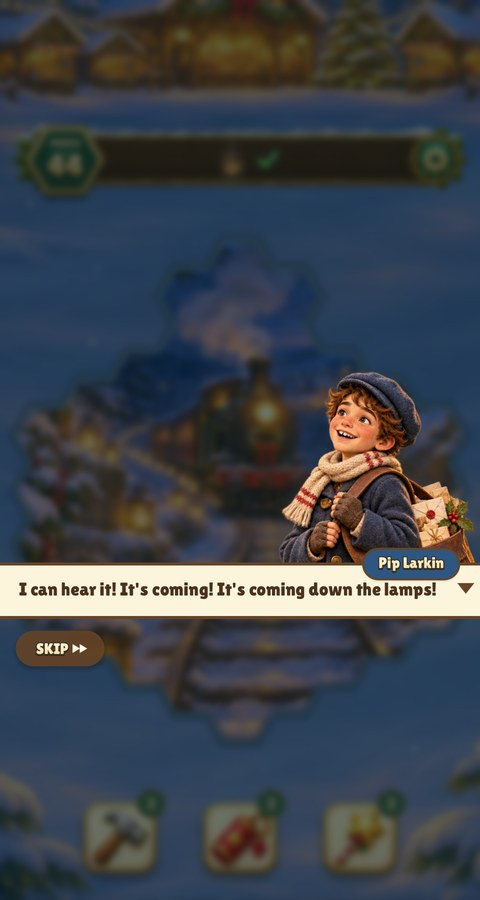 |

Render the reveal states and reel from the repository root.

```sh
build/test/all --suite=christmas-market "shot story-floor-" "reel story-floor-train-win"
```
