# Christmas Market town wallet

Christmas Market uses the Relic Rush town HUD layout with Lives, Gold and
Christmas Stars. Gold pays for buildings. First clears earn Stars that unlock
new stock and regions. Tap a region marker to open its card.

| Size | Before | After |
| --- | --- | --- |
| 480×900 | 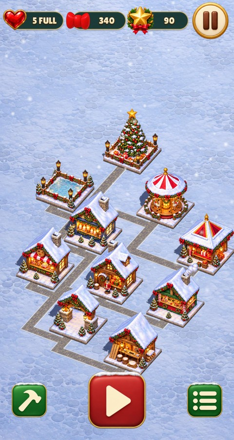 | 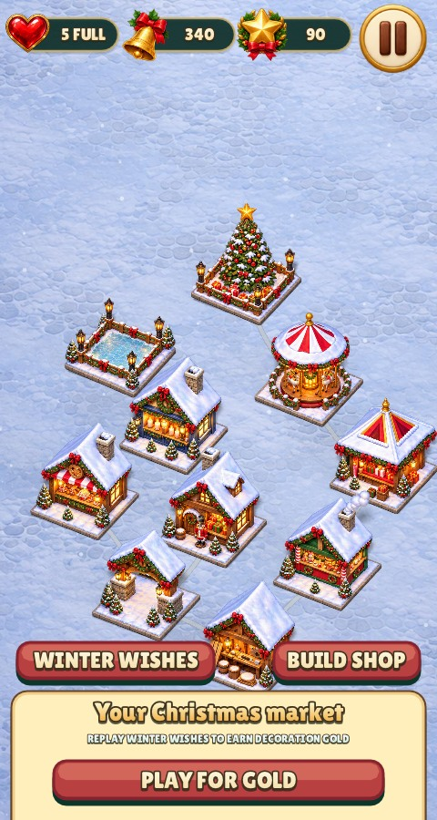 |
| 390×844 with safe areas | 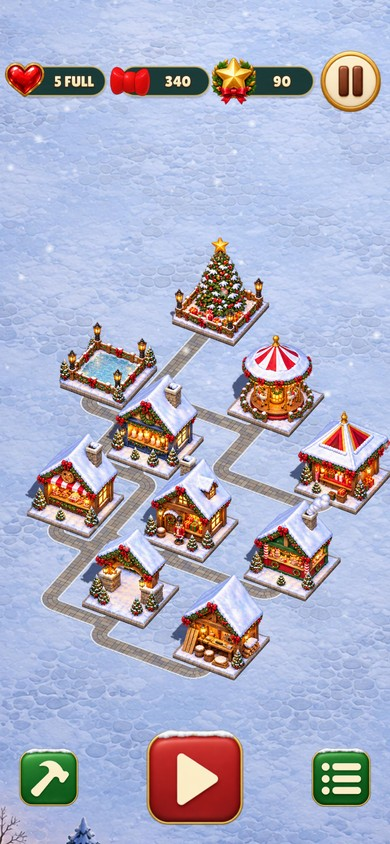 | 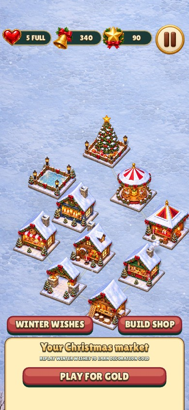 |

| Screen | Before | After |
| --- | --- | --- |
| Region card | 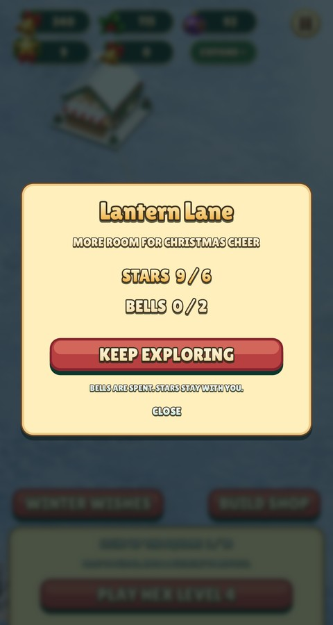 | 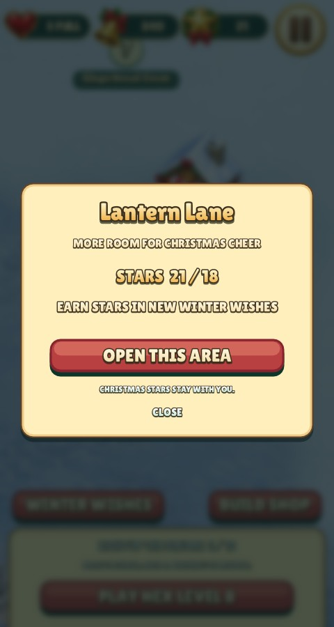 |
| Building card | 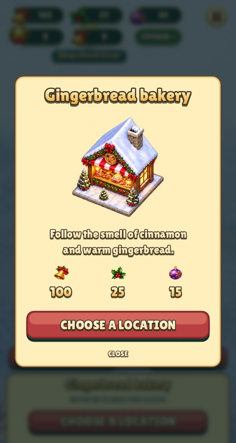 | 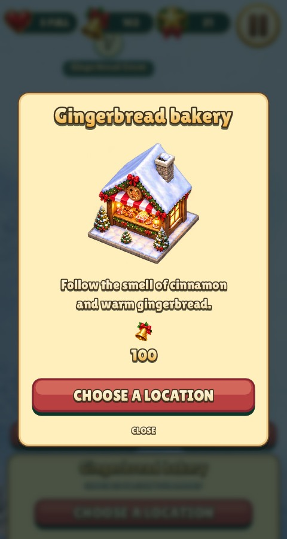 |
| First-clear reward | 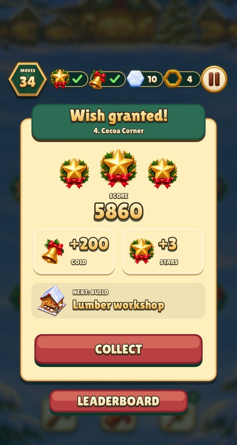 | 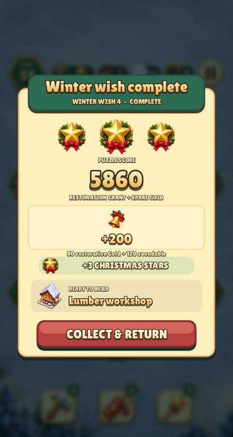 |
| Winter wishes | 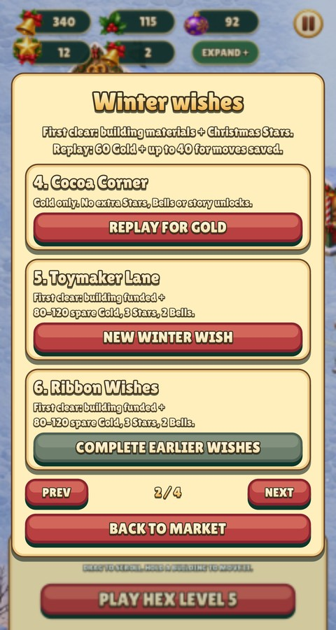 | 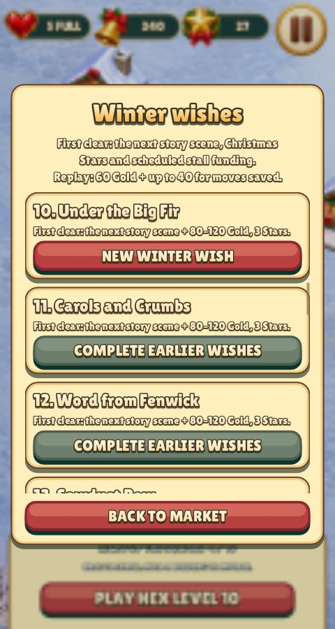 |
| Failed wish | 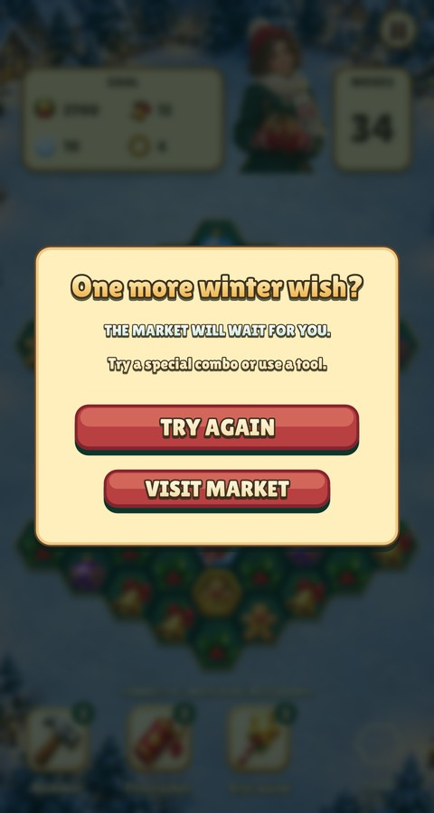 | 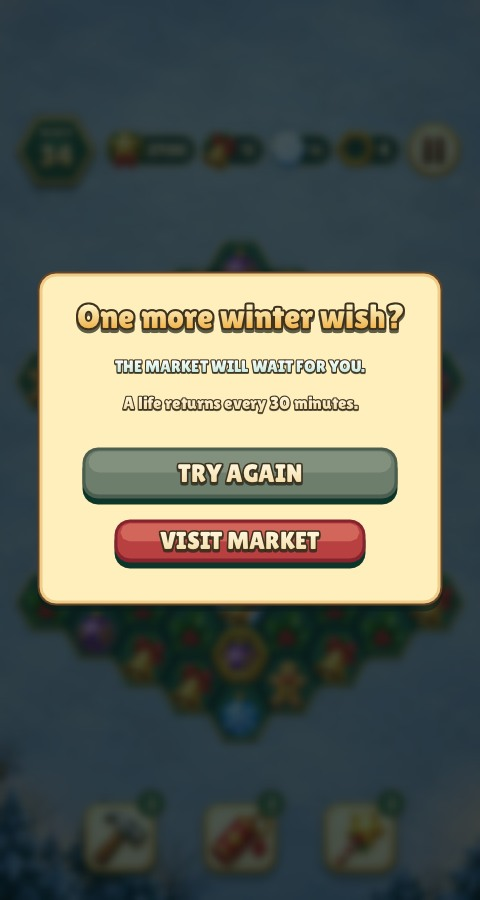 |
