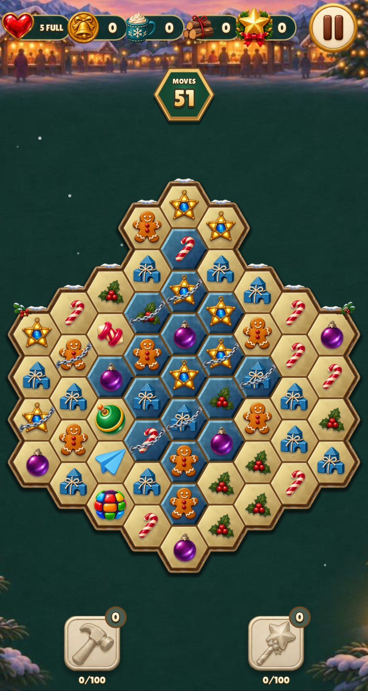
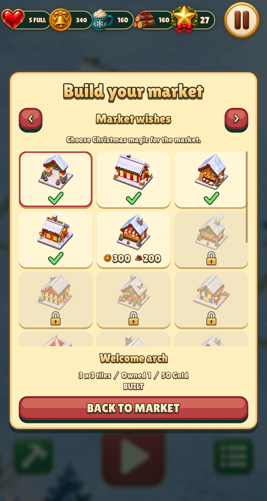

# Twenty-stall ladder review

Captured with the game's own entry points after the ladder change.

| Capture | Command |
| --- | --- |
|  | `./build/christmas-market --headless --mute --fresh --size 480x900 --level 30 --frames 120 --shot out.png` |
|  | `./build/christmas-market --headless --mute --fresh --size 390x844 --level 28 --frames 120 --safe-area 0,47,0,34 --shot out.png` |
|  | `./build/christmas-market --headless --mute --fresh --size 480x900 --catalogue wonder --shot out.png` |

Wish 30 opens with all four stall specials (shooting star, firework bomb,
paper plane and rainbow ball) beside plum baubles and candy canes; tool meters
read /100 after the post office. Wish 28 has three specials: the tree's
rainbow ball arrives on wish 30. The shop lists the stalls in ladder order.
