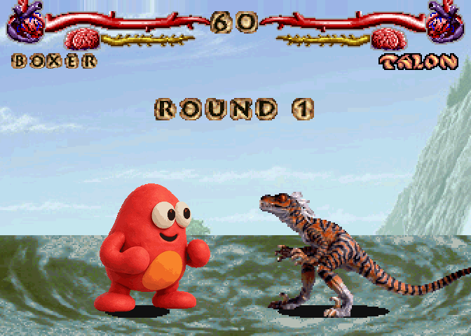
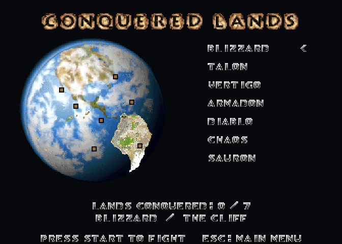

# Clayfight

A fighting game where children photograph their clay creatures and make them
fight. The complete original C game now runs on the shared engine: platform
window/input/audio, shared CPU sprite rendering and photo processing, a
streamed nearest-neighbour framebuffer, and Lua frame scheduling. Game code lives in `source/`; the shared engine has no Clayfight
rules or resource dependencies. The simulation remains C, preserving its
original state machines and timing.

## Engine boundary

The shared `engine/` owns the stereo PCM mixer (`audio.c`), palette-sprite CPU
renderer (`raster.c`), image decoder (`gfx.c`) and background removal, scaling
and palette generation (`photo.c`). These modules use caller-provided data and
have no Clayfight or Primal Rage dependencies.

`source/game/` owns combat, menus, the original animation VM, arcade ROM
decoding, native character glyphs, fighter palettes and sound selection.
`v_video.c`, `w_photo.c` and `source/platform/i_sound.c` are compatibility
adapters calling the shared APIs. There is no game-local engine or mixer.
The simulation remains native C; Lua schedules it through `host.c`.

## Screenshots

Actual 672×480 frames (2× the arcade 336×240 view) captured from the port's software renderer with local
reference data. Regenerate with `python3 games/clayfight/tools/screenshots.py`.






## Build and play

```sh
make clayfight-resources  # validate data/primrage, or import your arcade chip set
make run-clayfight
make run-clayfight ARGS='-fight boxer lizard -cpu'
make run-clayfight ARGS='-warp select'
make run-clayfight ARGS='--touch'
```

Place the supported Primal Rage 2.3 December 1994 arcade chips (MAME
`primrageo`) in `data/primrage/`, or import an external directory with
`python3 games/clayfight/tools/import_resources.py /path/to/primrage`.
Fighters, animation scripts, moves, hit boxes, palettes, menus, title, stages,
compact glyphs, stone lettering, anatomical health/stun HUD, effects and voices
load directly from those ROMs. DOS data, converted
retail creature files and an emulator installation are unnecessary. The original
ROMs remain ignored by Git. Native/iOS/web builds bundle the arcade chips and
custom creatures from `data/`; reference extraction ZIPs live outside it.

The CAGE DSP interpreter decodes effects and seven voice tables into the shared
mixer's PCM format once at startup, caching them in memory. It adds several
seconds to sound-enabled startup; `-nosound` skips this work.

The game includes five custom clay creatures and four concept/action sheets.
With local retail data it also loads all seven original fighters, their scripts,
voices, fonts, menus, title art, character selection and stages.

## Features and controls

Left player: WASD, R/T for high quick/fierce, F/G for low quick/fierce, Enter
starts. Right player: arrow keys, O/P and L/semicolon. Right-player input joins
on the select screen. Escape pauses; Q returns to the menu while paused;
backtick toggles hit boxes. macOS and iOS support two GameController devices;
the non-Apple platform joystick backend exposes its first device.

Combat retains the original animation timing, root motion, attack/hurt boxes,
blocking, crouching, jumping, knockdowns, hitstop, CPU behavior, best-of rounds,
timer, palettes, particles, stereo samples and voices. Game flow includes the
conquest campaign, continues, seven-opponent final gauntlet, training, tug of
war, endurance, options, volume and sound test.

## Photograph a fighter

Desktop: choose **CREATE FIGHTER**. The local Python companion opens a browser
workshop, also usable from a phone on the same Wi-Fi. Capture poses and a portrait,
remove the background, align the silhouette, and publish. Publication validates
with the actual game executable before adding the creature; returning to the
select screen refreshes the roster. No external server is used. The macOS development bundle also includes the
companion, requires Python 3, and stores published fighters in Application
Support/Clayfight; its subprocess workflow runs without App Sandbox.

iOS: `clayfight.xcodeproj`, scheme `clayfight-ipad`, builds on the shared engine
for iPhone and iPad with native multi-touch controls. **CREATE FIGHTER** opens the original native
AVFoundation camera/photo/video workshop. Drafts, source images and published
creatures live in Application Support and survive app upgrades. Native camera
and photo-library permissions are included in the generated project.

The web preview can play with bundled local data and keyboard or `?touch`
controls; creature capture requires the native app or desktop companion.

## Verification

```sh
make test-clayfight         # framebuffer/photo/JS processing, no retail data
make test-clayfight-retail  # 280 arcade animation/move checks, audio, flow/rendering,
                           # real server publication and playable custom fighter
python3 -B games/clayfight/tests/concepts.py
```

To reproduce comparisons against a built original executable:

```sh
python3 games/clayfight/tests/parity.py /path/to/original/clayfight
```

The historical DOS port matched 78 frames across 13 scenes. Arcade rendering
now intentionally differs in source artwork, timing and native dimensions.
The original source backup is under ignored `reference/clayfight/original-source`.
See [PORT.md](docs/PORT.md) for acceptance evidence and validation limits,
[creature-format.md](docs/creature-format.md) for the content format and
[primal-rage-scripts.md](docs/primal-rage-scripts.md) for the original VM.
The local arcade ROM extraction and DOS artwork comparisons are documented in
[primal-rage-arcade.md](docs/primal-rage-arcade.md).

## Fast rule tests

Run `make test-clayfight` from the repository root for this game's tests in one command. The Lua suites use deterministic state injections and need no window or artwork. See [the testing guide](../../docs/TESTING.md) for coverage, test-only `ENGINE_TEST` hooks, extended samples and renderer smoke checks.
