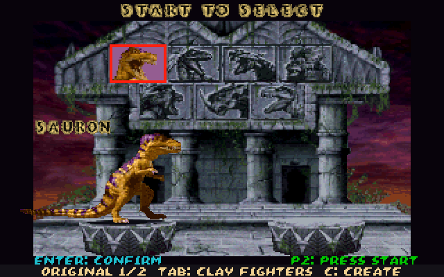
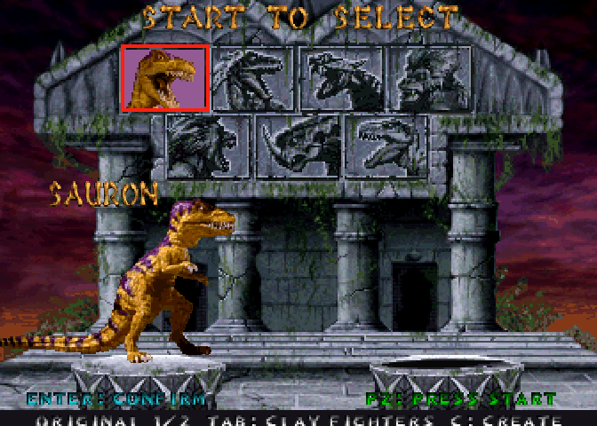
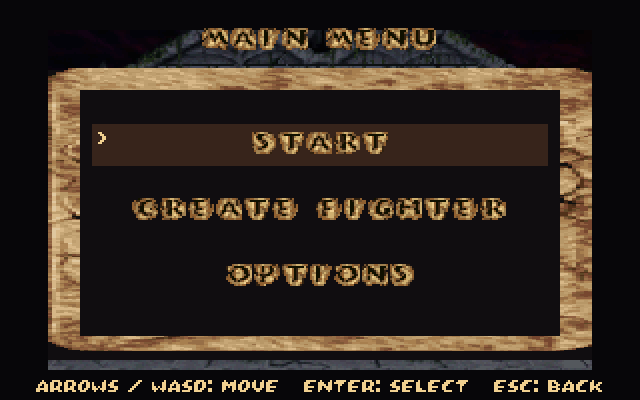
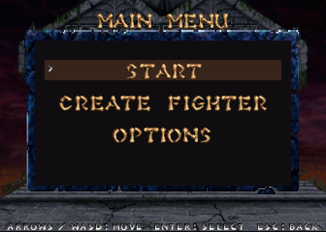
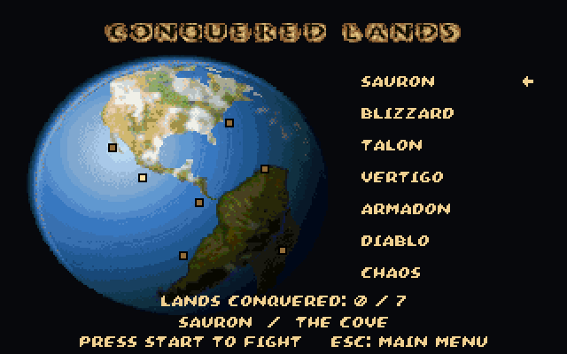

# Primal Rage arcade runtime and asset catalogue

Clayfight now uses the supplied **Primal Rage arcade 2.3 December 1994**
(`primrageo`) chips in `data/primrage/`. The entire game framebuffer is
**672×480**, exactly twice the arcade's native **336×240**. Fighting sprites
retain their original pixels, RGB555 colours and pivots. The DOS installation,
DOS executable and converted retail creature definitions are unused and removed
from active data. Custom clay photographs remain in `data/creatures/`.

## Runtime contract

| Asset / behaviour | Original source | Runtime / registration |
|---|---|---|
| Seven fighter bodies and effects | 12,000-slot Atari RLE motion-object table; 11,206 nonempty objects | `w_gra.c`, lazy decoding; source signed x/y pivots; index 0 transparent |
| Fighter colours | CPU palette pointer table `0x6e38c` | Seven characters × four original 64-colour palettes; no recolouring |
| Animations and moves | CPU script table `0x6d964`, 65 rows × 10 slots | `p_script.c` executes big-endian ROM bytecode; native units, 30-frame breathing and 20-frame crouch cycles |
| Damage, stun, hit class and attack boxes | `0xfbba0`, `0x6fca4`, `0x72ea4`, `0x7d328`, `0x49f7c` | `PS_Move`; native sprite anchors; no DOS art scale |
| Eight complete arena playfields | Three tile-plane chips; sky halves `0x1e58c4`/`0x1e58e4`, floor halves `0x1e5904`/`0x1e5924`; palette pointers `0x5fea2` | Separate sky/floor tile banks, per-arena horizon/crop, native scanline floor scrolling, original palette cycling |
| 115 scenery objects, including linked parts | Placements `0x6c418`, extras `0xf2648`, type descriptors `0x6d724`; stage palettes `0x614e2` | `r_stage.c`; original RLE frames, 26.6 positions, signed pivots, scale, mirror, depth/bias and source animation scripts |
| Fighter ground shadows | Per-character pose lookup `0x6b068`; descriptors `0x6d5e0`; palette `0x61702` | Original per-pose shadow sprite and mirror; native Diablo scale; custom photo fighters retain their own procedural contact shadow |
| Hit and blocked contacts | Scripts `0x56e28`/`0x56e36`, descriptor `0x6cf50`; palettes `0x61822`/`0x61802` | Source 10-frame contact cycles, three ticks per frame, all 64 colours; replaces square-particle art |
| Ambient tribespeople | Six idle descriptors `0x6d270 + variant×16`; team palettes `0x63382 + character×128` | Four original animated people behind the fighters, port-specific placement at 0.75 scale; interactions remain outside this port |
| Title and menu panel | Motion object 446, PRIMAL animation 447–460, RAGE animation 475–480; native setup `0x35bc0`, descriptors `0x7422c`/`0x7423c`/`0x7425c` | Blue stone `0x650e2`, red PRIMAL `0x65162`, cream/orange RAGE `0x652e2`; source pivots and independent palettes retained |
| Character-selection temple | Objects 784/785; palettes `0x6717a`/`0x671fa` | Complete 336×240 background at 2×, sky plus temple |
| Podiums | Objects 786/787; palette `0x6727a` | Both source podiums; inward-facing animated previews above their surfaces |
| Original selection states | Reliefs 788–794 and original body palettes | Unselected stone reliefs in background; coloured source heads under P1/P2 cursors; procedural red/yellow focus outlines retained |
| Original close-up portraits | Objects 852–886, five frames per fighter; palette pointers at `0x676fa` | Source palettes; clay pages retain authored photo portraits, selected/unselected tile backgrounds and shared cursors |
| Conquest globe | Object 491 with `0x65cfa`; continents 503/516/529 with `0x65d7a` | Shared source hotspots retained; uniformly scaled to fit campaign list |
| Compact character glyphs | `136102-1045b.23p`, packed 4-bit 8×8 glyphs; descending neutral palette `0x61802` | Small labels and hints; light fill and dark bevel, trimmed transparent right columns |
| Intro/UI alpha typeface | ASCII lookup `0xc510`, column-major tile descriptors `0xc370`, character-bank offset `0x80`, gold palette `0x61442` | `FONT_BIG` uses the arcade VERSION typeface, 16 pixels high with native 8/16-pixel cell advances |
| Stone timer digits | RLE 417–426; original gold palette `0x68e3a` | Separate `FONT_TIMER`; HUD timer retains its existing artwork and registration |
| Anatomical HUD | Alpha-map tables `0x1ff43e`/`0x1ff622` (health), `0x1ff806`/`0x1ff91a` (stun); RLE 1767–1794 | Authored left/right bar states, pulsing/burst heart and brain icon; see the HUD contract below |
| Fighter HUD names | RLE nameplates 314–320; descriptor pointers `0x73e74`, palettes `0x64d02 + character×128` | Original name artwork; custom names use the intro typeface, fitted to the same HUD slots |
| Effects and seven voice tables | CAGE boot chip 1078a and sound chips 0075/0077 | Standalone BSD-licensed TMS320C3x interpreter, native ROM driver, four DAC channels mixed into cached 11025 Hz mono PCM; shared stereo panning |

The sound adapter reads victory, attack and pain command tables at `0x6b0b0`,
`0x6e3e8` and `0x69c64`. Generic impact commands 8064–806A, block 806B,
swish 8049, thud 806F, crowd 80E3 and select 806C feed the existing events.
Samples decode once during sound-enabled startup, then play without emulation
in the combat loop. `-nosound` skips decoding. See
[`source/sound/LICENSE`](../source/sound/LICENSE) for interpreter attribution.
There is no runtime SDL or MAME executable dependency.

The port retains its existing campaign, training, tug, endurance and photo
capture rules. This migration does not implement the original machine's full
special-move, projectile, fatality, follower or cinematic systems; those were
already outside the port's supported rules. Ambient tribespeople now render with original art; interaction and worship/eating AI remain unimplemented. It does not claim hardware-exact
arcade emulation. See [menus and capture](menu-and-capture.md).

## HUD contract and reviewed states

The first arcade migration retained rectangle health bars and used the compact
character font for every text size. Those placeholders are replaced by source
HUD artwork. Health and stun bars decode the character chip through the exact
CPU tile maps, including **121 authored health levels per side** and **69
authored stun levels per side**. There is no flat rectangle fill, recolouring,
or stretched replacement. Original alpha palettes are `0x61482` (red vein)
and `0x614a2` (gold vein).

The heart's original script at `0x57052` holds object 1767 and beats through
1768/1769 at four ticks per pose; 1770–1776 supply its authored burst sequence
at zero health. The brain starts at 1777. Both use original palette `0x61742`.
Native HUD anchors are retained: health at (32,8)/(184,8), stun at
(72,24)/(184,24), hearts at (4,0)/(332,0), brains at (48,16)/(288,16).
Right-hand organs use the original mirror registration. Nameplates start at
y=38; timer digits use the gold stone alphabet. Compact character-chip digits
show round wins. All native pixels render through the same 2× framebuffer.

The port's existing hit/block stun timer selects the stun artwork; this change
does not add the original machine's separate dizziness or fatality rules.
Original fighters use their individual illustrated nameplates and palettes.
Photo fighters use the intro typeface, preserving its colour shading and fitting
up to 16-character names. Training and final battles retain the compact “--”
unlimited timer. Tug of War displays each side's complementary health through
the two original bar sets.

The combined arcade checks validate every authored bar frame, exact 2× mirrored
heart pixels, the large digit bank, and real captures for full, damaged and
empty health, stun, unlimited time, Tug of War and a maximum-length custom name.
Captures are `after/hud-full.png`, `hud-damaged.png`, `hud-empty.png`,
`hud-training.png`, `hud-tug.png` and `hud-custom.png` under the review folder.
The pre-correction fight/menu frames are in `docs/review/arcade-hud/before/`.

## Intro and menu typography

The small font previously mapped increasing pixel indices to increasing greys,
reversing the authored bevel and lighting its outer rim. It now uses the original
descending neutral ramp. Larger UI labels previously used the decorative RLE
alphabet instead of the intro's alpha typeface. Native print setup `0x35e76`
selects font 3 (`0x4003`) for “VERSION 2.3”; the loader now assembles that same
typeface from its original four-tile descriptors and gold palette. Wording stays
specific to this port. The timer uses its separate stone digits.

The combined arcade test compares “VERSION 2.3” directly against raw character
chip pixels, RGB555 colours and native cell advances at exact 2× resolution,
including narrow letters, spaces and punctuation. It also checks the compact
font's original pixels and descending bevel. Reviewed captures are
`review/arcade/after/menu.png`, `title.png`, `options.png`, `select.png`,
`ending.png` and `hud-custom.png`; the longest heading and maximum custom name
fit their existing layouts. The timer crop is pixel-identical to the preceding
revision. Reproduce these captures with the combined screenshot command below.

## Stage and graphics audit

The first migration omitted foreground scenery, used the sky tile bank for the
floor, drew one of the two floor halves, stretched the floor vertically and
cropped every sky against the full 240-pixel view. The corrected renderer reads
all four map tables, the independent bank tables at `0x1e5944`/`0x1e594c`, and
the source horizons at `0x6ba0c`. Each floor half occupies 512 pixels; the two
halves form the hardware's 1024-pixel wrapped surface. The sky's native copier
has a 64-column stride, including the overhang overwrite of 72-column maps.
Sky crop is `map_height - horizon`; floor scanlines retain their native rows.

Horizontal scroll follows native routine `0x23c74`, including per-stage depth
denominators at `0x6b9ec`, sky scroll bases at `0x6b9fc` and depth offsets at
`0x6ba1c`. The original camera limit at `0x6ba36` is 372 pixels per side; the
arena is consequently 1080 native pixels wide, rather than the DOS-era 592.
The viewport remains **336×240 presented at 2×**. Both camera extremes are
captured and the source terrain stays registered while panning.

Scenery expands the original placement and extra-object tables, including
linked parts spawned before an object's first frame. A zero-duration script
holds that first frame; reading farther would incorrectly execute the adjacent
script. Animated water, waves, lava, smoke and fire run their original frame
scripts. Source cycle registrations in `0x2472e`–`0x24818` rotate authored
palette ranges at their original intervals. Cached tile indices preserve those
cycles without generating replacement artwork. Scenery uses a private seeded
random stream; repeated drawing and animation rewind cannot change combat RNG.
Objects retain source positions, alpha, RGB555 colours, mirror, source scales
(including half-size Graveyard art), and front/behind-fighter depth ordering.

| Arena index | Source name | Scenery objects, including linked parts |
|---|---|---:|
| 0 | The Cove | 10 |
| 1 | The Inferno | 9 |
| 2 | The Strip | 8 |
| 3 | The Tomb | 32 |
| 4 | The Cliff | 8 |
| 5 | The Ruins | 10 |
| 6 | The Hollows | 21 |
| 7 | Dinosaur Graveyard | 17 |

Campaign homes now read the original character-to-arena table at `0x69a40`:
Sauron 0, Blizzard 4, Talon 2, Vertigo 3, Armadon 6, Diablo 1 and Chaos 5.
The prior guessed associations for Talon, Armadon and Chaos were incorrect.

The broader audit also replaced generic ellipse shadows for original fighters
with the native pose lookup, restored the original hit/block contact sprites
and all their palette colours, and replaced repeated title-patch aliases with
the original PRIMAL/RAGE lettering animation. The title loader reads each
layer's palette offset from its native descriptor. Previously both words shared
`0x652c2`, which also starts 16 colours before RAGE's actual bank, and the plaque
used an unrelated brown palette. The corrected title/menu plaque is blue stone,
PRIMAL is red, and RAGE retains its cream/orange shading. Pixel checks compare
every visible lettering texel at 2× with its original RGB555 source colour. Contact timing follows the native
three-tick setup in `0x15b1a`. Team-coloured ambient tribespeople use six source
idle scripts. Their port-specific world x offsets are −58/−36/76/98 from the
arena centre, y is the port's foot plane minus 7/4 pixels, and scale is 0.75;
the right group mirrors inward. They do not participate in combat.

[`arcade-graphics.json`](arcade-graphics.json) inventories every scene descriptor,
map/bank, horizon, palette cycle and reference pixel. Regenerate or validate it
without an emulator or an extraction archive:

```sh
python3 games/clayfight/tools/audit_arcade_graphics.py
python3 games/clayfight/tools/audit_arcade_graphics.py --check
```

Reviewed in-game captures: `review/arcade/after/stage-0.png` through `stage-7.png`,
`stage-left.png`, `stage-right.png` and `impacts.png`. `scenery.gif` shows four
arenas' animation and scrolling; `title.gif` shows the lettering sequence;
`fight.gif` shows the restored combat scene. The combined suite also checks
independently decoded background pixels, all eight exact 2× tile surfaces,
both camera extremes, deterministic rendering/rewind, pose-specific shadows,
contact palette bounds/lifetime and all seven campaign stage associations.

### Remaining original presentation, explicitly tracked

[Issue #55](https://github.com/corepunch/nile-archive/issues/55) tracks the original
intro/seven ending cinematics, full title-ray/lightning choreography, graphics
triggered by unsupported special/projectile/fatality rules, and full follower
interaction. The port's ending screen is a campaign summary, not an extracted
original ending. The restored people are ambient scenery. These sequences must
have source scripts/palettes, transitions and reviewed reels before being marked
complete. Current port-only menu controls, territory pins, photo-fighter contact
shadows and debug overlays are intentional UI/rendering, not replacement arcade
art. No DOS art, generated scene painting or flattened stage screenshot is used
by the runtime.

## Reproduction and review

From the repository root:

```sh
python3 games/clayfight/tools/import_resources.py /path/to/primrage
make CFLAGS="-O2 -g -Werror" clayfight build/clayfight-arcade
make test-clayfight-retail
python3 games/clayfight/tools/screenshots.py
make lint
```

The combined retail suite starts the game once, checks all seven voice tables
and effect decoding, 280 standard animations/move slots, game flow, selection,
palettes and 1,629 airborne pose/box registrations, and captures title, menus,
original/clay selection, all eight arenas, conquest, continue, ending and a
short fight reel. Screens are under `docs/review/arcade/after/`; representative
DOS baselines are under `before/`. Normal project screenshots are updated by
the screenshot tool. The renderer is fixed at 672×480 and larger host windows
letterbox it without changing the native coordinate system.

| Screen | DOS baseline | Arcade runtime |
|---|---|---|
| Selection |  |  |
| Menu |  |  |
| Campaign |  |  |

## Historical sprite comparison, corrected mapping

Both versions show the same recognisable models and poses, but their sprites
are **not identical**. Arcade retains more pixels, colours and intermediate
poses. The comparison now selects poses from the arcade's actual standing
scripts for **all seven fighters**. Early comparisons inferred object IDs
through DOS aliases; that mapping was unreliable and its 53-frame cycle counts
were incorrect. All seven native arcade breathing cycles contain 30 frames.

Historical comparison requires an external DOS copy and externally generated
DOS definitions; they are not installed inside runtime data:

```sh
python3 games/clayfight/tools/pr2creature.py /path/to/DOS /tmp/dos-creatures
python3 games/clayfight/tools/compare_arcade.py --dos /path/to/DOS --creatures /tmp/dos-creatures
```

Outputs stay Git-ignored under `art/reference/arcade-comparison/`, outside
bundled data: native/detail comparison PNGs, a SHA-256 input/report manifest,
`arcade-raw-indexed.zip` (11,206 objects) and
`arcade-standing-coloured.zip` (210 native standing objects, all seven
palettes). Raw indexed exports have a diagnostic greyscale palette; coloured
exports use the original CPU palettes and transparency. No generated artwork,
smoothing or manufactured intermediate frames are used.

| Fighter | DOS pixels | Arcade object | Arcade pixels | DOS / arcade colours |
|---|---|---:|---|---:|
| Sauron | 153×86 | 3818 | 190×122 | 31 / 59 |
| Blizzard | 70×87 | 4747 | 87×122 | 31 / 60 |
| Talon | 139×64 | 3004 | 173×90 | 30 / 47 |
| Vertigo | 173×83 | 5789 | 215×118 | 28 / 59 |
| Armadon | 131×76 | 8070 | 163×107 | 31 / 60 |
| Diablo | 137×75 | 3788 | 194×122 | 31 / 60 |
| Chaos | 56×71 | 4776 | 80×114 | 29 / 60 |

Measurements include transparent margins and use visually closest standing poses;
they do not claim pixel-exact pose equivalence.

ROM layout and RLE provenance: [MAME Atari GT driver](https://github.com/mamedev/mame/blob/master/src/mame/atari/atarigt.cpp), [Atari RLE decoder](https://github.com/mamedev/mame/blob/master/src/mame/atari/atarirle.cpp), [CAGE board](https://github.com/mamedev/mame/blob/master/src/mame/shared/cage.cpp).
