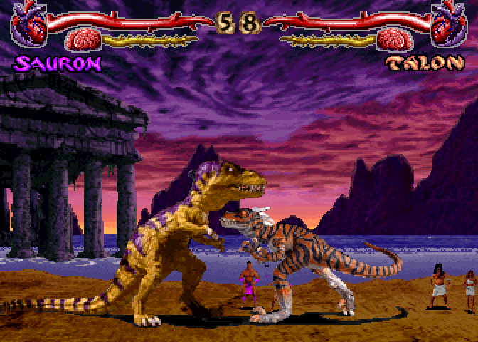
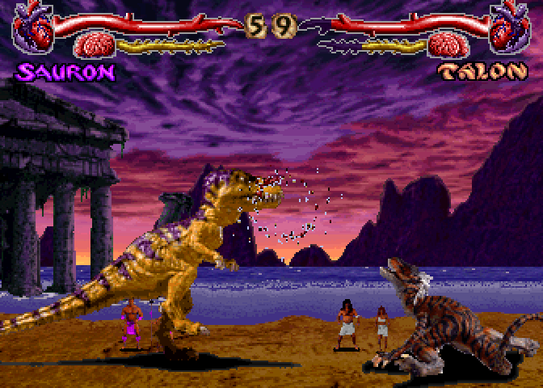
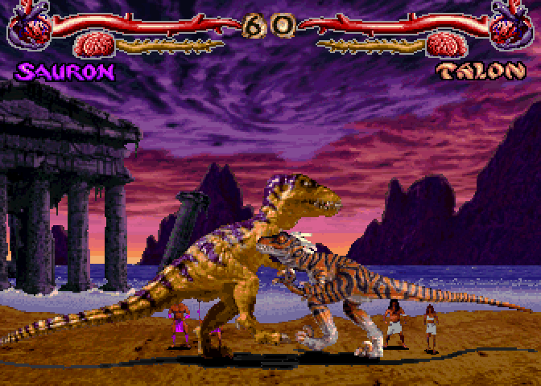
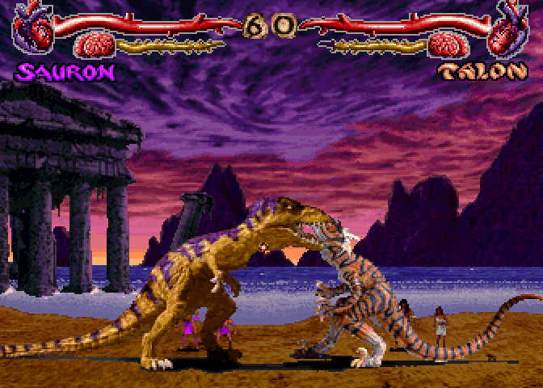
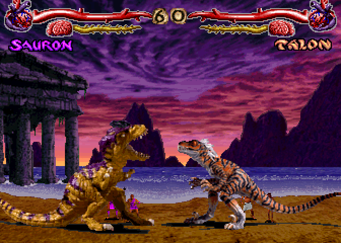
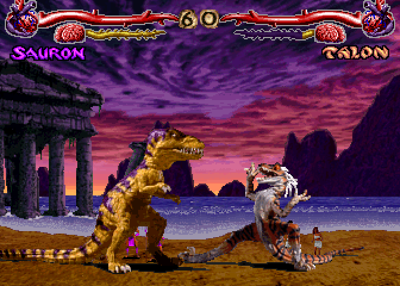

# Primal Rage combat and Clayfight's fighter/CPU model

Clayfight runs the supplied **arcade 2.3 December 1994 (`primrageo`)** animation
and normal-move data. Its controller, physics, collision resolution and CPU
planner are C code owned by this port. This document separates the original
mechanics, facts read from the supplied program, and the approximations used
here. It is not a claim of hardware parity.

## How Primal Rage worked

The arcade has a joystick and four attack buttons: high quick, high fierce,
low quick and low fierce. The top or bottom quick/fierce pair produces a power
attack. Specials use held button combinations with directional sequences;
combination attacks reward learning how moves connect. The single-player game
progresses through seven opponents to a bonus round and final battle. These
are described in Atari's [operator's manual, printed pp. 1-3–1-4](https://www.aurcade.com/games/manuals/00000167.pdf).
The [3DO manual, Control Reference and Power Moves](https://www.digitpress.com/library/manuals/3do/primal_rage.pdf)
also documents the four-button/power-pair convention.

Contemporary first-hand [arcade play observations, sections 3 and 4](https://www.gamezero.com/team-0/pro_page/faq/primal_rage.html)
describe away/down-away guarding without attack buttons, no air blocking,
chip damage, a separate regenerating brain gauge, delayed dizziness after a
combo or knockdown, and faster dizzy recovery by alternating left/right.
They also describe character-specific CPU patterns. Those observations do not
establish the original AI's decision periods, probabilities or native code.

### Fighter execution in the supplied arcade program

A fighter's pictures, animation and combat properties are separate:

- RLE motion objects provide indexed sprite pixels and drawing pivots.
- A 65-row × 10-slot table at `0x6d964` points to animation bytecode. The
  interpreter advances frames, applies durations, loops, root motion and
  native calls. Native handlers still own parts of fighter behavior.
- Three move tables (`0xfbba0`, `0x6fca4`, `0x72ea4`) select animation rows and
  supply damage, reaction duration, strength and other properties.
- Five attack-window records per move at `0x7d328` select shapes from
  `0x49f7c` by animation step. A live window is not the whole animation.
- Collision anchors come from **`0xfd148 + frame_id × 2`**, independently of
  the RLE drawing pivot. Native routines `0x249d2–0x24a50` and `0x27000`
  distinguish them. In 26.6 world coordinates the shape bytes shift by eight
  and anchors shift by six: **one shape unit is four world pixels**. Diablo
  and Chaos apply the anchor adjustment at `0x27048`.
- The guard class is the low three bits of **move table C byte 3**. Values
  4/5 select low guarding here. Byte 2 contains separate flags; reading it as
  a guard class silently loses low attacks.

These addresses and shifts were checked directly in the local program chips,
using the same four-lane interleave as `w_exe.c`. No ROM bytes, disassembly dump
or proprietary source are checked into Git. Reproduce the relevant behavior
with the retail combat test below and your own supported chip set.

### The 24 normal-move slots

| Posture / range | Four single buttons: HQ, HF, LQ, LF | High power / low power | Native arcade animation rows for powers |
|---|---|---|---|
| Standing at range | 0–3 | 16–17 | 19 / 20 |
| Standing close | 4–7 | 18–19 | 37 / 38 |
| Crouching | 8–11 | 20–21 | 25 / 26 |
| Airborne | 12–15 | 22–23 | 31 / 32 |

The last column uses native arcade row numbers, before the interpreter's
logical-row remapping. Straight and traveling jumps use the same normal
attack slots. Treating 20–23 as four traveling-jump attacks incorrectly plays
a crouching power move in the air and makes the other power pairs unreachable.

### Original CPU architecture: what is known

The local DOS executable investigation in
[`tools/extract_scripts.py`](../tools/extract_scripts.py) identifies per-character
`mv_*` joystick macros containing input/duration pairs, plus weighted choice
and other raw AI tables. Animation bytecode alone is therefore insufficient to
recover the fighter controller or CPU. This evidence concerns the DOS program;
it does not prove identical arcade AI tables or algorithms. The arcade CPU
policy has not been fully reconstructed in this port.

## What this change implements

**Move selection:** simultaneous HQ+HF or LQ+LF selects the appropriate power
pair for stance, distance and air state. Both newly pressed and already held
buttons participate in the chord. Traveling jumps now choose normal air slots
12–15. Slots 20–21 remain grounded in the script and creature animation
classifiers. Sparse photo creatures fall back to their existing ground fierce
move when a power is absent; an absent air move remains unavailable.

**Collision and defense:** arcade attacks use the combat anchors, four-pixel
shape units and Diablo/Chaos adjustment above. Guard follows the opponent's
current side, including a side switch during block recovery. Up, conflicting
horizontal directions or any attack button cancel guard; airborne and dizzy
fighters cannot guard. Low attacks require down-away. Block recovery and hit
reactions cannot finish early merely because the last animation frame ended.
Unblocked reaction time uses the move's stun value, with the old 18-tick
fallback for a move that supplies none. Existing symmetric trade resolution,
chip floor of one health, and knockdown rules remain port behavior.

**Brain gauge:** the HUD now shows accumulated brain damage rather than the
current hit/block recovery timer. At 100 brain damage an unblocked hit queues
dizziness; it begins after the reaction or knockdown/get-up returns control.
A block can fill the damage gauge but cannot trigger dizziness. Neutral time
recovers brain damage; alternating left/right accelerates recovery while dizzy.
A new unblocked hit interrupts the current dizzy pose and applies its reaction.
A full depleted brain can therefore be punished again; there is no invented
post-dizzy immunity.

**CPU:** a committed joystick plan replaces the old defense roll on every tic.
The planner chooses approach, retreat, guard, jump or attack at decision
boundaries. It attacks during jumps, sends real power-button chords, prefers
heavier retaliation against a dizzy foe or an attack that has already
connected, and clears its movement plan when hit. Intro and hitstop consume no
CPU timers or combat RNG. Commands pass through `P_PlayerThink`, so humans and
the CPU share move availability, recovery and guard rules.

The seven original characters have port-authored spacing and jump/crouch/power
weights: Sauron favors heavy pressure, Talon close mobile pressure, Vertigo and
Diablo longer spacing, Armadon crouching power, and Blizzard/Chaos mixed
pressure. Custom fighters use a balanced profile. These weights are an
adaptation of the original's character-specific planning idea, not extracted
arcade AI probabilities.

### Explicit tuning and remaining differences

The following are **Clayfight tuning**, not recovered arcade constants:
100-point brain capacity; hit-stun amount added as brain damage; one-quarter
that amount on block; 60 unfrozen ticks before neutral recovery at one point
per tick; dizzy recovery at one point per tick plus eight per left/right
alternation. CPU decision intervals are 17/12/7 ticks for easy/normal/hard,
with 0–3 ticks of jitter and an extra interval after an attack choice. The
existing 14-tick blockstun, five-tick hitstop and simplified jump physics also
remain port rules.

Full negative-edge special inputs, native special handlers/projectiles,
per-frame defensive boxes, the complete overhead/unblockable classification,
combo cancellation/juggles, multiple attacks per jump, fatalities and follower
interactions remain outside this pass. There is still one contact per move
activation. The seven ROM dizzy animations are available; the five photo
fighters temporarily use their existing hit pose, tracked in
[issue #60](https://github.com/corepunch/nile-archive/issues/60). See the
[asset/state catalogue](primal-rage-arcade.md#combat-state-mapping).

## Verification and review

From the repository root:

```sh
make CFLAGS='-O2 -g -Werror' clayfight build/test/clayfight
./build/test/clayfight                      # no ROMs: controller/AI fixtures
mkdir -p games/clayfight/build/combat-after
./build/test/clayfight --retail --captures games/clayfight/build/combat-after
```

The last command is one process: all rule fixtures, 280 ROM animation/move
checks, power selection for every original fighter/posture, an actual low hit
versus standing/down-away guard, a deterministic CPU reel, completed rounds
for all seven CPU styles, and photo dizzy fallbacks. `--captures` is optional;
without it no review screenshots are exported. The fixture suite is included
in `make test`, `make test-full` and `make test-clayfight`.

The checked-in baseline was captured from commit `16b5145` before editing.
To reproduce it, build that revision and run the unmodified game once:

```sh
./build/clayfight -nosound -fight sauron talon -cpu \
  -shots games/clayfight/build/combat-before/fight- -every 6 -tics 420
```

`docs/review/combat/` contains reviewed PNGs and two five-second GIFs encoded
from ticks 120–414 at one frame per six simulation ticks (100 ms per frame).
Before/after PNGs show tick 240. This game renders at fixed **672×480** at every
host window size; no responsive layout changed. The additional power and dizzy
shots show existing authored animation rows and the brain meter. `powers.jpg`
is the reviewed seven-fighter × eight-choice gallery; `clay-dizzy.png` records
the temporary photo hit-pose fallback tracked in #60.

| Before | After |
|---|---|
|  |  |
|  |  |




Measured on the development Mac for this change: incremental full native build
plus combat test binary **0.98 s**; standard test execution **2.64 s** (21 groups,
5 s budget; command wall time 2.77 s); focused retail tests plus capture export
**4.52 s** including startup; lint **1.08 s**. The first sandboxed renderer run
could not create a macOS OpenGL window (`CGSNewWindow`); the authorized run with
window access passed. These are measured local times, not CI or clean-build
estimates. Python converter syntax and `git diff --check` also passed.
