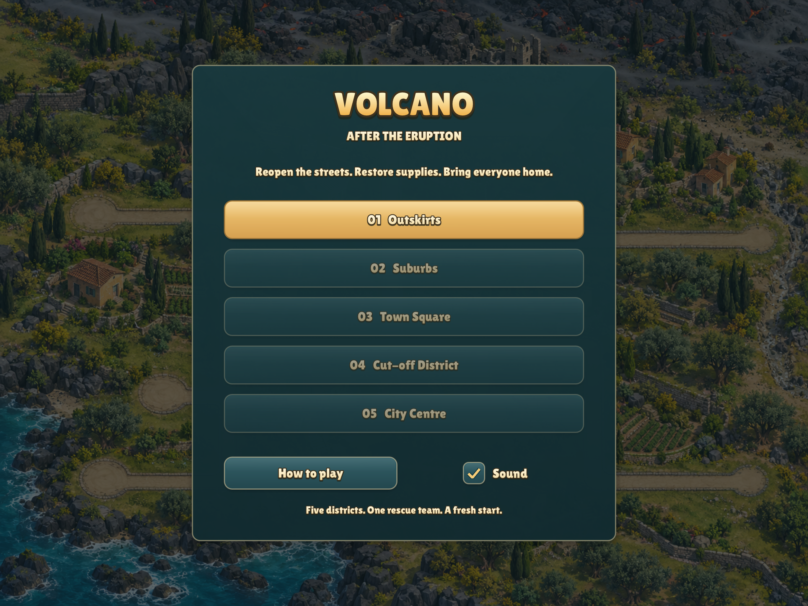
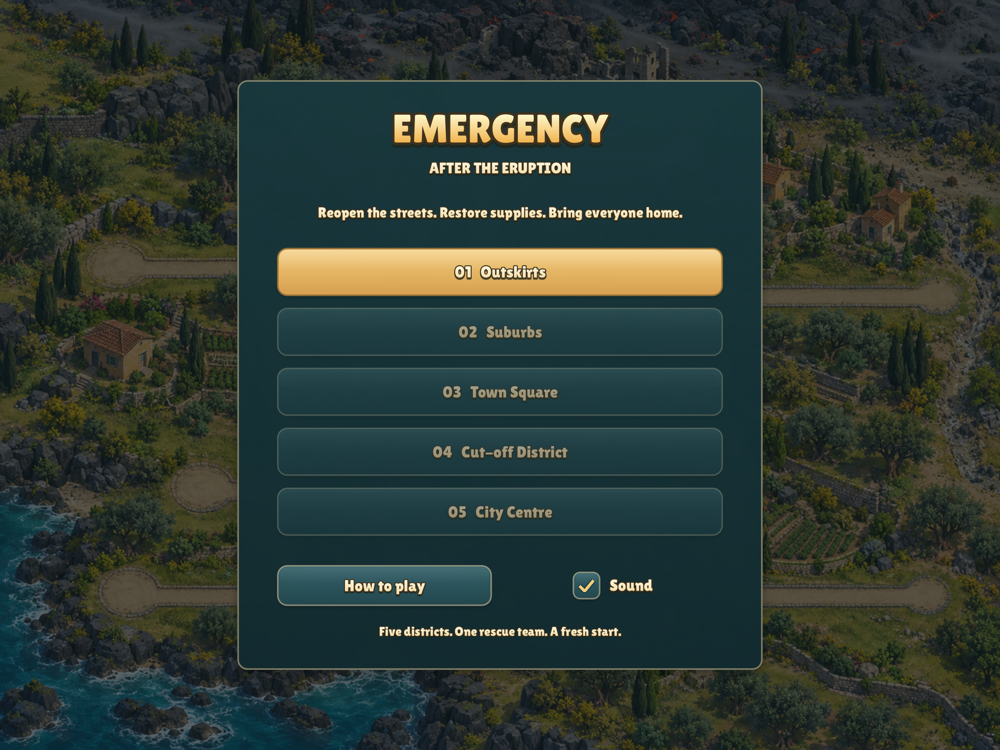
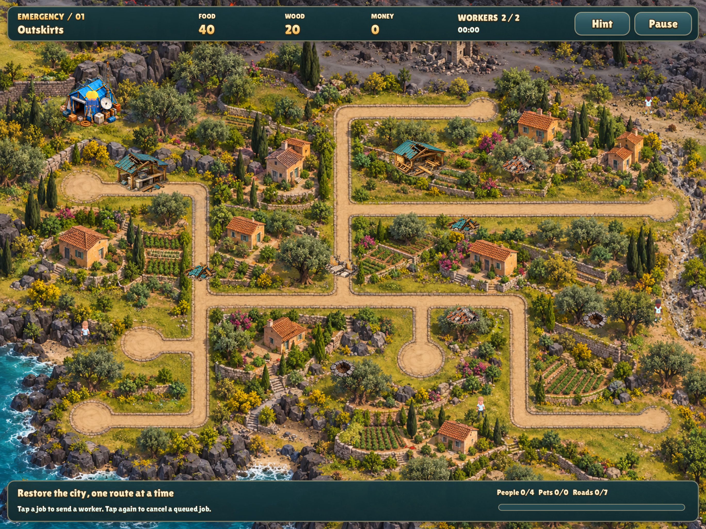

# Emergency rename

The active game directory, modules, runtime backgrounds, test suite and Xcode
project/schemes were moved with `git mv`. Build, run, test, web, device-deploy
and CI entry points now use `emergency`. The menu, gameplay header, native window
title and iOS/macOS display names say Emergency.

The installed-app bundle identity `com.corepunch.volcano` and Lua save namespace
`volcano` are unchanged to retain existing campaign progress. The 338 archived
source files and seven original generation prompts were verified byte-for-byte
after the move. Preservation manifests point at their new directory.

The selected AppIcon 12 and its complete 16-option sheet remain unchanged.
Runtime map pixels, sprite pixels, simulation and layout are unchanged.

## Menu and gameplay header

Captured using the existing Emergency test manifest in one process per game,
at 1368×1026 and 1200×900. The matching before captures used the original game.

| Screen | Before | After |
| --- | --- | --- |
| Menu, 1368×1026 |  |  |
| Menu, 1200×900 |  |  |
| Gameplay, 1368×1026 |  |  |
| Gameplay, 1200×900 |  |  |

## Verification

- Full native build with `CFLAGS="-O2 -g -Werror"`: passed, 2.63 seconds.
- Emergency rules, five-district input smoke and four after captures in one
  game process: passed, 15.75 seconds.
- Full repository checks with `make test TEST_BUDGET=15`: all 17 groups passed;
  check execution took 8.32 seconds. The default five-second budget is unchanged.
- Lua lint, generated-project freshness and asset/provenance checks: passed.
- `make -C games/emergency ios`: built, installed and launched on the connected
  iPad. Built app metadata names it Emergency, with executable `emergency`,
  selected AppIcon 12 and the original bundle identifier for update compatibility.

Every before/after image was reviewed. Pixel differences are limited to the
changed menu title or gameplay header at both sizes. The README's menu and
outskirts images were refreshed from these existing captures.
