# Архив Нила · Nile Archive

`make -C games/nile-archive ios` из корня репозитория собирает, подписывает,
устанавливает и запускает игру на подключённом iPad. Выбор устройства:
`DEVICE="имя или UDID"`; команда `make list-devices` показывает устройства.
См. [настройку подписи и развёртывания](../../tools/xcode/README.md#deploy-to-a-connected-iphone-or-ipad).

Находки, серии находок, промахи, подсказки и завершение главы сопровождаются
тактильным откликом на поддерживаемых устройствах. Постройки дают отклик после
подтверждения размещения или переноса; перетаскивание и предпросмотр — без него.
См. [общий контракт haptics](../../docs/HAPTICS.md).

Приключенческая игра в жанре **hidden object**: ищите предметы, раскрывайте семейную тайну и восстанавливайте островное поместье в Египте эпохи Птолемеев.

Игра полностью написана на **C11 / SDL2** поверх общего движка из [`engine/`](../../engine) — того же, на котором сделана [Relic Rush](../relic-rush). Весь интерфейс (панель игрока, валюты, главы, постройки, диалоги, подсказки) рисуется движком: нарисованные шрифты с обводкой, градиентом и тенью, сглаженные панели и кнопки, частицы. HTML-оболочки больше нет — в браузере работает та же программа, собранная в WebAssembly.

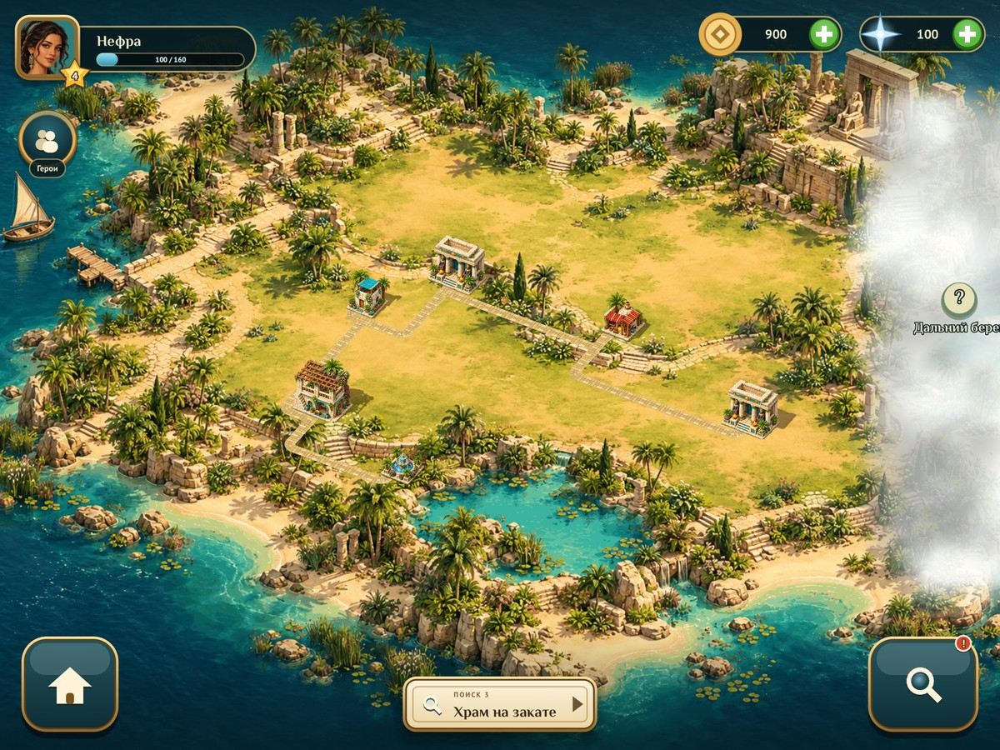

## Интерфейс

Интерфейс сделан по образцу iPad-версии June’s Journey, в цветах архива:

- **Без автоматических дорог.** Постройки не соединяются процедурными линиями; дорожки на фоновой иллюстрации остаются частью пейзажа.
- **Остров во весь экран.** Сверху слева — табличка Нефры: портрет в золотой рамке, звезда уровня и полоска влияния до следующего уровня. Сверху справа — капсулы монет и влияния с зелёным «+». Слева — круглые кнопки «Герои» и «Берег» с ценой.
- **Снизу.** Кнопка «Строить» открывает лоток построек, табличка посередине показывает следующую цель, кнопка «Главы» открывает список поисков, тайник и журнал улик. Красная точка означает, что следующая цель доступна.
- **Окна.** Тёмно-бирюзовые панели в золотой рамке с заклёпками, красная лента с заголовком и пергаментные карточки. Золотая кнопка запускает поиск, серая показывает недостающее условие.
- **Без рамок и полос.** Остров и сцена поиска занимают весь экран iPad, включая полосы под строкой состояния и индикатором «домой»; кнопки остаются в безопасной зоне. Картинка сцены заполняет экран целиком, а края, которые не поместились, видны при перетаскивании.
- **Сцена поиска во весь экран, без нижней панели.** Как в June’s Journey, поверх картинки почти ничего нет, и она видна целиком. Сверху — полоска «Бонус» с множителем «3x», пока длится серия находок, и прозрачная круглая кнопка паузы в правом углу (пауза предлагает продолжить или вернуться на остров и флажок «Меньше анимации»: без всплывающих окон, пульсаций, искр и летящих очков; настройка сохраняется вместе с прогрессом). Снизу — три полупрозрачные коричневые плашки с золотой каймой и крупными белыми названиями: найденное зачёркивается и уступает место следующему, подсказанное подсвечивается золотом. Справа в углу — лампочка подсказки в золотом кольце, перезаряжающаяся 20 секунд. Очки и время показываются в итогах главы.
- **Очки.** Каждая находка — 300 очков, умноженных на комбо (до ×5, если следующий предмет найден за 5 секунд). Промах стоит 60 очков и сбрасывает комбо. До 1:15 поиск даёт три звезды, до 2:30 — две. Второе и третье прохождения гарантируют минимум две и три звезды соответственно.
- **Диалоги** скрывают нижние кнопки, как сюжетные сцены June’s Journey.

| Выбор главы | Лоток построек |
| --- | --- |
| 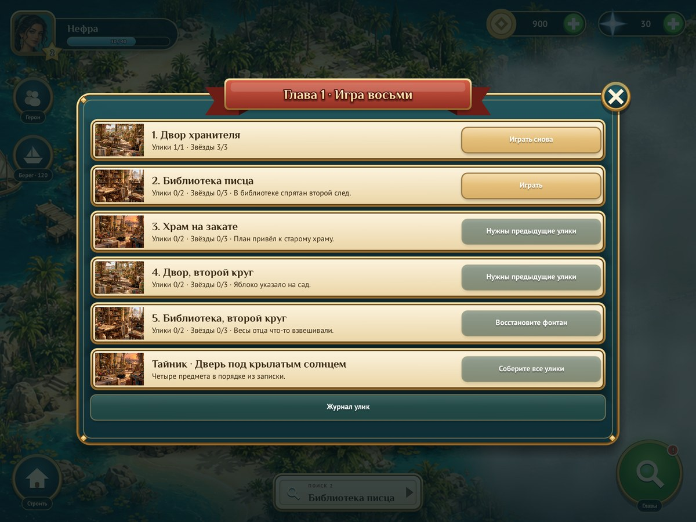 | 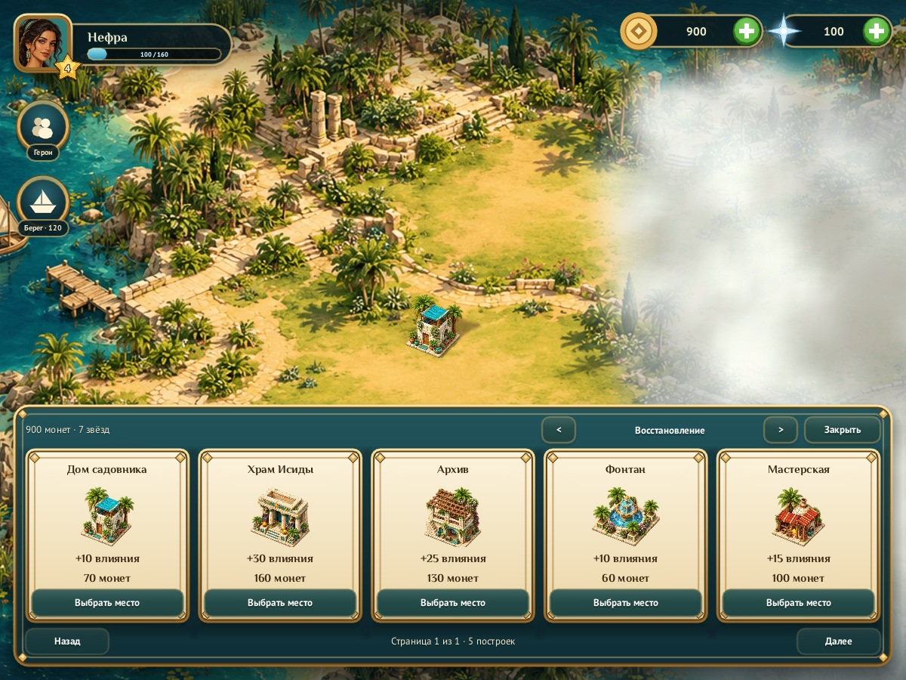 |

Сцена на iPad Air (1180 × 820, безопасная зона: 24 сверху и 20 снизу) — от края до края:

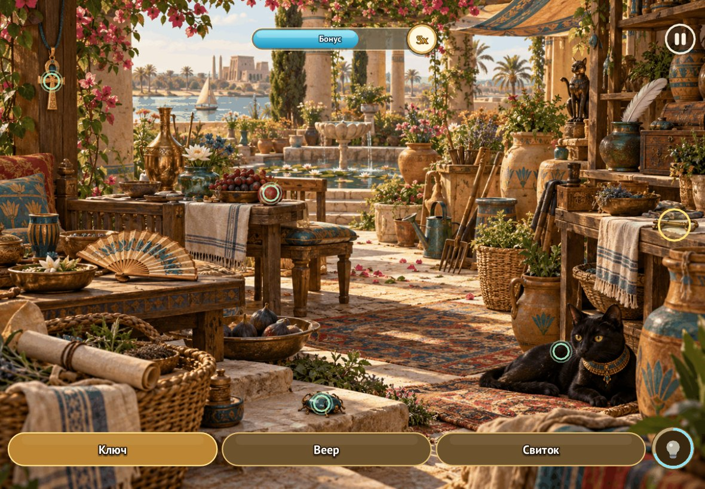

## Сюжет

**Египет, 196 год до н. э.** Нефра, дочь хранителя архива, возвращается в семейное поместье на острове Нила. После наводнения отец исчез, библиотека опустела, а знакомые дворы и террасы хранят лишь разрозненные следы прошлого.

Среди повседневных вещей Нефра находит свиток с семейной печатью. Отец успел спрятать книги до прихода воды — и оставил цепочку подсказок. Печать ведёт к библиотеке, план острова указывает на старый храм, а последняя записка обещает открыть путь к спрятанному архиву.

Чтобы вернуть острову жизнь, Нефра восстанавливает дома, мастерскую, фонтан и храм. Поиск предметов приносит средства для строительства, а восстановление поместья открывает новые главы и берега. Находки приближают её к архиву; судьба отца остаётся основой для продолжения истории.

Это художественный сюжет в историческом антураже, а не реконструкция реальных событий.

Доступны три главы «Игра восьми», «Книга разливов» и «Печать». Во второй и третьей главах Нефра и Мерит исследуют хранилище, ниломер, дамбу, амбары, дом надзирателя и мастерскую. Каждая глава завершается тайником. Полный [сценарий](docs/story.md) содержит правду истории и цепочки улик.

| Поиск | Условие |
| --- | --- |
| 1. Двор хранителя | С начала игры |
| 2. Библиотека писца | Первая улика и 20 влияния |
| 3. Храм на закате | Обе улики библиотеки и 50 влияния |
| 4. Двор, второй круг | Обе улики храма и 75 влияния |
| 5. Библиотека, второй круг | Обе улики двора, 90 влияния и восстановленный фонтан |
| Тайник под крылатым солнцем | Все девять улик |

## Персонажи

| Нефра — героиня | Хорем — пропавший отец | Мерит — лодочница |
| --- | --- | --- |
| 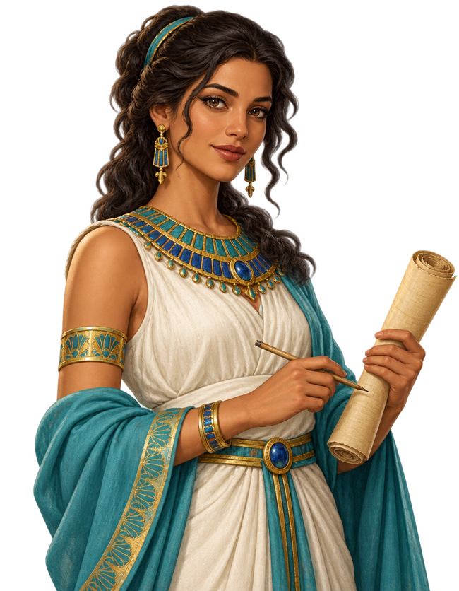 |  |  |

Персонажи говорят через общую систему диалогов движка: портрет, речевой пузырь с хвостиком к говорящему, табличка с именем и печатающийся текст (нажатие — показать строку целиком, следующее — дальше; есть «Пропустить»).

- **Нефра** вместе с Мерит разбирает улики после поиска.
- **Хорем** звучит в записках, которые появляются в пузырях мыслей.
- **Мерит** помогает вести расследование и комментирует восстановленные постройки.

Постановка как в историях Playrix и Wooga: говорящий стоит в своём углу, пузырь — на высоте лица, хвостик заканчивается у рта; предыдущий собеседник остаётся напротив, приглушённым.

Табличка с именем центрируется на видимом верхнем контуре любого пузыря — обычного, облачного или колючего. Выступы уже учитываются в отступах текста, поэтому сверху нет лишней пустоты.

Каждая сюжетная сцена показывается один раз и запоминается в сохранении. Все трое представлены в галерее персонажей.

| Нефра рассказывает | Записка Хорема | Мерит у нового берега |
| --- | --- | --- |
| 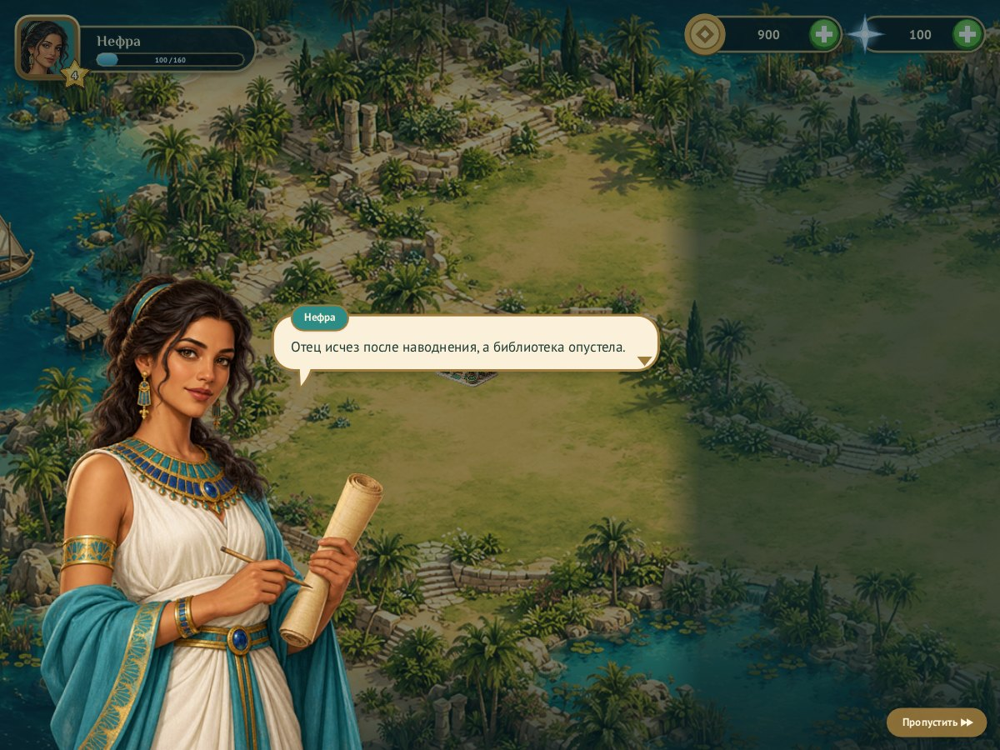 | 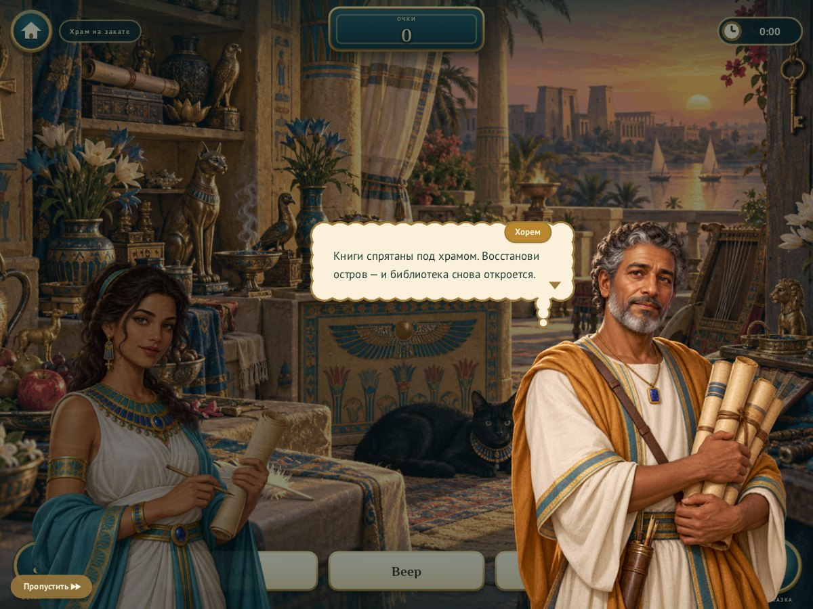 | 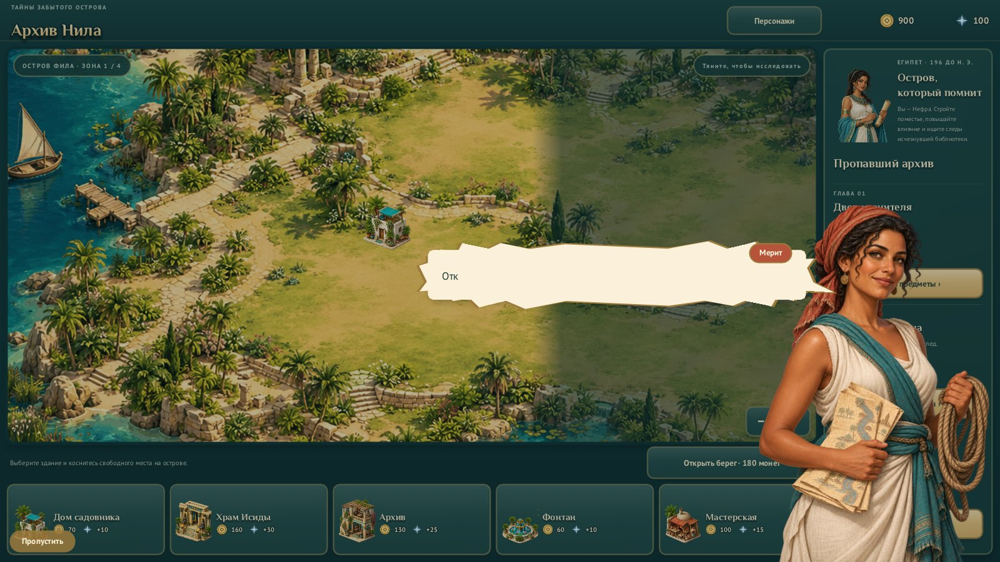 |

## Скриншоты

Кадры получены самой игрой (`make shots`, программный рендерер без окна).

| Двор хранителя (комбо и подсказка) | Библиотека писца |
| --- | --- |
| 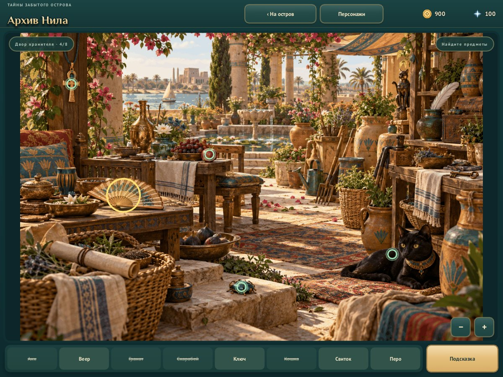 | 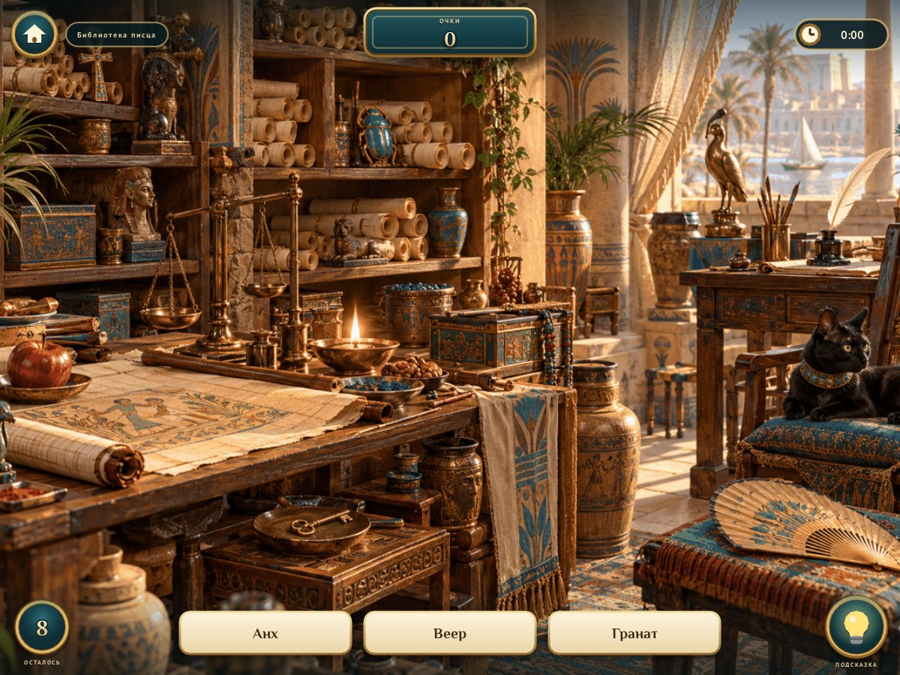 |
| **Храм на закате** | **Награда за главу** |
| 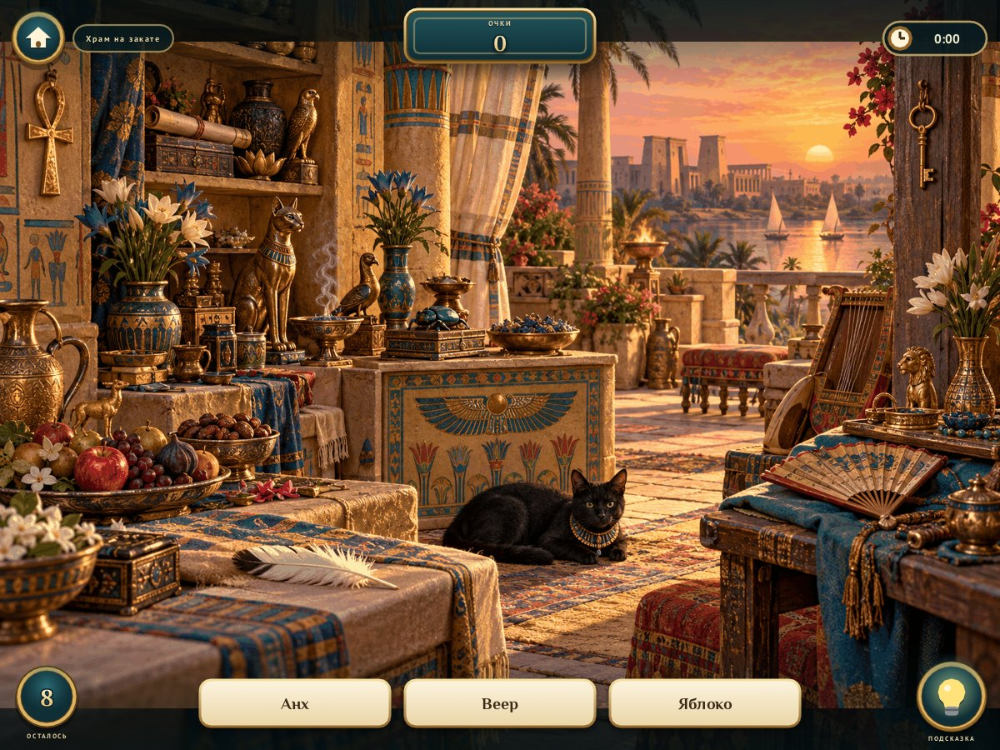 | 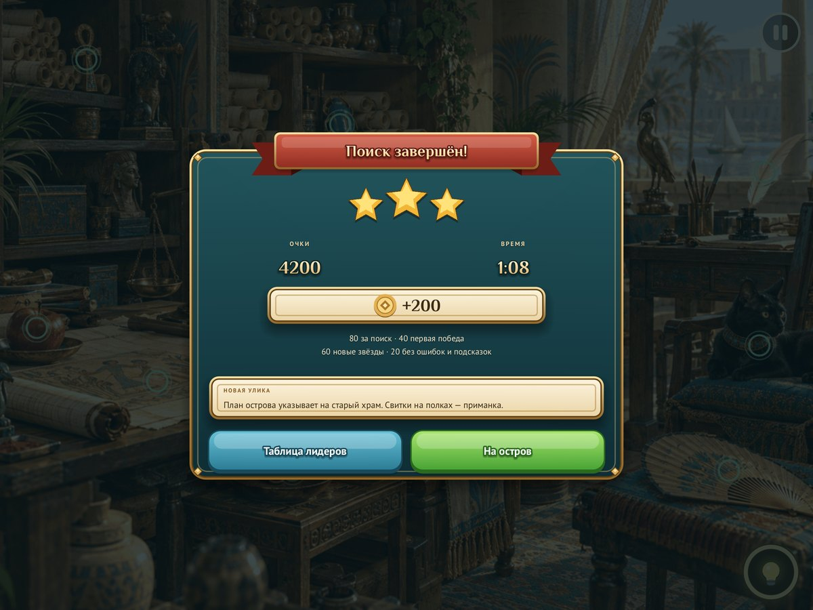 |

Окно награды, звёзды и подписи предметов движутся на движковом модуле `tween`
([docs/MOTION.md](../../docs/MOTION.md)):

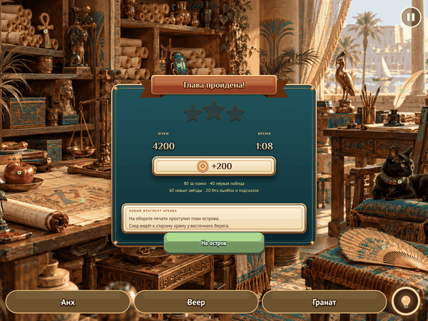
| **Люди острова** | **Широкий экран 16:9** |
| 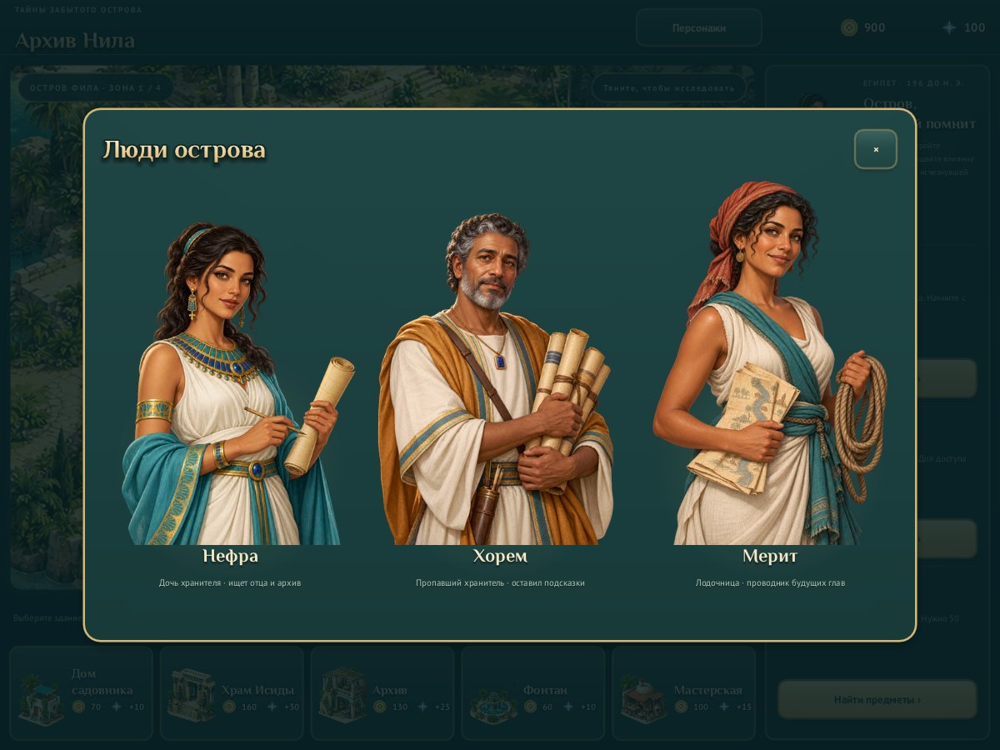 | 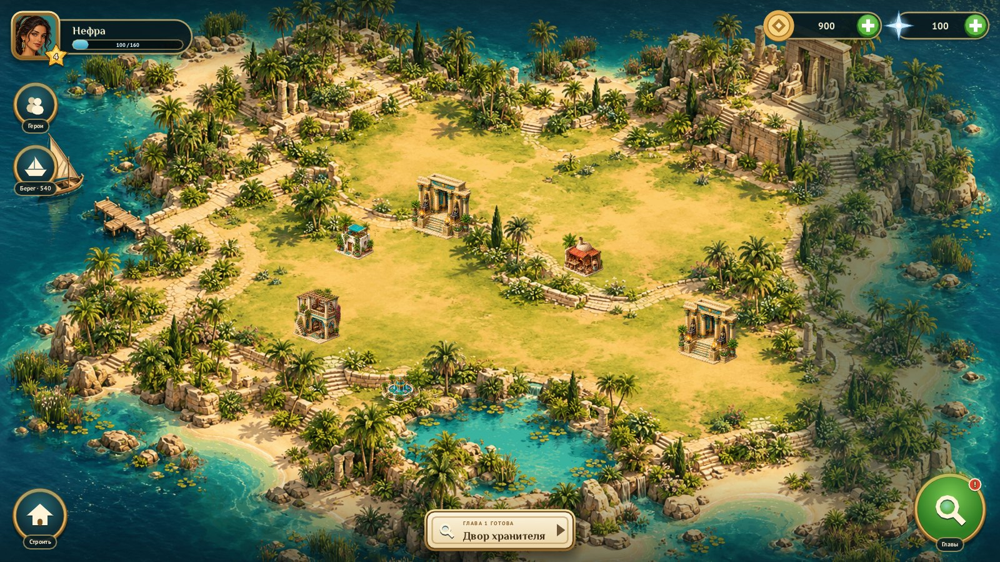 |

## Таблицы лидеров

Game Center подключён через движок ([docs/GAMECENTER.md](../../docs/GAMECENTER.md)). В игре две
вещи: **таблица влияния** (`influence`, суммарное влияние, оно только растёт; открывается кнопкой
«Таблица лидеров» в списке глав) и **таблица каждого поиска** (`search_1` … `search_15`, лучший счёт;
открывается кнопкой на окне «Поиск завершён!»). Очки уходят при победе в поиске, влияние — при
каждом сохранении. Окно рисуется скином игры (роли `leaderboard_*` в `lua/archive_skin.lua`), подписи
по-русски; без Game Center оно показывает ваш лучший результат. В App Store Connect нужны шестнадцать
таблиц (от большего к меньшему): `com.corepunch.nilearchive.influence` и
`com.corepunch.nilearchive.search_1` … `search_15`. Таблицы `search_6` … `search_15` необходимо добавить в App Store Connect. Для снимков: `--screen leaderboard` и
`--screen win-leaderboard` с `--gamecenter-demo`.

| Влияние | Поиск «Библиотека писца» | Список глав | Окно награды |
| --- | --- | --- | --- |
| 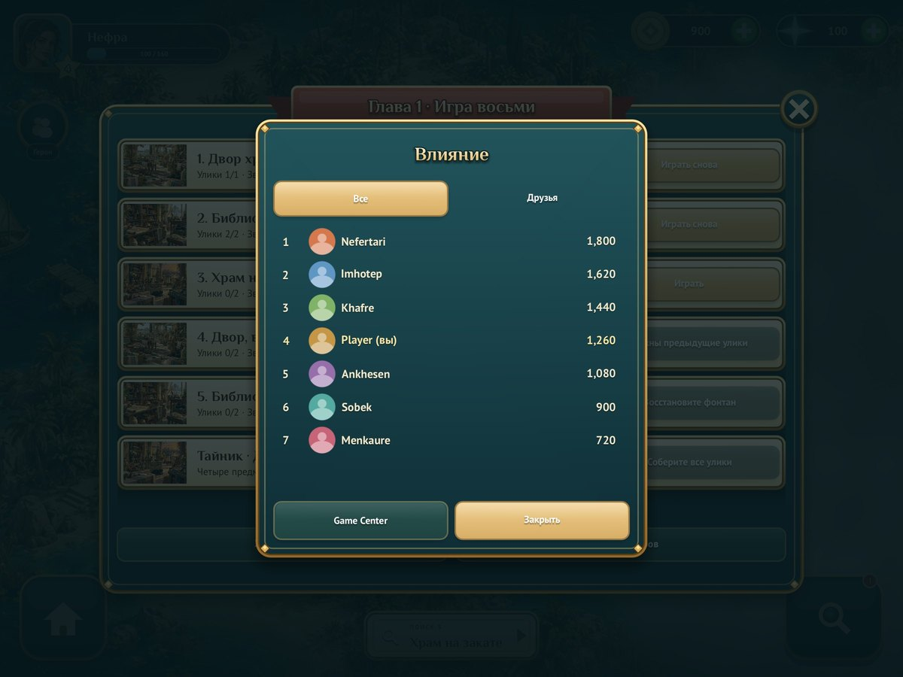 | 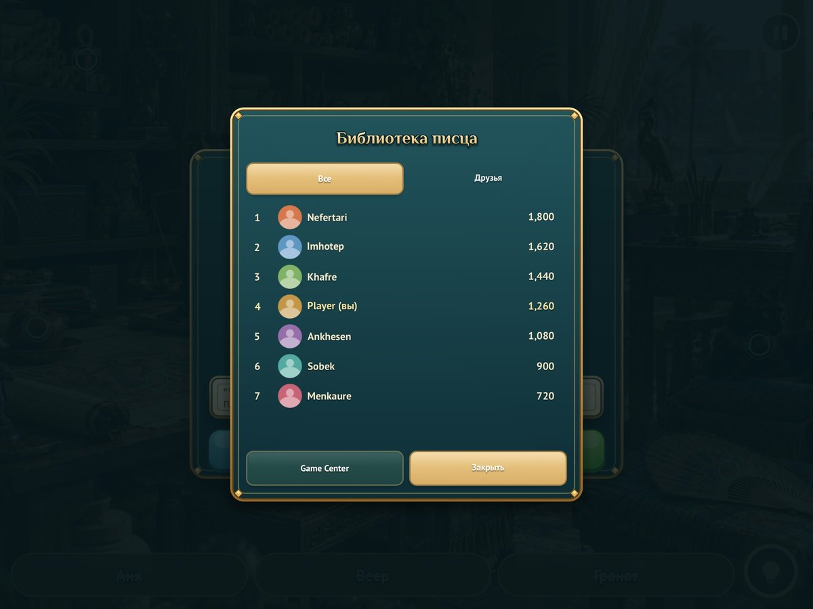 | 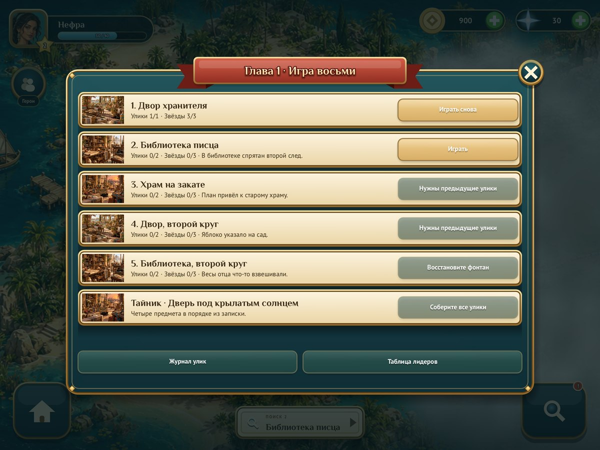 |  |

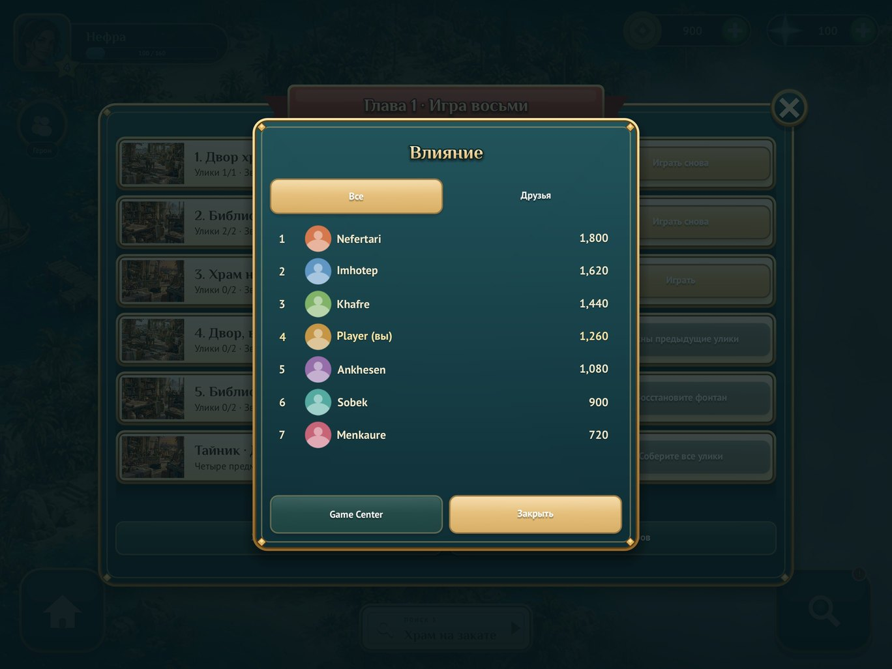

## Как играть

1. Нажмите «Главы», выберите двор и найдите восемь предметов. Их названия видны по три на табличках внизу. Засчитываются только предметы, названные на текущих табличках. Лампочка обводит один из названных предметов золотой рамкой и перезаряжается 20 секунд.
2. За каждую завершённую сцену получите **80 монет**. Первая победа даёт ещё **40**, каждая новая звезда лучшего результата — **20**, поиск без промахов и подсказок — ещё **20**. Первая победа приносит 140–200 монет, повтор освоенной сцены — 80–100. Подсказки бесплатны; базовая награда от них не уменьшается.
3. Новая игра начинается с домом садовника, **0 монет и 10 влияния**. Нажмите «Строить», выберите доступную постройку, разместите предпросмотр и подтвердите стоимость. «Отмена» ничего не тратит.
4. Каждую сюжетную постройку можно восстановить один раз. В лотке также есть [96 украшений](docs/building-catalogue.md), которые открываются за суммарные лучшие звёзды. Украшение даёт по единице влияния за каждые 10 монет цены с округлением вниз. Влияние и звёзды не тратятся.
5. Двор даёт одну улику при первом посещении. В поисках 2–5 первая победа открывает улику A, а успешный повтор после уже полученной третьей звезды — улику B. Найденные улики сохраняются в журнале, даже если пропустить диалог.
6. Тайник каждой главы предлагает четыре предмета по одному. Посторонние нажатия не штрафуются. Решение завершает главу и приносит награду один раз: 150, 150 и 200 монет соответственно.
7. Берега стоят 120, 180 и 240 монет и открываются после одного, двух и трёх разных поисков. После первого тайника в лотке «Работы на острове» доступны пять проектов второй главы, а после второго — пять проектов третьей. Каждый проект отдельно показывает цену и влияние, требует подтверждения и выполняется один раз. Поиски можно повторять ради монет. Энергии и строительных таймеров нет.

См. [план сюжета, прогрессии и экономики Nile Archive](docs/progression-economy.md),
[справочник June’s Journey для разработки Nile Archive](../../docs/junes-journey-reference/README.md),
[исследование экономики Playrix и Wooga, бюджеты и проверку баланса](../../docs/ECONOMY_RESEARCH.md)
и [сравнение игровых экранов](docs/review/economy/README.md).

Чтобы переместить постройку, удерживайте её полсекунды, затем перетащите. После отпускания нажмите «Подтвердить» или «Отмена»; до подтверждения положение и монеты не меняются. Обычное перетаскивание прокручивает карту, даже если началось на постройке. Esc отменяет перенос.

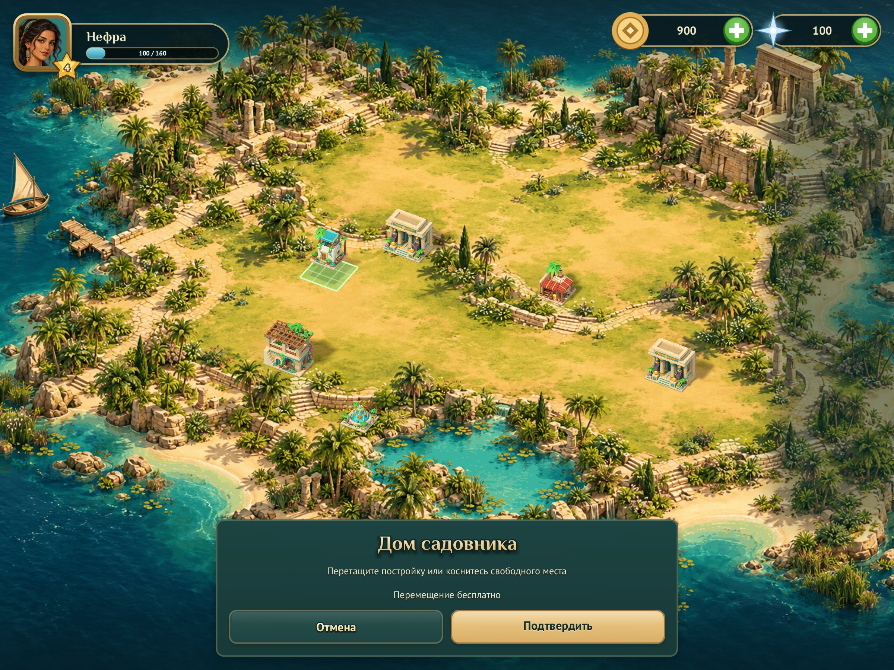

Перетаскивайте остров мышью или пальцем; масштаб меняют колесо мыши и щипок двумя пальцами. Целевая платформа — **iPad, только альбомная ориентация**; в портретной ориентации движок показывает просьбу повернуть устройство. Прогресс сохраняется автоматически: в браузере — в `localStorage`, в настольной версии — в файл в папке пользовательских данных. Клавиша Esc закрывает окно или возвращает на остров.

### Постройки

| Постройка | Цена, монеты | Влияние |
| --- | ---: | ---: |
| Дом садовника | 70 | +10 |
| Храм Исиды | 160 | +30 |
| Архив | 130 | +25 |
| Фонтан | 60 | +10 |
| Мастерская | 100 | +15 |

Фонтан и мастерская доступны после первого успешного поиска, архив и храм — после второго. Дом уже стоит в новой игре. Старые сохранения сохраняют монеты, влияние, постройки и доступ к посещённым местам. Журнал показывает зачтённые улики по порядку.


## Экраны и устройства

Логический экран — 1200 × 900 (iPad, 4:3). На более широких экранах он растёт по ширине до 16:9, и компоновка подстраивается: элементы интерфейса держатся углов безопасной зоны, а остров и сцены поиска заполняют весь экран. Текст растеризуется в физическом разрешении экрана, поэтому остаётся чётким на Retina. В портретной ориентации показывается экран поворота.

Кнопки подтверждения переноса используют тёмный текст на золотом фоне; «Отмена» — светлый текст с обводкой на тёмном фоне. Общая тема применяет градиенты и тени текста из движка; подписи сохраняют контраст при наведении, нажатии и недоступном подтверждении. Состояния и снимки описаны в `docs/UI_CATALOGUE.md`.

## Запуск и сборка

Из корня репозитория:

```sh
make run-nile                      # настольная версия, нужен SDL2 (apt install libsdl2-dev / brew install sdl2)
make web                           # WebAssembly, нужен Emscripten SDK
python3 -m http.server 8080 --directory dist   # затем http://localhost:8080/nile-archive/
```

Полезные параметры: `--fresh` — не читать и не записывать сохранение; `--screen island|build|scene0|scene1|scene2|cast|chapters|win` — открыть нужный экран; `--screen build --catalogue <категория> --catalogue-page N` — лоток с прокруткой к нужной группе построек; `--building-review N` — поставить на остров украшения 8(N−1)+1…8N для проверки; `--footprints` — показать поверх построек их клетки и опорную точку (проверка размеров, см. `docs/BUILDINGS.md`); `--shot файл.png` — сохранить кадр и выйти; `--smoke` — пройти первую главу, проверить прокрутку, поднятие удержанием, отмену и подтверждение переноса (запускается в CI).

Прогресс старой HTML-версии (`localStorage["nile-v1"]`) при первом запуске веб-версии переносится автоматически.

## Структура

| Файл или каталог | Назначение |
| --- | --- |
| `lua/main.lua` | Точка входа: переходы между островом и сценой, запуск, отладочные экраны (`--screen`, `--building-review`) |
| `lua/archive_state.lua` | Общее состояние и константы, которые читают все модули |
| `lua/archive_content.lua` | Списки предметов с координатами, постройки и персонажи |
| `lua/archive_story.lua` | Диалоги первой главы и записи журнала |
| `lua/archive_economy.lua` | Экономика: награды, пороги глав, цены; покрыта тестами |
| `lua/archive_progress.lua` | Сохранение, перенос старого прогресса, цель главы, уровень игрока |
| `lua/archive_skin.lua` | Внешний вид как данные (`ui.skin`): шрифты, стили текста, тема движка, рамки и кнопки-«пилюли» со всеми состояниями |
| `lua/archive_kit.lua` | Обёртки над скином (рамки, кнопки) и нарисованные элементы: лента, круглые кнопки, валюты, значки |
| `lua/archive_island.lua` | Экран острова: табличка игрока, валюты, цель, лоток построек, перенос |
| `lua/archive_scene.lua` | Правила поиска предметов и экран сцены |
| `lua/archive_dialogs.lua` | Окна: награда, главы, пауза, персонажи |
| `lua/archive_smoke.lua` | Прогон `--smoke` щелчками (запускается в CI) |
| `data/` | Фоны сцен, карта острова, постройки, портреты, значки, шрифты (Philosopher, PT Sans — OFL) |
| `art/` | Исходные изображения построек и персонажей в полном размере |
| `art/building-catalogue/` | Blender-мастер 96 украшений (`build_scene.py`, `nile_archive_buildings.blend`), каталог, регистрация, контактный лист |
| `art/building-catalogue/build_scene.py`, `tools/prepare_catalogue.py` | Модели построек и каталог; `make buildings GAME=nile-archive` рендерит их по имени |
| `tools/import_buildings.py` | Пересборка старого атласа построек (историческое) |
| `tools/make_icons.py` | Значки монеты и влияния |
| `docs/` | Описание проекта, художественное направление, референсы, скриншоты |

Остров — это `city` движка: каталог построек с ценами и наградами, четыре открываемые зоны, проверка суши (`island_buildable`), сортировка по глубине и сохранение.

## Полное описание проекта

- [Концепция, сюжет, правила, экономика, архитектура, сохранения и дальнейшие идеи](docs/PROJECT.md)
- [Референсы June’s Journey и Pearl’s Peril и принятые решения](docs/REFERENCES.md)
- [Художественное направление и устройство ресурсов](docs/ART.md)
- [Устройство общего движка](../../docs/ENGINE.md)

## Статус

Первая глава полностью проходима. В ней пять поисков, девять улик и храмовый тайник. [Кадры первой главы в двух альбомных размерах](docs/UI_CATALOGUE.md#chapter-1-captures).

Иллюстрации фонов, портреты и изометрические постройки созданы генеративным инструментом; значки нарисованы скриптом. Механический ориентир — цикл поиска предметов и развития острова из June’s Journey и Pearl’s Peril. Персонажи, сюжет и графика проекта созданы отдельно.

## Лицензия

См. [LICENSE](../../LICENSE).

## Fast rule tests

Run `make test-nile-archive` from the repository root for this game's tests in one command. The Lua suites use deterministic state injections and need no window or artwork. See [the testing guide](../../docs/TESTING.md) for coverage, test-only `ENGINE_TEST` hooks, extended samples and renderer smoke checks.

При переносе или размещении здания контуры остальных построек показывают
занятую землю без дополнительного отступа: основания могут соприкасаться.
Светлые линии с тёмной окантовкой помогают
быстро выравнивать постройки. Старое место переносимого здания не выделяется;
после подтверждения или отмены контуры исчезают.
[Сравнение](../../docs/review/city-placement-guides/README.md).

## Town screen

The estate uses the engine's [shared town screen](../../docs/TOWN.md), laid out
by `data/town.json`, like Relic Rush and Christmas Market: Build and Play
badges, the goal card between them, region markers to open shores, Cancel and
Confirm under a lifted building, and a word bubble when a building is tapped.
