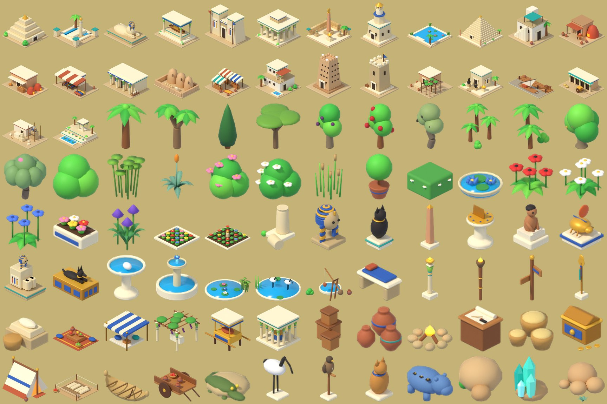
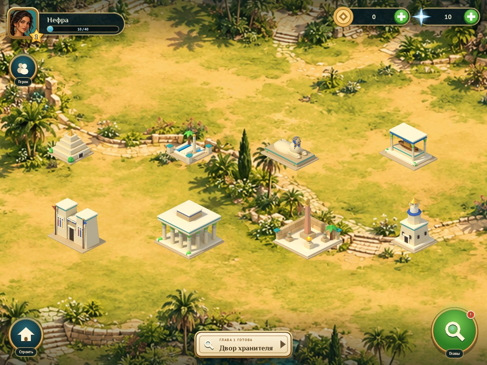
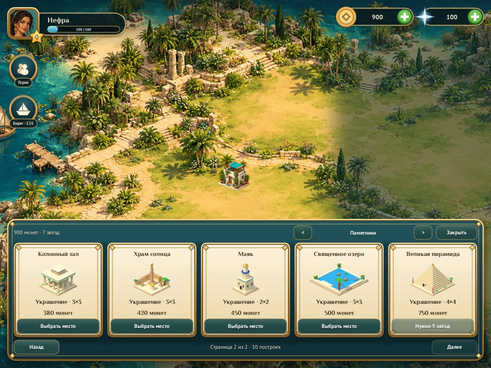

# Buildings and decorations

Nile Archive has **101 building types**: the five painted restorations
(types 0–4, which grant Influence) and **96 catalogue objects** (types 5–100)
rendered in Blender. The catalogue mirrors Relic Rush's
[building catalogue](../../relic-rush/docs/building-catalogue.md) one slot for one
slot: the same 11 categories with the same counts and footprints.

| Category | Tray label | Count | Footprints |
| --- | --- | ---: | --- |
| `wonder` | Памятники | 10 | 2×2, 3×2, 3×3, 4×4 |
| `building` | Дома и мастерские | 16 | 2×2 to 4×4 |
| `tree` | Деревья | 11 | 7 × 1×1, 4 × 2×2 |
| `bush` | Кусты | 8 | 1×1 |
| `flower` | Цветы | 8 | 6 × 1×1, 2 × 2×2 |
| `statue` | Статуи | 9 | 7 × 1×1, 2 × 2×2 |
| `water` | Вода | 5 | 2 × 1×1, 3 × 2×2 |
| `garden` | Сад | 11 | 6 × 1×1, 5 × 2×2 |
| `camp` | Припасы | 10 | 6 × 1×1, 4 × 2×2 |
| `animal` | Животные | 5 | 1×1 |
| `rock` | Камни | 3 | 2 × 1×1, 1 × 2×2 |



## Rules

Catalogue objects are decorations. They cost coins once, on confirmation, and
grant no Influence, so the chapter gates (20 and 50 Influence) still depend only
on the five restorations. Each object unlocks with **Stars**: the sum of the best
Stars of the three chapters (0–9). Stars are a requirement in wallet slot 4,
rebuilt from the saved best Stars, and are never spent. Prices run from 15 coins
for a flower to 750 coins for the Great Pyramid. The island holds at most 160
objects (`CITY_MAX`). Placement, the 0.5-second hold-to-move, Confirm/Cancel and
saving are the same as for restorations. Old saves load unchanged, because the
new types follow the existing ones.

## Build tray

«Строить» opens the tray on the last category viewed. The goal plaque opens it
on «Восстановление». The arrows at the top step through «Восстановление», «Все
постройки» and the 11 categories. «Назад»/«Далее» page through five cards at a
time. A card shows the name, the sprite, «+N влияния» for restorations or
«Украшение · W×H» for decorations, the price and the action. The action reads
«Выбрать место», «Не хватает монет», «Нужно N звёзд», «Пройдите главу N» or
«Остров заполнен», and it is disabled unless the object can be placed. The cards
are an engine `list` filled with `form:set_items`, keyed by the stable type number.

## Source and rendering

`art/building-catalogue/build_scene.py` builds all 96 objects as procedural
geometry. It reuses Relic Rush's Blender mesh kit, materials, bevels, lighting
and orthographic camera unchanged. The camera sits 30° above the ground at a
45° azimuth, so the ground projects to the game's exact 2:1 grid. Nile Archive
adds its own palette (limestone, whitewash, lapis, turquoise and gold) and
Egyptian helpers: battered pylons, papyrus columns, nemes heads, obelisks,
felucca hulls and lotus. One Blender unit is one tile side and every object's
pivot is its footprint's ground centre. Buildings stand on a paved slab that is
exactly their footprint. Decorations stand on the grass, and their footprint is
a virtual base, as in Relic Rush. `catalogue.json` lists each object's key,
Russian name, category, footprint, coins, Stars and Relic slot. The master is
`nile_archive_buildings.blend`, with the layout report `scene_layout.json`.

`tools/render_buildings.py` renders each object on its own with Cycles, using a
transparent film. It moves the master's camera over the object at one fixed
scale, **128 sprite pixels per tile**, so all sprites share the same detail.
Because of that fixed scale, `base_width` is exactly `(w + h) × 64` and the
pivot is projected analytically into `registration.json`; nothing is guessed
from the silhouette. `tools/prepare_catalogue.py` crops each render to its
visible pixels, keeping the rendered RGBA and moving the pivot with the crop.
It then writes `lua/archive_catalogue.lua`, `art/building-catalogue/manifest.json` and
the 12 × 8 `geometry-atlas.png` contact sheet, laid out like Relic Rush's. On
slab buildings, `tools/footprint.py` agrees with the registration to within
1–5 px. The bevels round the corners it measures.

These are the Blender renders themselves; there has been no ImageGen paint-over
like Relic Rush's runtime sprites. The renders are a finished, consistent toy
style, but they are less painterly than the five restorations and the island
painting. The paint-over pass and a review of decoration scale (1×1 decorations are
small next to the island's painted palms at the default zoom) are tracked in
[issue #32](https://github.com/corepunch/nile-archive/issues/32).

## Supported presentation and interactions

Every object has one rendered normal sprite. It has no damaged, construction,
upgrade, hover, pressed or disabled world artwork. The engine's transient
placement preview supplies the lift, the alpha and the green/red footprint. Tray
cards always show the normal sprite without tinting. Locked and unaffordable
states are expressed only by the label and the disabled form button.

## Reproduce and verify

The full procedure and its requirements, from a new catalogue row to the
reviewed pull request, are in [docs/BUILDING_ART.md](../../../docs/BUILDING_ART.md).

```sh
cd games/nile-archive/art/building-catalogue && blender -b --python build_scene.py && cd -
blender -b games/nile-archive/art/building-catalogue/nile_archive_buildings.blend \
    --python games/nile-archive/tools/render_buildings.py      # add "-- key ..." to render a few
python3 games/nile-archive/tools/prepare_catalogue.py --inventory   # prints the inventory rows below
python3 tools/footprint.py games/nile-archive/data/buildings/great_pyramid.png --overlay /tmp/pyramid.png
make CFLAGS="-O2 -g -Werror" && make test
./build/nile-archive --headless --mute --fresh --size 1200x900 --screen build --catalogue wonder --shot /tmp/shop.png
./build/nile-archive --headless --mute --fresh --size 1200x900 --building-review 12 --footprints --shot /tmp/fp.png
./build/nile-archive --headless --mute --fresh --smoke
```

Blender 5.2 renders all 96 objects in about 1.5 minutes on four CPU cores. The
`bpy` Python module works in place of the `blender` binary. On Linux, run the
game captures under Xvfb with `LIBGL_ALWAYS_SOFTWARE=1`. `--building-review N`
places objects 8(N−1)+1 to 8N on the island, zoomed to fit the page's largest
footprint, and pages 1–12 cover all 96. `--screen build --catalogue <category>
--catalogue-page N` opens the tray on a page with 7 Stars, so the last few
objects stay locked. The smoke test opens the tray, steps to «Деревья», pages
forward and back, then buys and places a date palm. It checks that the purchase
charges 30 coins once and grants no Influence.

| Monuments, page 1 | Locked state |
| --- | --- |
|  |  |

## Runtime inventory

Pivots are in cropped-sprite pixels and base widths in sprite pixels. Every
entry supports the presentation and interaction contract above.

| Type / key | Name | Category | Tiles | Pivot px | Base px | Coins | Stars | Reviewed city capture |
| --- | --- | --- | --- | --- | ---: | ---: | ---: | --- |
| 5 / `small_pyramid` | Малая пирамида | wonder | 2 x 2 | 127, 123 | 256 | 240 | 0 | [Page 1](review/building-catalogue/footprints-01.jpg) |
| 6 / `nilometer` | Ниломер | wonder | 2 x 2 | 127, 125 | 256 | 260 | 0 | [Page 1](review/building-catalogue/footprints-01.jpg) |
| 7 / `sphinx` | Сфинкс | wonder | 3 x 2 | 159, 111 | 320 | 300 | 1 | [Page 1](review/building-catalogue/footprints-01.jpg) |
| 8 / `barque_shrine` | Святилище ладьи | wonder | 3 x 2 | 159, 185 | 320 | 320 | 1 | [Page 1](review/building-catalogue/footprints-01.jpg) |
| 9 / `pylon_gate` | Пилон | wonder | 3 x 2 | 159, 225 | 320 | 340 | 2 | [Page 1](review/building-catalogue/footprints-01.jpg) |
| 10 / `hypostyle` | Колонный зал | wonder | 3 x 3 | 191, 231 | 384 | 380 | 3 | [Page 1](review/building-catalogue/footprints-01.jpg) |
| 11 / `sun_temple` | Храм солнца | wonder | 3 x 3 | 191, 238 | 384 | 420 | 4 | [Page 1](review/building-catalogue/footprints-01.jpg) |
| 12 / `lighthouse` | Маяк | wonder | 2 x 2 | 127, 242 | 256 | 450 | 5 | [Page 1](review/building-catalogue/footprints-01.jpg) |
| 13 / `sacred_lake` | Священное озеро | wonder | 3 x 3 | 191, 117 | 384 | 500 | 6 | [Page 2](review/building-catalogue/footprints-02.jpg) |
| 14 / `great_pyramid` | Великая пирамида | wonder | 4 x 4 | 255, 243 | 512 | 750 | 9 | [Page 2](review/building-catalogue/footprints-02.jpg) |
| 15 / `mud_house` | Глинобитный дом | building | 2 x 2 | 127, 173 | 256 | 200 | 2 | [Page 2](review/building-catalogue/footprints-02.jpg) |
| 16 / `pottery` | Гончарня | building | 2 x 2 | 127, 124 | 256 | 220 | 2 | [Page 2](review/building-catalogue/footprints-02.jpg) |
| 17 / `bakery` | Пекарня | building | 3 x 2 | 159, 155 | 320 | 240 | 3 | [Page 2](review/building-catalogue/footprints-02.jpg) |
| 18 / `weaver` | Ткацкая мастерская | building | 3 x 2 | 159, 150 | 320 | 260 | 3 | [Page 2](review/building-catalogue/footprints-02.jpg) |
| 19 / `scribe_school` | Школа писцов | building | 3 x 2 | 159, 171 | 320 | 280 | 4 | [Page 2](review/building-catalogue/footprints-02.jpg) |
| 20 / `granary` | Зернохранилище | building | 3 x 2 | 159, 134 | 320 | 300 | 4 | [Page 2](review/building-catalogue/footprints-02.jpg) |
| 21 / `bazaar` | Базар | building | 3 x 3 | 191, 164 | 384 | 320 | 5 | [Page 3](review/building-catalogue/footprints-03.jpg) |
| 22 / `villa` | Вилла вельможи | building | 3 x 3 | 191, 237 | 384 | 340 | 5 | [Page 3](review/building-catalogue/footprints-03.jpg) |
| 23 / `dovecote` | Голубятня | building | 2 x 2 | 127, 196 | 256 | 360 | 5 | [Page 3](review/building-catalogue/footprints-03.jpg) |
| 24 / `watchtower` | Сторожевая башня | building | 2 x 2 | 127, 236 | 256 | 380 | 5 | [Page 3](review/building-catalogue/footprints-03.jpg) |
| 25 / `winery` | Винодельня | building | 3 x 3 | 191, 178 | 384 | 400 | 6 | [Page 3](review/building-catalogue/footprints-03.jpg) |
| 26 / `bastet_shrine` | Святилище Бастет | building | 3 x 3 | 191, 187 | 384 | 420 | 6 | [Page 3](review/building-catalogue/footprints-03.jpg) |
| 27 / `felucca_dock` | Причал с фелюкой | building | 4 x 2 | 191, 105 | 384 | 440 | 7 | [Page 3](review/building-catalogue/footprints-03.jpg) |
| 28 / `chariot_stable` | Конюшня колесниц | building | 4 x 3 | 223, 195 | 448 | 460 | 7 | [Page 3](review/building-catalogue/footprints-03.jpg) |
| 29 / `sculptor_yard` | Двор скульптора | building | 4 x 3 | 223, 181 | 448 | 500 | 8 | [Page 4](review/building-catalogue/footprints-04.jpg) |
| 30 / `pharaoh_garden` | Сад фараона | building | 4 x 4 | 255, 238 | 512 | 550 | 9 | [Page 4](review/building-catalogue/footprints-04.jpg) |
| 31 / `date_palm` | Финиковая пальма | tree | 1 x 1 | 38, 83 | 128 | 30 | 0 | [Page 4](review/building-catalogue/footprints-04.jpg) |
| 32 / `doum_palm` | Пальма дум | tree | 1 x 1 | 40, 77 | 128 | 30 | 0 | [Page 4](review/building-catalogue/footprints-04.jpg) |
| 33 / `cypress` | Кипарис | tree | 1 x 1 | 24, 112 | 128 | 45 | 1 | [Page 4](review/building-catalogue/footprints-04.jpg) |
| 34 / `acacia` | Акация | tree | 1 x 1 | 37, 83 | 128 | 45 | 1 | [Page 4](review/building-catalogue/footprints-04.jpg) |
| 35 / `fig` | Смоковница | tree | 1 x 1 | 29, 90 | 128 | 45 | 2 | [Page 4](review/building-catalogue/footprints-04.jpg) |
| 36 / `pomegranate` | Гранатовое дерево | tree | 1 x 1 | 30, 82 | 128 | 60 | 3 | [Page 4](review/building-catalogue/footprints-04.jpg) |
| 37 / `olive` | Олива | tree | 1 x 1 | 26, 82 | 128 | 75 | 4 | [Page 5](review/building-catalogue/footprints-05.jpg) |
| 38 / `palm_grove` | Пальмовая роща | tree | 2 x 2 | 65, 132 | 256 | 120 | 2 | [Page 5](review/building-catalogue/footprints-05.jpg) |
| 39 / `twin_palms` | Двойная пальма | tree | 2 x 2 | 54, 132 | 256 | 150 | 2 | [Page 5](review/building-catalogue/footprints-05.jpg) |
| 40 / `sycamore` | Сикомор | tree | 2 x 2 | 54, 134 | 256 | 180 | 3 | [Page 5](review/building-catalogue/footprints-05.jpg) |
| 41 / `tamarisk` | Тамариск | tree | 2 x 2 | 55, 116 | 256 | 300 | 5 | [Page 5](review/building-catalogue/footprints-05.jpg) |
| 42 / `shrub` | Круглый куст | bush | 1 x 1 | 31, 53 | 128 | 15 | 0 | [Page 5](review/building-catalogue/footprints-05.jpg) |
| 43 / `papyrus` | Папирус | bush | 1 x 1 | 38, 82 | 128 | 15 | 0 | [Page 5](review/building-catalogue/footprints-05.jpg) |
| 44 / `aloe` | Алоэ | bush | 1 x 1 | 32, 67 | 128 | 30 | 1 | [Page 5](review/building-catalogue/footprints-05.jpg) |
| 45 / `oleander` | Олеандр | bush | 1 x 1 | 36, 60 | 128 | 30 | 1 | [Page 6](review/building-catalogue/footprints-06.jpg) |
| 46 / `henna` | Куст хны | bush | 1 x 1 | 35, 49 | 128 | 30 | 2 | [Page 6](review/building-catalogue/footprints-06.jpg) |
| 47 / `reeds` | Нильский тростник | bush | 1 x 1 | 32, 93 | 128 | 30 | 2 | [Page 6](review/building-catalogue/footprints-06.jpg) |
| 48 / `potted_tree` | Деревце в кадке | bush | 1 x 1 | 24, 78 | 128 | 45 | 3 | [Page 6](review/building-catalogue/footprints-06.jpg) |
| 49 / `hedge` | Живая изгородь | bush | 1 x 1 | 53, 64 | 128 | 30 | 3 | [Page 6](review/building-catalogue/footprints-06.jpg) |
| 50 / `blue_lotus` | Голубой лотос | flower | 1 x 1 | 32, 28 | 128 | 15 | 0 | [Page 6](review/building-catalogue/footprints-06.jpg) |
| 51 / `poppies` | Маки | flower | 1 x 1 | 27, 44 | 128 | 15 | 0 | [Page 6](review/building-catalogue/footprints-06.jpg) |
| 52 / `chamomile` | Ромашки | flower | 1 x 1 | 33, 41 | 128 | 15 | 1 | [Page 6](review/building-catalogue/footprints-06.jpg) |
| 53 / `cornflowers` | Васильки | flower | 1 x 1 | 26, 50 | 128 | 30 | 2 | [Page 7](review/building-catalogue/footprints-07.jpg) |
| 54 / `flower_box` | Цветочный ящик | flower | 1 x 1 | 38, 41 | 128 | 30 | 2 | [Page 7](review/building-catalogue/footprints-07.jpg) |
| 55 / `irises` | Ирисы | flower | 1 x 1 | 29, 61 | 128 | 30 | 3 | [Page 7](review/building-catalogue/footprints-07.jpg) |
| 56 / `flower_bed` | Клумба | flower | 2 x 2 | 126, 74 | 256 | 90 | 2 | [Page 7](review/building-catalogue/footprints-07.jpg) |
| 57 / `pattern_bed` | Узорный цветник | flower | 2 x 2 | 121, 72 | 256 | 180 | 5 | [Page 7](review/building-catalogue/footprints-07.jpg) |
| 58 / `broken_column` | Упавшая колонна | statue | 1 x 1 | 40, 67 | 128 | 30 | 1 | [Page 7](review/building-catalogue/footprints-07.jpg) |
| 59 / `pharaoh_head` | Голова фараона | statue | 1 x 1 | 35, 75 | 128 | 45 | 1 | [Page 7](review/building-catalogue/footprints-07.jpg) |
| 60 / `bastet_cat` | Кошка Бастет | statue | 1 x 1 | 30, 84 | 128 | 60 | 2 | [Page 7](review/building-catalogue/footprints-07.jpg) |
| 61 / `obelisk` | Обелиск | statue | 1 x 1 | 27, 118 | 128 | 60 | 3 | [Page 8](review/building-catalogue/footprints-08.jpg) |
| 62 / `sundial` | Солнечные часы | statue | 1 x 1 | 24, 65 | 128 | 60 | 3 | [Page 8](review/building-catalogue/footprints-08.jpg) |
| 63 / `scribe_statue` | Статуя писца | statue | 1 x 1 | 31, 65 | 128 | 90 | 4 | [Page 8](review/building-catalogue/footprints-08.jpg) |
| 64 / `golden_scarab` | Золотой скарабей | statue | 1 x 1 | 35, 58 | 128 | 150 | 5 | [Page 8](review/building-catalogue/footprints-08.jpg) |
| 65 / `colossus` | Колосс | statue | 2 x 2 | 86, 149 | 256 | 180 | 4 | [Page 8](review/building-catalogue/footprints-08.jpg) |
| 66 / `anubis` | Анубис | statue | 2 x 2 | 80, 85 | 256 | 240 | 5 | [Page 8](review/building-catalogue/footprints-08.jpg) |
| 67 / `birdbath` | Чаша для птиц | water | 1 x 1 | 29, 58 | 128 | 45 | 1 | [Page 8](review/building-catalogue/footprints-08.jpg) |
| 68 / `small_fountain` | Фонтанчик | water | 1 x 1 | 39, 65 | 128 | 90 | 3 | [Page 8](review/building-catalogue/footprints-08.jpg) |
| 69 / `lotus_pond` | Пруд с лотосами | water | 2 x 2 | 82, 54 | 256 | 120 | 2 | [Page 9](review/building-catalogue/footprints-09.jpg) |
| 70 / `ibis_pond` | Пруд с ибисами | water | 2 x 2 | 85, 52 | 256 | 150 | 3 | [Page 9](review/building-catalogue/footprints-09.jpg) |
| 71 / `shaduf` | Шадуф | water | 2 x 2 | 108, 116 | 256 | 240 | 5 | [Page 9](review/building-catalogue/footprints-09.jpg) |
| 72 / `bench` | Каменная скамья | garden | 1 x 1 | 37, 46 | 128 | 30 | 0 | [Page 9](review/building-catalogue/footprints-09.jpg) |
| 73 / `lamp_post` | Светильник | garden | 1 x 1 | 19, 96 | 128 | 30 | 0 | [Page 9](review/building-catalogue/footprints-09.jpg) |
| 74 / `torch` | Факел | garden | 1 x 1 | 10, 91 | 128 | 30 | 1 | [Page 9](review/building-catalogue/footprints-09.jpg) |
| 75 / `signpost` | Указатель | garden | 1 x 1 | 21, 77 | 128 | 30 | 1 | [Page 9](review/building-catalogue/footprints-09.jpg) |
| 76 / `standard` | Штандарт | garden | 1 x 1 | 18, 109 | 128 | 45 | 2 | [Page 9](review/building-catalogue/footprints-09.jpg) |
| 77 / `grain_mill` | Ручная мельница | garden | 1 x 1 | 36, 33 | 128 | 45 | 3 | [Page 10](review/building-catalogue/footprints-10.jpg) |
| 78 / `feast_mat` | Пир на циновке | garden | 2 x 2 | 93, 56 | 256 | 120 | 2 | [Page 10](review/building-catalogue/footprints-10.jpg) |
| 79 / `shade_canopy` | Навес с подушками | garden | 2 x 2 | 103, 133 | 256 | 150 | 2 | [Page 10](review/building-catalogue/footprints-10.jpg) |
| 80 / `vine_pergola` | Виноградная пергола | garden | 2 x 2 | 98, 131 | 256 | 180 | 3 | [Page 10](review/building-catalogue/footprints-10.jpg) |
| 81 / `palanquin` | Паланкин | garden | 2 x 2 | 83, 133 | 256 | 240 | 4 | [Page 10](review/building-catalogue/footprints-10.jpg) |
| 82 / `kiosk` | Беседка-киоск | garden | 2 x 2 | 102, 160 | 256 | 300 | 4 | [Page 10](review/building-catalogue/footprints-10.jpg) |
| 83 / `crates` | Ящики | camp | 1 x 1 | 31, 75 | 128 | 15 | 0 | [Page 10](review/building-catalogue/footprints-10.jpg) |
| 84 / `amphorae` | Амфоры | camp | 1 x 1 | 34, 42 | 128 | 15 | 0 | [Page 10](review/building-catalogue/footprints-10.jpg) |
| 85 / `campfire` | Костёр | camp | 1 x 1 | 34, 33 | 128 | 30 | 0 | [Page 11](review/building-catalogue/footprints-11.jpg) |
| 86 / `scribe_desk` | Пюпитр писца | camp | 1 x 1 | 32, 52 | 128 | 60 | 3 | [Page 11](review/building-catalogue/footprints-11.jpg) |
| 87 / `grain_baskets` | Корзины с зерном | camp | 1 x 1 | 34, 35 | 128 | 90 | 5 | [Page 11](review/building-catalogue/footprints-11.jpg) |
| 88 / `treasure_chest` | Сундук сокровищ | camp | 1 x 1 | 32, 46 | 128 | 120 | 5 | [Page 11](review/building-catalogue/footprints-11.jpg) |
| 89 / `tent` | Шатёр | camp | 2 x 2 | 88, 125 | 256 | 120 | 1 | [Page 11](review/building-catalogue/footprints-11.jpg) |
| 90 / `dig_site` | Раскопки | camp | 2 x 2 | 95, 66 | 256 | 120 | 2 | [Page 11](review/building-catalogue/footprints-11.jpg) |
| 91 / `reed_boat` | Тростниковая лодка | camp | 2 x 2 | 62, 71 | 256 | 150 | 3 | [Page 11](review/building-catalogue/footprints-11.jpg) |
| 92 / `cart` | Повозка | camp | 2 x 2 | 64, 76 | 256 | 180 | 3 | [Page 11](review/building-catalogue/footprints-11.jpg) |
| 93 / `crocodile` | Крокодил | animal | 1 x 1 | 25, 30 | 128 | 60 | 2 | [Page 12](review/building-catalogue/footprints-12.jpg) |
| 94 / `ibis` | Ибис | animal | 1 x 1 | 24, 64 | 128 | 60 | 2 | [Page 12](review/building-catalogue/footprints-12.jpg) |
| 95 / `falcon` | Сокол | animal | 1 x 1 | 18, 83 | 128 | 60 | 3 | [Page 12](review/building-catalogue/footprints-12.jpg) |
| 96 / `cat` | Кошка | animal | 1 x 1 | 21, 58 | 128 | 90 | 4 | [Page 12](review/building-catalogue/footprints-12.jpg) |
| 97 / `hippo` | Бегемотик | animal | 1 x 1 | 26, 35 | 128 | 90 | 4 | [Page 12](review/building-catalogue/footprints-12.jpg) |
| 98 / `boulder` | Песчаный валун | rock | 1 x 1 | 31, 49 | 128 | 15 | 0 | [Page 12](review/building-catalogue/footprints-12.jpg) |
| 99 / `turquoise` | Бирюза | rock | 1 x 1 | 25, 68 | 128 | 120 | 5 | [Page 12](review/building-catalogue/footprints-12.jpg) |
| 100 / `desert_rocks` | Скалы пустыни | rock | 2 x 2 | 83, 92 | 256 | 60 | 1 | [Page 12](review/building-catalogue/footprints-12.jpg) |
