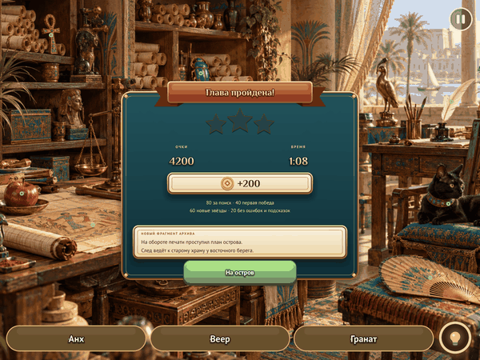
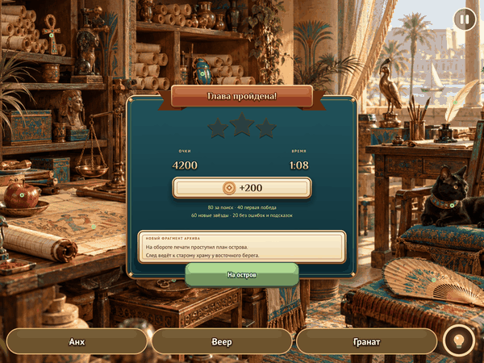

# Popup motion on the tween module

The popups' pop and backdrop, the stars of a result, the name pills' arrival,
strike-through and drop, the ring on a found item and the combo bar moved from
timestamps and hand-kept clocks (`G.modal_time`, `G.slot_time`, `G.found[i]`
as a time) onto the engine's motion module
([docs/MOTION.md](../../../../../docs/MOTION.md)). The settled stills
(`reward`, `chapters`, `characters`, `scene0`) are pixel-identical to the
previous build. In the entrance below the popup and stars differ only by the
one frame a tween takes to start; the name pills now play the find's
strike-through and drop that the debug win screen used to skip.

| Before | After |
| --- | --- |
|  |  |

`--screen win --reel`, 1200×900, 16 pictures 6 frames apart.
