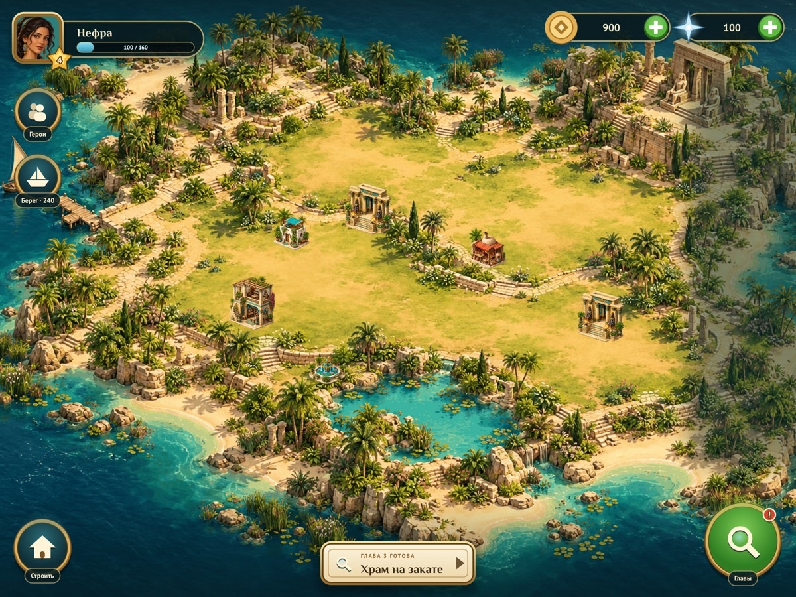
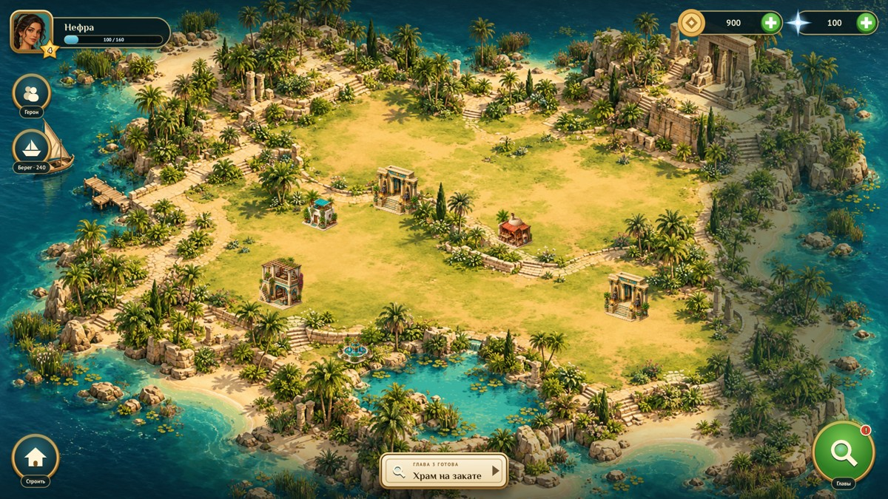

# Automatic roads disabled

Nile Archive explicitly disables generated building connectors, matching its previous default. Painted terrain paths remain part of the background.

Before: main `3628324`. After: this branch. All captures use the native game renderer.

| Logical size | Before | After |
| --- | --- | --- |
| 1200x900 |  |  |
| 1368x1026 |  |  |
| 1600x900 |  |  |

Reproduce each logical size with:

```sh
./build/nile-archive --headless --mute --fresh --size 1200x900 --screen island --shot /tmp/island.png
```

For the 390×844 Relic Rush capture, add `--safe-area 0,47,0,34`. Nile also covers 1368×1026 and 1600×900. PNG captures are converted to RGB JPEG at quality 90, fitted within 600×1100 (phone) or 1200×1000 (iPad).
