# Relic Rush · The Lost Valley

A portrait mobile-first hex match-4 / island-restoration prototype, written in C11 on the repository's shared platform engine ([`engine/`](../../engine)), the same engine that runs [Nile Archive](../nile-archive). The island is the engine's `city`; text, shapes, input, camera, saves and sound come from the engine; this folder holds the rules, the content and the look. The WebAssembly preview runs the same C code; the browser page is only a fullscreen canvas.

Launch straight into level one. Swipe adjacent relics, or tap one and then its neighbor. Complete the score / idol / excavation / lock objectives within the move budget, claim resources, restore the next building on the island, and set out again. Ten redesigned hex stages and ten buildings end in a restored sun temple. The island is a scrollable 1920 × 2880 world with six unlockable regions, freely placed buildings and persistent positions.

## Screenshots

Captured from the engine build with `make shots` (headless, software renderer). Island images use demonstration progress to show the settlement and placement tools.

| Hexagonal expeditions | Restored island |
| --- | --- |
| 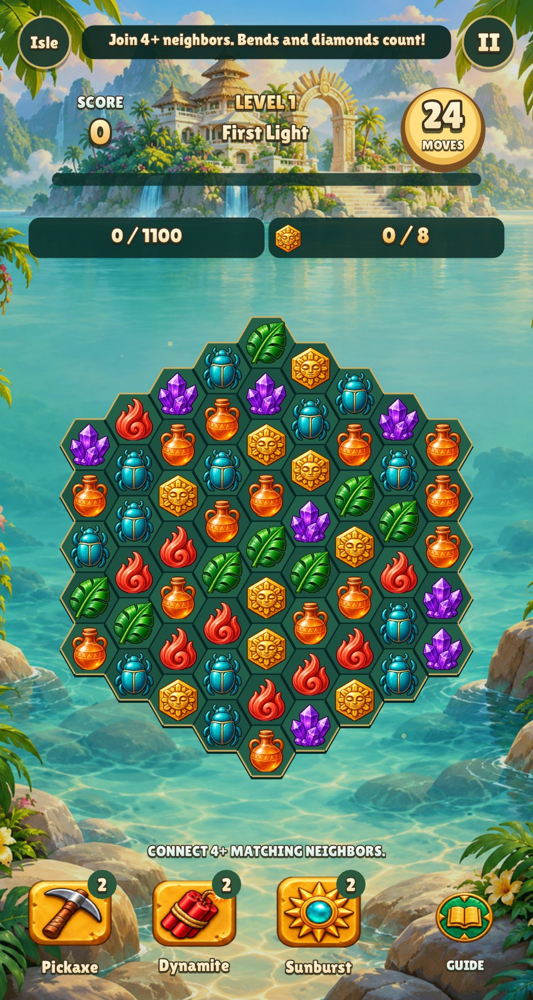 | 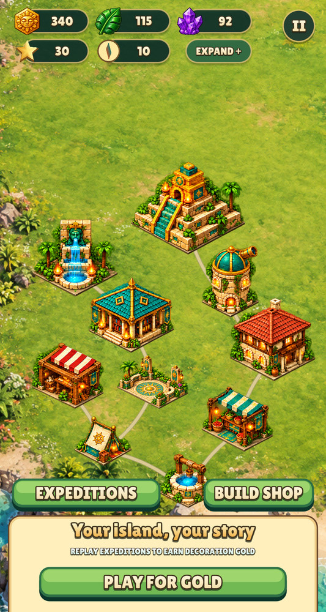 |
| 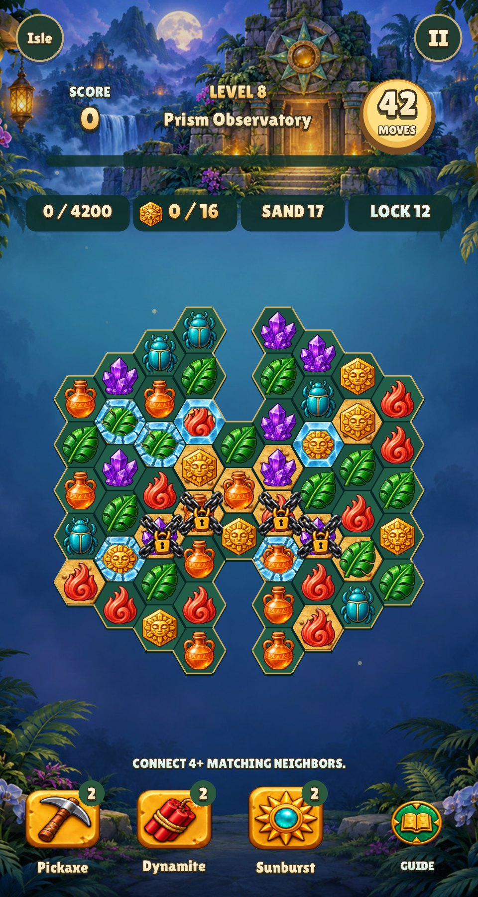 | 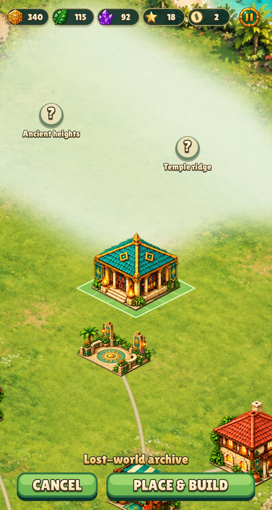 |
| 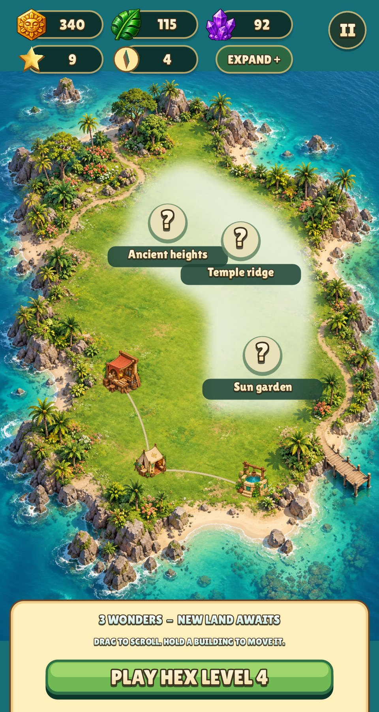 | 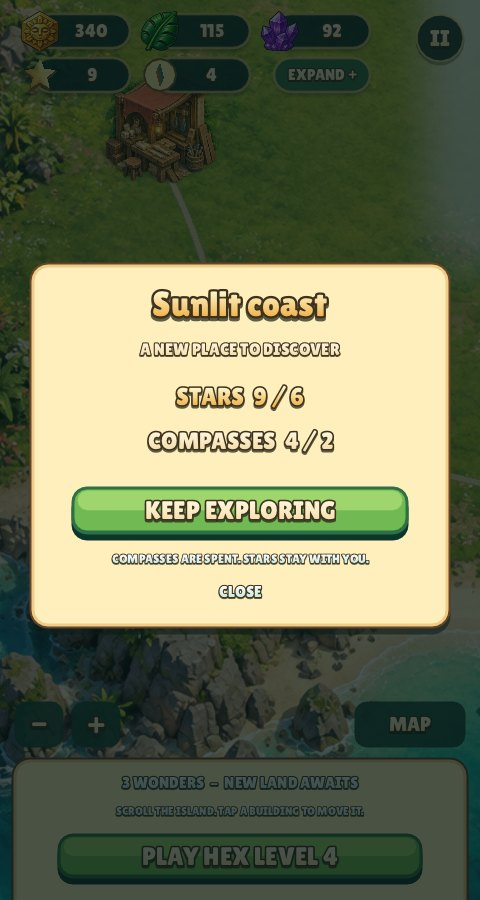 |
| 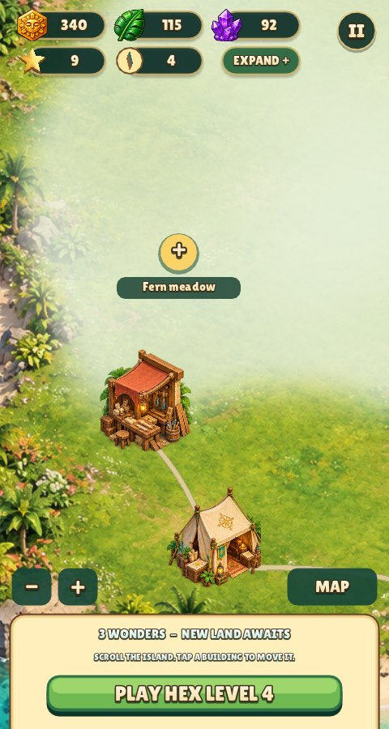 | 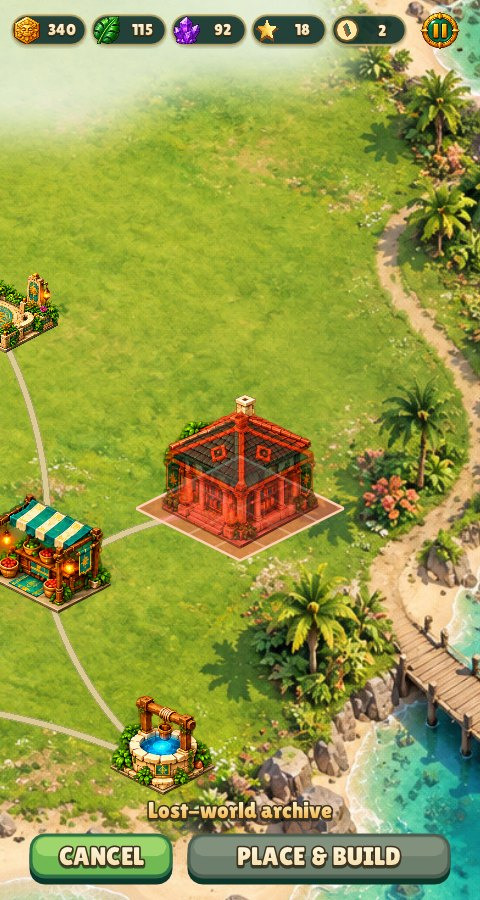 |

## Shared UI and dialog layers

Pause, building and guide dialogs use engine-owned form resources and one game skin. The guide is a measured stack populated from a stable-key data source: icon rows left-align title and description, and wrapping determines row height. Modal screens and dialogue blur earlier layers with the engine’s cached GPU Gaussian pass; foreground UI stays sharp. See the [shared UI API and adoption examples](../../docs/UI_ENGINE.md).

## Result screens and typography

The result screen now reveals stars, score, resources, progression and the next restoration in sequence, with a short animated return to the island. Quiet torch sconces replace victory fireworks. Building cards use clean sprite extraction and balanced text wrapping.

Text is aligned by its visible ink bounds (the engine's `text_in`), shared by buttons and counters, and paragraphs wrap into balanced lines (`text_box`).

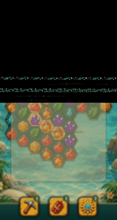

See [UI architecture, Playrix/Candy Crush references and regression checks](docs/ui-results-and-type.md).

## Effects and motion

Travelling sun rays, expanding bomb shockwaves, prism target links, special-piece birth glows, colored fragments, resource trails, HUD landing pulses, smooth score count-up, landing squash/stretch and escalating cascade chimes use the shared triangle renderer. Reduced-motion mode is supported.

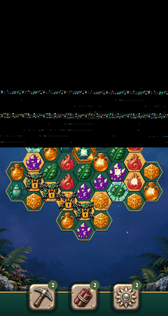

See [effect reference study](docs/effects.md). The reel uses deterministic test boards; actual iPhone/Android performance still needs device testing.

## Current match-4 rules and board shapes

The minimum match is **four side-connected identical relics**, including bent groups and diamonds. Ready groups resolve automatically before further input and after each fall. There are ten different board silhouettes, with real holes and separate refill segments. The gold idol now has a six-sided silhouette.

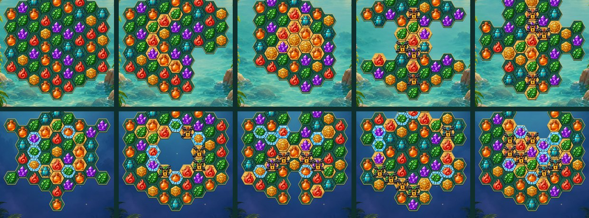

See [rules, shape list, implementation notes and reference sources](docs/match4-rules.md).

## New art direction

The match-3 scenes now use two original runtime backgrounds: **Sunlit Lagoon** for levels 1–5 and **Moonlit Sun Temple** for levels 6–10. The study draws on Tropicats and Candy Crush for playable-screen readability, and June's Journey / Pearl's Peril for garden islands and adult adventure characters.

See the [reference study, original cast and asset gallery](docs/art-direction-v2.md) and [complete generation prompts](docs/art-direction-v2-prompts.json).


Elena Voss leads the archaeological expedition; Mara Bell is its pilot, Tomas Reed its archivist, and Adrian Vale its ambiguous financier. These are original character concepts. Their busts (cut by `tools/prepare_assets.py` from that lineup) appear in the game's dialogue; the garden-island painting is a design asset without a playable version.

## Story and world

An archaeological expedition reaches an overgrown tropical island known only as the Lost Valley. Broken sunstones, abandoned terraces and a silent temple suggest that the island once held a thriving settlement. The expedition's goal is to uncover its history, restore a home among the ruins and bring light back to the Temple of the Sun.

You begin with a small expedition camp. Each puzzle represents an excavation: uncover buried ground, free relics from ancient chains, thaw frozen seals and collect the materials that make the next restoration possible. The growing settlement turns discoveries into visible progress: fresh water, a workshop, a market, a lodge and an archive. The observatory and jade fountain prepare the final approach to the temple, where the expedition uncovers the Heart of the Sun.

This is an original adventure setting inspired by archaeological serials and lost-world fiction, rather than a licensed Indiana Jones setting or a claim to portray a specific historical civilization. The colorful tropical palette combines jade, turquoise, warm stone and gold, with readable silhouettes and soft jungle scenery.

**Narrative status:** the cast now speaks through the engine's dialogue system (bust in a medallion standing above a dialogue box sized to the line, name plate on the box's edge and no tail, as in the story screens of portrait match-3 games; typed text: tap to finish a line, tap again to continue, or skip). Name badges are centred on the visible outline of speech, cloud and burst bubbles; decorative puffs/spikes count toward the padding so they do not engulf the badge. Each beat plays once per save:

- Bubbles come in three kinds: Elena's first musing is a thought cloud, Mara's greeting a shout, the rest speech.
- **Elena Voss** opens the expedition and explains each level's twist the first time it is played (its lesson; later it is a reminder toast).
- **Mara Bell** greets every newly opened region.
- **Tomas Reed** tells each restored wonder's story, and the island answers with a word bubble over the building.
- **Adrian Vale** appears when the last wonder is restored, and Elena answers him.

The intro and finale lines are new, short and written from the cast notes in [art-direction-v2](docs/art-direction-v2.md); everything else reuses the game's existing texts. Journal entries, branching choices and cinematics are not implemented.

| Elena | Mara | Tomas | Adrian | Word bubble |
| --- | --- | --- | --- | --- |
| 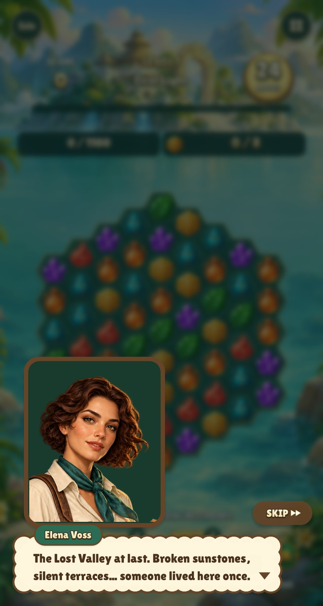 | 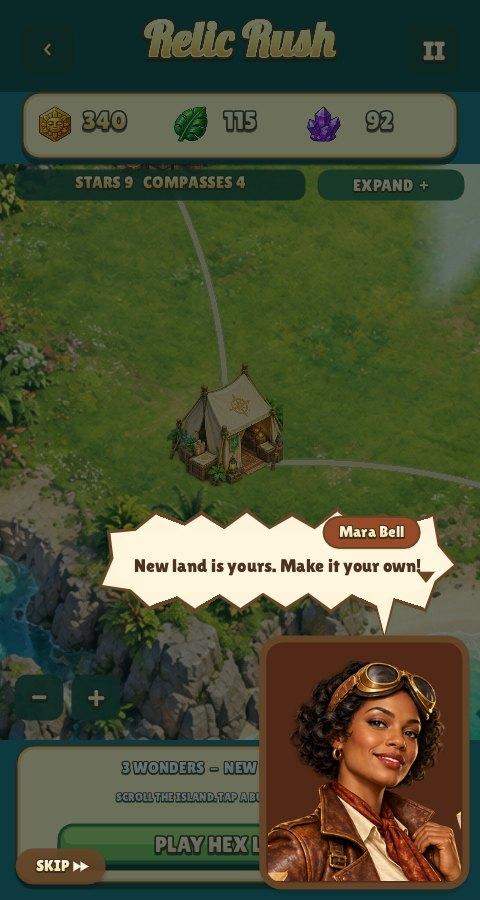 | 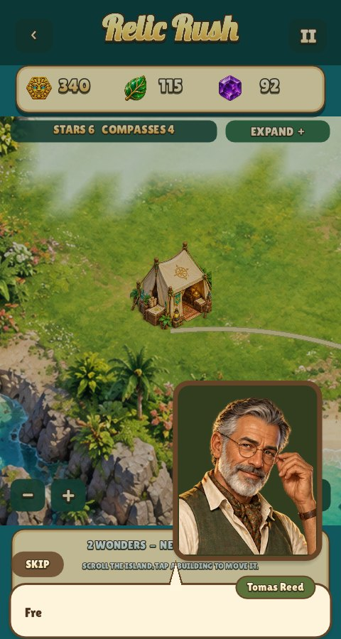 | 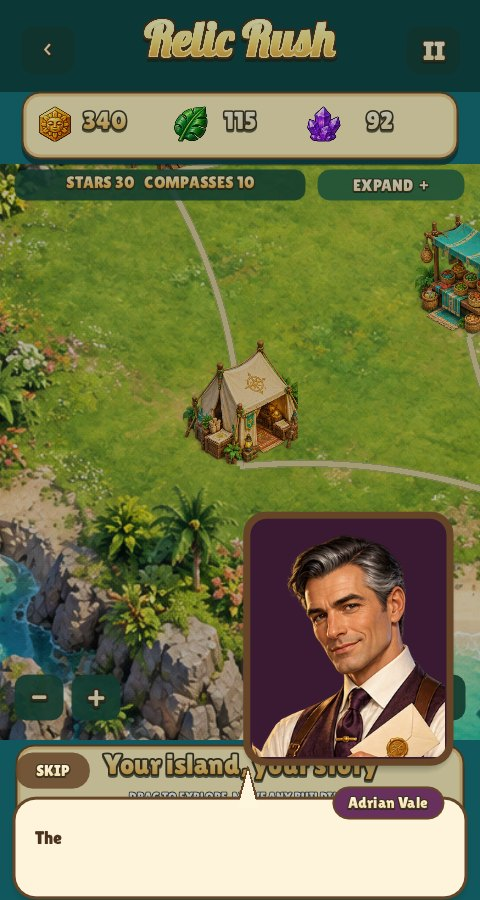 | 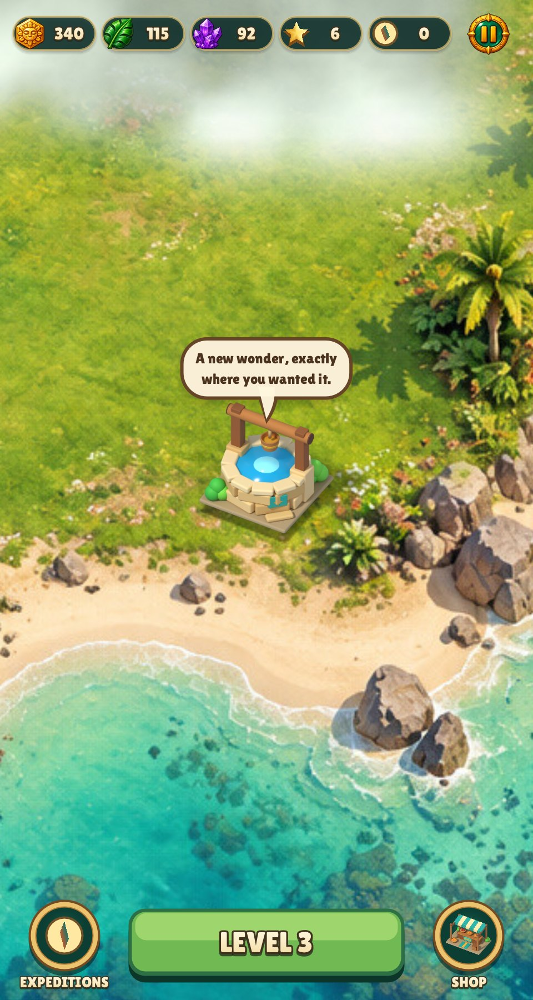 |

On a 390 × 844 iPhone (safe-area insets 47 top, 34 bottom) the island and the jungle run to the screen edges while the controls stay inside the safe area. The screen grows taller there (480 × 939) rather than showing bars: the top HUD stays at the top, the tools and the island's bottom sheet move down to the bottom edge, and the board and dialogs stay centred:

| Island | Board |
| --- | --- |
| 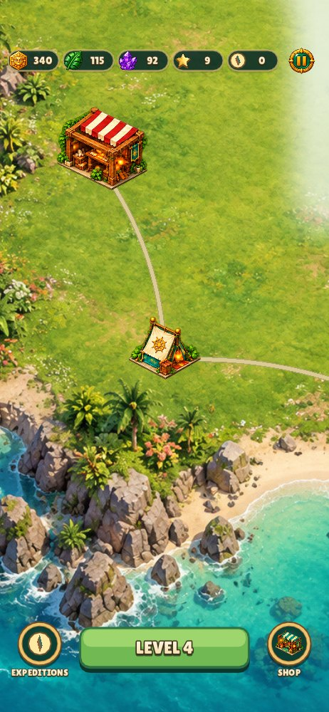 |  |

## Expedition and restoration loop

1. Start directly in the first match-4 level; there is no title-screen or friend-road detour.
2. Complete its score, idol, excavation and blocker objectives within the move budget.
3. Claim the win once, receiving building resources plus 3 Stars and 3 Compasses.
4. Return to the island, select the next restoration and choose its location on opened grass.
5. Confirm construction, pan across the growing settlement and open neighboring land when eligible.
6. Set out for the next expedition. Ten completed stages support ten restored buildings, ending at the sun temple.

Gold, wood and stone pay for buildings. Stars measure cumulative expedition progress and are never spent. Compasses are spent on land expansion. The prototype grants enough resources for the next building; it has no energy timers, purchase flow or backend economy.

## Campaign: ten hex levels

Every stage uses its own active-cell mask within a radius-four hex grid (43–61 playable cells). See [current match-4 rules and all ten board shapes](docs/match4-rules.md). Objectives below are taken from the current level configuration; all listed blockers must be cleared.

| # | Expedition | Moves | Score | Idols | Sand | Chains | Ice cells | Focus |
| --- | --- | ---: | ---: | ---: | ---: | ---: | ---: | --- |
| 1 | First Light | 24 | 1100 | 8 | 0 | 0 | 0 | Join 4+ neighbors. Bends and diamonds count! |
| 2 | The Jade Crescent | 28 | 1800 | 10 | 7 | 0 | 0 | Groups of five create a sun ray. |
| 3 | Sunstone Spiral | 32 | 2300 | 12 | 12 | 0 | 0 | Excavate the spiral beneath the relics. |
| 4 | The Vine Constellation | 34 | 2700 | 12 | 10 | 4 | 0 | Match locked relics to break their chains. |
| 5 | Three Paths Meet | 36 | 3100 | 14 | 13 | 4 | 0 | Groups of six or more make a hex blast. |
| 6 | Winter Lotus | 38 | 3400 | 14 | 13 | 0 | 5 | Break the ice around the frozen lotus. |
| 7 | The Ember Ring | 40 | 3800 | 16 | 15 | 4 | 5 | Fire melts ice in all six neighboring cells. |
| 8 | Prism Observatory | 42 | 4200 | 16 | 17 | 4 | 6 | Six in a straight line forge a sun prism. |
| 9 | The Sixfold Seal | 44 | 4600 | 18 | 19 | 5 | 6 | Combine rays to clear all three axes. |
| 10 | Heart of the Hexagon | 46 | 5000 | 20 | 22 | 6 | 6 | Uncover the ancient sun at the heart of the valley. |

Ice can require more than one hit. Board patterns progress from the introductory field to crescents, spirals, branching lines, rings and the final central seal.

## Buildings

Buildings unlock in this order as expeditions are completed. Positions are chosen by the player; the order does not impose fixed plots or a road layout.

| # | Building | Gold | Wood | Stone | Purpose in the story |
| --- | --- | ---: | ---: | ---: | --- |
| 1 | Expedition camp | 60 | 10 | 5 | Every great discovery begins with a little canvas. |
| 2 | Spring well | 80 | 15 | 15 | Fresh water brings the lost valley back to life. |
| 3 | Artisan workshop | 100 | 25 | 15 | A home for the hands that rebuild the valley. |
| 4 | Jungle market | 120 | 25 | 25 | Stories, spices and treasures from far away. |
| 5 | Sunstone gateway | 140 | 30 | 30 | A garden arch marks the path into your valley. |
| 6 | Explorer's lodge | 160 | 35 | 35 | A warm light after a long day of adventure. |
| 7 | Lost-world archive | 180 | 35 | 45 | Protect the knowledge buried beneath the vines. |
| 8 | Star observatory | 200 | 40 | 50 | Follow the stars to the next discovery. |
| 9 | Jade fountain | 220 | 45 | 55 | Let the ancient spring flow once more. |
| 10 | Temple of the sun | 250 | 50 | 60 | The heart of the valley shines again. |

These are restoration milestones, not autonomous resource factories: production timers, citizens and upgrade trees are future possibilities rather than current mechanics.

## Island regions

The 1920 × 2880 world scrolls beyond the phone screen. Hidden six-neighbor land tiles define connected regions, while placement itself uses continuous world coordinates. The puzzle grid and island territory graph are separate systems.

| Region | Required cumulative Stars | Compasses spent |
| --- | ---: | ---: |
| Harbor glade | 0 | 0 — starting land |
| Sunlit coast | 6 | 2 |
| Fern meadow | 9 | 3 |
| Sun garden | 15 | 4 |
| Ancient heights | 21 | 5 |
| Temple ridge | 27 | 6 |

A region must touch opened land, meet its Star requirement and have its Compass cost available. Select the clouded region and confirm expansion; only Compasses are deducted. This follows the June's Journey expansion principle. Regions do not open on a timer, and players do not need to build roads. Decorative paths adapt to the selected building positions.

## Play

- Ten distinct hex board masks with 43–61 active cells. Any side-connected group of at least four identical relics matches automatically; bends and diamonds count, three relics do not. Swaps without a match animate back and do not spend a move.
- Four connected relics → ordinary match; five → directional lightning relic; six or more → hex bomb, or a sun prism when six form a straight line.
- Swap two specials for a combination attack; prism + special converts that color before detonation.
- Ancient sand is excavated by matches above it. Chained and frozen relics cannot move until matched or hit. Double ice needs two hits. Matched flame relics also thaw adjacent ice.
- Cascades increase score multipliers. Collected resources fly to the top HUD.
- Pickaxe, dynamite and sunburst tools: select a tool, then a board cell. Two charges per tool per level; no move cost. The guide explains mechanics.
- Idle hints, automatic dead-board recovery, restart on failure, pause, sound toggle and reduced motion.
- Win rewards combine an expedition grant and actual collected idols / jade / crystals; they always cover the next building. Claims cannot be collected twice.
- Large scrollable island, six connected land regions defined by a hidden hex tile graph. Drag empty land to pan; use +/- to zoom and Map for the overview.
- June's Journey-style expansion: adjacent clouded regions require cumulative Stars and spendable Compasses. Wins award 3 Stars and 3 Compasses. Confirming a region consumes only its Compass cost; Stars remain. Region requirements and fog are separate from building placement.
- The island's HUD is two rows of small resource capsules (idols, leaves and crystals; then Stars and Compasses beside **Expand**) and a pause button. There is no title or header band; tap a capsule to learn what it is for. The board keeps only the way back to the island and pause in its top corners. Score, level and moves float over the background painting without a large backing panel; outlined text and a slim translucent progress track preserve readability.
- Choose any valid grassy position within opened land. Drag a building and confirm or cancel. The building shows no label; it turns semitransparent red where it can't go. Completed buildings can be moved without spending resources. Preview and cancellation never change the saved layout.
- Footprint collision and shoreline checks prevent overlap and water placement. Decorative paths are generated from the chosen positions; no road management is required.
- Progress saves after rewards, construction and region unlocks (a `key=value` file in the per-game preferences folder, or `localStorage["relic-rush/progress"]` in the browser). An unfinished board restarts if the application is closed.

## Selected tile art

The [artwork and state catalogue](docs/asset-catalogue.md) inventories every gem
pack, special, blocker, tool and animation state, with source/runtime paths and
reproduction commands. Specials, blockers and all five tool interaction states
use one authored atlas; `--art-states` shows the complete set and `--art-board`
freezes a board with all specials. Catalogue coverage runs in `make test`.

The archaeological **Relics** set (option 1) is the default match piece art: a hexagonal sun idol, coral flame, jade leaf, turquoise scarab, purple crystal cluster and amber amphora. **Jewels** and **Resources** stay available as optional art packs — `--tiles jewels` natively, `?tiles=jewels` in the browser. Gameplay, rewards and costs are the same with every pack. See the [tile-set comparison and construction research](docs/tile-sets.md).


## Run and build

From the repository root (system platform development files needed for native builds, the Emscripten SDK for the web):

```sh
make run-relic                                  # native desktop
make test                                       # rules, island and engine tests
make web && python3 -m http.server 8080 --directory dist   # http://localhost:8080/relic-rush/
```

The game is laid out for a 480 × 900 portrait screen inside the device's safe area. It is `fixed` with `max_aspect = 2.2`, so on taller phones the screen keeps its width and grows taller (`R.layout()` moves the bottom group down by the extra height, `R.drop`). Its jungle backdrop, the island and the bottom sheet run on under the status bar and the home indicator to the screen edges (`app.bleed()` / `gfx.bleed`). Runtime art in `data/` is committed; `python3 games/relic-rush/tools/prepare_assets.py` rebuilds it from the sources in `art/` (needs Pillow).

Debug and capture options (no progress is written): `--level N`, `--city N` (an island after N expeditions; `--open MASK` limits it to those regions, bit per region), `--look X,Y` (centre the island camera on a world point), `--showcase`, `--overview`, `--footprints` (every building's footprint and pivot over its sprite), `--placing [blocked|dragging]` (`blocked`: the red ghost over a built wonder; `dragging`: the ghost held up between tiles over the footprint of the tile it will land on), `--zone N`, `--card N`, `--victory`, `--dialog guide|pause|failed|finale|intro|mara|tomas|adrian|bubble`, `--tiles relics|jewels|resources`, `--art-states`, `--art-board`, `--fx ray|bomb|prism`, `--smoke` (plays level one through injected clicks, claims, builds and enters level two), plus the engine's `--shot file.png --frames N`, `--size WxH`, `--fresh` and `--mute`.

## Controls and saved progress

- **Board:** swipe to one of six neighbors, or tap two adjacent relics. Select a tool and then its target. The top-right button pauses (sound, reduced motion, guide); Escape does the same.
- **Island:** drag empty land to pan; pinch, the mouse wheel or + / − zoom; Map switches between overview and home. Tap a building for its card, or drag it to move it. Tap clouded land to see what opening it needs.
- **Placement:** choose a grassy spot, check the green/red footprint, then confirm or cancel. Buildings cannot overlap, cross the shoreline or occupy closed land. Moving a completed building is free.
- **Save:** level progress, resources, opened regions and building positions persist; an unfinished puzzle restarts. Saves of the standalone prototype (`progress.txt`, `localStorage["relic-rush-v1"]`) are not imported.

## Verification

- `make test` runs the original rule regressions, ported: grid invariants, four-of-a-kind and bent/diamond groups, rejection of triples, five/six special creation, holes and segmented gravity, chain and ice locks, fire thawing, tools, prism colour clears, ten distinct connected board masks, 1,000 opening boards (100 seeds × 10 levels) without ready matches and with a legal move, exactly-once rewards and construction, shoreline/collision/zone rules on the engine city, and 300 greedy campaign trials — 298 wins, identical to the standalone build.
- `--smoke` opens and closes the data-backed guide, then drives the real game loop with injected mouse clicks through swaps, cascades, the win dialog, the claim, the island, construction and the start of level two.
- Every screenshot above is rendered by the same code; they were compared side by side with captures of the standalone prototype.
- iPhone/iPad and Android device builds, touch feel, safe areas and performance still need device QA.

## Art and text pipeline

Original generated environment paintings, a 10-building sprite sheet and the 6 × 3 tile sheet (`art/tile-sets/source.png`: the Relics, Jewels and Resources packs) are kept as editable sources in `art/`. `tools/prepare_assets.py` cuts sprites out of the sheets (largest opaque component, so neighbouring paintings never leak in), scales backgrounds to what the screen needs and writes PNG/JPG files the engine loads directly. `docs/references.md` records reference research and provenance. Generated art is a prototype asset set and needs an art consistency / IP review before a commercial release.

Fonts: **Lilita One** for the game UI, rendered at runtime by the engine (TrueType with outline, gradient and drop shadow, any Unicode — Cyrillic localisation no longer needs a new atlas); **Lobster** made the gold `title.png` logo and stays in `art/fonts`. Both are unmodified SIL OFL 1.1 fonts with their license text.

## Source layout

- `lua/state.lua`: the state shared by the game's modules, and their namespace (`R`).
- `lua/art.lua`: named authored states, control-state selection and the in-game catalogue.
- `lua/rules.lua`: hex grid, deterministic match-4 rules, specials, blockers, tools, campaign and rewards — pure Lua, tested headlessly.
- `lua/island.lua`: shoreline, the hidden hex region map, region adjacency and the ten wonders as engine building definitions.
- `lua/board.lua`: the expedition screen, animation phases and swipe/tap input.
- `lua/vfx.lua`: rays, shockwaves, prism links, births, sparks, flying relics, score pop-ups and torches.
- `lua/island_view.lua`: the island screen around the engine city: HUD, region markers, placement panel.
- `lua/screens.lua`: text palettes, panels, buttons and every dialog.
- `lua/main.lua`: flow, saves, sound and debug entry points; returns the app descriptor the engine runs.
- `art/`, `data/`, `docs/`, `tools/`: sources, runtime assets, documentation and the asset pipeline.

## Design references and original assets

- **Cradle of Rome:** excavating puzzle terrain and spending collected resources on visible restoration.
- **Candy Crush:** understandable special-piece creation, combination attacks, boosters and animated reward feedback.
- **June's Journey / Pearl's Peril (Wooga):** a large island, player-selected building locations and land expansion, replacing a linear friend-road progression map.
- **Supercell games:** readable building silhouettes, polished resource feedback and a cheerful settlement presentation.
- **Settlers II / Return to the Roots:** a reference for territory represented by small connected land cells. No road-management system or GPL implementation was copied into the game.
- **Canva-style text effects:** inspiration for layered, image-like lettering with gradient fill, a unified outline and shadow.

See [reference research and source links](docs/references.md) and [art prompts and screenshot provenance](docs/art-prompts.md). The island and buildings are original generated prototype artwork; no ripped commercial game assets are bundled. Font licenses are included alongside the font files. Bundled font licenses apply to the fonts. The repository’s existing top-level `LICENSE` is preserved.

## Roadmap and prototype boundaries

Ideas discussed for later development:

- More decorations, alternative buildings, upgrade choices and a richer restoration economy.
- An expedition journal, characters, narrative events and story scenes built around the Lost Valley premise.
- Visiting friends' settlements; optional asynchronous raids were discussed as an exploratory idea, not an implemented or committed feature.
- Backend accounts, cloud saves and social progression if those features are pursued.
- Human playtesting, campaign balancing, sound design, haptics and more responsive device-specific polish.
- Localization; app icons, safe-area validation, mobile performance checks and signed iOS/Android releases. The standalone prototype's Android/iOS host projects were not carried into this repository; mobile packaging is to be set up once for the shared engine.

Current scope is an offline prototype: ten hex levels, ten buildings, six regions, local saves and a complete puzzle → reward → placement → next-level loop. There are no multiplayer services, advertisements, in-app purchases, production timers, implemented raids or native store releases.
