# Relic Rush · The Lost Valley

From the repository root, `make -C games/relic-rush ios` builds, signs, installs
and launches on the connected iPhone. Set `DEVICE="name or UDID"` to select one.
See the [device deployment guide](../../tools/xcode/README.md#deploy-to-a-connected-iphone-or-ipad).

A portrait mobile-first hex match-3 / island-restoration prototype, written in C11 on the repository's shared platform engine ([`engine/`](../../engine)), the same engine that runs [Nile Archive](../nile-archive). The island is the engine's `city`; text, shapes, input, camera, saves and sound come from the engine; this folder holds the rules, the content and the look. The WebAssembly preview runs the same C code; the browser page is only a fullscreen canvas.

Launch straight into level one. Swipe adjacent relics, or tap one and then its neighbor. Complete the score / idol / excavation / lock objectives within the move budget, claim resources, restore the next building on the island, and set out again. Thirty hex stages across three episodes restore the ten existing wonders and end with the valley singing and five lights answering at sea. The island is a scrollable 1920 × 2880 world with six unlockable regions, freely placed buildings and persistent positions.

Building popup images and resource icons follow the panel’s entrance scale,
position and opacity through the shared form skin. See the
[popup and refill comparisons](docs/review/popup-refill/README.md).

Haptics accompany matches, special activations, cascades, trickling landings,
results, income collection, building pickup and release/drop. Moving a preview
requires dragging the building; tapping land does not move it. Confirm and Cancel
add no feedback. See the [shared haptics contract](../../docs/HAPTICS.md).

## Island navigation and resources

Buildings is the large workshop/hammer image at bottom left, Play the large right-pointing image at bottom right, and Expeditions the smaller compass beside Buildings. These bottom actions have no text captions. The larger top-right gear opens Settings. Resource icons protrude beyond their counter bars for readability. Expeditions and the building catalogue are continuous measured scrolling lists with bounded inertia; the building catalogue keeps its category selectors. Keyboard focus reveals its item and mouse wheels scroll the same viewport. The two lists share templates with Christmas Market and lay out only the rows in view.

The wallet contains five lives, hex amulets and discovery stars. Losing an expedition spends one life; lives regenerate every 30 minutes up to five, including offline time. First clears add spare amulets and discovery stars; wonder milestones also fund their restoration. Replays earn 60–100 amulets without extra stars. Buildings cost amulets; discovery-star gates open land without requiring compasses. The old wood, stone and compass slots stay reserved for save compatibility, with no new costs, rewards or UI.

Tap a placed building for its name and subtitle in the existing speech bubble above it. Only one stays open; the next press dismisses it. A stationary hold still picks up a building through the shared mover, with Confirm/Cancel preserving saved state. Taps do not open building dialogs.

Scrolling uses the engine animation clock: a scalar `CAAnimation` drives the iOS timeline, as in CorePunch/orca, while other platforms use the platform monotonic clock.

## Shared match engine and atlas

The [engine match-3 module](../../docs/MATCH3_ENGINE.md) owns all matching,
swaps, blockers, specials, trickling gravity, cascades, hints, tools and board
input/timing. This game provides campaign data, graphics and integer behavior
flags. Every exposed column top (no active cell directly above) spawns gems
vertically. Interior gems fall straight down whenever their cell below is
empty and movable, and slide diagonally only when that cell is occupied,
locked or missing. Locks still route gems around their sides.

All board imagery uses one `data/match3.png` override atlas. The engine embeds
a neutral resource atlas for games without an override; `--default-match3`
previews it. `python3 tools/match3_atlas.py` reproduces both skins while
preserving authored alpha and every control state. See the
[review captures](docs/review/trickling/README.md).

## Screenshots

Captured from the engine build with `make shots` (headless, software renderer). Island images use demonstration progress to show the settlement and placement tools.

| Hexagonal expeditions | Restored island |
| --- | --- |
| 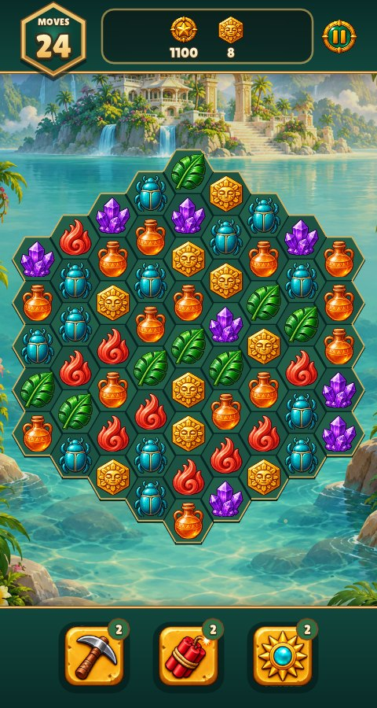 | 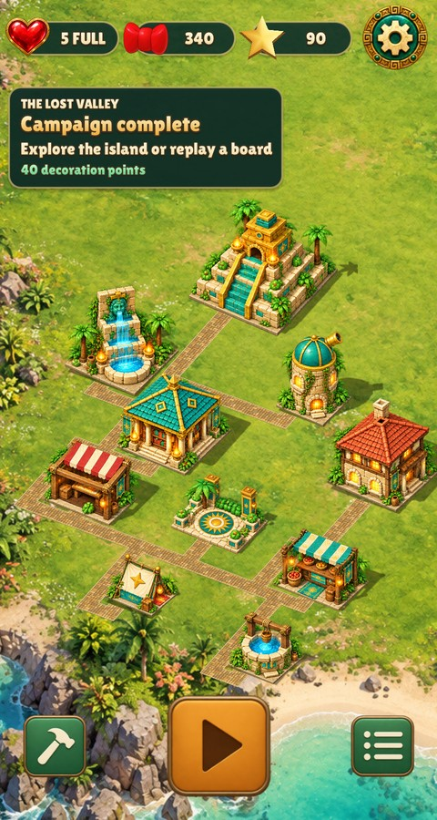 |
| 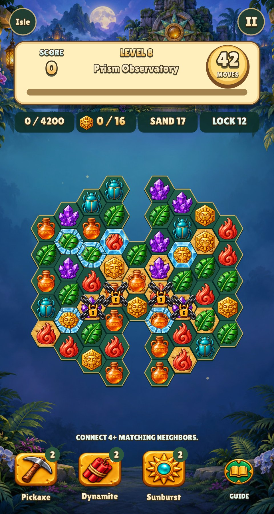 | 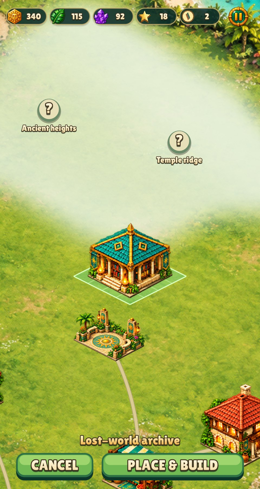 |
| 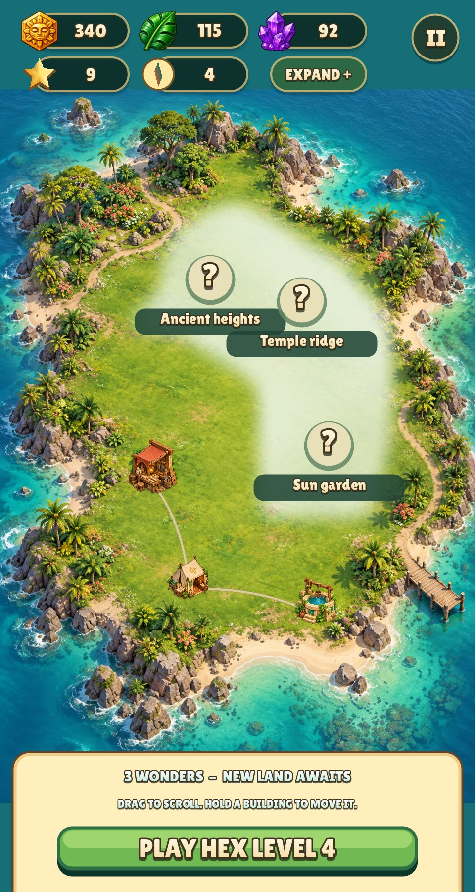 | 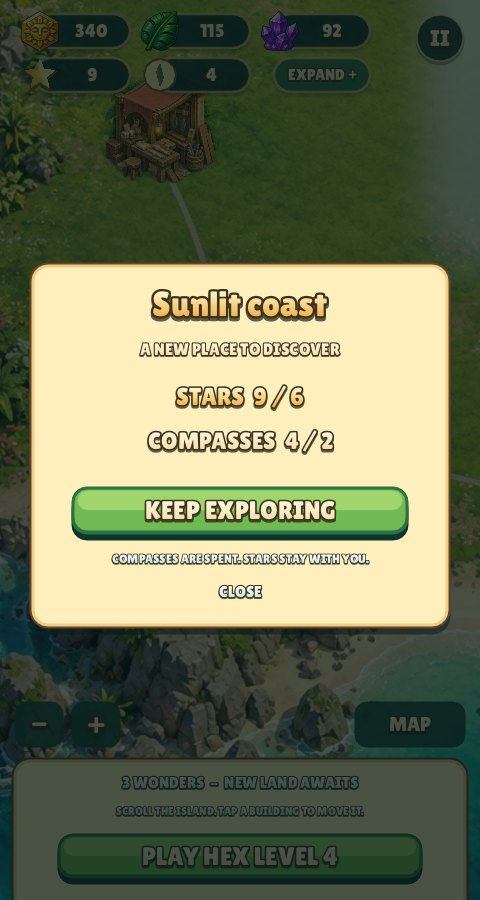 |
| 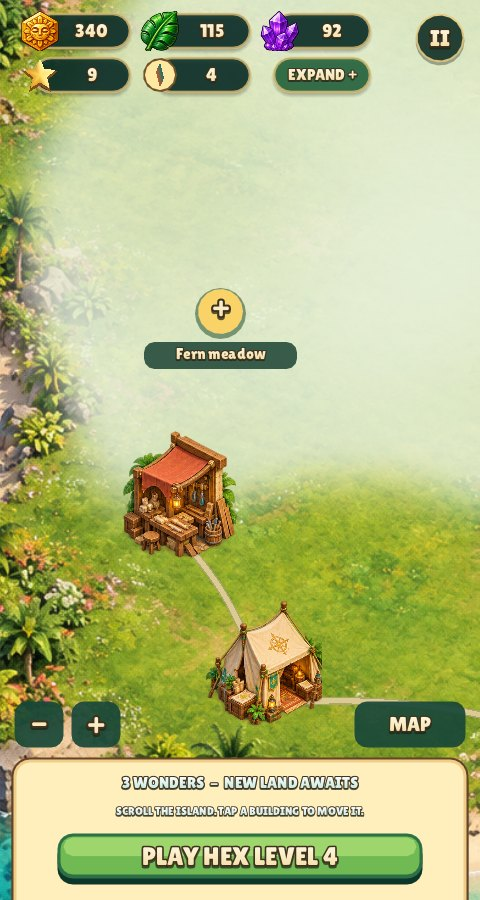 | 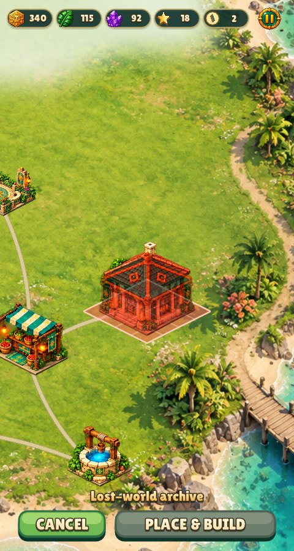 |

## Leaderboards

Game Center is in every game through the engine ([docs/GAMECENTER.md](../../docs/GAMECENTER.md)).
Relic Rush turns it on with the `leaderboard` block of `data/game.json`: one **stars** board holds
the lifetime Discovery Stars (they are never spent), and one board per expedition (`level_01`
to `level_30`) holds its best score. Scores are reported when a reward is claimed, so a
replay that beats the old score raises that board, and a weaker one changes nothing. Settings
has a LEADERBOARD link for the stars board; the results card has a LEADERBOARD button for that
expedition. Both open the shared dialog with Everyone / Friends tabs, player portraits and the
player's own row marked; without Game Center it shows the player's own best.

| Settings | Stars board | Results card | Expedition board |
| --- | --- | --- | --- |
| 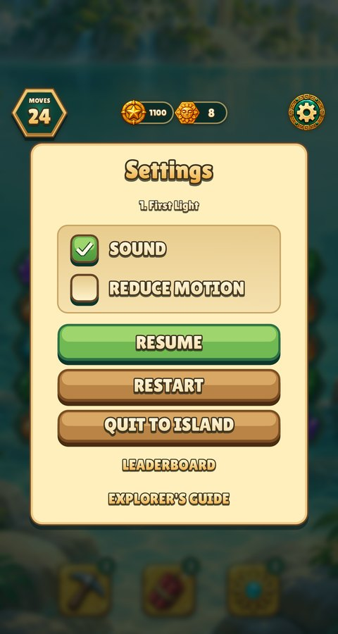 | 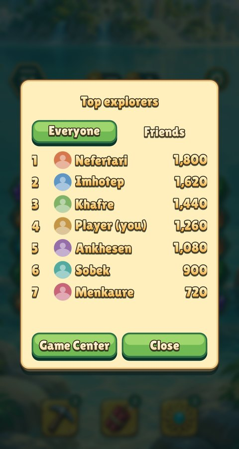 | 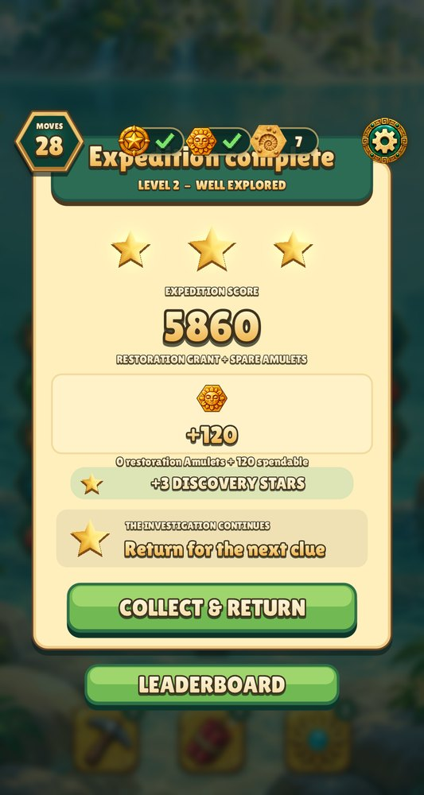 | 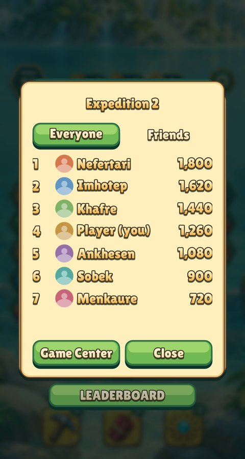 |

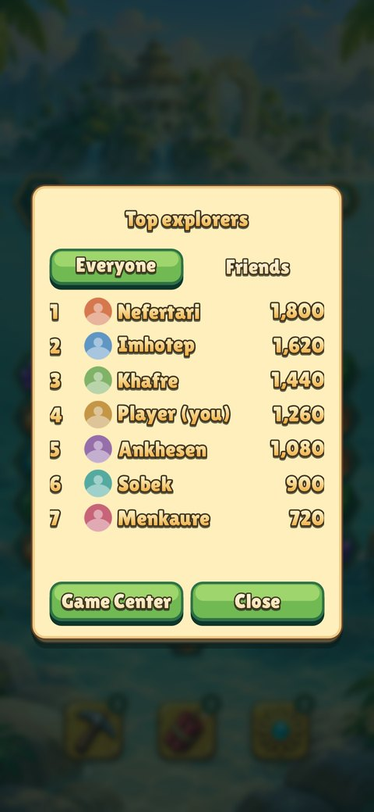

To publish them, create 31 leaderboards in App Store Connect (Game Center, high to low) with the
identifiers `com.corepunch.relicrush.stars` and `com.corepunch.relicrush.level_01` ...
`com.corepunch.relicrush.level_30`, ideally grouped in a leaderboard set. `--gamecenter-demo`
shows sample rivals for captures; `--dialog leaderboard` and `--victory --dialog level-leaderboard`
open the dialogs.

## Shared UI and dialog layers

Pause, building and guide dialogs use engine-owned form resources and one game skin. The whole look (text palettes, panels, buttons and their pressed/disabled states, focus) is data in [`lua/skin.lua`](lua/skin.lua), compiled by the engine's `ui.skin`; see [skin files](../../docs/UI_ENGINE.md#skins). The expedition screen follows the portrait match-3 layout of Royal Match, Toon Blast and Homescapes. With no band behind them, a hexagonal Moves medallion (red over the last five moves), one small resource panel per goal with its remaining count (a check seal when met) and the pause button float along the top edge, and the three tools stand along the bottom edge. Nothing else covers the painting, and the board fills the space between. Level details and the Explorer's Guide live in Pause; score/reward totals live in Results. The measured goal list retains every win condition without duplicate totals or a progress bar. The guide uses a measured data-backed list too. Menus and other closable popups dismiss on background taps through the shared engine; results retain explicit actions. Modal screens and dialogue use the engine’s cached GPU Gaussian blur. See the [match-3 HUD review](docs/review/match3-hud/README.md), the [header and popup review](docs/review/expedition-header/README.md) and [shared UI API](../../docs/UI_ENGINE.md).

The expedition and city headers share a 64-unit Settings gear with a matching touch area. Goal rows and city currency pills leave room beside it on both phone sizes. See the [before/after Pause review](docs/review/larger-pause/README.md).

## Result screens and typography

The result screen now reveals stars, score, resources, progression and the next restoration in sequence, with a short animated return to the island. Building cards use clean sprite extraction and balanced text wrapping.

Text is aligned by its visible ink bounds (the engine's `text_in`), shared by buttons and counters, and paragraphs wrap into balanced lines (`text_box`).

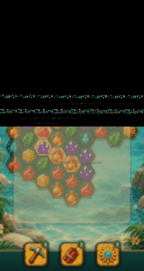

Dialogs arrive and leave on the engine's motion module ([docs/MOTION.md](../../docs/MOTION.md)): the card eases in and the parts of the result settle on one timeline, which the first tap skips.

See [UI architecture, Playrix/Candy Crush references and regression checks](docs/ui-results-and-type.md).

## Effects and motion

Travelling sun rays, expanding bomb shockwaves, prism target links, special-piece birth glows, colored fragments, resource trails, HUD landing pulses, smooth score count-up, landing squash/stretch and escalating cascade chimes use the shared triangle renderer. After any dialogue the board presents itself: the HUD lands, the cells ripple out from the centre, relics rain down their columns with squash and bounce, blockers slam on and a sheen runs across as the board goes live. A tap skips it; reduced motion makes it a short fade. See [the board entrance](../../docs/ENGINE.md#board-entrance). Reduced-motion mode is supported.

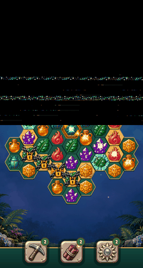

See [effect reference study](docs/effects.md). The reel uses deterministic test boards; actual iPhone/Android performance still needs device testing.

## Current match-3 rules and board shapes

The widest nine-cell board spans 448 of the 480 logical screen units, using a 32-unit cell radius and 16-unit side margins. Gems and cell artwork scale together from their authored sizes: gems retain their transparent padding, and cell faces and state panels retain a small inset so neighbouring cells do not overlap. The entrance returns to a 1× pose when it finishes or is skipped. The board remains centred between the goals and tools on both phone sizes. See the [wide-board and cell-fit correction](docs/review/gem-cell-fit/README.md).

Each green well shades from light at the top to dark at the bottom. The goal
icons sit slightly left over their capsule edges. See the
[cell and goal review](docs/asset-catalogue.md#cell-and-goal-alignment).

The minimum match is **three identical relics in a straight line** along any of the three hex axes. Bends and diamonds do not count. Ready lines resolve automatically before further input and after each fall. There are thirty different board silhouettes, with real holes and diagonal refill routes. The gold idol now has a six-sided silhouette.

After five idle seconds, a legal swap is highlighted. If there is no legal swap, the board reshuffles for free and displays “No moves. Board reshuffled.” This recovery also runs after cascades; the same gems are rearranged with all earned special powers intact; moves, tools, objectives, terrain and locked relics are preserved. See the [dead-board regression and captures](docs/review/dead-board/README.md).

The three power-up buttons use square artwork and 76×76 touch targets, with all five interaction states redrawn together. See the [square-button review](docs/review/square-tools/README.md).

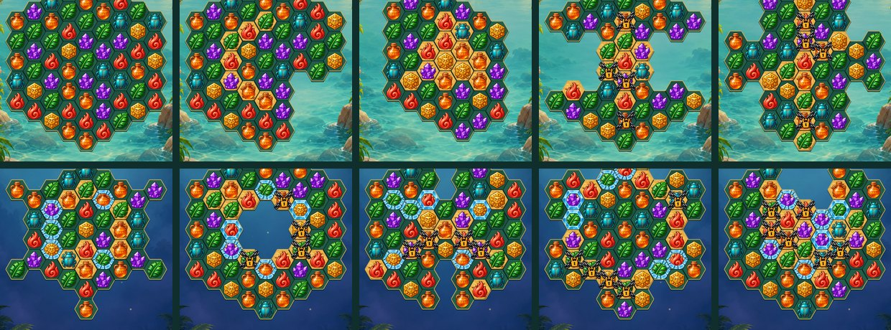

See [rules, shape list, implementation notes and reference sources](docs/match4-rules.md).

## New art direction

The match-3 scenes now use two original runtime backgrounds: **Sunlit Lagoon** for levels 1–5 and **Moonlit Sun Temple** for levels 6–10; each later episode reuses those paintings, opening on the lagoon and moving into the temple. The study draws on Tropicats and Candy Crush for playable-screen readability, and June's Journey / Pearl's Peril for garden islands and adult adventure characters.

See the [reference study, original cast and asset gallery](docs/art-direction-v2.md) and [complete generation prompts](docs/art-direction-v2-prompts.json).


Elena Voss leads the archaeological expedition; Mara Bell is its pilot, Tomas Reed its archivist, and Adrian Vale its ambiguous financier. These are original character concepts. Their busts (cut by `tools/prepare_assets.py` from that lineup) appear in the game's dialogue; the garden-island painting is a design asset without a playable version.

## Story and world

An archaeological expedition reaches an overgrown tropical island known only as the Lost Valley. Broken sunstones, abandoned terraces and a silent temple suggest that the island once held a thriving settlement. The expedition's goal is to uncover its history, restore a home among the ruins and bring light back to the Temple of the Sun.

You begin with a small expedition camp. Each puzzle represents an excavation: uncover buried ground, free relics from ancient chains, thaw frozen seals and collect the materials that make the next restoration possible. The growing settlement turns discoveries into visible progress: fresh water, a workshop, a market, a lodge and an archive. The observatory and jade fountain prepare the final approach to the temple, where the expedition uncovers the Heart of the Sun.

This is an original adventure setting inspired by archaeological serials and lost-world fiction, rather than a licensed Indiana Jones setting or a claim to portray a specific historical civilization. The colorful tropical palette combines jade, turquoise, warm stone and gold, with readable silhouettes and soft jungle scenery.

**Narrative status:** all three episodes in [the reviewed script](docs/story.md) are playable: 36 named scenes and 214 lines across Elena, Mara, Tomas, Adrian and Kessler, a rival heard only over the radio, whose lines show as captions with no bust. The existing four authored portraits, island and ten registered wonder sprites are reused. Dialogue uses 31.5-point text (50% larger than the previous 21), 22.5-point names and larger building bubbles. Busts stand on the dialogue box with no frame or plate behind them, so the box hides the cut along the bottom of each cutout. Bubble outlines, listeners and Skip stay inside the safe screen.

Results return to the island. A scheduled wonder must be confirmed before its discovery scene; other levels deliver their clue immediately. The wonder milestones are **1, 4, 7, 9 / 13, 16, 19 / 23, 26, 29**. The tenth wonder does not end the game: level 30 delivers the final song and “To be continued” scene. Building descriptions respond to discoveries, and Mara has a separate greeting for each new region.

A completed scene is acknowledged only after its last line or Skip. Interrupted scenes restart safely on reload. Replays and retries cannot repeat a completed story scene. Older saves retain their clears, buildings, wallet and land, receive an appropriate recap, and can continue into the additional twenty levels; already-owned wonders satisfy later story milestones. No decoration-rank gate is imposed.

`lua/story_content.lua` is compiled directly from the script by `python3 games/relic-rush/tools/prepare_story.py`; `--check` catches drift and runs with the other asset checks in `make test-assets` and `make test`. `lua/journey.lua` holds the restoration schedule, recap and changing tap lines as data (the engine keeps the keyed checkpoints); `lua/narrative.lua` holds the cast; the engine (`engine/match3_game.lua`) delivers the scenes. Preview any scene with `--story-beat before-11` or `--story-beat after-30 --story-line 9`. The current presentation uses the live island/scene paintings and character busts; the script's illustrated-panel directions remain optional art direction, not required runtime assets.

| Elena | Mara | Tomas | Adrian | Word bubble |
| --- | --- | --- | --- | --- |
| 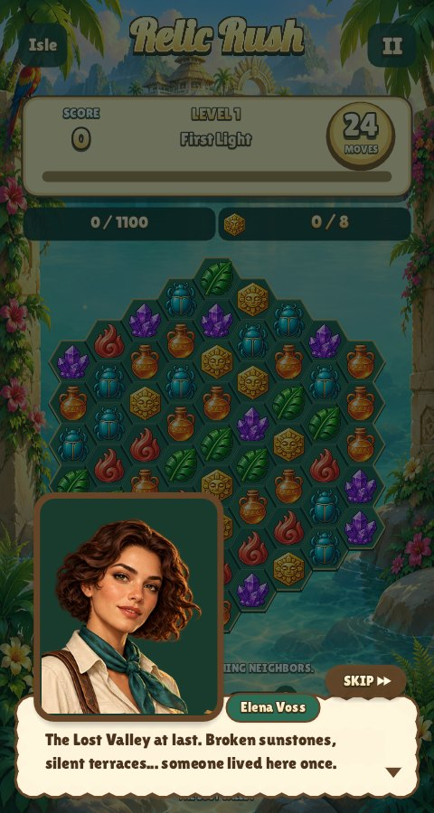 | 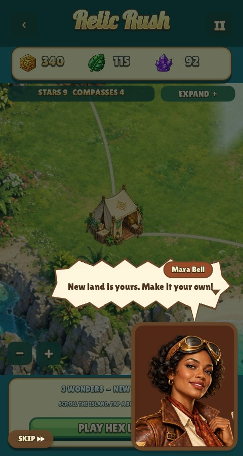 | 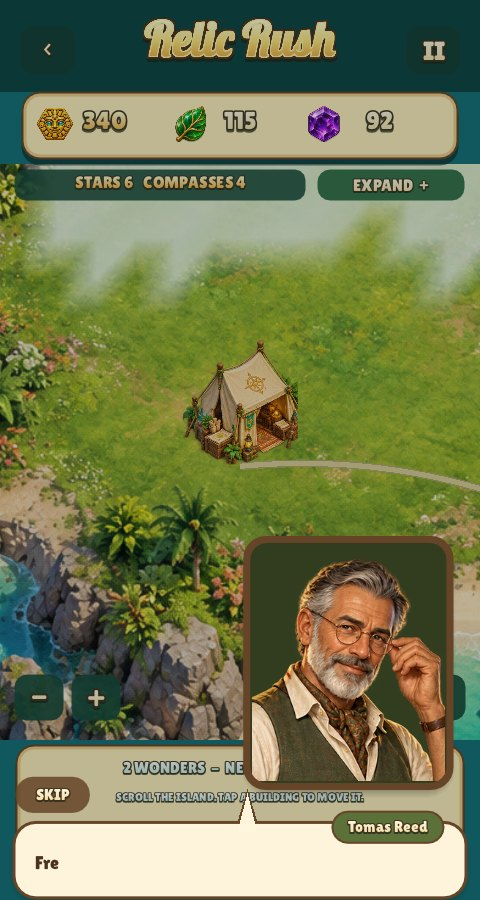 | 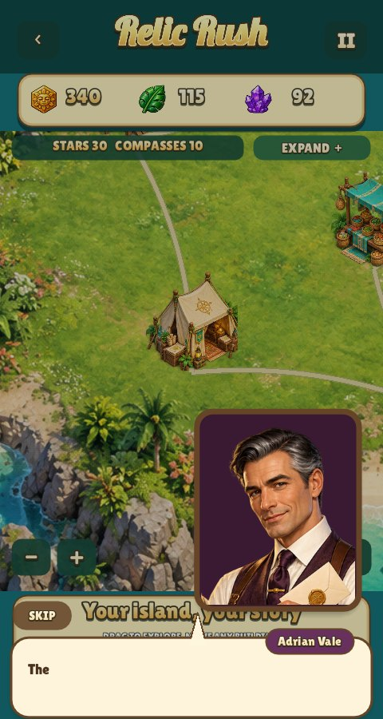 | 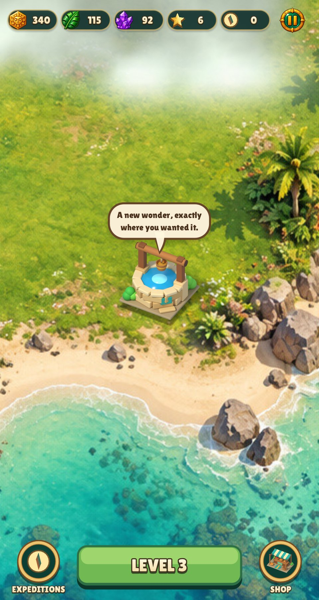 |

On a 390 × 844 iPhone (safe-area insets 47 top, 34 bottom) the island and the jungle run to the screen edges while the controls stay inside the safe area. The screen grows taller there (480 × 939) rather than showing bars: the top HUD stays at the top, the tools and the island's bottom buttons move down to the bottom edge, and the board and dialogs stay centred:

| Island | Board |
| --- | --- |
| 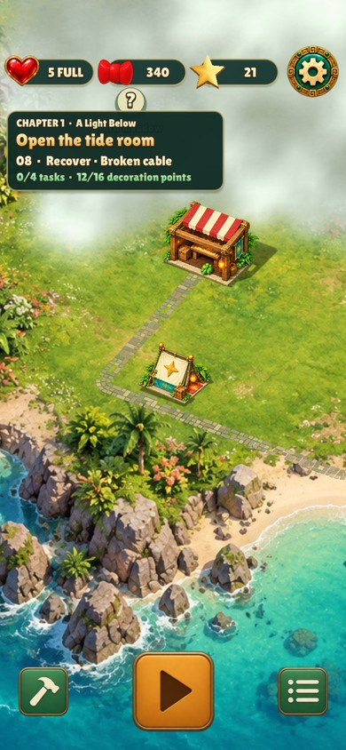 | 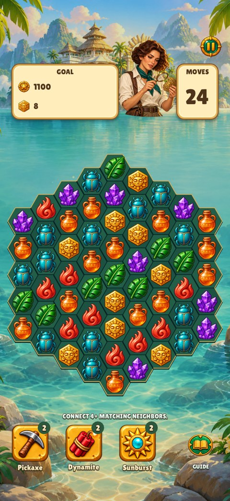 |

## Expedition and restoration loop

1. Start directly in the first match-3 level; there is no title-screen or friend-road detour.
2. Complete its score, idol, excavation and blocker objectives within the move budget.
3. Claim the first win once: 80–120 spare amulets and 3 discovery stars, plus a restoration grant at a wonder milestone.
4. Return to the island. At a wonder milestone, choose a location and confirm construction; otherwise the next story clue plays immediately.
5. Confirm construction, pan across the growing settlement and open neighboring land when eligible.
6. Read the discovery, then set out again. Thirty stages support ten restored buildings; level 30 delivers the final hook.

Hex amulets pay for restorations and decorations. Each scheduled first-clear grant covers its wonder; random match colours do not change it. Replays earn 60 base amulets plus two per saved move, up to 40 bonus, without new stars or story progress. Discovery stars unlock stock and adjacent land and are never spent. Failed attempts cost one of five lives; one life regenerates per 30 minutes, including offline time. There is no purchase backend.

## Campaign: thirty hex levels

Every stage uses its own connected active-cell mask within a radius-four hex grid. Their sand and lock placements make seams, interrupted approaches and thawing excavations; [board progression](docs/board-progression.md) records the decisions and exact starting terrain. Objectives below are taken from the current level configuration; all listed blockers must be cleared.

| # | Expedition | Moves | Score | Idols | Sand | Chains | Ice cells | Focus |
| --- | --- | ---: | ---: | ---: | ---: | ---: | ---: | --- |
| 1 | First Light | 24 | 1100 | 8 | 0 | 0 | 0 | Match 3 in a row. |
| 2 | The Jade Crescent | 29 | 1800 | 10 | 7 | 0 | 0 | Match 4 for a sun ray. |
| 3 | Sunstone Spiral | 32 | 2300 | 12 | 12 | 0 | 0 | Dig along the seam. |
| 4 | The Vine Constellation | 35 | 2700 | 12 | 10 | 4 | 0 | Match to break chains. |
| 5 | Three Paths Meet | 35 | 3100 | 14 | 13 | 4 | 0 | Rays cross gaps. |
| 6 | Winter Lotus | 37 | 3400 | 14 | 13 | 0 | 5 | Match to break ice. |
| 7 | The Ember Ring | 40 | 3800 | 16 | 15 | 4 | 5 | Flames thaw nearby ice. |
| 8 | Prism Hollow | 40 | 4200 | 16 | 17 | 4 | 6 | Match 5 for a prism. |
| 9 | The Sixfold Seal | 43 | 4600 | 18 | 19 | 5 | 6 | Use rays across the seal. |
| 10 | Heart of the Hexagon | 46 | 5000 | 20 | 22 | 6 | 6 | Uncover the buried centre. |
| 11 | The Long Terrace | 33 | 2500 | 12 | 14 | 0 | 0 | Dig the long terrace. |
| 12 | Twelve Crates | 36 | 2900 | 13 | 15 | 5 | 0 | Free chained relics. |
| 13 | Names in the Stone | 37 | 3200 | 14 | 16 | 6 | 0 | Aim rays along the stone. |
| 14 | Static | 38 | 3500 | 14 | 17 | 7 | 0 | Work around the broken seam. |
| 15 | The Frost Line | 39 | 3700 | 15 | 18 | 4 | 6 | Clear chains and ice. |
| 16 | Supper for Twelve | 40 | 4000 | 15 | 18 | 4 | 7 | Flames thaw nearby ice. |
| 17 | The Torn Log | 42 | 4200 | 16 | 19 | 5 | 7 | Some ice takes two hits. |
| 18 | Lantern Steps | 40 | 3000 | 12 | 12 | 2 | 4 | Clear the open terrace. |
| 19 | Under the Vines | 45 | 4600 | 18 | 20 | 6 | 8 | Dig beneath the locks. |
| 20 | The Archivist's Key | 46 | 5100 | 20 | 22 | 7 | 9 | Open the central approach. |
| 21 | Tomas's Trail | 35 | 2800 | 12 | 15 | 0 | 0 | Follow the buried seam. |
| 22 | The Frozen Stair | 40 | 3400 | 14 | 16 | 2 | 8 | Thaw the frozen approach. |
| 23 | The Star Road | 40 | 3700 | 15 | 16 | 5 | 5 | Choose a colour for the prism. |
| 24 | Noon Shadow | 41 | 3900 | 16 | 20 | 4 | 5 | Excavate across the shadow. |
| 25 | Smoke on the Water | 38 | 4000 | 16 | 18 | 6 | 6 | Work through the locks. |
| 26 | The Jade Deep | 43 | 4300 | 17 | 20 | 4 | 9 | Thaw the buried ground. |
| 27 | Six Sun Gates | 45 | 4600 | 18 | 20 | 7 | 8 | Clear the scattered locks. |
| 28 | The Last Terrace | 42 | 3200 | 13 | 13 | 2 | 4 | Clear the open terrace. |
| 29 | The Silent Temple | 47 | 5200 | 20 | 23 | 8 | 10 | Dig through the temple floor. |
| 30 | The Song Returns | 49 | 5500 | 22 | 24 | 8 | 10 | Uncover the final approach. |

Ice can require more than one hit. Board patterns progress from the introductory field to crescents, spirals, branching lines, rings and the final central seal.

## Buildings

Buildings unlock in this order at clear milestones 1, 4, 7, 9, 13, 16, 19, 23, 26 and 29. Positions are chosen by the player; the order does not impose fixed plots or a road layout.

| # | Building | Amulets | Purpose in the story |
| --- | --- | ---: | --- |
| 1 | Expedition camp | 60 | Every great discovery begins with a little canvas. |
| 2 | Spring well | 80 | Fresh water brings the lost valley back to life. |
| 3 | Artisan workshop | 100 | A home for the hands that rebuild the valley. |
| 4 | Jungle market | 120 | Stories, spices and treasures from far away. |
| 5 | Sunstone courtyard | 140 | A sunlit gathering place brings the valley together. |
| 6 | Explorer's lodge | 160 | A warm light after a long day of adventure. |
| 7 | Lost-world archive | 180 | Protect the knowledge buried beneath the vines. |
| 8 | Star observatory | 200 | Follow the stars to the next discovery. |
| 9 | Jade fountain | 220 | Let the ancient spring flow once more. |
| 10 | Temple of the sun | 250 | The heart of the valley shines again. |

These are restoration milestones, not autonomous resource factories: production timers, citizens and upgrade trees are future possibilities rather than current mechanics.

The island's **SHOP** adds 86 repeatable buildings and decorations to these
ten story wonders: buildings, trees, shrubs, flowers, monuments, water gardens,
furniture, supplies, wildlife and rocks. Browse categories and pages, check the
Amulet price and cumulative Star requirement, then choose a location and confirm.
Cancelling is free; Stars are never spent. Amulets for earned story restorations
stays reserved so optional purchases cannot block the campaign. Purchases save
and move like wonders, with a 160-object island limit. See the complete
[building catalogue](docs/building-catalogue.md) and
[in-game review](docs/review/building-catalogue/README.md).


## Island regions

The 1920 × 2880 world scrolls beyond the phone screen. Hidden six-neighbor land tiles define connected regions, while placement itself uses continuous world coordinates. The puzzle grid and island territory graph are separate systems.

| Region | Required discovery stars |
| --- | ---: |
| Harbor glade | 0 |
| Sunlit coast | 6 |
| Fern meadow | 9 |
| Sun garden | 15 |
| Ancient heights | 21 |
| Temple ridge | 27 |

A region must touch opened land and meet its discovery-star gate. Expansion does not spend stars or require compasses. Regions do not open on a timer, and players do not need to build roads.

## Play

- Thirty distinct hex board masks with 48–58 active cells. Contiguous straight lines of three or more identical relics match along the three hex axes; bends, diamonds and rings do not count. Swaps without a match animate back and do not spend a move.
- Three in a line → ordinary match; four → directional lightning relic; five or more → sun prism. Crossing lines do not create bombs; existing bombs and dynamite retain their effects.
- Swap two specials for a combination attack; prism + special converts that color before detonation.
- Ancient sand is excavated by matches above it. Sand and ice have [thin rims around the cell](docs/asset-catalogue.md#terrain-blockers-and-board-interaction). Chained and frozen relics cannot move until matched or hit. Double ice needs two hits. Matched flame relics also thaw adjacent ice.
- Cascades increase score multipliers. Matched pieces animate toward score/objective readouts; the result screen separately explains the guaranteed grant and spare Gold.
- Pickaxe, dynamite and sunburst tools: select a tool, then a board cell. Two charges per tool per level; no move cost. The guide explains mechanics.
- Idle hints, automatic dead-board recovery, restart on failure, pause with Restart (confirmed), Quit to Island, and Sound and Reduce motion checkboxes.
- First-clear grants fund the next building and leave 80–120 spare Gold. Completed expeditions can be replayed for 60–100 Gold. Each won attempt pays once; only first clears advance discoveries.
- Large scrollable island, six connected land regions defined by a hidden hex tile graph. Drag the map to pan, even when the gesture starts on a building; pinch to zoom (or use the mouse wheel on desktop).
- Adjacent clouded regions require cumulative discovery stars, which stay with the expedition. Compasses are retired.
- The island HUD has lives, hex amulets and stars beside the settings gear. Large Buildings and Play actions sit at the bottom corners with a smaller Expeditions compass beside Buildings. Both catalogues scroll continuously. The building shop shows three cards per row.
- Choose any valid grassy position within opened land. Hold a placed building still for half a second to pick it up, then drag and confirm or cancel. The building shows no label; it turns semitransparent red where it can't go. Completed buildings can be moved without spending resources. Preview and cancellation never change the saved layout.
- Footprint collision and shoreline checks prevent overlap and water placement. Automatic connector roads are disabled.
- Progress saves after rewards, construction and region unlocks (a `key=value` file in the per-game preferences folder, or `localStorage["relic-rush/progress"]` in the browser). An unfinished board restarts if the application is closed.

## Selected tile art

The [artwork and state catalogue](docs/asset-catalogue.md) inventories every gem
pack, special, blocker, tool and animation state, with source/runtime paths and
reproduction commands. Specials, blockers and all five tool interaction states
use one authored atlas; `--art-states` shows the complete set and `--art-board`
freezes a board with all specials. Catalogue coverage runs in `make test`.

The archaeological **Relics** set (option 1) is the default match piece art: a hexagonal sun idol, coral flame, jade leaf, turquoise scarab, purple crystal cluster and amber amphora. **Jewels** and **Resources** stay available as optional art packs — `--tiles jewels` natively, `?tiles=jewels` in the browser. Gameplay, rewards and costs are the same with every pack. See the [tile-set comparison and construction research](docs/tile-sets.md).

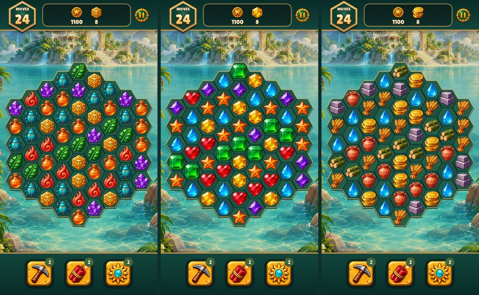

## Run and build

From the repository root (system platform development files needed for native builds, the Emscripten SDK for the web):

```sh
make run-relic                                  # native desktop
make test                                       # rules, island and engine tests
make web && python3 -m http.server 8080 --directory dist   # http://localhost:8080/relic-rush/
```

The game is laid out for a 480 × 900 portrait screen inside the device's safe area. It is `fixed` with `max_aspect = 2.2`, so on taller phones the screen keeps its width and grows taller (`R.layout()` moves the bottom group down by the extra height, `R.drop`). Its jungle backdrop, the island and the HUD bands run on under the status bar and the home indicator to the screen edges (`app.bleed()` / `gfx.bleed`). Runtime art in `data/` is committed; `python3 games/relic-rush/tools/prepare_assets.py` rebuilds it from the sources in `art/` (needs Pillow).

Debug and capture options (no progress is written): `--level N`, `--city N` (an island after N expeditions; `--open MASK` limits it to those regions, bit per region), `--look X,Y` (centre the island camera on a world point), `--showcase`, `--overview`, `--catalogue [category]`, `--catalogue-page N`, `--catalogue-item ID`, `--catalogue-card ID`, `--building-review N` (four catalogue objects per footprint review page), `--footprints` (every building's footprint and pivot over its sprite), `--placing [blocked|dragging]` (`blocked`: the red ghost over a built wonder; `dragging`: the ghost held up between tiles over the footprint of the tile it will land on), `--zone N`, `--card N`, `--victory`, `--dialog guide|pause|failed|finale|intro|mara|tomas|adrian|bubble|leaderboard|level-leaderboard`, `--tiles relics|jewels|resources`, `--art-states`, `--art-board`, `--fx ray|bomb|prism`, `--smoke` (plays level one through injected clicks, claims, builds, checks pan/long-press move/cancel/confirm and enters level two), plus the engine's `--shot file.png --frames N`, `--size WxH`, `--fresh` and `--mute`.

## Controls and saved progress

- **Board:** swipe to one of six neighbors, or tap two adjacent relics. Select a tool and then its target. The top-right medallion pauses: level details, a Sound and Reduce motion group, Resume, Restart (asks first), Quit to island (keeps the board) and the guide; Escape does the same. Tap outside a closable popup to dismiss it; results require an explicit action.
- **Island:** drag the map to pan, including from buildings; pinch or use the mouse wheel to zoom. Tap a building for its card, or hold it still for half a second to pick it up and move it. Tap clouded land to see what opening it needs.
- **Placement:** choose a grassy spot, check the green/red footprint, then confirm or cancel. Buildings cannot overlap, cross the shoreline or occupy closed land. Moving a completed building is free.
- **Save:** level progress, resources, opened regions and building positions persist; an unfinished puzzle restarts. Saves of the standalone prototype (`progress.txt`, `localStorage["relic-rush-v1"]`) are not imported.

## Verification

- `make test` runs the original rule regressions, ported: grid invariants, straight triples, rejection of bent/diamond/ring groups, four/five special creation, holes and diagonal trickling, chain and ice locks, fire thawing, tools, prism colour clears, connected board masks and seeded opening boards without ready matches and with a legal move, exactly-once rewards and construction, shoreline/collision/zone rules on the engine city, and 120 greedy campaign trials (extended: `make test-extended`). The greedy bot must win every one of the thirty levels at least once in its four seeds, without tools.
- `--smoke` opens and closes the data-backed guide, then drives the real game loop with injected mouse clicks through swaps, cascades, the win dialog, the claim, construction, pan/long-press pickup/cancel/confirm and the start of level two.
- `--smoke --campaign` plays all thirty expeditions through the real result, Claim, region, placement, dialogue and Play controls. Each board's goals are met before one real swap, so it checks the flow rather than the boards. Every one of the 36 story beats must play once, in script order, and be acknowledged, and the run must end on the finale with ten wonders and every region open. A stuck story or restoration gate fails it with the level and the beats played so far. It takes about 35 seconds and runs in `make test-full` (CI), or alone with `build/test/relic-rush "smoke campaign"`.
- Every screenshot above is rendered by the same code; they were compared side by side with captures of the standalone prototype.
- iPhone/iPad and Android device builds, touch feel, safe areas and performance still need device QA.

## Art and text pipeline

Nine matching landmarks have independently registered ground shadows below the
current painted sprites. The courtyard and all 86 repeatable catalogue entries
are preserved. See [building registration](docs/BUILDINGS.md) and the
[reviewed captures](docs/review/painted-buildings/README.md).

Original generated environment paintings, the legacy 10-building sprite sheet and the 6 × 3 tile sheet (`art/tile-sets/source.png`: the Relics, Jewels and Resources packs) are kept as editable sources in `art/`. The 96 current building sprites use the Blender-guided ImageGen atlas and `tools/prepare_buildings.py` (see the building catalogue). `tools/prepare_assets.py` cuts the other sprites out of their sheets (largest opaque component, so neighbouring paintings never leak in), scales backgrounds to what the screen needs and writes PNG/JPG files the engine loads directly. `docs/references.md` records reference research and provenance. Generated art is a prototype asset set and needs an art consistency / IP review before a commercial release.

Fonts: **Lilita One** for the game UI, rendered at runtime by the engine (TrueType with outline, gradient and drop shadow, any Unicode — Cyrillic localisation no longer needs a new atlas); **Lobster** made the gold `title.png` logo and stays in `art/fonts`. Both are unmodified SIL OFL 1.1 fonts with their license text.

## Source layout

Relic Rush and Christmas Market are one game with two skins
([docs/PORTRAIT_GAMES.md](../../docs/PORTRAIT_GAMES.md)). The flow around the
board, every dialog, the shop, the level list, the town hooks, story delivery,
effects and the debug entry points are the engine's (`engine/match3_game.lua`,
`engine/match3_vfx.lua`, `engine/match3_debug.lua`); this folder is data and art.

- `data/game.json`: every word of the shared screens (notices, Pause, Restart, failed, region, finale, building card, shop, level list), the piece packs and the dialogue scale.
- `data/town.json`: the town screen's layout and notices.
- `lua/state.lua`: the shared state table (`R`) from the engine.
- `lua/art.lua`: named authored states, control-state selection and the in-game catalogue.
- `lua/rules.lua`: piece identities, the economy slots and rewards over the engine's match-3 rules.
- `lua/campaign.lua`, `lua/story_content.lua`, `lua/buildings.lua`, `lua/building_sprites.lua`: levels, the script and the building catalogue.
- `lua/journey.lua`: the restoration schedule, recap and changing tap lines.
- `lua/narrative.lua`: the cast.
- `lua/island.lua`: shoreline, the hidden hex region map, region adjacency and the ten wonders as engine building definitions.
- `lua/board.lua`: how cells, relics, ice and blockers are painted.
- `lua/screens.lua`: the results card, the guide's rows and icons, and the wallet, star and compass icons.
- `lua/skin.lua`: the look as data (`ui.skin`).
- `lua/main.lua`: loads the modules and returns the engine's app descriptor.
- `lua/smoke.lua`: the `--smoke` run through injected input, including the engine's `city.move_test`.
- `art/`, `data/`, `docs/`, `tools/`: sources, runtime assets, documentation and the asset pipeline.

## Design references and original assets

- **Cradle of Rome:** excavating puzzle terrain and spending collected resources on visible restoration.
- **Candy Crush:** understandable special-piece creation, combination attacks, boosters and animated reward feedback.
- **June's Journey / Pearl's Peril (Wooga):** a large island, player-selected building locations and land expansion, replacing a linear friend-road progression map.
- **Supercell games:** readable building silhouettes, polished resource feedback and a cheerful settlement presentation.
- **Settlers II / Return to the Roots:** a reference for territory represented by small connected land cells. No road-management system or GPL implementation was copied into the game.
- **Canva-style text effects:** inspiration for layered, image-like lettering with gradient fill, a unified outline and shadow.

See [reference research and source links](docs/references.md) and [art prompts and screenshot provenance](docs/art-prompts.md). The island and buildings are original generated prototype artwork; no ripped commercial game assets are bundled. Font licenses are included alongside the font files. Bundled font licenses apply to the fonts. The repository’s existing top-level `LICENSE` is preserved.

## Roadmap and prototype boundaries

Ideas discussed for later development:

- More decorations, alternative buildings, upgrade choices and a richer restoration economy.
- An expedition journal, characters, narrative events and story scenes built around the Lost Valley premise.
- Visiting friends' settlements; optional asynchronous raids were discussed as an exploratory idea, not an implemented or committed feature.
- Backend accounts, cloud saves and social progression if those features are pursued.
- Human playtesting, campaign balancing, sound design, haptics and more responsive device-specific polish.
- Localization; app icons, safe-area validation, mobile performance checks and signed iOS/Android releases. The standalone prototype's Android/iOS host projects were not carried into this repository; mobile packaging is to be set up once for the shared engine.

Current scope is an offline prototype: thirty hex levels, ten story wonders plus 86 purchasable buildings/decorations, six regions, local saves and a complete puzzle → reward → placement → next-level loop. There are no multiplayer services, advertisements, in-app purchases, production timers, implemented raids or native store releases.

## Fast rule tests

Run `make test-relic-rush` from the repository root for this game's tests in one command. The Lua suites use deterministic state injections and need no window or artwork. See [the testing guide](../../docs/TESTING.md) for coverage, test-only `ENGINE_TEST` hooks, extended samples and renderer smoke checks.

Board artwork fills its registered hex slots. Dialogue portraits slide/fade in and out, and only brighten/dim on speaker changes; no resizing, rotation or idle wobble; the engine owns those transitions. See [motion review](../../docs/review/motion/README.md).

Level entrances provide grouped haptic ticks as gems land and a stronger pulse for
blockers. The touch opening a level cannot skip its entrance; a new tap during
the entrance can. Reduced motion and skipped entrances omit these landing effects.
Building previews show a round × on the lower left and ✓ on the lower right of
the building. Dragging, panning and zooming keep these controls with the preview;
✓ is disabled on blocked land. Cancel preserves the original building and wallet.
Popups (Pause, results, guide, cards) and their backdrops appear and close
immediately, with no entrance or exit motion; only `--reel` captures still play
the results parts.

Ray gems retain their matching artwork with broad engine-rendered cream stripes
masked to the gem's alpha. Stripe direction identifies the cleared board axis.
Bombs are full-size bombs replacing the gem; prisms remain whole crystals.
Frozen pieces retain a centred **1**/**2** counter above the board layers. Selection uses
a soft mint glow; hints use gold light and sparkles. See the updated Explorer’s
guide and [visual review](../../docs/review/striped-specials/README.md).

While moving or placing a building, cream outlines around other buildings show
their occupied ground and clearance for quick alignment. The mover's old spot is
free; guides remain until Confirm/Cancel. See the
[shared placement-guide review](../../docs/review/city-placement-guides/README.md).

## Town screen

The island is the engine's [shared town screen](../../docs/TOWN.md), laid out by
`data/town.json`. Tapping a building shows its name in a word bubble; holding
it for half a second lifts it to move.

The town bottom row has a large central Play button and equal smaller Build
and Levels buttons, with simplified authored icons and five interaction states.
