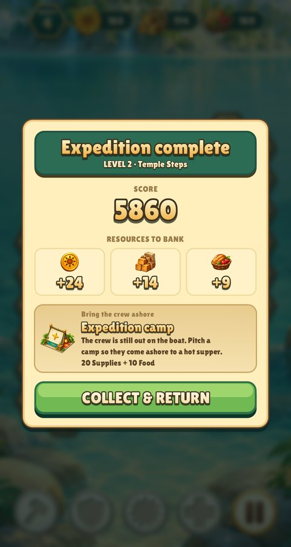
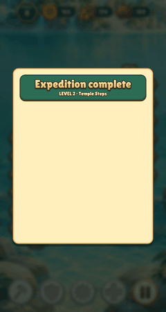
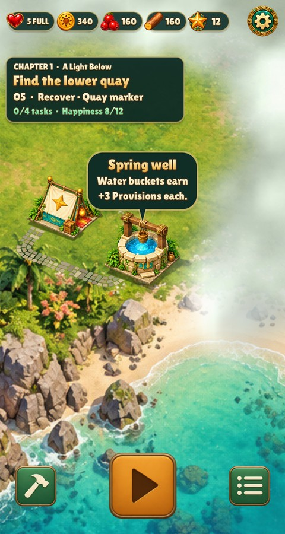
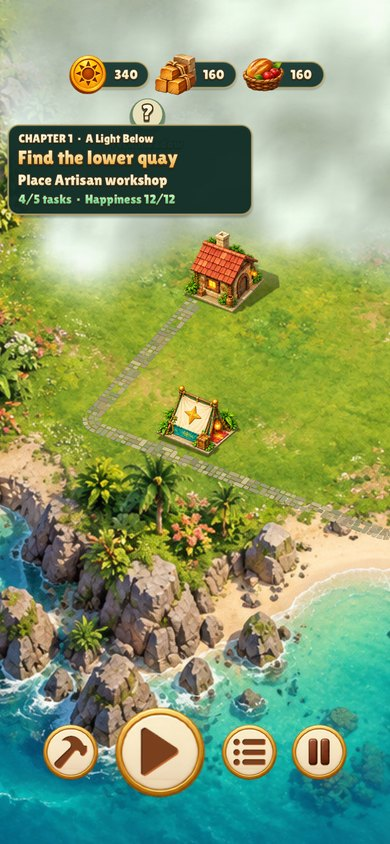

# Relic Rush · The Lost Valley

From the repository root, `make -C games/relic-rush ios` builds, signs, installs
and launches on the connected iPhone. Set `DEVICE="name or UDID"` to select one.
See the [device deployment guide](../../tools/xcode/README.md#deploy-to-a-connected-iphone-or-ipad).

A portrait mobile-first hex match-4 / island-restoration prototype, written in C11 on the repository's shared platform engine ([`engine/`](../../engine)), the same engine that runs [Nile Archive](../nile-archive). The island is the engine's `city`; text, shapes, input, camera, saves and sound come from the engine; this folder holds the rules, the content and the look. The WebAssembly preview runs the same C code; the browser page is only a fullscreen canvas.

Launch straight into level one. Swipe adjacent relics, or tap one and then its neighbor. Clear every plaque within the move budget, claim resources, restore the next building on the island, and set out again. The story runs across the first thirty of the hundred boards, in three episodes: it restores the ten wonders and ends with the valley singing and five lights answering at sea. Boards 31-100 are playable without story yet. The island is a scrollable 1920 × 2880 world with six unlockable regions, freely placed buildings and persistent positions.

Building popup images and resource icons follow the panel’s entrance scale,
position and opacity through the shared form skin. See the
[popup and refill comparisons](docs/review/popup-refill/README.md).

Haptics accompany matches, cascades, trickling landings,
results, income collection, building pickup and release/drop. Moving a preview
requires dragging the building; tapping land does not move it. Confirm and Cancel
add no feedback. See the [shared haptics contract](../../docs/HAPTICS.md).

## Island navigation and resources

The town actions show a cottage for Buildings, a green triangle for Play and a blue gear for Settings. Play carries the number of the expedition it starts or resumes; there is no expedition list, and once all 100 are cleared Play opens the "You won!" card. Resource icons protrude beyond their counter bars for readability. The building catalogue is a full-screen sheet under the wallet row: a continuous measured scrolling list with bounded inertia, one entry per row. A building's row shows its art, what it unlocks, its whole price in Coins, Supplies and Food (an amount the wallet cannot cover is red) and a BUILD button or the reason it waits; restored buildings keep their art on a shorter ticked row. During epoch one, Buildings opens the current quest card with a short narrated reason for the building in flat ink, then its price and what it brings side by side as icons with figures. A new piece shows the resource and amount each match banks, and a bonus gem shows its icon. Its shop link opens the full catalogue and category selectors. Keyboard focus reveals its item and mouse wheels scroll the same viewport. The list shares its template with Christmas Market and lays out only the rows in view.

The top wallet shows Coins, Supplies and Food on both screens. Matches
preview in the wallet during an expedition and bank after a successful clear.
The completion dialog shows the expedition score.
The Well costs Coins. The Workshop, Market, Archive and Temple use all three
resources. Boards cleared unlock shop stock and land. There are no lives: a failed
board can be retried at once.

Tap a placed building for its name and subtitle above it. Only one stays open. The next press dismisses it. A stationary hold picks up a building through the shared mover, with Confirm/Cancel preserving saved state.

See the [building label comparisons at both phone sizes](docs/screenshots/review/town-labels/README.md).

Scrolling uses the engine animation clock: a scalar `CAAnimation` drives the iOS timeline, as in CorePunch/orca, while other platforms use the platform monotonic clock.

## Shared match engine and atlas

Every expedition ends when all of its plaques are clear. A blue plaque takes
one hit and a green plaque takes two. A single chain absorbs one hit, and a
double chain absorbs two before the plaque underneath can be cleared.
With three or fewer tablets left, sparks trace their edges after the same idle delay as the move suggestion.
Swipe or tap a gem toward a chain, ice or a carved stone and it slides toward
the blocker and back, with the same haptic as a rejected swap and zero moves spent.
See the [board progression](docs/board-progression.md) for the pattern and move budget of each expedition
and the [campaign sheet](../../docs/review/level-sheets/relic-rush.png) for all 100 layouts.
The [resource expedition design](docs/resource-expedition.md) covers how
resource matches and restoration costs fit into the campaign.
See the [shared element rules and design reference](../../docs/MATCH3_ELEMENTS.md)
and [current board review](docs/review/chains-only/README.md).

The [engine match-3 module](../../docs/MATCH3_ENGINE.md) owns all matching,
swaps, blockers, trickling gravity, cascades, hints, tools and board
input/timing. This game provides campaign data, graphics and integer behavior
flags. Every exposed column top (no active cell directly above) spawns gems
vertically. Interior gems fall straight down whenever their cell below is
empty and movable, and slide diagonally only when that cell is occupied,
locked or missing. Locks still route gems around their sides.

The board's art is one atlas per kind in `data/board/`: `pieces.png`,
`blockers.png`, `cells.png`, `hud.png` and `fx.png`. Its backgrounds are separate JPEGs in
`data/board/backs/`. The small HUD icons share `pieces.png` with the board
pieces, and the jade signboard lives in `hud.png`.
`python3 tools/match3_atlas.py` rebuilds the atlases from
the registered sprites in `art/registered/`; [Asset layout](../../docs/ASSET_LAYOUT.md)
describes the folders.
`--default-match3` previews the engine's neutral skin.


## Screenshots

Captured from the engine build with `make shots` (headless, software renderer). Island images use demonstration progress to show the settlement and placement tools.

| Hexagonal expeditions | Restored island |
| --- | --- |
|  |  |
|  |  |
|  |  |
|  |  |

## Leaderboards

Game Center is in every game through the engine ([docs/GAMECENTER.md](../../docs/GAMECENTER.md)).
Relic Rush turns it on with the `leaderboard` block of `lua/game_config.lua`: one board ranks players by boards cleared (its Game Center id is still `stars`), and one board per expedition (`level_01`
to `level_100`) holds its best score. Scores are reported when a reward is claimed, so a
replay that beats the old score raises that board, and a weaker one changes nothing. Settings
has a LEADERBOARD link for the boards-cleared board. The results card has no leaderboard button; the
expedition boards still receive scores. The link opens the shared dialog with Everyone / Friends tabs, player portraits and the
player's own row marked; without Game Center it shows the player's own best.

| Settings | Boards-cleared board | Results card | Expedition board |
| --- | --- | --- | --- |
|  |  |  |  |


To publish them, create 101 leaderboards in App Store Connect (Game Center, high to low) with the
identifiers `com.corepunch.relicrush.stars` and `com.corepunch.relicrush.level_01` ...
`com.corepunch.relicrush.level_100`, ideally grouped in a leaderboard set. `--gamecenter-demo`
shows sample rivals for captures; `--dialog leaderboard` and `--victory --dialog level-leaderboard`
open the dialogs.

Board 1, The Landing, is a nine-column hex with seven blue plaques in its centre. It uses Cradle of Rome's opening pool: sun coins and silver coins (Coins) plus a leaf, a flower and an amphora that only score. Food and Supplies pieces arrive with the restorations.
Boards 2–10 and 13 show a story piece in place of one matching colour.
Every board spawns five kinds, so those boards use four regular kinds plus the story piece.
[Story pieces and board captures](docs/screenshots/review/story-collection/README.md)

Clear every blue plaque to finish the expedition. The opening chapter’s dialogue follows island construction.

## Shared UI and dialog layers

The island and the board share one wallet and Settings bar. The green resource
capsules have the same brass rim and drop shadow as the round buttons. The board shows
Moves at the left of the resource balances. The medallion turns red at five
moves. Blue tablets mark the board objective. Winning banks the resources
earned in the three slots.
Four large circular bonus sockets sit in one row below the centered board from the first
expedition. Settings opens the Explorer's Guide,
and Results shows the score and rewards. Dialogs reuse the engine's forms and
cached blur. See the [top bar review](docs/screenshots/review/top-bar-moves/README.md)
and [shared UI API](../../docs/UI_ENGINE.md).


## Result screens and typography

The result card fits its contents. Every popup uses the shared title panel. Settings shows the current board as its subtitle during play. Score, a row of three resource totals (icon and figure), one line about the next restoration and Collect stack vertically. That line is what the restoration still needs after this win, as the same icon-and-figure amounts, or its picture under READY TO BUILD once the wallet covers it. The quest title, story sentence and price stay on the building card. If no restoration is available, Collect follows the resources directly. See the [results review](docs/review/chapter-one/README.md).

Text is aligned by its visible ink bounds (the engine's `text_in`), shared by buttons and counters, and paragraphs wrap into balanced lines (`text_box`).



Dialogs arrive and leave on the engine's motion module ([docs/MOTION.md](../../docs/MOTION.md)): the card eases in and the parts of the result settle on one timeline, which the first tap skips.

See [UI architecture, Playrix/Candy Crush references and regression checks](docs/ui-results-and-type.md).

## Effects and motion

Coloured match fragments, resource trails and cascade chimes follow each clear. During refills, each gem gives a small bounce when it comes to rest in its slot. Reduce Motion suppresses the bounce. The result screen counts the score up. After any dialogue the board presents itself: the HUD lands, the cells ripple out from the centre, relics rain down their columns with squash and bounce, blockers slam on and a sheen runs across as the board goes live. A tap skips it; reduced motion makes it a short fade. See [the board entrance](../../docs/ENGINE.md#board-entrance).


See [effect reference study](docs/effects.md). The reel uses deterministic test boards; actual iPhone/Android performance still needs device testing.

## Current match-4 rules and boards

The widest nine-cell board spans 448 of the 480 logical screen units, using a 32-unit cell radius and 16-unit side margins. Gems and cell artwork scale together from their authored sizes: gems retain their transparent padding, and cell faces and state panels retain a small inset so neighbouring cells do not overlap. The entrance returns to a 1× pose when it finishes or is skipped. The board remains centred between the goals and tools on both phone sizes. See the [wide-board and cell-fit correction](docs/review/gem-cell-fit/README.md).

The pale limestone and blue tablets meet at hairline seams on one continuous
board surface. [Before and after at both phone sizes](../../docs/review/match3-board-seams/README.md).

The minimum match is **four identical relics in a straight line** along any of the three hex axes. Bends and diamonds do not count. Ready lines resolve automatically before further input and after each fall. There are no special pieces: a longer line just clears. The 100 boards sit on a 9 x 12 rectangle of flat-top hexes, with real holes and diagonal refill routes. The gold idol now has a six-sided silhouette.

All 100 expeditions use five piece kinds. Each board has a move limit fitted to its difficulty tier. See the [campaign balance and board comparisons](docs/board-progression.md#match-four-difficulty).

After five idle seconds, a legal swap is highlighted. If there is no legal swap, the board reshuffles for free and displays “No moves. Board reshuffled.” This recovery also runs after cascades. Movable pieces fly to their new cells during either a free shuffle or a Mixer use. Locked pieces and blue tablets stay put. Reduce Motion settles the pieces immediately. See the [dead-board regression and captures](docs/review/dead-board/README.md).

Power comes only from the bonus tools: matched bonus gems fly into their sockets and reveal the colored pieces from the bottom.
With Reduce Motion on, the charge appears immediately.
Empty buttons show the tool recessed into sandstone, with a soft shadow along the upper-left edge.
See the [bonus artwork and state review](docs/asset-catalogue.md#campaign-bonus-pieces-and-sockets).

See [matching rules, board shape, implementation notes and reference sources](docs/match4-rules.md).

## New art direction

The match-4 scenes now use two original runtime backgrounds: **Sunlit Lagoon** for levels 1–5 and **Moonlit Sun Temple** for levels 6–10; each later episode reuses those paintings, opening on the lagoon and moving into the temple. The study draws on Tropicats and Candy Crush for playable-screen readability, and June's Journey / Pearl's Peril for garden islands and adult adventure characters.

See the [reference study, original cast and asset gallery](docs/art-direction-v2.md) and [complete generation prompts](docs/art-direction-v2-prompts.json).


Elena Voss leads the archaeological expedition. Mara Bell pilots the Marigold, Tomas Reed keeps the harbor, and Adrian Vale finances the trip. Their busts (cut by `tools/prepare_assets.py` from that lineup) appear in the game's dialogue.

## Story and world

In **A Light Below** (levels 1–10), the crew lands, restores the water supply and investigates a light below the cliff. The Sawmill supplies the quay repair. The Well and the repaired steps have fixed sites.

In **The Keeper’s Return** (levels 11–20), the crew returns the Courtyard, Lodge and Archive to use. Ines’s note identifies the signaler, and her signed plan gives the crew a way to repair the quay wall. Chapter 3 carries the repair and ownership dispute to the finale. The signal plate and Ines’s reply on board 30 pay off the three flashes at the restored steps.

A first clear advances the expedition counter. Every won expedition banks its matched resources. Construction, currency and story progress persist across saves.

`lua/story_content.lua` is compiled directly from the script by `python3 games/relic-rush/tools/prepare_story.py`; `--check` catches drift and runs with the other asset checks in `make test-assets` and `make test`. `lua/journey.lua` holds the restoration schedule, recap and changing tap lines as data (the engine keeps the keyed checkpoints); `lua/narrative.lua` holds the cast; the engine (`engine/lua/match3/game.lua`) delivers the scenes. Preview any scene with `--story-beat before-11` or `--story-beat after-30 --story-line 9`. The current presentation uses the live island/scene paintings and character busts; the script's illustrated-panel directions remain optional art direction, not required runtime assets.

| Elena | Mara | Tomas | Adrian | Word bubble |
| --- | --- | --- | --- | --- |
|  |  |  |  |  |

On a 390 × 844 iPhone (safe-area insets 47 top, 34 bottom) the island and the jungle run to the screen edges while the controls stay inside the safe area. The screen grows taller there (480 × 939) rather than showing bars: the top HUD stays at the top, the tools and the island's bottom buttons move down to the bottom edge, and the board and dialogs stay centred:

| Island | Board |
| --- | --- |
|  |  |

## Expedition and restoration loop

1. Start directly in the first match-4 level; there is no title-screen or friend-road detour.
2. Clear all blue tablets within the move budget.
3. Claim the matched resources. A first clear counts as a cleared board.
4. Return to the island. At a restoration milestone, check the price and play the next expedition if you need more resources. Clearing the tablets and claiming the reward opens the next expedition. You can finish all 100 with an empty island. If you build later, the island story picks up where you left it.
5. Confirm construction, pan across the growing settlement and open neighboring land when eligible.
6. See how the crew uses what you built, then set out again. The story's thirty boards support ten restored buildings; board 30 delivers the final hook.

A matched sun coin earns 5 Coins and a silver coin 3. Leaves, flowers and amphoras add score only.
The Well costs 50 Coins. Its buckets earn 3 Food each from expedition 2. The Hunter's Hut introduces Hammer, and the Sawmill introduces timber worth 5 Supplies per piece. Buying the Village replaces Hammer with Bomb. The result shows what the next restoration still needs or that it is ready to build.

### Tutorials and citizens (`lua/user_events.lua`)

[`lua/user_events.lua`](lua/user_events.lua) ports Cradle of Rome's
`settings/user_events.xml`. It uses the same event ids, `If` conditions,
`Then` effects and `available` chaining.
[`lua/user_events_runtime.lua`](lua/user_events_runtime.lua) lists every
condition and effect it supports. Each event fires once per profile, and the
save keeps which events are done.

- **Tutorials.** The move hint repeats with the board's 1st, 2nd, 3rd and
  5th suggestion until the first line of four. Toasts introduce tablets,
  double tablets, chains, double chains, ice, the low-moves warning, each
  charged bonus and the catalogue.
- **Citizens.** Tomas joins as soon as the Well is restored. Other building events open a citizen’s challenge. Examples: a line of five after the Workshop, 120 Supplies on
  one expedition after the Archive. Meeting the challenge upgrades the
  building and improves the yield of a matched resource or the charge from a matched bonus gem.
- **Test flag.** `--user-events-test` fires the `test=true` events at once,
  like Rome's F5 cheat.

The citizen amounts are a first pass. The building upgrade is recorded but
has no art yet.

## Campaign: one hundred hex boards

Every board is authored on a 9 x 12 rectangle of flat-top hexes, with holes and blockers that shape the seams and approaches. [Board progression](docs/board-progression.md) records the feature schedule and [level-moves.md](docs/level-moves.md) lists every board's name, tier and move budget. [Level design](../../docs/LEVEL_DESIGN.md) is the authoring guide. Every board is won by clearing its blue tablets; green double tablets take two hits. The story and the twenty restorations run across boards 1-30 (three episodes); boards 31-100 are playable without story yet.

Temple Steps (level 2) puts two plaque groups on a diagonal stairway. Sunken Courtyard (level 3) wraps its plaque field around an open centre. Overgrown Terraces (level 4) introduces a chained plaque. Twin Terraces (level 9) starts with an empty lower chamber that fills once its entrance chain breaks. From level 7 through level 30, plaques cover at least 80% of each board. The bosses at 10, 20 and 30 are entirely green double plaques.

## Buildings

The twenty campaign purchases follow the Windows edition of Cradle of Rome 2. Each purchase introduces one piece. Prices reflect ten seeded plays of each of the 100 hex boards. The first thirty cover all twenty purchases. The balance simulation uses mean income per win and spends about 80% of the available balance at a purchase stop.

| # | Building | After clear | Coins / Food / Supplies | Board reward |
| --- | --- | ---: | --- | --- |
| 1 | Well | 1 | 50 / 0 / 0 | Water buckets earn 3 Food each. |
| 2 | Hunter's Hut | 4 | 195 / 75 / 0 | Unlocks Hammer. Hit one cell. |
| 3 | Sawmill | 7 | 360 / 135 / 0 | Timber bundles earn 5 Supplies each. |
| 4 | Village | 10 | 480 / 180 / 210 | Unlocks Bomb. Hit a cell and its six neighbors. |
| 5 | Farm | 11 | 165 / 70 / 90 | Ration jars earn 4 Food each. |
| 6 | Quarry | 12 | 40 / 30 / 35 | Dressed stones earn 7 Supplies each. |
| 7 | Mill | 12 | 50 / 60 / 60 | Grain bundles earn 5 Food each. |
| 8 | Thermae | 13 | 5 / 55 / 40 | Unlocks Shield. Hit the row through a chosen cell. |
| 9 | Port | 13 | 10 / 60 / 45 | Shrimp earn 6 Food each. |
| 10 | Curia Octavia | 16 | 180 / 410 / 230 | Unlocks Hourglass. Add five moves. |
| 11 | Coliseum | 17 | 80 / 195 / 100 | Helmets earn 6 Coins each. |
| 12 | House of the Vestals | 18 | 100 / 245 / 145 | Unlocks Lightning. Strike up to fifteen random cells. |
| 13 | Aqueduct | 19 | 80 / 155 / 100 | Rings earn 7 Coins each. |
| 14 | Lighthouse | 20 | 115 / 185 / 120 | Unlocks Plus. Choose a resource piece for 100 resources or another bonus to add a quarter charge. |
| 15 | Nero's Golden House | 21 | 80 / 140 / 95 | Scarabs earn 8 Coins each. |
| 16 | Mausoleum of Augustus | 23 | 175 / 260 / 160 | Unlocks Mixer. Shuffle the pieces. |
| 17 | Pantheon | 24 | 115 / 165 / 100 | Sandals earn 9 Coins each. |
| 18 | Theatre | 25 | 220 / 280 / 200 | Harps earn 10 Coins each. |
| 19 | Forum | 26 | 135 / 175 / 115 | Unlocks Star. Clear all pieces of a chosen kind. |
| 20 | Fountain | 29 | 485 / 625 / 410 | Emeralds earn 11 Coins each. |

The Sawmill also repairs the fixed quay as part of the island story. Players may continue expeditions while saving for construction. The shop offers repeatable scenery alongside the campaign buildings. Browse categories and pages, check the
resource price and the number of boards cleared it needs, then choose a location and
confirm. Cancelling is free. The resources
needed for an earned restoration are reserved until placement. Purchases save
and move like wonders, with a 160-object island limit. See the complete
[building catalogue](docs/building-catalogue.md) and
[in-game review](docs/review/building-catalogue/README.md).


## Island regions

The 1920 × 2880 world scrolls beyond the phone screen. Hidden six-neighbor land tiles define connected regions, while placement itself uses continuous world coordinates. The puzzle grid and island territory graph are separate systems.

| Region | Boards cleared to open |
| --- | ---: |
| Harbor glade | 0 |
| Sunlit coast | 6 |
| Fern meadow | 9 |
| Sun garden | 15 |
| Ancient heights | 21 |
| Temple ridge | 27 |

A region must touch opened land and meet its boards-cleared gate. Expansion spends nothing. Regions do not open on a timer, and players do not need to build roads.

## Play

- Swap adjacent pieces to make a straight line of four or more identical pieces along any hex axis. A longer line or a crossing just clears: there are no special pieces. As in Cradle of Rome, power comes only from the bonus tools, charged by matching bonus gems.
- Match or land a tool hit on a chained piece to break the chain. A later hit clears a blue tablet on that cell. Ice and carved stones are other blockers; they gate the fall below them.
- Cascades increase score multipliers. Gathered resources animate toward their wallet slots. The result screen shows the matched resource totals and, as icon amounts, what the next restoration still needs.
- Restore buildings to unlock four bonus families. A later restoration
  upgrades each of the four slots and carries its charge forward. An expedition
  can feature one bonus gem family. Matching six fills one use, and activation
  costs zero moves. [Bonus effects and restorations](docs/board-progression.md#bonus-pieces)
- Idle hints, automatic dead-board recovery, restart on failure, pause with Restart (confirmed), Quit to Island, and Sound and Reduce motion checkboxes.
- Each won attempt banks what the crew brings back. First clears count toward boards cleared. Chapter 1 story progress follows island actions.
- Large scrollable island, six connected land regions defined by a hidden hex tile graph. Drag the map to pan, even when the gesture starts on a building; pinch to zoom (or use the mouse wheel on desktop).
- Adjacent clouded regions open by the number of boards cleared. There are no stars or compasses.
- The settings gear sits beside the three resource balances. Buildings, Play and Expeditions occupy the town's bottom row. Both catalogues scroll continuously. The building shop shows three cards per row.
- Choose any valid grassy position within opened land. Hold a placed building still for half a second to pick it up, then drag and confirm or cancel. The building shows no label; it turns semitransparent red where it can't go. Completed buildings can be moved without spending resources. Preview and cancellation never change the saved layout.
- Footprint collision and shoreline checks prevent overlap and water placement. Automatic connector roads are disabled.
- Progress saves after rewards, construction and region unlocks (a `key=value` file in the per-game preferences folder, or `localStorage["relic-rush/progress"]` in the browser). An unfinished board restarts if the application is closed.

## Selected tile art

The [artwork and state catalogue](docs/asset-catalogue.md) inventories every gem
pack, chain, tool and animation state, with source and runtime paths.
`--art-states` shows the collection and `--art-board` previews the shared
engine’s board pieces for development. Catalogue coverage runs in `make test`.

The campaign uses one [painted atlas](docs/asset-catalogue.md#campaign-piece-atlas)
for resources, upgrades and story pieces. The **Jewels** and **Resources**
art previews remain available through `--tiles jewels` and `--tiles resources`.
See the [tile-set comparison and construction research](docs/tile-sets.md).
The [Cradle of Rome gem sheet](../../docs/cradle-of-rome-reference/gem-correspondence.html)
shows both games’ pieces and payouts side by side.

Use `--rome-reference-art /absolute/path/to/game_graphics` to compare the
extracted Cradle of Rome 2 chips in a local run. Point it at the directory with
`gmbn_5.png`. The shipped resource art remains in the game data.


## Run and build

From the repository root (system platform development files needed for native builds, the Emscripten SDK for the web):

```sh
make run-relic                                  # native desktop
make test                                       # rules, island and engine tests
make web && python3 -m http.server 8080 --directory dist   # http://localhost:8080/relic-rush/
```

The game is laid out for a 480 × 900 portrait screen inside the device's safe area. It is `fixed` with `max_aspect = 2.2`, so on taller phones the screen keeps its width and grows taller (`R.layout()` moves the bottom group down by the extra height, `R.drop`). Its jungle backdrop, the island and the HUD bands run on under the status bar and the home indicator to the screen edges (`app.bleed()` / `gfx.bleed`). Runtime art in `data/` is committed; `python3 games/relic-rush/tools/prepare_assets.py` rebuilds it from the sources in `art/` (needs Pillow).

Debug and capture options (no progress is written): `--level N`, `--city N` (an island after N expeditions; `--open MASK` limits it to those regions, bit per region), `--epoch N` (an island once N epochs of four ladder purchases are bought), `--look X,Y` (centre the island camera on a world point), `--showcase`, `--overview`, `--catalogue [category]`, `--catalogue-page N`, `--catalogue-item ID`, `--catalogue-card ID`, `--building-review N` (four catalogue objects per footprint review page), `--footprints` (every building's footprint and pivot over its sprite), `--placing [blocked|dragging]` (`blocked`: the red ghost over a built wonder; `dragging`: the ghost held up between tiles over the footprint of the tile it will land on), `--zone N`, `--card N`, `--victory`, `--dialog guide|pause|failed|finale|intro|mara|tomas|adrian|bubble|leaderboard|level-leaderboard`, `--tiles relics|jewels|resources`, `--art-states`, `--art-board`, `--fx shatter`, `--smoke` (plays level one through injected clicks, claims, builds, checks pan/long-press move/cancel/confirm and enters level two), plus the engine's `--shot file.png --frames N`, `--size WxH`, `--fresh` and `--mute`.

## Controls and saved progress

- **Board:** swipe to one of six neighbors, or tap two adjacent relics. Tap a charged socket and then its target. Plus activates as soon as you tap its socket. The top-right medallion pauses: level details, a Sound and Reduce motion group, Resume, Restart (asks first), Quit to island (keeps the board) and the guide; Escape does the same. Tap outside a closable popup to dismiss it; results require an explicit action.
- **Island:** drag the map to pan, including from buildings; pinch or use the mouse wheel to zoom. Tap a building for its card, or hold it still for half a second to pick it up and move it. Tap clouded land to see what opening it needs.
- **Placement:** choose a grassy spot, check the green/red footprint, then confirm or cancel. Leave a tile of open ground between building bases. Footprints cannot cross the shoreline or occupy closed land. Moving a completed building is free.
- **Save:** level progress, resources, opened regions and building positions persist; an unfinished puzzle restarts. Saves of the standalone prototype (`progress.txt`, `localStorage["relic-rush-v1"]`) are not imported.

## Verification

- `make test` runs the original rule regressions, ported: grid invariants, straight lines and rejection of bent, diamond and ring groups, holes and diagonal trickling, chains, tool targeting, playable opening boards, reward claims and construction. The extended campaign test runs with `make test-extended`. The greedy bot must win every board at least once in its seeds, without tools.
- `--smoke` opens and closes the data-backed guide, then drives the real game loop with injected mouse clicks through swaps, cascades, the win dialog, the claim, construction, pan/long-press pickup/cancel/confirm and the start of level two.
- `--smoke --campaign` plays the thirty story expeditions through the real result, Claim, region, placement, dialogue and Play controls. Each board's goals are met before one real swap. All 47 story beats must play once, in script order, and be acknowledged, and the run must end on the finale with ten wonders and every region open. A stuck story or restoration gate fails it with the level and the beats played so far. It runs in `make test-full` (CI), or alone with `build/test/relic-rush "smoke campaign"`.
- Every screenshot above is rendered by the same code; they were compared side by side with captures of the standalone prototype.
- iPhone/iPad and Android device builds, touch feel, safe areas and performance still need device QA.

## Art and text pipeline

Nine matching landmarks have independently registered ground shadows below the
current painted sprites. The courtyard and all 86 repeatable catalogue entries
are preserved. See [building registration](docs/BUILDINGS.md) and the
[reviewed captures](docs/review/painted-buildings/README.md).

Original generated environment paintings, the legacy 10-building sprite sheet and the 6 × 3 tile sheet (`art/tile-sets/source.png`: the Relics, Jewels and Resources packs) are kept as editable sources in `art/`. The 97 current building sprites use the Blender-guided ImageGen atlas and `tools/prepare_buildings.py` (see the building catalogue). `tools/prepare_assets.py` cuts the other sprites out of their sheets (largest opaque component, so neighbouring paintings never leak in), scales backgrounds to what the screen needs and writes PNG/JPG files the engine loads directly. `docs/references.md` records reference research and provenance. Generated art is a prototype asset set and needs an art consistency / IP review before a commercial release.

Fonts: **Lilita One** for the game UI, rendered at runtime by the engine (TrueType with outline, gradient and drop shadow, any Unicode — Cyrillic localisation no longer needs a new atlas); **Lobster** made the gold `title.png` logo and stays in `art/fonts`. Both are unmodified SIL OFL 1.1 fonts with their license text.

## Source layout

Relic Rush and Christmas Market are one game with two skins
([docs/PORTRAIT_GAMES.md](../../docs/PORTRAIT_GAMES.md)). The flow around the
board, every dialog, the shop, the town hooks, story delivery,
effects and the debug entry points are the engine's (`engine/lua/match3/game.lua`,
`engine/lua/match3/vfx.lua`, `engine/lua/match3/debug.lua`); this folder is data and art.

- `lua/game_config.lua`: every word of the shared screens (notices, Pause, Restart, failed, region, finale, building card, shop), the piece packs and the dialogue scale.
- `lua/town_config.lua`: the town screen's layout and notices.
- `lua/state.lua`: the shared state table (`R`) from the engine.
- `lua/art.lua`: named authored states, control-state selection and the in-game catalogue.
- `lua/rules.lua`: piece identities, the economy slots and rewards over the engine's match-3 rules.
- `lua/campaign.lua`, `lua/story_content.lua`, `lua/buildings.lua`, `lua/building_sprites.lua`: levels, the script and the building catalogue.
- `lua/journey.lua`: the restoration schedule, recap and changing tap lines.
- `lua/narrative.lua`: the cast.
- `lua/island.lua`: shoreline, the hidden hex region map, region adjacency and the ten wonders as engine building definitions.
- `lua/board.lua`: how cells, resource pieces and chains are painted.
- `lua/screens.lua`: the results card, the guide's rows and icons, and the wallet and compass icons.
- `lua/skin.lua`: the look as data (`ui.skin`).
- `lua/main.lua`: loads the modules and returns the engine's app descriptor.
- `lua/smoke.lua`: the `--smoke` run through injected input, including the engine's `city.move_test`.
- `art/`, `data/`, `docs/`, `tools/`: sources, runtime assets, documentation and the asset pipeline.

## Design references and original assets

- **Cradle of Rome:** excavating puzzle terrain and spending collected resources on visible restoration.
- **Candy Crush:** an earlier reference for animated reward feedback.
- **June's Journey / Pearl's Peril (Wooga):** a large island, player-selected building locations and land expansion, replacing a linear friend-road progression map.
- **Supercell games:** readable building silhouettes, polished resource feedback and a cheerful settlement presentation.
- **Settlers II / Return to the Roots:** a reference for territory represented by small connected land cells. No road-management system or GPL implementation was copied into the game.
- **Canva-style text effects:** inspiration for layered, image-like lettering with gradient fill, a unified outline and shadow.

See [reference research and source links](docs/references.md) and [art prompts and screenshot provenance](docs/art-prompts.md). The island and buildings are original generated prototype artwork; no ripped commercial game assets are bundled. Font licenses are included alongside the font files. Bundled font licenses apply to the fonts. The repository’s existing top-level `LICENSE` is preserved.

## Roadmap and prototype boundaries

Ideas discussed for later development:

- More decorations, alternative buildings, upgrade choices and a richer restoration economy.
- An expedition journal, characters, narrative events and story scenes built around the Lost Valley premise.
- Visiting friends' settlements; optional asynchronous raids were discussed as an exploratory idea, not an implemented or committed feature.
- Backend accounts, cloud saves and social progression if those features are pursued.
- Human playtesting, campaign balancing, sound design, haptics and more responsive device-specific polish.
- Localization; app icons, safe-area validation, mobile performance checks and signed iOS/Android releases. The standalone prototype's Android/iOS host projects were not carried into this repository; mobile packaging is to be set up once for the shared engine.

Current scope is an offline prototype: one hundred hex boards, twenty campaign purchases and repeatable scenery, six regions, local saves and a complete puzzle → reward → placement → next-level loop. There are no multiplayer services, advertisements, in-app purchases, production timers, implemented raids or native store releases.

## Fast rule tests

Run `make test-relic-rush` from the repository root for this game's tests in one command. The Lua suites use deterministic state injections and need no window or artwork. See [the testing guide](../../docs/TESTING.md) for coverage, test-only `ENGINE_TEST` hooks, extended samples and renderer smoke checks.

Board artwork fills its registered hex slots. Dialogue portraits slide/fade in and out, and only brighten/dim on speaker changes; no resizing, rotation or idle wobble; the engine owns those transitions. See [motion review](../../docs/review/motion/README.md).

Level entrances provide grouped haptic ticks as gems land and a stronger pulse for
blockers. The touch opening a level cannot skip its entrance; a new tap during
the entrance can. Reduced motion and skipped entrances omit these landing effects.
Building previews show a round × on the lower left and ✓ on the lower right of
the building. Dragging, panning and zooming keep these controls with the preview;
✓ is disabled on blocked land. Cancel preserves the original building and wallet.
Popups (Pause, results, guide, cards) and their backdrops appear and close
immediately, with no entrance or exit motion; only `--reel` captures still play
the results parts.

Frozen pieces retain a centred **1**/**2** counter above the board layers. Selection uses
a soft mint glow; hints use gold light and sparkles. See the updated Explorer’s
guide.

While moving or placing a building, cream outlines around other buildings show
their occupied ground and clearance for quick alignment. The mover's old spot is
free; guides remain until Confirm/Cancel. See the
[shared placement-guide review](../../docs/review/city-placement-guides/README.md).

## Town screen

The island is the engine's [shared town screen](../../docs/TOWN.md), laid out by
`lua/town_config.lua`. Tapping a building shows its name in a word bubble; holding
it for half a second lifts it to move.

The town row draws Build, Play, Levels and Pause as enamel buttons sized to their
slots. A single [painted strip](../../art/match3-buttons/README.md) supplies the
128×128 action icons. The board draws its own bonus pieces on the same buttons.

For a local story walkthrough, launch `./build/relic-rush --debug-walkthrough`.
Tap **Skip level** at the top right of the board, read any scene, then claim the usual reward.
On the island, **Advance** places an earned story building or starts the next board.
The walkthrough has its own save. Add `--fresh` to start at the opening without saving.

### Board

The shared hex board follows Cradle of Rome: chains, ice, carved stones and blue tablets, drawn with the recreated Cradle of Rome hex tiles. Matches only clear; power comes from the tools. The field uses the expedition's teal hex palette.
